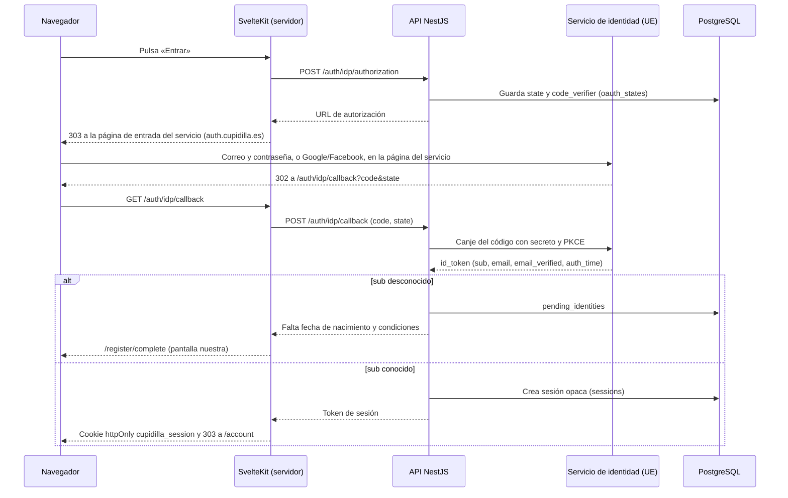

# Autenticación propia frente a un servicio de identidad — Análisis para decidir

[← Índice](../../README.md) · Base: [H0](../h0-diseno-tecnico.md), [entrada con terceros](../login-terceros-diseno-tecnico.md), [correo](../correo-diseno-tecnico.md), [privacidad y seguridad](../privacidad-y-seguridad.md) · Fecha: 14 de noviembre de 2026 · Autor: arquitecto, por encargo del CTO

Lo leerá el CEO para decidir. Los precios son los de lista publicados en las webs de cada proveedor el 14 de noviembre de 2026 (enlaces en [Fuentes](#fuentes)), en dólares y sin impuestos. Lo marcado como **estimación** es mío y lleva su supuesto al lado.

---

## Resumen

**Recomendación: seguir con la autenticación propia**, terminar lo que falta (recuperación de contraseña, endurecimiento y una prueba de intrusión externa) y dejar elegido y documentado un **plan B: Logto** (en la nube de la UE o autohospedado), para el día en que se cumpla alguna de las condiciones de [§5.2](#52-cuándo-cambiaría).

Por qué, en cinco cifras:

| | Seguir con lo propio | Cambiar ahora (Logto o Auth0, lo mejor de cada caso) |
|---|---|---|
| Trabajo hasta producción | **3–4,5 días** (recuperación ya diseñada y endurecimiento) | **4–7 días** de migración, más los mismos pendientes de producción |
| Cuota a 1 000 / 10 000 / 100 000 usuarios activos al mes | **0 $ / 0 $ / 0 $** | Logto: 0–72 $ / 72 $ / 112–352 $ al mes. Auth0: 0–70 $ / 0–700 $ / ≈ 7 000 $ al mes (precio a medida) |
| Mantenimiento previsible | **5–9 días al año** | 2–4 días al año (en la nube) o 6–12 (autohospedado) |
| Código que **no** desaparece aunque se cambie | — | Sesión, edad, consentimientos, borrado, revisión de datos y `/account`: más o menos la mitad de lo construido |
| Encargados del tratamiento nuevos con la lista completa de usuarios de una web de citas | **Ninguno** | Uno (y, en los estadounidenses, transferencias y la Ley CLOUD) |

Lo esencial:

1. **A esta escala el precio no decide.** Hasta 10 000 usuarios, cualquier opción viable cuesta menos de 75 $ al mes salvo Auth0 Essentials (700 $). Lo que decide es el riesgo, el control y el trabajo.
2. **Un servicio no elimina lo difícil.** La regla de edad, los tres consentimientos, el borrado completo, la sesión revocable al instante y, a partir de H3, quién puede ver qué perfil o qué chat siguen siendo código nuestro. El servicio solo sustituye la contraseña, el correo de verificación y la conexión con Google y Facebook.
3. **Cambiar más adelante cuesta casi lo mismo que cambiar hoy.** No hay usuarios reales, pero los hashes argon2id se pueden importar en Logto, Auth0 y Keycloak, así que una migración futura no obligaría a nadie a cambiar su contraseña. Esperar no encarece la salida de forma significativa (unos 2–3 días más por migrar usuarios reales).
4. **Descartados por la arquitectura o por la UE:** Clerk (sin residencia de datos en la UE, cookie de sesión legible desde JavaScript), Firebase Auth (datos solo en EE. UU., inicio de sesión desde el navegador) y Supabase Auth (obliga a llevarse la base de datos a Supabase y usa JWT, en contra de la decisión 15).
5. **El riesgo real de lo propio** es un fallo de seguridad en código propio sin auditar, con un equipo de una persona. Se mitiga con una prueba de intrusión externa antes de la beta y con las condiciones de revisión de §5.2, no cambiando de proveedor a ciegas.

---

## 1. Punto de partida

### 1.1 Lo que hay

Todo en código propio y en el repositorio, con pruebas. Cifras medidas en la rama `mejora-pruebas` el 14 de noviembre de 2026 (líneas de TypeScript y Svelte, sin pruebas):

| Pieza | Líneas | Qué hace |
|---|---|---|
| `apps/api/src/auth` | 646 | Login, registro uniforme, sesión opaca, verificación de correo, sesión reciente |
| `apps/api/src/oauth` | 1 812 | Google y Facebook con PKCE (`openid-client`), alta pendiente, unión con contraseña, añadir y quitar proveedores |
| `apps/api/src/users` | 652 | Contraseña (argon2id), `/users/me`, borrado, barrido de cuentas sin verificar |
| `apps/api/src/mail` | 1 245 | *Outbox*, *worker*, SMTP, plantillas y tokens de un solo uso |
| `apps/api/src/consents` | 55 | Consentimiento versionado |
| `packages/contracts` | 656 | Esquemas Zod compartidos |
| `apps/web/src/routes` | 2 238 | `/login`, `/register`, `/verify-email`, `/account` y sus subpáginas, vuelta de OAuth |
| `packages/fake-oauth-provider` | 790 | Proveedor OAuth falso para pruebas |
| Pruebas | ≈ 13 000 | Unitarias, de integración (`apps/api/test`, 8 753) y e2e (`apps/web/tests/e2e`, 4 261) |

Estado: H0, Google y Facebook en `main`; verificación de correo y registro uniforme (fases A y B) en el PR #6, abierto. **La recuperación de contraseña (fase C) está diseñada al detalle, con sus escenarios de prueba, pero no implementada** ([correo §Fase C](../correo-diseno-tecnico.md#fase-c-pr-3--recuperación-de-contraseña-y-revisión-de-datos)).

### 1.2 Las reglas que condicionan la comparación

| Regla | Origen | Qué exige a un servicio |
|---|---|---|
| El navegador solo habla con SvelteKit, y SvelteKit con la API | Decisión 16 | Que el canje de códigos y los tokens del servicio no pasen nunca por el navegador. Una página de inicio de sesión alojada por el servicio es aceptable (es lo que ya pasa con Google); un SDK que guarda tokens en el navegador, no |
| Sesiones opacas en PostgreSQL, sin JWT, revocables al instante | Decisión 15 | O se mantiene nuestra sesión encima del servicio, o se acepta que una sesión cerrada siga valiendo hasta que caduque su token |
| Fecha de nacimiento y edad mínima configurable (18–25) | H0, `MIN_AGE` | Se pide en una pantalla nuestra; ningún servicio la valida por nosotros |
| Consentimiento versionado y separado | Decisión 7, privacidad | Siempre en nuestra tabla `consents` |
| Borrado total de la cuenta | H0 §10 | Además, borrar al usuario en el servicio, con reintentos si falla |
| Datos de una web de citas, en la UE | Privacidad | Datos en la UE, contrato de encargo y, preferiblemente, empresa sin exposición a la Ley CLOUD |

Sobre el último punto: que una persona tenga cuenta en una web de contactos ya es un dato delicado. La autoridad noruega multó a Grindr porque el mero hecho de ser usuario revelaba la orientación sexual. Cupidilla es generalista, así que el caso no se traslada tal cual, pero **un servicio de identidad tendría la lista completa de nuestros usuarios, con su correo y sus cuentas de Google y Facebook**. Es un encargado del tratamiento más, que entra en el registro de actividades, en la evaluación de impacto y en la revisión jurídica.

---

## 2. Opción A: seguir con lo propio

### 2.1 Qué falta para producción

| # | Trabajo | Esfuerzo (estimación) | ¿Se evita con un servicio? |
|---|---|---|---|
| A1 | Fusionar el PR #6 (fases A y B del correo) | Revisión pendiente | No aplica: con un servicio, ese código se borraría |
| A2 | **Recuperación de contraseña y revisión de datos** (fase C). Diseño cerrado, escenarios Dado-Cuando-Entonces escritos | 1–1,5 días, ≈ 55–80 $ | Sí |
| A3 | **Endurecimiento antes de la beta**: límite de intentos compartido entre instancias (R5 de H0), prefijo `__Host-` en la cookie, limpieza periódica (R6 de terceros), alertas de vulnerabilidades de dependencias en CI | 1,5–2,5 días, ≈ 80–135 $ | En parte: el límite de intentos del login y la cookie de sesión siguen siendo nuestros si se mantiene la sesión propia |
| A4 | Lista de contraseñas comprometidas (consulta por prefijo a Have I Been Pwned) | 0,5 días | Solo en planes de pago de Auth0; Logto lo tiene en su paquete de seguridad (48 $/mes) |
| A5 | Apps de producción de Google y Meta para el dominio definitivo, con la revisión de Meta | Trámite del CEO | **No**: también hay que registrarlas y pasar la revisión con un servicio, porque en producción se usan credenciales propias |
| A6 | Proveedor SMTP de la UE y dominio remitente | Trámite y configuración | **No**: Auth0 exige SMTP propio en producción, Logto lo recomienda, y el correo hará falta igual para los avisos de H3 |
| A7 | **Prueba de intrusión externa** de la web (autenticación, sesión, consentimiento) | 4 000–10 000 € la prueba completa; la parte de autenticación propia supone unas 2–3 jornadas, ≈ 1 500–3 000 € (estimación de mercado, sin presupuesto pedido) | En parte: con un servicio la prueba sigue haciendo falta, con algo menos de alcance |
| A8 | Verificación real de la edad antes de abrir al público | Decisión abierta | **No**: ningún servicio de identidad la hace |

**Total de trabajo propio hasta producción: 3–4,5 días** (A2 + A3 + A4), unos 165–270 $ equivalentes de API a la tasa observada hasta ahora (215 $ en 4 días, ≈ 54 $ por día). Lo demás es común a todas las opciones.

### 2.2 MFA y llaves de acceso (*passkeys*)

No son imprescindibles para la beta: las webs de contactos grandes no ofrecen TOTP, y el fraude que preocupa (perfiles falsos, estafas) se combate con verificación de perfiles y moderación, que ningún servicio de identidad resuelve. Si se piden:

| Función | Cómo | Esfuerzo (estimación) |
|---|---|---|
| Llaves de acceso | `@simplewebauthn/server` y `@simplewebauthn/browser`, tabla `passkeys`, alta y entrada desde la web | 2–3 días |
| TOTP | `otplib`, códigos de recuperación, paso extra en el login | 1–1,5 días |

Con un servicio vienen hechas, pero en Logto Cloud son un complemento de 48 $/mes y las llaves de acceso exigen el plan Pro; en Auth0, el MFA completo exige Essentials o superior.

### 2.3 Mantenimiento previsible

| Concepto | Días al año (estimación) | Comentario |
|---|---|---|
| Parches de dependencias de autenticación (`argon2`, `openid-client`, `jose`, `nodemailer`) | 1–2 | Versiones fijadas; avisos automáticos de vulnerabilidades. `openid-client` tiene un solo mantenedor (R9 de terceros), aislado tras `ProviderClient` |
| Cambios de los proveedores (versión de la Graph API de Facebook cada año, R8; pantallas de consentimiento y políticas de Google y Meta) | 1–2 | La parte de trámite (revisiones de Meta) también existe con un servicio |
| Correcciones y vulnerabilidades encontradas en el código propio | 2–4 | La reserva grande: es código complejo (unión de cuentas, correo único entre tablas, carreras resueltas con bloqueos) |
| Revisión anual con la lista OWASP ASVS (autenticación y sesión) | 1 | |
| **Total** | **5–9 días al año** | ≈ 270–490 $ al año en API, más las horas de revisión humana, que son el coste real y no están contadas |

### 2.4 Riesgos de seguir

| Riesgo | Gravedad | Mitigación |
|---|---|---|
| Un fallo en el flujo propio permite entrar en la cuenta de otra persona | Alta en una web de citas | Prueba de intrusión externa (A7) antes de la beta; ASVS; la batería de pruebas ya cubre las carreras conocidas |
| Equipo de una persona: si nadie revisa, nadie detecta | Media | Revisión automática (CodeRabbit) y prueba externa; condición de cambio 3 de §5.2 |
| Ataques masivos de credenciales robadas cuando haya volumen | Baja en la beta, media a 100 000 usuarios | Límite compartido, lista de contraseñas comprometidas y Cloudflare Turnstile en el login si se detecta abuso; es la condición de cambio 4 |
| Cada función nueva de identidad (MFA, llaves de acceso, cambio de correo) cuesta días | Media | Se decide caso a caso; condición de cambio 2 |

---

## 3. Opción B: pasar a un servicio

### 3.1 El único patrón compatible con nuestra arquitectura

Para respetar las decisiones 15 y 16, cualquier servicio tendría que integrarse **como un proveedor OIDC más**, igual que Google hoy, y no con su SDK de navegador:



- El navegador habla con la página del servicio, como hoy con Google. Ningún token del servicio llega al navegador ni a SvelteKit; la API los canjea y los descarta, como ya hace `oauth-flow.service.ts`.
- **Se mantiene nuestra sesión opaca encima**: la revocación sigue siendo inmediata, la cookie la pone SvelteKit y ningún JWT entra en el sistema.
- La fecha de nacimiento y las condiciones se piden en nuestra pantalla de alta pendiente, que ya existe. No se guardan en el servicio (minimización).
- La sesión reciente (decisión 21) se pide con `prompt=login` y `max_age`, comprobando `auth_time`.
- Efecto en la factura: el servicio solo ve un inicio de sesión cuando caduca nuestra sesión de 30 días o se usa otro dispositivo, así que los usuarios facturables pueden quedar por debajo de los activos reales. Los cálculos de §3.4 no cuentan con ese ahorro.

Los servicios pensados para que el navegador hable directamente con ellos (Clerk, Firebase, Supabase con su SDK de cliente) rompen este patrón o lo fuerzan.

### 3.2 Qué se borra y qué se queda

Con el patrón de §3.1 y cualquier servicio OIDC (estimación sobre las cifras de §1.1):

| Se borra (≈ 3 800 líneas, ≈ 45 % del código de identidad, y ≈ 50 % de las pruebas) | Se queda o se adapta |
|---|---|
| `PasswordService`, argon2 e igualación de tiempos | `SessionsService`, `SessionGuard`, cookie y `hooks.server.ts` |
| Registro uniforme, login con contraseña, `/register`, `/register/check-email` | Regla de edad (`MIN_AGE`) y `checkBirthDate` |
| Verificación de correo, `email_tokens`, cuatro de las cinco plantillas | `consents` y la subida de versión de las condiciones |
| Recuperación de contraseña (la fase C no se haría) | Borrado de la cuenta, **más** el borrado en el servicio con reintentos (*outbox*) |
| Clientes de Google y Facebook, unión con contraseña, añadir y quitar proveedores desde `/account` | Alta pendiente (`pending_identities`) para fecha y condiciones |
| `/login/link`, `/account/password`, barrido de cuentas sin verificar | *Outbox* y SMTP, para los correos de H3 |
| | `/account`, más simple; «formas de entrar» pasa a la página de cuenta del servicio o desaparece |
| | Proveedor OIDC falso para las pruebas, simplificado a un solo proveedor |

Código nuevo: ≈ 800–1 200 líneas (cliente OIDC del servicio, borrado sincronizado, adaptación del alta, configuración, tema de la página de entrada en español).

Se perdería además el control fino de decisiones del CEO ya tomadas: registro que no revela si un correo existe, unión que pide la contraseña, correo único entre cuentas y proveedores (R7b), revisión de datos tras recuperar una cuenta ocupada, textos propios y funcionamiento sin JavaScript. Habría que comprobar una a una qué permite cada servicio; algunas no serán configurables. Como referencia, varias de las vulnerabilidades graves publicadas en 2026 en better-auth son justo de esta clase: toma de cuentas por unión automática con un correo sin verificar y por cuentas creadas de antemano con un correo ajeno.

### 3.3 Evaluación servicio por servicio

| Servicio | Encaje con SvelteKit solo servidor + NestJS | Residencia y RGPD | Dependencia del proveedor | Veredicto |
|---|---|---|---|---|
| **Auth0** (Okta) | Bueno con el patrón de §3.1 (OIDC estándar, página de entrada en español, dominio propio). La unión de cuentas exige programar *Actions* propias | Región UE (Fráncfort, con respaldo en Dublín), elegida al crear el *tenant* y para siempre. Empresa de EE. UU.: Marco de Privacidad de Datos UE-EE. UU. y exposición a la Ley CLOUD. Avisos antiguos mencionan que el panel de administración procesa datos en EE. UU. | Media: las *Actions* y la configuración no se llevan; la exportación de hashes se pide a soporte | **Viable**. El más maduro y con más funciones de protección (en los planes caros). Caro a partir de 10 000 usuarios |
| **Clerk** | Malo: pensado para el SDK de navegador; su cookie `__session` es legible desde JavaScript; sin SDK oficial de SvelteKit | **Sin residencia en la UE**: datos en EE. UU., transferidos con el Marco de Privacidad de Datos; región UE «en la hoja de ruta» | Alta: SDK propietario en todas las capas | **Descartado** (UE y decisión 16) |
| **Firebase Auth / Identity Platform** | Malo: el inicio de sesión ocurre en el navegador con el SDK de Google; la cookie de sesión de servidor existe, pero después | **Datos de autenticación solo en EE. UU.**, sin opción de región | Media: exportación de hashes con `scrypt` modificado | **Descartado** (UE y decisión 16) |
| **Supabase Auth** | Regular: `@supabase/ssr` permite usarlo desde el servidor, pero los usuarios viven en el esquema `auth` de **una base de datos de Supabase** y la sesión es un JWT de una hora con *refresh token* | Región UE (Fráncfort) para base de datos y autenticación | Baja en los datos (es PostgreSQL), alta en la plataforma | **Descartado**: obliga a llevarse la base de datos o a mantener una segunda, y contradice la decisión 15 |
| **Kinde** | Bueno: OIDC con páginas alojadas y SDK de TypeScript para servidor | Región UE (Dublín), elegida al crear la cuenta. Empresa australiana: Australia no tiene decisión de adecuación de la UE, así que cualquier acceso desde allí es una transferencia con cláusulas tipo | Media; exportación de hashes por confirmar | **Viable, sin ventajas** sobre Logto o Auth0, y el más caro a 100 000 |
| **Logto Cloud** | Bueno: OIDC estándar, SDK de Node, página de entrada en español, «trae tu propia interfaz» en Pro | Región **Europa (Países Bajos)**, elegida al crear el *tenant* y para siempre. Entidad, subencargados y transferencias por confirmar en su contrato de encargo | **Baja**: el mismo producto es de código abierto y se puede autohospedar, así que hay salida sin reescribir | **Viable. Plan B preferido** |
| **Logto autohospedado** | Muy bueno: Node y PostgreSQL, nuestro mismo stack; puede usar una base de datos aparte en el mismo PostgreSQL gestionado | Donde lo despleguemos (UE); sin encargado nuevo | Baja (licencia MPL-2.0) | **Viable**: el mejor si el motivo para cambiar es delegar código sin añadir un encargado |
| **Keycloak** (autohospedado) | Bueno en protocolo (el más completo), pesado en operación: Java, 1–2 GB de RAM, temas en FreeMarker o Keycloakify para adaptar las pantallas en español | Donde lo despleguemos (UE); sin encargado nuevo | Baja (Apache 2.0, CNCF) | **Viable** pero el más caro de mantener: publica versiones con correcciones de seguridad casi cada mes (26.8.0 el 1 de octubre, 26.8.1 el 13 de octubre, 26.8.2 el 5 de noviembre de 2026) y solo la última versión recibe parches |
| **better-auth** (biblioteca) | Regular: quiere sus propias rutas `/api/auth/*` y poner las cookies él mismo. Montarlo en SvelteKit haría que la web hable con la base de datos (rompe la decisión 16); montarlo en NestJS necesita un paquete comunitario (`@thallesp/nestjs-better-auth` 2.8.0) y reenviar cookies | En nuestra base de datos (UE); sin encargado nuevo | Baja en datos, media en esquema (sus tablas `user`, `session`, `account`, `verification`) | **No recomendado**: ahorra poco frente a lo que ya funciona, cambia la arquitectura y en 2026 ha publicado al menos siete avisos de gravedad alta o crítica (toma de cuentas por unión OAuth, evasión del segundo factor, valores OIDC inseguros); con la 1.7.25 del 14 de noviembre sale versión casi a diario |

### 3.4 Coste por usuarios activos al mes

Cuota mensual en dólares, a precio de lista del 14 de noviembre de 2026. «Activo» = usuario que inicia sesión al menos una vez en el mes (Clerk cuenta solo los que vuelven al menos 24 horas después de darse de alta).

| Servicio y plan | 1 000 | 10 000 | 100 000 | Notas |
|---|---|---|---|---|
| **Propio** | **0** | **0** | **0** | Solo la infraestructura que ya existe |
| Auth0 Free | 0 | 0 | — (tope: 25 000) | Sin el MFA completo, registros de 1 día, solo soporte de la comunidad |
| Auth0 Essentials (B2C) | 70 | 700 | ≈ 7 000 (estimación) | La tabla publicada llega a 50 000 (3 500 $). Por encima, presupuesto a medida; la cifra extrapola el precio de lista |
| Auth0 Professional (B2C) | 240 | 1 600 | Presupuesto a medida | «Contact us» desde 30 000 |
| Logto Cloud Free | 0 | 0 | 0 | Hasta 50 000; **sin MFA ni llaves de acceso**, con la marca de Logto |
| Logto Cloud Pro + MFA | 72 | 72 | 112–352 (estimación) | 24 $ + 48 $ de MFA. Factura por *access tokens* (50 000 incluidos, 0,08 $ cada 100 más). Supuesto: 1–4 inicios de sesión por usuario y mes, gracias a nuestra sesión de 30 días |
| Kinde | 0 | 0 | ≈ 1 591 | Gratis hasta 10 500. Pro: 25 $ + 0,0175 $ por usuario por encima (la web dice que los precios son «indicativos») |
| Logto autohospedado | 10–40 € | 10–40 € | 30–100 € | Estimación: un contenedor pequeño y una base de datos aparte en el PostgreSQL gestionado |
| Keycloak autohospedado | 15–50 € | 15–50 € | 50–150 € | Estimación: uno o dos nodos de 1–2 GB y base de datos aparte |
| better-auth | 0 | 0 | 0 | Dentro de nuestra infraestructura |
| *Clerk Pro (descartado)* | *25* | *25* | *1 025* | *50 000 incluidos y 0,02 $ por usuario por encima* |
| *Firebase / Identity Platform (descartado)* | *0* | *0* | *≈ 275* | *50 000 gratis; 0,0055 $ por usuario entre 50 000 y 100 000 (tabla en caché de Google; confirmar)* |
| *Supabase Pro (descartado)* | *25* | *25* | *25* | *100 000 incluidos; es el plan de toda la base de datos; el gratuito se pausa tras una semana sin actividad* |

En todas las opciones se paga además el SMTP de la UE (A6), que es común y no cambia la comparación.

### 3.5 Esfuerzo de migración (si se cambiara hoy)

Estimaciones en días de calendario con la forma de trabajar actual (diseño del arquitecto, diseño UX, implementación, revisión), a ≈ 54 $ por día de API:

| Opción | Días | ≈ $ API | Qué se lleva el tiempo |
|---|---|---|---|
| Auth0 | 5–7 | 270–380 | *Actions* para unir cuentas y para el alta pendiente, tema de Universal Login, borrado sincronizado, rehacer e2e contra un proveedor OIDC falso |
| Logto Cloud | 4–7 | 220–380 | Lo mismo, con menos configuración propietaria |
| Kinde | 4–7 | 220–380 | Lo mismo |
| Logto autohospedado | 6–9 | 325–490 | Lo de Logto Cloud, más despliegue, copias de seguridad y actualizaciones |
| Keycloak | 7–10 | 380–540 | Despliegue, tema en español, configuración del *realm* |
| better-auth | 5–8 | 270–430 | Reescribir los flujos sobre su esquema y sus *hooks*, y resolver el choque con la decisión 16 |

Migración de usuarios: 0 días hoy (no hay usuarios reales). Si se hiciera con usuarios, +2–3 días para importar los hashes argon2id (Auth0, Logto y Keycloak lo admiten; confirmar parámetros) y comunicar el cambio.

Mantenimiento después del cambio: 2–4 días al año en la nube (integración, configuración, cambios de plan y de precio); 6–12 días al año autohospedado (Keycloak con actualizaciones casi mensuales); 4–8 días al año con better-auth.

---

## 4. Coste hundido frente a coste futuro

Los 215 $ y los 4 días ya gastados **no cuentan**. Tampoco cuenta como argumento a favor de seguir que «ya está hecho»: cuenta que funciona, que está probado y que lo que queda por hacer es poco. Desde hoy:

| A partir de hoy | Seguir | Logto Cloud | Auth0 |
|---|---|---|---|
| Trabajo único | 3–4,5 días | 4–7 días | 5–7 días |
| Cuota, escenario A: 1 000 usuarios durante 3 años | 0 $ | 0–2 600 $ (Free o Pro + MFA) | 0–2 520 $ (Free o Essentials) |
| Cuota, escenario B: 1 000 → 10 000 → 100 000 (un año cada uno) | 0 $ | ≈ 3 100–6 000 $ | ≈ 93 000 $ con Essentials (≈ 84 000 $ si se usa Free los dos primeros años) |
| Mantenimiento a 3 años | 15–27 días | 6–12 días | 6–12 días |
| **Días totales a 3 años** | **18–31,5** | **10–19** | **11–19** |
| Encargado nuevo con la lista de usuarios | No | Sí (UE, entidad por confirmar) | Sí (UE, empresa de EE. UU.) |
| Control de las reglas del CEO (registro uniforme, unión, R7b) | Total | Parcial | Parcial |

Lectura honesta:

- **Un servicio ahorra entre 7 y 13 días de trabajo en tres años.** Es real, pero son unos 380–700 $ de API y algunas horas de revisión, a cambio de una cuota, un encargado nuevo y la pérdida de control.
- **El riesgo de seguridad sí favorece al servicio en una parte concreta**: guardar contraseñas y unir cuentas lo hace mejor un equipo dedicado. Pero esa parte ya está escrita con bibliotecas estándar (argon2, `openid-client`) y probada, y no es donde está el mayor riesgo de Cupidilla: el acceso a perfiles, presentaciones y chats de H2 y H3 será código nuestro en cualquier caso.
- **La opción de cambiar no caduca**: `ProviderClient` ya aísla los proveedores OIDC, y los hashes se pueden importar. Seguir hoy no cierra la puerta.

---

## 5. Recomendación

### 5.1 Qué hacer

1. **Seguir con la autenticación propia** para la beta y mientras no se cumpla ninguna condición de §5.2.
2. **Terminar y endurecer** (plan de §8): fase C, endurecimiento y lista de contraseñas comprometidas, ASVS y prueba de intrusión externa antes de abrir la beta.
3. **Dejar elegido el plan B: Logto**, en la nube de la UE para empezar rápido, con la salida a autohospedado si se quiere quitar el encargado. Auth0 queda como alternativa si en ese momento se necesitan su madurez y sus funciones de protección y hay presupuesto. Keycloak, solo si se quiere autohospedar y hay alguien que lo opere.
4. **No adoptar better-auth**: cambia la arquitectura, ahorra poco y hoy sale versión casi a diario.
5. Opcional, para reducir mantenimiento: **medir en la beta cuánta gente entra con Facebook**. Es el proveedor que más trabajo da (versión anual de la Graph API, revisión de la app, correo sin garantía de verificación, R1). Si lo usa menos del 10 %, plantear quitarlo.

### 5.2 Cuándo cambiaría

Se reabre la decisión, con Logto como primera candidata, si se cumple **cualquiera** de estas condiciones:

| # | Condición | Cómo se mide |
|---|---|---|
| 1 | La prueba de intrusión encuentra un fallo grave **de diseño** en la autenticación (no un error puntual que se corrige en una tarde) | Informe de la prueba |
| 2 | El producto necesita funciones de identidad cuyo coste propio supere unos 5 días en un año (por ejemplo, MFA, llaves de acceso, cambio de correo y entrada con Apple a la vez) | Estimación del arquitecto en cada propuesta |
| 3 | El mantenimiento real de la autenticación pasa de 10 días al año, o entra en el equipo alguien que no conoce este código y lo va a mantener | Registro de horas por área |
| 4 | Se pasa de unos 20 000 usuarios activos o hay ataques de credenciales robadas que el límite propio no frena | Métricas del login |
| 5 | Un inversor, un socio o la revisión jurídica exige certificaciones (ISO 27001, SOC 2) de la capa de identidad | Petición concreta |
| 6 | Se produce un incidente de seguridad en la autenticación con usuarios reales | Incidente |

---

## 6. Componentes y estructura

### 6.1 Con la recomendación (seguir)

No cambia la estructura. Los cambios del plan caen en módulos existentes:

```
apps/api/src/
  auth/            fase C (restablecimiento), throttler compartido, cookie __Host- (en la web)
  users/           revisión de datos (fase C), comprobación de contraseñas comprometidas
  common/guards/   almacenamiento compartido del límite de intentos
  oauth/providers/ sin cambios; ProviderClient sigue siendo la frontera del plan B
docs/
  arquitectura/auth-propia-vs-servicio.md   este documento
  arquitectura/auth-modelo-amenazas.md      nuevo (tarea T4)
```

### 6.2 Si se activara el plan B (solo referencia, no se construye ahora)

```
apps/api/src/oauth/providers/
  idp.client.ts          ProviderClient del servicio (OIDC con PKCE, max_age, auth_time)
apps/api/src/users/
  idp-deletion.ts        Borrado en el servicio desde el outbox, con reintentos
```

Se borrarían `auth/` (salvo sesiones), `google.client.ts`, `facebook.client.ts`, la unión con contraseña, `email-tokens.service.ts`, `password.service.ts`, el barrido de cuentas sin verificar y las rutas web de §3.2.

---

## 7. Modelo de datos y contratos

### 7.1 Con la recomendación

Sin cambios de modelo más allá de los de la fase C, ya diseñados ([correo §3](../correo-diseno-tecnico.md#3-modelo-de-datos)). Si se usa PostgreSQL para el límite de intentos compartido:

| Tabla | Columnas | Notas |
|---|---|---|
| `rate_limit_hits` | `key text`, `window_start timestamptz`, `hits int`, PK `(key, window_start)` | `key` = cubo y SHA-256 de la IP o del correo; nunca el valor en claro. Limpieza por `window_start` |

Alternativa: Redis como almacenamiento de `@nestjs/throttler`, ya previsto en `arquitectura.md`. Se elige en la tarea T2 según el despliegue (una instancia: sigue en memoria; varias: PostgreSQL si no hay Redis).

### 7.2 Si se activara el plan B (referencia)

- `identities.provider` admitiría `'idp'`; el `subject` del servicio sería la clave. `users.password_hash` y `email_tokens` desaparecerían en una migración posterior.
- `ProviderClient` existente, sin cambiar la firma:

```ts
interface ProviderClient {
  authorizationUrl(input: { state: string; codeVerifier: string; nonce: string; maxAge?: number }): URL;
  exchange(input: { code: string; codeVerifier: string; nonce: string }): Promise<ProviderProfile>;
}
// ProviderProfile del servicio: { subject, email, emailVerified, authTime }
```

- El borrado añadiría a `POST /users/me/deletion` una fila en el *outbox* de tipo `idp_user_deletion`, con reintentos hasta que el servicio confirme el borrado.

---

## 8. Plan de implementación (con la recomendación)

| # | Tarea | Hecho cuando |
|---|---|---|
| T1 | Fusionar el PR #6 e implementar la **fase C** del diseño de correo (recuperación y revisión de datos) | Pasan los escenarios C1-1 a C5-5 y QA-C1 y QA-C2 del [diseño de correo](../correo-diseno-tecnico.md#fase-c-pr-3--recuperación-de-contraseña-y-revisión-de-datos); `decisiones.md` ya no tiene «Cuenta sin forma de entrar» |
| T2 | **Límite de intentos compartido** entre instancias (§7.1) | Con dos instancias de la API detrás del mismo PostgreSQL (o Redis), el sexto intento de login fallido en 15 minutos da 429 sin importar a cuál llegue; con una sola instancia, las pruebas actuales siguen en verde |
| T3 | **Endurecimiento**: cookie `__Host-cupidilla_session`, limpieza periódica de `sessions`, `oauth_states` y `pending_identities` caducadas, alertas de vulnerabilidades de dependencias en CI y comprobación de contraseñas comprometidas por prefijo (k-anonimato) en el registro, la creación y el restablecimiento | La cookie sale con el prefijo y sin `Domain`; una fila caducada desaparece en el siguiente barrido; CI falla con una dependencia con aviso alto; `password123456` se rechaza con un código propio y solo se envían a la consulta los 5 primeros caracteres del SHA-1 |
| T4 | **Modelo de amenazas y ASVS**: `docs/arquitectura/auth-modelo-amenazas.md` con los requisitos de los capítulos de autenticación y sesión de OWASP ASVS 5 nivel 2 y el estado de cada uno | Cada requisito tiene «cumple», «no aplica» o una tarea; ninguno queda sin revisar |
| T5 | **Prueba de intrusión externa** antes de abrir la beta, con alcance de autenticación, sesión, consentimiento y borrado | Informe recibido; los hallazgos altos y críticos están corregidos y verificados; se revisa la condición 1 de §5.2 |
| T6 | **Medir para decidir**: anotar las horas dedicadas a autenticación, contar en `usage_events` (o en logs sin datos personales) los inicios de sesión por método | Hay una cifra de horas al año y el reparto contraseña / Google / Facebook tras un mes de beta |
| T7 | **Documentar la salida al plan B** en este documento: pasos concretos para Logto, exportación de hashes argon2id y su importación | Una persona puede estimar la migración leyendo solo esa sección |
| T8 | (Después de la beta, solo si se pide) Llaves de acceso con `@simplewebauthn/server`, con diseño técnico y UX propios | Diseño aprobado por el CEO; se revisa la condición 2 de §5.2 |

Orden: T1 → T2 y T3 (en paralelo) → T4 → T5 antes de la beta. T6 empieza con la beta. T7, en cualquier momento antes de T5.

---

## 9. Decisiones y riesgos

### 9.1 Alternativas descartadas

| Alternativa | Motivo |
|---|---|
| Cambiar ahora a Auth0 | Ahorra 7–13 días en tres años y añade un encargado de EE. UU. con la lista de usuarios; a 100 000 usuarios, ≈ 7 000 $ al mes |
| Cambiar ahora a Logto | Es la mejor de las alternativas, pero el ahorro no compensa hoy la pérdida de control ni el encargado nuevo. Queda como plan B |
| Clerk, Firebase Auth | Sin residencia de datos en la UE y con el navegador hablando con el servicio |
| Supabase Auth | Obliga a cambiar de base de datos y a usar JWT |
| Keycloak | Operación cara (Java, actualizaciones casi mensuales) para un equipo de una persona |
| better-auth | Cambia la arquitectura, ahorra poco y tiene un historial reciente de vulnerabilidades graves |
| Híbrido «contraseña propia y social por un servicio» | Lo peor de los dos: dos sistemas de identidad que unir y mantener |

### 9.2 Riesgos de la recomendación y qué vigilar

| # | Riesgo | Qué vigilar |
|---|---|---|
| R1 | Fallo de seguridad en código propio sin auditar | T4 y T5 antes de la beta; condición 1 |
| R2 | Coste de oportunidad: cada día en autenticación es un día menos en H1, que es lo que valida el producto | Con este plan quedan 3–4,5 días, frente a 4–7 de migrar; condición 3 |
| R3 | Las estimaciones de días son mías y se basan en solo 4 días de historia | Revisarlas con T6 |
| R4 | Los precios de los servicios cambian (Auth0 subió precios en 2023; Kinde los llama «indicativos») | Comprobar de nuevo si se activa el plan B |
| R5 | Datos de residencia sacados de documentación y foros, no de los contratos | Si se activa el plan B, revisar el contrato de encargo, los subencargados y las transferencias con asesoría jurídica |
| R6 | Las cifras de Firebase vienen de una copia en caché de la página de Google | Irrelevante para la decisión (descartado), pero no citarlas sin confirmar |

---

## Preguntas para el CTO

1. **Crecimiento esperado**: ¿cuántos usuarios activos al mes se esperan a 12 y a 24 meses? Las cifras de 10 000 y 100 000 son escenarios, no previsiones.
2. **Presupuesto de la prueba de intrusión** (T5): ¿hay 4 000–10 000 € antes de la beta, o se limita el alcance a autenticación y sesión (≈ 1 500–3 000 €)?
3. **¿MFA o llaves de acceso son requisito** para la beta o para la apertura pública? Si lo son, la condición 2 se acerca.
4. **Certificaciones**: ¿algún inversor o socio va a pedir ISO 27001 o SOC 2 a corto plazo?
5. **Facebook**: ¿es imprescindible por estrategia, o se puede quitar si la beta muestra poco uso?
6. ¿Se registra esta recomendación como decisión 23 en `decisiones.md` cuando la apruebe el CEO?

---

## Fuentes

Consultadas el 14 de noviembre de 2026.

- Auth0, precios: [auth0.com/pricing](https://auth0.com/pricing) y [auth0.com/pricing.md](https://auth0.com/pricing.md); regiones: [Auth0 Tenants](https://auth0.com/docs/get-started/auth0-overview/create-tenants), [Countries Auth0 stores data in](https://community.auth0.com/t/countries-auth0-stores-data-in/70319), [Brexit y residencia](https://auth0.com/blog/auth0-customers-your-brexit-questions-answered), [cambios de precio de 2023](https://auth0.com/blog/upcoming-pricing-changes-for-the-customer-identity-cloud/).
- Clerk, precios: [clerk.com/pricing](https://clerk.com/pricing); residencia: [clerk.com/security](https://clerk.com/security), [Clerk Pricing Explained](https://clerk.com/articles/clerk-pricing-explained), [DPA](https://clerk.com/legal/dpa); cookie de sesión: [discusión en GitHub](https://github.com/clerk/javascript/discussions/336).
- Firebase, precios: [firebase.google.com/pricing](https://firebase.google.com/pricing) y [Identity Platform pricing](https://cloud.google.com/identity-platform/pricing); residencia: [comparativa de Logto](https://logto.io/compare/firebase), [petición en UserVoice](https://firebase.uservoice.com/forums/948424-general/suggestions/46591651-firebase-authentication-for-eu).
- Supabase, precios: [supabase.com/pricing](https://supabase.com/pricing); regiones y residencia: [Regions](https://supabase.com/docs/guides/platform/regions), [Data Residency and Transfers FAQ](https://supabase.com/legal/privacy-resources/data-residency-and-transfers-faq).
- Kinde, precios: [kinde.com/pricing](https://kinde.com/pricing/); regiones: [Supported data regions](https://docs.kinde.com/get-started/learn-about-kinde/supported-data-regions), [región UE](https://kinde.com/blog/releases/eu-data-region-now-available-in-kinde/).
- Logto, precios: [logto.io/pricing](https://logto.io/pricing) y [Billing and pricing](https://docs.logto.io/logto-cloud/billing-and-pricing); regiones: [Tenant settings](https://docs.logto.io/logto-cloud/tenant-settings), [regiones de datos](https://blog.logto.io/data-region-resources).
- Keycloak, versiones: [26.8.0](https://www.keycloak.org/2026/10/keycloak-2680-released), [26.8.1](https://www.keycloak.org/2026/10/keycloak-2681-released), [26.8.2](https://www.keycloak.org/2026/11/keycloak-2682-released), [endoflife.date](https://endoflife.date/keycloak).
- better-auth: [integración con NestJS](https://better-auth.com/docs/integrations/nestjs.md), [Security update: June 2026](https://better-auth.com/blog/security-update-june-2026), [avisos en Corgea](https://corgea.com/advisories/packages/npm/better-auth), [CVE-2026-53516](https://corgea.com/advisories/vulnerabilities/CVE-2026-53516), [CVE-2026-67327](https://corgea.com/advisories/vulnerabilities/CVE-2026-67327), [CVE-2026-67337](https://advisories.gitlab.com/npm/better-auth/GHSA-xg6x-h9c9-2m83/). Versión 1.7.25 y `@thallesp/nestjs-better-auth` 2.8.0 comprobadas en el registro de npm.
- Las cifras de esfuerzo, mantenimiento, infraestructura autohospedada y prueba de intrusión son estimaciones del arquitecto, no datos de terceros.
