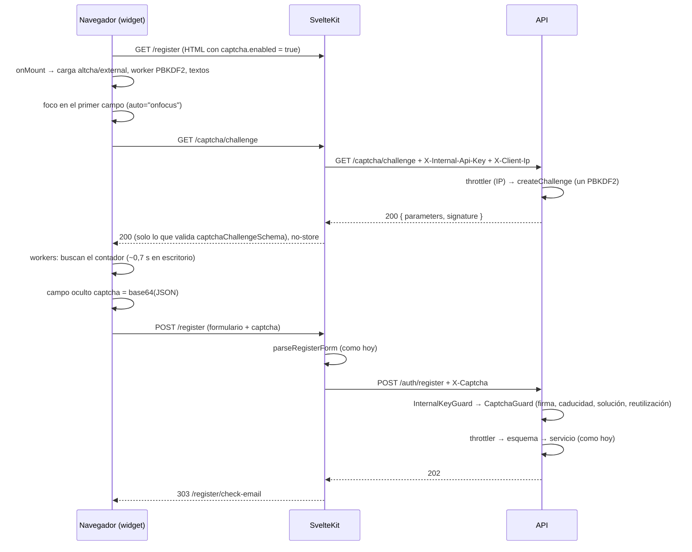

# Protección antibots con ALTCHA: diseño técnico

[← Índice](../README.md) · Base: [H0](h0-diseno-tecnico.md) (web → API, guards, límites, CSP), [correo](correo-diseno-tecnico.md) (`envSchema`, `GET /config`), [contacto](contacto-diseno-tecnico.md) (`POST /contact`) · Privacidad: [privacidad-y-seguridad.md](privacidad-y-seguridad.md#protección-antibots-altcha) · Fecha: 22 de noviembre de 2026

Este documento es para el programador y para QA. Lo que dicen los textos de §8.5 es provisional: UX puede cambiarlo sin tocar este diseño, pero las claves y los nombres de los campos no cambian. Las decisiones del cliente (§1.1) no se vuelven a discutir.

## Resumen

- **Qué**: una comprobación antibots común a `/register`, `/forgot-password` y `/contact` con [ALTCHA](https://altcha.org). Es una prueba de trabajo (*proof-of-work*): el navegador hace un cálculo de un segundo o dos y el servidor lo comprueba con un HMAC. Va alojada en nuestros servidores, sin terceros, sin cookies y sin pruebas cognitivas. El login y OAuth no llevan comprobación (§10 explica cómo añadirla al login).
- **Dónde**: la API genera y verifica los retos (`altcha-lib` 2.8.0, API v2). La web solo pinta el widget (`altcha` 3.5.0, paquete `altcha/external`) y hace de intermediaria: `GET /captcha/challenge` en SvelteKit llama a la API con la clave interna, y la solución viaja a la API en la cabecera `X-Captcha`. Así no cambia ningún esquema de los cuerpos.
- **Verificación**: un guard global, `CaptchaGuard`, que solo actúa en las rutas marcadas con `@RequiresCaptcha()`. Va justo después de la clave interna y antes del límite de intentos: así un envío sin comprobación no gasta el cupo por correo de una persona. Comprobar cuesta solo dos HMAC, porque el reto es «determinista» y lleva la firma de la clave derivada.
- **Reutilización**: cada reto caduca a los **10 minutos** y solo vale una vez. Los retos usados se guardan en memoria hasta que caducan (el `nonce` del reto y su caducidad), igual que el *throttler* (R5 de H0). No hace falta una tabla nueva.
- **Configuración**: `CAPTCHA_ENABLED` (**activada por defecto**), `CAPTCHA_HMAC_KEY` (obligatoria si está activada; 32 caracteres o más y distinta de `INTERNAL_API_KEY`) y `CAPTCHA_DIFFICULTY` (`normal` o `minimal`; `minimal` no vale en producción). Los tests y los e2e actuales la desactivan, y una suite e2e aparte la prueba activada con la dificultad mínima.
- **Sin JavaScript**: con la comprobación activada, estos tres formularios **necesitan JavaScript**. Lo avisan antes de que empieces a escribir (`<noscript>`) y ofrecen otra vía (§7). Un camino sin comprobación para quien no tiene JavaScript sería justo el que usarían los bots.
- **Por qué así**: es lo mínimo que encaja con lo que ya hay. El backend valida, la web no tiene secretos nuevos, la CSP sigue siendo estricta (solo se añade `worker-src 'self'`) y no hacen falta migraciones ni servicios nuevos.

---

## 1. Alcance y decisiones

**Dentro**: el reto (`GET /captcha/challenge` en la API y en la web), el guard y su decorador, el almacén contra la reutilización, tres variables de entorno, `captcha.enabled` en `GET /config`, el widget en los tres formularios, los códigos de error y las suites de pruebas.

**Fuera**: el login (solo el boceto de §10), OAuth, el reenvío de la verificación (`POST /auth/email-verification/request`, ver las preguntas), ALTCHA Sentinel y cualquier servicio de ALTCHA en la nube, los retos de código (imagen o audio) y la firma de interacción humana (HIS).

### 1.1 Decisiones del cliente (cerradas)

| # | Decisión | Consecuencia aquí |
|---|---|---|
| K1 | ALTCHA, prueba de trabajo, alojado en nuestros servidores, sin terceros ni cookies | §2, §9 |
| K2 | En `/contact`, `/register` y `/forgot-password` | §6 |
| K3 | El login no la lleva por ahora; se deja apuntado cómo activarla tras N fallos | §10 |
| K4 | OAuth (Google y Facebook) no la lleva | Las rutas `/auth/oauth/*` y `/auth/[provider]` no cambian |
| K5 | Se activa y desactiva con una variable de entorno, sin romper los tests ni los e2e | §5 |

### 1.2 Decisiones de este diseño

| # | Decisión | Alternativa descartada y motivo |
|---|---|---|
| A1 | **La API genera y verifica**. La web solo es intermediaria | Hacerlo en SvelteKit (`altcha-lib/frameworks/sveltekit`): la regla quedaría fuera del backend, y la web tendría que guardar un secreto más y su propio almacén de retos usados |
| A2 | Uso directo de `createChallenge` y `verifySolution`, sin el plugin de NestJS de `altcha-lib` | El plugin (`AltchaModule`, `createAltchaGuard`) responde un 400 con su propio formato, no con `ApiException`, y su ruta `/challenge` no sigue nuestras convenciones de límites ni de clave interna |
| A3 | La solución viaja en la **cabecera `X-Captcha`** (web → API) | Un campo `captcha` en el cuerpo obligaría a tocar los tres esquemas estrictos (`registerRequestSchema`, `emailRequestSchema`, que también usa el reenvío de la verificación, y `contactRequestSchema`). Además, el cuerpo de contacto ya roza los 16 KB del *body parser* (contacto §5.1): ~14,5 KB más ~0,8 KB de solución |
| A4 | Un **guard global** (`CaptchaGuard`) que solo actúa con `@RequiresCaptcha()`, el mismo patrón que `@Public()` o `@AllowDuringDataReview()` | Llamar a la verificación desde cada servicio: sería repetir lo mismo tres veces y tocar `contact.service.ts`, que se está escribiendo ahora |
| A5 | El orden de los guards: clave interna → **captcha** → límite de intentos → sesión → … | Después del límite: un envío sin comprobación (por ejemplo, sin JavaScript) gastaría el cupo por correo (3 registros al día) y dejaría a la persona sin poder registrarse ese día. Va antes porque comprobar cuesta dos HMAC (A7), nunca un PBKDF2 |
| A6 | **PBKDF2/SHA-256**, que es el algoritmo por defecto de ALTCHA, con WebCrypto nativo | Argon2id o scrypt: necesitan un *worker* WASM (`hash-wasm`) y de 64 a 128 MB por *worker*, y en móviles modestos dan errores de memoria. SHA-256 a secas: el propio ALTCHA lo califica de «muy baja» resistencia a GPU |
| A7 | Reto **determinista** (`counter` aleatorio) firmado con `hmacKeySignatureSecret` | Reto aleatorio (solo `keyPrefix`): el trabajo del cliente no tiene techo, y cada verificación cuesta un PBKDF2 completo que un atacante puede provocar con soluciones falsas |
| A8 | Caducidad de **10 minutos** y almacén de retos usados **en memoria** | Una tabla `captcha_used` en PostgreSQL: sobrevive a los reinicios y vale para varias instancias, pero necesita una migración, un barrido y una escritura por envío. Con una sola instancia no aporta nada: el *throttler* ya vive en memoria (R5 de H0), y los dos pasarán a Redis a la vez |
| A9 | Un solo reto y una sola dificultad para los tres formularios, sin atar el reto a una ruta | Atar el reto a una ruta (`data.purpose`, firmado): no aporta nada mientras los tres tengan la misma dificultad, y obligaría a añadir un parámetro al reto |
| A10 | `CAPTCHA_ENABLED` **activada por defecto** | Desactivada por defecto: si alguien olvida la variable en producción, los formularios quedan sin proteger sin que nadie se entere. Con el valor por defecto a `true`, lo que se puede olvidar es la clave, y entonces la API no arranca (como con `INTERNAL_API_KEY`) |
| A11 | Sin JavaScript no hay forma de pasar la comprobación (§7) | Un camino alternativo sin prueba de trabajo, con un límite más estricto o una trampa de tiempo firmada: los bots sencillos no ejecutan JavaScript y usarían justo ese camino, así que la protección no serviría de nada |
| A12 | El widget se carga y se pinta **solo en el navegador** (import dinámico tras `onMount`) | Pintarlo en el SSR: sin JavaScript no hace nada, y su configuración global (`$altcha`) tiene que existir antes de que se cree el elemento (§8.2) |
| A13 | `altcha/external`, sus *workers* importados con `?worker` y su CSS aparte | El paquete por defecto crea los *workers* desde un `blob:` (o una URL `data:`), y eso obliga a añadir `worker-src blob:` a la CSP |
| A14 | Desactivadas: la firma de interacción humana (`humanInteractionSignature: false`), el pie con el enlace a altcha.org (`hideFooter: true`) y los retos de código | La HIS recoge cómo se usa el teclado y el puntero, y solo sirve con Sentinel. El pie añade un enlace a un tercero y una parada de tabulador más. El reto de código es una prueba cognitiva (WCAG 3.3.8) |

---

## 2. Bibliotecas y versiones

Comprobado en npm el 22 de noviembre de 2026. Se exige que cada versión lleve al menos dos semanas publicada (es decir, publicada antes del 8 de noviembre de 2026). Se fijan en exacto, como el resto del proyecto.

| Paquete | Versión | Publicada | Dónde | Por qué esta |
|---|---|---|---|---|
| `altcha` (widget) | **3.5.0** | 22-10-2026 | `apps/web` (`devDependencies`, como el resto de la web) | Es la última con más de dos semanas: la 3.6.0 es del 12-11 y la 3.7.0, del 20-11. Licencia MIT. Es ESM (`"type": "module"`, `exports.import`). Es un *web component* compilado con su propio Svelte, así que no depende del Svelte de la aplicación (5.57.3). Trae los tipos para Svelte en `altcha/types/svelte`. Solo define el elemento si `typeof window !== 'undefined'`, así que no rompe el SSR |
| `altcha-lib` (servidor) | **2.8.0** | 24-10-2026 | `apps/api` (`dependencies`) | Es la última con más de dos semanas: la 2.9.0 es del 17-11 y la 2.10.0, del 21-11. ESM y CJS. Funciona con Node 20 o superior (el proyecto usa 24.15). No tiene dependencias, y sus `peerDependencies` (Nest, Express, SvelteKit…) son todas opcionales (`peerDependenciesMeta`), así que npm 11 no instala nada de más. Incluye la corrección del aviso del 30-07-2026 («la verificación v2 no comprobaba `keyPrefix`», corregido en 2.3.2) |

- **Dependencia transitiva**: `altcha` depende de `hash-wasm ^4.12.0`, que hoy se resuelve a 4.13.0 (publicada el 07-11-2026, hace 15 días). Solo la usan los *workers* de Argon2id y scrypt, que no se cargan (A6), pero se instala igual. El *lockfile* la fija.
- **Aviso del 21-11-2026** sobre `altcha-lib`: afecta solo a la API v1 (`altcha-lib/v1`), y se corrigió en la 2.10.0. Aquí no se importa nunca `altcha-lib/v1` (lo comprueba la tarea T2). Hay que pasar a la 2.10.x y a la 3.7.x del widget **a partir del 5 de diciembre de 2026**, cuando cumplan las dos semanas, en un PR aparte y con estas mismas pruebas.
- **Lo que se importa**: en la API, `createChallenge`, `verifySolution` y `randomInt` de `altcha-lib`, y `deriveKey` de `altcha-lib/algorithms/pbkdf2` (que usa `node:crypto`). En la web, `altcha/external`, `altcha/altcha.css`, `altcha/workers/pbkdf2?worker` y `altcha/i18n/es-es`. Nada más.
- **Cuidado con `randomInt(max, min)`**: el máximo va **primero**. El README de `altcha-lib` lo escribe al revés (`randomInt(5_000, 10_000)`) y funciona por casualidad. Aquí se llama siempre con los nombres de las constantes, `randomInt(COUNTER_MAX, COUNTER_MIN)`, y lo cubre una prueba unitaria.
- **Comprobación al instalar**: `npm ls altcha altcha-lib hash-wasm` enseña las versiones de esta tabla, y `npm ls --all | grep -E "@nestjs/platform-fastify|hono|h3"` no devuelve nada.

---

## 3. Componentes y estructura

```
packages/contracts/src/
├─ captcha.ts                     # NUEVO: CAPTCHA_HEADER, CAPTCHA_FIELD, límites, captchaChallengeSchema, captchaPayloadSchema
├─ errors.ts                      # + CAPTCHA_REQUIRED, CAPTCHA_INVALID (400)
├─ config.ts                      # + captcha: { enabled }, + support: { email } (§7.2)
└─ index.ts                       # + export * from './captcha.js'

apps/api/src/
├─ captcha/                       # NUEVO módulo
│  ├─ captcha.module.ts           # provee y exporta CaptchaService y CaptchaReplayStore
│  ├─ captcha.controller.ts       # GET /captcha/challenge
│  ├─ captcha.service.ts          # createChallenge(), verify()
│  ├─ captcha-difficulty.ts       # CAPTCHA_TTL_SECONDS y CAPTCHA_DIFFICULTIES
│  ├─ captcha-replay.store.ts     # retos usados, en memoria
│  └─ captcha.guard.ts            # guard global; solo actúa con @RequiresCaptcha()
├─ common/decorators/requires-captcha.decorator.ts   # NUEVO
├─ auth/auth.controller.ts        # + @RequiresCaptcha() en register y requestPasswordReset
├─ contact/contact.controller.ts  # + @RequiresCaptcha()          ← depende de contacto
├─ config/env.schema.ts           # + CAPTCHA_ENABLED, CAPTCHA_HMAC_KEY, CAPTCHA_DIFFICULTY y checkCaptcha
├─ config/config.controller.ts    # + captcha.enabled y support.email
└─ app.module.ts                  # + CaptchaModule y APP_GUARD CaptchaGuard (segundo)

apps/web/src/
├─ app.d.ts                       # + tipos de <altcha-widget> (altcha/types/svelte)
├─ lib/captcha/
│  ├─ load-widget.ts              # NUEVO: carga en el navegador del widget, worker, idioma y opciones
│  └─ captcha.svelte.ts           # NUEVO: createCaptcha(): estado y ensureVerified()
├─ lib/components/CaptchaField.svelte   # NUEVO
├─ lib/forms/submission.svelte.ts # + opción { captcha } (espera la comprobación antes de enviar)
├─ lib/forms/form-data.ts         # + captchaFromForm(data)
├─ lib/server/api-client.ts       # + captchaChallenge(); + captcha? en register, requestPasswordReset, sendContactMessage
├─ lib/server/min-age.ts          # + displayCaptchaConfig(), displaySupportEmail()
├─ lib/server/data-review.ts      # + '/captcha/challenge' en DATA_REVIEW_ROUTES
├─ lib/errors/messages.ts         # + CAPTCHA_* en register, forgot y contact
├─ lib/texts.ts                   # + claves captcha.*
├─ routes/captcha/challenge/+server.ts  # NUEVO: GET, intermediario hacia la API
├─ routes/(guest)/register/+page.server.ts, +page.svelte
├─ routes/forgot-password/+page.server.ts (+ load), +page.svelte
└─ routes/contact/+page.server.ts, +page.svelte                  ← depende de contacto

apps/web/vite.config.ts           # CSP: + 'worker-src': ['self']
apps/web/playwright.config.ts     # ignora *.captcha.e2e.ts
apps/web/playwright.captcha.config.ts   # NUEVO: suite con la comprobación activada
apps/web/tests/e2e/helpers/servers.ts   # e2eServers({ captcha })
apps/web/tests/e2e/captcha.captcha.e2e.ts   # NUEVO
apps/api/vitest.config.ts         # CAPTCHA_ENABLED=false por defecto
apps/api/test/helpers/captcha.ts  # NUEVO: solveCaptcha(app)
.env.example                      # bloque nuevo (§5.3)
package.json (raíz)               # + script test:e2e:captcha
```

**Responsabilidades**

| Pieza | Hace | No hace |
|---|---|---|
| `CaptchaService` | Crea retos firmados y verifica soluciones: formato, firma, caducidad, solución y reutilización | Decidir qué rutas la exigen. No escribe en la base de datos |
| `CaptchaReplayStore` | Recuerda los `nonce` usados hasta que caducan. `markUsed` es atómico porque es síncrono (un solo hilo de JavaScript) | Persistir nada. Compartirse entre instancias (R-CA3) |
| `CaptchaGuard` | En las rutas con `@RequiresCaptcha()` y con `CAPTCHA_ENABLED=true`, lee `X-Captcha` y responde 400 si no vale. Registra `captcha_rejected` | Leer el cuerpo ni validarlo: eso lo siguen haciendo los esquemas |
| `CaptchaController` | `GET /captcha/challenge`: el reto o un 404 si está desactivada | — |
| `GET /captcha/challenge` (web) | Pide el reto a la API, comprueba su forma con `captchaChallengeSchema` y lo devuelve con `no-store` | Generar retos. No guarda ningún secreto |
| `CaptchaField.svelte` | Carga el widget en el navegador, lo pinta, enseña el aviso sin JavaScript y el error del campo | Enviar el formulario |
| `createSubmission({ captcha })` | Si se envía antes de que la comprobación termine, espera a que termine y vuelve a enviar una sola vez | — |

`CaptchaModule` no importa ningún otro módulo. `AppModule` lo importa y registra `CaptchaGuard` como `APP_GUARD`. `AuthModule` y `ContactModule` no lo importan: el decorador solo escribe metadatos.

---

## 4. Modelo de datos y contratos

### 4.1 Sin cambios en la base de datos

No hay tablas ni migraciones nuevas. Los retos usados viven en memoria (§4.5). Esto deja a esta tarea fuera de la numeración de migraciones (`0001_contact` está en curso).

### 4.2 `packages/contracts/src/captcha.ts`

```ts
/** Nombre del campo del formulario (atributo `name` del widget). */
export const CAPTCHA_FIELD = 'captcha';
/** Cabecera con la que la web pasa la solución a la API (A3). Siempre en minúsculas. */
export const CAPTCHA_HEADER = 'x-captcha';
/** Una solución real ocupa unos 800 caracteres. Más allá, no se intenta leer. */
export const CAPTCHA_PAYLOAD_MAX = 4096;

const hex = z.string().regex(/^(?:[0-9a-f]{2})+$/);

/** Respuesta de GET /captcha/challenge (API y web). No admite nada más: ni `codeChallenge` ni `configuration`. */
export const captchaChallengeSchema = z.strictObject({
  parameters: z.strictObject({
    algorithm: z.literal('PBKDF2/SHA-256'),
    nonce: hex,
    salt: hex,
    cost: z.number().int().positive(),
    keyLength: z.number().int().positive(),
    keyPrefix: hex,
    keySignature: hex,
    expiresAt: z.number().int().positive(),   // segundos Unix
  }),
  signature: hex,
});
export type CaptchaChallenge = z.infer<typeof captchaChallengeSchema>;

/** Lo que el widget pone en el campo: base64 de este JSON. Solo lo lee la API. */
export const captchaPayloadSchema = z.strictObject({
  challenge: captchaChallengeSchema,
  solution: z.strictObject({
    counter: z.number().int().nonnegative(),
    derivedKey: hex,
    time: z.number().nonnegative().optional(),
  }),
});
export type CaptchaPayload = z.infer<typeof captchaPayloadSchema>;
```

- Como los esquemas son estrictos, quedan fuera la carga de prueba del widget (`{ challenge: null, solution: null, test: true }`), las de la v1 y cualquier campo añadido.
- `errors.ts`:

```ts
'CAPTCHA_REQUIRED', // 400  falta la comprobación antibots (X-Captcha) en una ruta que la exige
'CAPTCHA_INVALID',  // 400  comprobación mal formada, con la firma o la solución incorrectas, caducada o ya usada
```

- `config.ts`: `configResponseSchema` añade `captcha: z.object({ enabled: z.boolean() })` y `support: z.object({ email: z.string() })` (§7.2).

### 4.3 `GET /captcha/challenge` (API)

| | |
|---|---|
| Ruta | `GET /captcha/challenge` (`@Controller('captcha')`) |
| Acceso | `@Public()`. Exige `X-Internal-Api-Key`, como todas. La web no envía `Bearer` |
| Éxito | `200` con `CaptchaChallenge` y `Cache-Control: no-store` |
| Límite | `@Throttle({ [IP_THROTTLER]: { limit: 30, ttl: THROTTLE_TTL.quarterHour } })`, multiplicado por `RATE_LIMIT_FACTOR`. Así caben los reintentos de una persona (reto caducado, errores, varias pestañas) |

| Código | Cuándo |
|---|---|
| 404 `NOT_FOUND` | `CAPTCHA_ENABLED=false` |
| 403 `FORBIDDEN` | Falta la clave interna |
| 429 `RATE_LIMITED` | Con `Retry-After` |
| 500 `INTERNAL_ERROR` | Fallo inesperado de `createChallenge` |

### 4.4 `CaptchaService`

```ts
// captcha/captcha-difficulty.ts
export const CAPTCHA_TTL_SECONDS = 10 * 60;
export const CAPTCHA_ALGORITHM = 'PBKDF2/SHA-256';
export const CAPTCHA_DIFFICULTIES = {
  // ~2 000 intentos de PBKDF2 con 5 000 iteraciones (§4.6)
  normal: { cost: 5_000, counterMin: 1_000, counterMax: 3_000 },
  // Solo desarrollo y pruebas: se resuelve en milisegundos
  minimal: { cost: 1, counterMin: 1, counterMax: 10 },
} as const;

// captcha/captcha.service.ts
export type CaptchaRejection = 'missing' | 'malformed' | 'signature' | 'expired' | 'solution' | 'replayed';
export type CaptchaVerdict = { ok: true } | { ok: false; reason: CaptchaRejection };

@Injectable()
export class CaptchaService {
  get enabled(): boolean;
  /** Reto nuevo firmado. Solo con CAPTCHA_ENABLED=true. */
  createChallenge(): Promise<CaptchaChallenge>;
  /** No lanza nunca: cualquier excepción de altcha-lib cuenta como 'malformed'. */
  verify(header: string | undefined): Promise<CaptchaVerdict>;
}
```

**Secretos.** De `CAPTCHA_HMAC_KEY` salen dos al construir el servicio, con `node:crypto`: `hmacSignatureSecret = HMAC-SHA256(CAPTCHA_HMAC_KEY, 'cupidilla:altcha:challenge')` y `hmacKeySignatureSecret = HMAC-SHA256(CAPTCHA_HMAC_KEY, 'cupidilla:altcha:key')`, en hexadecimal. Así hay una sola variable y dos secretos separados. No se usa `deriveHmacKeySecret`: no está en el índice de `altcha-lib` 2.8.0, aunque el README diga que sí.

**`createChallenge()`**

```ts
createChallenge({
  algorithm: CAPTCHA_ALGORITHM,
  cost,
  counter: randomInt(counterMax, counterMin),          // (max, min): ver §2
  deriveKey,                                            // altcha-lib/algorithms/pbkdf2
  expiresAt: Math.floor(Date.now() / 1000) + CAPTCHA_TTL_SECONDS,
  hmacSignatureSecret,
  hmacKeySignatureSecret,
});
// → se devuelve solo { parameters, signature }, validado con captchaChallengeSchema
```

- Sin `data`, sin `codeChallenge` y sin `configuration`. La web descarta cualquier otra cosa, porque el widget hace caso de `configuration` si viene en el reto.
- **Reloj**: aquí se usa `Date.now()` y **no** el `Clock` del proyecto. Es la única excepción, y tiene un motivo: `verifySolution` compara `expiresAt` con `Date.now()` por dentro, y con el `FakeClock` (fijado en `TEST_NOW`, que ya es pasado) todos los retos estarían caducados. Las pruebas de caducidad usan `vi.useFakeTimers({ toFake: ['Date'] })` y `vi.setSystemTime`. Se deja un comentario en el código.

**`verify(header)`**, en este orden. El primer fallo decide el motivo:

1. Sin cabecera o vacía → `missing`.
2. Más de `CAPTCHA_PAYLOAD_MAX` caracteres, no es base64 (`/^[A-Za-z0-9+/]+={0,2}$/`), no se puede leer como JSON o no cumple `captchaPayloadSchema` → `malformed`.
3. `verifySolution({ challenge, solution, deriveKey, hmacSignatureSecret, hmacKeySignatureSecret })` dentro de un `try` (si lanza → `malformed`). Su orden es: `expired` → `expired`; `invalidSignature` → `signature`; `invalidSolution` → `solution`. Como el reto lleva `keySignature` y se pasa `hmacKeySignatureSecret`, la librería toma siempre el camino rápido (un HMAC) y nunca vuelve a derivar la clave.
4. `replayStore.markUsed(parameters.nonce, parameters.expiresAt * 1000)` → si devuelve `false`, `replayed`. Se apunta **después** de verificar, para que una solución falsa no ocupe sitio en el almacén.
5. `{ ok: true }`.

Un reto de otra dificultad, por ejemplo uno `minimal` creado antes de un reinicio con `normal`, se acepta mientras su firma sea válida y no haya caducado. Como en producción no se admite `minimal` y la clave de cada entorno es distinta, no se puede aprovechar.

### 4.5 `CaptchaReplayStore`

```ts
@Injectable()
export class CaptchaReplayStore {
  /** true la primera vez; false si ese nonce ya se usó y no ha caducado. */
  markUsed(nonce: string, expiresAtMs: number): boolean;
  /** Solo para los tests (como resetRateLimits). */
  clear(): void;
}
```

- Un `Map<string, number>` (`nonce` → `expiresAtMs`). Comprobar y apuntar van en la misma llamada síncrona, así que dos envíos simultáneos de la misma solución no pueden pasar los dos.
- **Limpieza**: dentro de `markUsed`, como mucho una vez por minuto, se borran las entradas con `expiresAtMs <= Date.now()`. No hay temporizador, así que nada se queda vivo en los tests.
- **Tope**: 100 000 entradas (unos 10 MB). Si se llega a él después de limpiar, se borra la más antigua (el `Map` conserva el orden de inserción, y todas caducan a los 10 minutos de su reto) y se registra `{ event: 'captcha_replay_store_full' }` como mucho una vez por minuto. Llegar ahí quiere decir que alguien ha resuelto 100 000 retos en 10 minutos (R-CA4).
- **Al reiniciar se vacía**: una solución usada justo antes podría valer otra vez durante los minutos que le queden. Es aceptable por lo mismo que el *throttler* (R5 de H0).
- **Para pasar a Redis** (varias instancias): `SET captcha:<nonce> 1 NX PXAT <expiresAtMs>`, con la misma interfaz y `Promise<boolean>`. El servicio ya espera con `await`.

### 4.6 Dificultad

Se ha medido en el equipo de desarrollo (Node 24, 8 núcleos): un PBKDF2-SHA256 de 5 000 iteraciones tarda unos **2,5 ms con `node:crypto` y unos 3 ms con WebCrypto** en un núcleo.

| Dificultad | Intentos (media) | CPU de un núcleo | Escritorio (8 *workers*) | Móvil de gama media (estimado, 4 núcleos rápidos y 2–3 veces más lento) |
|---|---|---|---|---|
| `normal` (5 000 iteraciones, contador 1 000–3 000) | ~2 000 | ~5–6 s | **~0,7 s** (como mucho ~1,1 s) | **~2–4 s** (como mucho ~5–6 s) |
| Ejemplo oficial de ALTCHA (contador 5 000–10 000) | ~7 500 | ~20 s | ~2,6 s | ~10–15 s: demasiado |
| `minimal` | ~5 | < 1 ms | El widget espera sus 500 ms de `minDuration` | Igual |

- Con `auto="onfocus"` (§8.2), el cálculo empieza en cuanto la persona entra en el primer campo y termina mientras escribe, así que en la práctica nadie espera.
- Para un bot, cada envío cuesta unos 5 s de CPU. No es un muro, es un coste: los límites por IP y por correo siguen siendo la segunda defensa.
- **Ajuste**: si QA mide más de 5 s en un móvil de gama media (CA19), se baja `counterMax` en `captcha-difficulty.ts`. No es una variable de entorno a propósito: no tiene que cambiar entre entornos, y así no se puede bajar por error en producción.

### 4.7 `CaptchaGuard` y `@RequiresCaptcha()`

```ts
// common/decorators/requires-captcha.decorator.ts
export const REQUIRES_CAPTCHA = 'requiresCaptcha';
export const RequiresCaptcha = () => SetMetadata(REQUIRES_CAPTCHA, true);
```

`canActivate(context)`:

1. Si la ruta no tiene el metadato, o si `CAPTCHA_ENABLED=false` → `true`.
2. `verdict = await captcha.verify(req.headers[CAPTCHA_HEADER])` (si llega como *array*, cuenta como `malformed`).
3. Si no vale, registra `{ event: 'captcha_rejected', reason, route }` (el patrón de la ruta, nunca la cabecera) y lanza `new ApiException(reason === 'missing' ? 'CAPTCHA_REQUIRED' : 'CAPTCHA_INVALID', 400)`.
4. `true`.

Orden en `AppModule` (A5):

```ts
{ provide: APP_GUARD, useClass: InternalKeyGuard },
{ provide: APP_GUARD, useClass: CaptchaGuard },        // NUEVO
{ provide: APP_GUARD, useClass: AppThrottlerGuard },
{ provide: APP_GUARD, useExisting: SessionGuard },
{ provide: APP_GUARD, useClass: VerifiedEmailGuard },
{ provide: APP_GUARD, useClass: DataReviewGuard },
```

El comentario «Orden de los guards globales» de `app.module.ts` se actualiza.

**Consecuencias del orden**:

- Una petición rechazada por la comprobación no cuenta para el límite por IP ni para el de correo. Rechazarla cuesta como mucho dos HMAC, y la clave interna ya garantiza que solo llama SvelteKit.
- La comprobación se gasta aunque después el *throttler* responda 429 o el esquema responda 400. No pasa nada: el widget se vuelve a montar con cada respuesta (`{#key form}`) y pide un reto nuevo, y la web valida con el mismo esquema antes de llamar a la API.
- En `/contact`, la comprobación va antes que el campo trampa (contacto A4). Un bot sin JavaScript recibe un 400 `CAPTCHA_REQUIRED` en vez del 202 falso. Es aceptable: que el formulario tiene comprobación lo ve cualquiera, así que no revela nada.

### 4.8 Las tres rutas

| Ruta | Cambio | Éxito | Errores nuevos |
|---|---|---|---|
| `POST /auth/register` | `@RequiresCaptcha()` | Igual (`202`) | 400 `CAPTCHA_REQUIRED`, 400 `CAPTCHA_INVALID` |
| `POST /auth/password-reset/request` | `@RequiresCaptcha()` | Igual (`202`) | Ídem |
| `POST /contact` | `@RequiresCaptcha()` (**depende de contacto**) | Igual (`202`) | Ídem |

Los cuerpos, los esquemas y los servicios no cambian. `POST /auth/email-verification/request`, que comparte `emailRequestSchema` con la recuperación, **no** la lleva (ver las preguntas).

---

## 5. Configuración

### 5.1 Variables nuevas (`envSchema` de la API)

```ts
// Protección antibots (captcha §5). Activada por defecto (A10).
CAPTCHA_ENABLED: booleanFlag('CAPTCHA_ENABLED', true),
// Clave HMAC de los retos. Obligatoria con CAPTCHA_ENABLED=true (checkCaptcha).
CAPTCHA_HMAC_KEY: optional(
  z.string().min(32, { error: 'CAPTCHA_HMAC_KEY tiene que tener 32 caracteres o más.' }),
),
// normal o minimal. minimal no vale con NODE_ENV=production (checkCaptcha).
CAPTCHA_DIFFICULTY: z.preprocess(
  (value) => (value === '' ? undefined : value),
  z.enum(['normal', 'minimal'], { error: 'CAPTCHA_DIFFICULTY solo admite normal o minimal.' }).default('normal'),
),
```

`checkCaptcha(env, ctx)`, nuevo y llamado desde el `superRefine`. Como en el resto del archivo, los mensajes nombran la variable y nunca muestran su valor:

| Regla | Mensaje |
|---|---|
| `CAPTCHA_ENABLED=true` sin `CAPTCHA_HMAC_KEY` | «CAPTCHA_HMAC_KEY es obligatoria con CAPTCHA_ENABLED=true (32 caracteres o más). Para desactivar la comprobación, CAPTCHA_ENABLED=false.» |
| `CAPTCHA_HMAC_KEY === INTERNAL_API_KEY` | «CAPTCHA_HMAC_KEY tiene que ser distinta de INTERNAL_API_KEY.» |
| `NODE_ENV=production` y `CAPTCHA_DIFFICULTY=minimal` | «CAPTCHA_DIFFICULTY=minimal es solo para desarrollo y pruebas: no vale con NODE_ENV=production.» |

- La clave **no** se exige con `CAPTCHA_ENABLED=false`. Si viene, se valida igual (32 caracteres o más), para que un valor malo no espere escondido a que alguien active la comprobación.
- Con `NODE_ENV=production` y `CAPTCHA_ENABLED=false`, la API arranca, pero registra al arrancar un aviso `{ event: 'captcha_disabled' }` con nivel `warn`. Es una decisión válida (por ejemplo, durante un incidente), pero tiene que verse.
- El comentario de `booleanFlag` pasa a nombrar también `CAPTCHA_ENABLED`.
- **Rotar la clave**: al reiniciar con otra, los retos pendientes (10 minutos como mucho) dan `CAPTCHA_INVALID` una vez. El widget pide uno nuevo y se vuelve a enviar. No hace falta nada más.

### 5.2 `GET /config`

Se añade `captcha: { enabled: CAPTCHA_ENABLED }` y `support: { email: MAIL_SUPPORT_ADDRESS }` (§7.2). La web los lee de su caché de 60 s (`min-age.ts`), con dos funciones nuevas:

- `displayCaptchaConfig(event)`: `{ enabled }`. Si nunca se ha sabido, `{ enabled: false }`: la página no pinta el widget, y si la API la exige responde `CAPTCHA_REQUIRED`. La siguiente carga ya trae el valor bueno. La API sigue decidiendo.
- `displaySupportEmail(event)`: la dirección, o `null` si no se sabe. Con `null`, el texto omite la frase de la dirección.

Si se cambia `CAPTCHA_ENABLED`, hay que reiniciar la API, y la web tarda como mucho 60 s en enterarse. En ese rato, un formulario sin widget puede recibir `CAPTCHA_REQUIRED` (se vuelve a pintar ya con el widget) o uno con widget puede recibir un 404 al pedir el reto (el widget enseña su error, y la API acepta el envío sin comprobación).

### 5.3 `.env.example`

Va después del bloque de OAuth y antes del de la web:

```sh
# Protección antibots ALTCHA de /register, /forgot-password y /contact (API). Activada por defecto.
# Con CAPTCHA_ENABLED=true, CAPTCHA_HMAC_KEY es OBLIGATORIA: vacía a propósito, la API no arranca
# hasta que pongas una clave aleatoria propia (32 caracteres o más, distinta de INTERNAL_API_KEY):
#   node -e "console.log(require('node:crypto').randomBytes(32).toString('base64url'))"
CAPTCHA_ENABLED=true
CAPTCHA_HMAC_KEY=
# normal (por defecto) o minimal (solo desarrollo y pruebas; no vale con NODE_ENV=production)
# CAPTCHA_DIFFICULTY=normal
```

La web no necesita variables nuevas.

### 5.4 Tests y e2e: nada se rompe

| Dónde | Qué se fija | Por qué |
|---|---|---|
| `apps/api/vitest.config.ts` (`integrationOptions.env`) | `CAPTCHA_ENABLED: 'false'`, `CAPTCHA_HMAC_KEY: ''`, `CAPTCHA_DIFFICULTY: ''` | Las pruebas actuales no cambian, y lo que haya exportado en la terminal no se cuela, como con `MAIL_FROM` |
| Pruebas nuevas de la API (`captcha*.int.spec.ts`) | Su propia app con `vi.stubEnv('CAPTCHA_ENABLED', 'true')`, una clave de prueba y `CAPTCHA_DIFFICULTY=minimal`, como `mail-flags.int.spec.ts` | `solveCaptcha(app)` resuelve el reto en Node con `solveChallenge` de `altcha-lib` en milisegundos |
| Unitarias (`project: unit`) | `env.schema.captcha.spec.ts` construye el entorno a mano | — |
| `tests/e2e/helpers/servers.ts` | `e2eServers({ captcha = false })`. Con `false`: `CAPTCHA_ENABLED: 'false'`. Con `true`: `'true'`, una clave fija de prueba y `minimal` | La suite actual, también el proyecto `chromium-no-js` con sus pruebas `@nojs`, sigue igual |
| `apps/web/playwright.captcha.config.ts` | Los mismos servidores y puertos con `e2eServers({ captcha: true })`, `testMatch: '**/*.captcha.e2e.ts'`, solo Chromium con y sin JavaScript | Va **después** de la suite principal (`npm run test:e2e:captcha`), nunca a la vez, así que puede usar la misma base `E2E_DATABASE_URL` (`start:e2e` la reinicia) y los mismos puertos |
| `apps/web/playwright.config.ts` | `testIgnore: '**/*.captcha.e2e.ts'` | — |

---

## 6. Flujo principal



Paso a paso (igual en los tres formularios):

1. La acción de la página (`load`) devuelve `captcha: (await displayCaptchaConfig(event)).enabled`. `/forgot-password` no tiene `load` en el servidor, y se le añade uno.
2. Con `captcha` a `true`, la página pinta `<CaptchaField>` antes del botón de enviar. Sin JavaScript solo se ve el aviso de `<noscript>` (§7).
3. Con JavaScript, `CaptchaField` carga el widget (§8.2) y lo pinta. Cuando la persona entra en cualquier campo del formulario, el widget pide el reto, lo resuelve y deja la solución en el campo oculto `captcha`.
4. Al enviar, `createSubmission({ captcha })` mira el estado. Si ya está comprobado, envía. Si no (todavía calculando, caducado o con error), cancela ese envío, anuncia «Comprobando…» en la región de estado del botón, espera a `ensureVerified()` y, si sale bien, vuelve a enviar con `form.requestSubmit(submitter)`. **Una sola vez**: los clics repetidos se siguen ignorando. Si sale mal, el foco va al widget, que enseña su error.
5. La acción lee `captchaFromForm(data)` (la cadena recortada, o `undefined` si está vacía o pasa de `CAPTCHA_PAYLOAD_MAX`) y se la pasa al cliente de la API, que la manda en `X-Captcha`. Validar el formulario no cambia: si la web encuentra errores, no llama a la API y la comprobación no se gasta.
6. La API comprueba la cabecera antes que nada (§4.7). Después, todo es como hoy.
7. Con `CAPTCHA_REQUIRED` o `CAPTCHA_INVALID`, la acción devuelve `fail(400)` con el error en el campo `captcha` y conserva los valores, como cualquier error de campo. `{#key form}` vuelve a montar el widget, que pide un reto nuevo en cuanto la persona entra en un campo o al reenviar.

### 6.1 `/register`

- `<CaptchaField>` va después de `TermsCheckbox` y antes de `SubmitButton`.
- `api.register(event, body, captcha?: string)`. `RegisterErrors['fields']` admite `captcha`, y el resumen de errores enlaza a `#captcha`.
- `TERMS_VERSION_OUTDATED` y `UNDERAGE` no cambian. Como la comprobación va antes que el esquema, una persona menor con una comprobación válida sigue recibiendo `UNDERAGE` (la web ya lo detecta antes y ni siquiera llama a la API).
- Sin JavaScript, el aviso ofrece los botones de Google o Facebook si hay algún proveedor configurado: son formularios POST y funcionan sin JavaScript.

### 6.2 `/forgot-password`

- `+page.server.ts` gana un `load` (`{ captcha, supportEmail }`). La acción pasa `captcha` a `api.requestPasswordReset(event, email, captcha?)`. `ForgotErrors` admite `captcha`.
- Funciona igual con sesión (crear una contraseña) y con la revisión de datos pendiente. Para eso, `'/captcha/challenge'` se añade a `DATA_REVIEW_ROUTES` en la web: si no, el reto se redirigiría a `/account/review`. La web no manda `Bearer` al pedir el reto, así que la API no necesita `@AllowDuringDataReview()`.

### 6.3 `/contact` (depende de que contacto esté terminado)

- `<CaptchaField>` va después de `PrivacyCheckbox` y antes de `SubmitButton`. El campo trampa no cambia.
- `api.sendContactMessage(event, body, captcha?)`. `contactErrorsFromIssues` y los valores devueltos no cambian. El error de la comprobación va en `errors.fields.captcha`.
- `/contact/sent` y la cookie `cupidilla_contact_sent` no cambian.

### 6.4 `GET /captcha/challenge` (web)

```ts
// routes/captcha/challenge/+server.ts
export const GET: RequestHandler = async (event) => {
  const result = await api.captchaChallenge(event);          // valida con captchaChallengeSchema
  const headers = { 'Cache-Control': 'no-store' };
  if (result.ok) return json(result.data, { headers });
  // El widget solo enseña su estado de error: el cuerpo no se muestra
  return json({ error: result.error.code }, { status: result.status === 404 ? 404 : 503, headers });
};
```

- `api.captchaChallenge(event)`: `request(event, { method: 'GET', path: '/captcha/challenge', schema: captchaChallengeSchema })`. Sin `token`: no hace falta la sesión.
- Un 429 de la API se convierte en 503 con `RATE_LIMITED`. El widget no lee el cuerpo, y la persona ve «No hemos podido hacer la comprobación».
- No se registra nada del reto.

---

## 7. Sin JavaScript y accesibilidad

### 7.1 Decisión

Con `CAPTCHA_ENABLED=true`, **los tres formularios necesitan JavaScript** (A11). Sin JavaScript:

- Encima del formulario, antes del primer campo, un `<noscript>` con un aviso de tipo `Notice` (§8.5, `captcha.sin_js.*`): por qué hace falta JavaScript y qué otra vía hay. Así la persona lo sabe antes de escribir un mensaje largo.
- Si se envía igual, la API responde `CAPTCHA_REQUIRED`, y la página vuelve con el error en el resumen (enlazado a `#captcha`, el contenedor del aviso) y **todos los valores conservados**, menos las contraseñas, como hoy.
- **Otras vías**: en `/register`, los proveedores OAuth configurados. En los tres formularios, escribir a `MAIL_SUPPORT_ADDRESS`, que la web lee de `GET /config` (`support.email`, §7.2).
- Con `CAPTCHA_ENABLED=false` todo funciona sin JavaScript, como hoy.

**Por qué no se rompe WCAG 2.2**:

| Criterio | Cómo se cumple |
|---|---|
| **3.3.8 Autenticación accesible (mínimo)**. El registro y la recuperación forman parte de la autenticación | La prueba de trabajo **no es una prueba cognitiva**: no hay que recordar, transcribir, reconocer ni resolver nada. La persona no tiene que hacer nada (`auto="onfocus"`). El reto de código de ALTCHA (imagen y audio), que sí lo sería, no se activa nunca: la API no envía `codeChallenge`, `captchaChallengeSchema` lo rechaza y lo comprueba CA4 |
| 2.2.1 Tiempo ajustable | La caducidad de 10 minutos no es un límite para la persona. Si caduca, al enviar se vuelve a comprobar sola (paso 4 de §6), sin perder nada |
| 4.1.3 Mensajes de estado | «Comprobando…» se anuncia en la región `role="status"` de `SubmitButton`. El widget anuncia su error con `role="alert"` |
| 2.1.1 Teclado | El widget es una casilla nativa y se puede marcar con el teclado. Sin el pie de ALTCHA, no añade más paradas de tabulador |
| JavaScript como tecnología | WCAG acepta JavaScript como tecnología compatible con la accesibilidad. Sin JavaScript no se incumple ningún criterio, pero sí el principio del proyecto de que los formularios funcionen sin él (H0 y contacto C16). Por eso el aviso llega antes de escribir y hay otras vías |

### 7.2 La dirección de soporte en la web

Hoy la web no conoce `MAIL_SUPPORT_ADDRESS`. Esta dirección ya es pública (sale al pie de todos los correos), así que se añade a `GET /config` (`support: { email }`) para dar la otra vía sin JavaScript. **Pendiente de que el CTO lo confirme** (ver las preguntas). Si no se acepta, los textos `captcha.sin_js.*` pierden la frase de la dirección, y en `/forgot-password` y `/contact` no queda otra vía.

---

## 8. Web: widget y CSP

### 8.1 `CaptchaField.svelte`

```svelte
<!-- Props: { enabled: boolean; captcha: Captcha; error?: string; supportEmail: string | null; form: 'register' | 'forgot' | 'contact' } -->
{#if enabled}
  <div class="field" id="captcha" tabindex="-1">
    <noscript><Notice … texto captcha.sin_js.{form} … /></noscript>
    {#if error}<FieldError text={error} />{/if}
    {#if captcha.loaded}
      <altcha-widget
        bind:this={captcha.element}
        name="captcha" challenge={resolve('/captcha/challenge')}
        auto="onfocus" type="checkbox" display="standard" language="es-es"
        aria-describedby={error ? 'captcha-error' : undefined}
      ></altcha-widget>
    {/if}
  </div>
{/if}
```

- `captcha = createCaptcha()` se crea en la página y se pasa también a `createSubmission({ captcha })`.
- `createCaptcha()` (`lib/captcha/captcha.svelte.ts`): `loaded` (`$state`), `element`, `state` (escucha el evento `statechange` del widget) y `ensureVerified(): Promise<boolean>`. Si `state === 'verified'`, devuelve `true`. Si no, llama a `element.verify()` y devuelve `true` si el campo `captcha` del formulario tiene valor. En su `onMount` (con `if (!browser) return`) hace `await loadWidget()` y pone `loaded = true`.
- **Orden de tabulación**: … última casilla del formulario → casilla del widget → botón de enviar.
- El aspecto (las variables CSS `--altcha-*` con los *tokens* de `app.css`) lo decide UX. Está fuera de este diseño.

### 8.2 `load-widget.ts`

Se ejecuta una vez y **antes** de crear ningún `<altcha-widget>`. Por eso el elemento solo se pinta cuando `loaded` es `true` (A12).

```ts
export async function loadWidget(): Promise<void> {
  if (!browser) return;                     // $app/environment: el import no entra en el paquete del servidor
  await import('altcha/external');          // define <altcha-widget> y globalThis.$altcha
  await import('altcha/altcha.css');
  await import('altcha/i18n/es-es');
  const { default: Pbkdf2Worker } = await import('altcha/workers/pbkdf2?worker');
  $altcha.algorithms.set('PBKDF2/SHA-256', () => new Pbkdf2Worker());
  $altcha.i18n.set('es-es', { ...$altcha.i18n.get('es-es'), ...textosPropios });   // §8.5, con tuteo
  $altcha.defaults.set({ humanInteractionSignature: false, hideFooter: true, disableAutoFocus: true });
}
```

- Solo se registra PBKDF2/SHA-256. Un reto con otro algoritmo daría error en el widget, y la API tampoco lo acepta.
- No se usan las opciones `test` ni `mockError` del widget, en ningún entorno. En las pruebas se usa `CAPTCHA_DIFFICULTY=minimal`.
- `app.d.ts`: `import 'altcha/types/svelte'`. Si `svelte-check` 4.7.8 no acepta su `namespace svelteHTML`, se declara `'altcha-widget'` en `SvelteHTMLElements` de `svelte/elements` (T7).
- El widget necesita un contexto seguro (`crypto.subtle`). Producción va por https, y `localhost` y `127.0.0.1` cuentan como seguros, así que el desarrollo y los e2e funcionan.

### 8.3 CSP

| Recurso del widget | Directiva | Cambio |
|---|---|---|
| Script del widget, del idioma y del *worker*: archivos de Vite en `/_app/immutable/…` | `script-src 'self'` | Ninguno |
| *Worker* de PBKDF2 (archivo aparte gracias a `?worker`, sin `blob:` ni `data:`) | `worker-src`, que si no existe usa `script-src` | **Se añade `'worker-src': ['self']`** en `vite.config.ts`. Ya funcionaba sin ella; se pone explícita para que nadie añada `blob:` sin darse cuenta |
| `fetch('/captcha/challenge')` | `connect-src 'self'` | Ninguno |
| Atributos `style` del widget | `style-src 'self' 'unsafe-inline'` | Ninguno (ya estaba, R6 de H0) |
| Logotipo en SVG en línea | — | Ninguno |
| Pie con enlace a altcha.org | — | Desactivado (`hideFooter`) |

No se añade ningún origen externo: ALTCHA no llama a ningún servidor suyo. La prueba E-8 (CSP) de la suite principal sigue igual, y la suite de captcha añade la suya (CA16).

### 8.4 Errores en la web

`errorMessages` (`messages.ts`) añade, en `register`, `forgot` y `contact`:

| Código | Clave |
|---|---|
| `CAPTCHA_REQUIRED` | `captcha.error.requerido` |
| `CAPTCHA_INVALID` | `captcha.error.invalido` |

Las acciones los pintan en el campo `captcha` (no como error general), y el resumen enlaza a `#captcha`. `byCode` ya tiene un valor por defecto, así que los demás formularios no cambian.

### 8.5 Textos provisionales (`texts.ts`, a falta de UX)

No están en ningún documento UX, así que `texts.spec.ts` no los compara. Van con tuteo y sustituyen a los del paquete `es-es`, que tratan de usted.

| Clave | Texto |
|---|---|
| `captcha.widget.etiqueta` (`label`) | No soy un robot |
| `captcha.widget.comprobando` (`verifying`, `waitAlert`) | Comprobando que no eres un robot… |
| `captcha.widget.comprobado` (`verified`) | Comprobado |
| `captcha.widget.error` (`error`) | No hemos podido hacer la comprobación. Marca la casilla para intentarlo otra vez. |
| `captcha.widget.caducado` (`expired`) | La comprobación ha caducado. Se repetirá sola al enviar. |
| `captcha.widget.requerida` (`verificationRequired`) | Falta la comprobación. |
| `captcha.estado.enviando` | Comprobando y enviando… |
| `captcha.sin_js.registro` | Para frenar los registros automáticos, este formulario hace una comprobación que necesita JavaScript. Actívalo en tu navegador, entra con Google o Facebook o escríbenos a {soporte}. |
| `captcha.sin_js.olvido` | Para frenar los envíos automáticos, este formulario hace una comprobación que necesita JavaScript. Actívalo en tu navegador o escríbenos a {soporte}. |
| `captcha.sin_js.contacto` | Para frenar el spam, este formulario hace una comprobación que necesita JavaScript. Actívalo en tu navegador o escríbenos directamente a {soporte}. |
| `captcha.error.requerido` | Falta la comprobación automática. Activa JavaScript y vuelve a enviar el formulario, o escríbenos a {soporte}. |
| `captcha.error.invalido` | La comprobación automática ha caducado o no es válida. Vuelve a enviar el formulario: se repetirá sola. |

`{soporte}` es `support.email`. Si no se conoce, se quita la frase de la dirección. «Entra con Google o Facebook» solo aparece si hay algún proveedor configurado, y nombra solo los que haya.

---

## 9. Privacidad

ALTCHA se eligió por esto (K1). Lo que trata este diseño:

| Dato | Dónde | Cuánto vive |
|---|---|---|
| Reto (`nonce`, `salt`, parámetros y firma) | Lo crea la API y lo resuelve el navegador | 10 minutos. No dice nada de la persona |
| `nonce` de los retos usados | Memoria de la API (`CaptchaReplayStore`) | Hasta que caduca (≤ 10 min) o hasta que se reinicia la API |
| IP de quien pide el reto | Solo el contador en memoria del *throttler*, como en el resto de las rutas | 15 minutos |
| Firma de interacción humana (teclado y puntero) | **No se recoge** (`humanInteractionSignature: false`) | — |
| Cookies | **Ninguna** (no se usa `setCookie`) | — |
| Terceros | **Ninguno**: ni Sentinel, ni la nube de ALTCHA, ni el enlace del pie | — |
| Logs | `captcha_rejected` con `{ reason, route }` y `captcha_replay_store_full`. Nunca la cabecera, el reto ni la IP | Lo que vivan los logs |

- El widget mira `navigator.hardwareConcurrency` y `navigator.deviceMemory` para elegir cuántos *workers* usar. Eso no sale del navegador.
- La política de privacidad (`/legal/privacy`) tiene que decir, en una frase, que los tres formularios hacen una comprobación automática en el navegador sin cookies ni terceros. La sección [Protección antibots (ALTCHA)](privacidad-y-seguridad.md#protección-antibots-altcha) de `privacidad-y-seguridad.md` lo recoge.
- **Para la revisión jurídica**: si este cálculo en el navegador entra en el artículo 5.3 de la Directiva ePrivacy (acceso al equipo terminal). En principio no guarda ni lee nada que identifique a la persona, y es estrictamente necesario para el servicio que se pide.

---

## 10. El login, más adelante (no se implementa)

Boceto para activarlo tras N intentos fallidos sin rediseñar nada:

1. **Variable**: `CAPTCHA_LOGIN_AFTER_FAILURES` (entero; `0` = nunca, que sería el valor por defecto; propuesta para cuando se active: `3`).
2. **Contador**: un `LoginFailureCounter` en memoria, como el *throttler*, que cuenta los `INVALID_CREDENTIALS` de los últimos 15 minutos por correo normalizado **y** por IP. Cuenta igual exista o no la cuenta, para que no sirva para averiguar qué correos están registrados (H0 §8.8). Un login correcto pone a cero el contador de ese correo.
3. **Guard**: `@RequiresCaptcha({ when: 'afterLoginFailures' })`. `CaptchaGuard` consulta el contador y solo exige `X-Captcha` si el correo o la IP pasan del umbral. Con `CAPTCHA_REQUIRED`, la página de login pinta `CaptchaField` (con `captcha: true` en `fail()`) y la persona vuelve a enviar. Para ahorrarse esa vuelta, la respuesta al fallo N puede llevar ya `CAPTCHA_REQUIRED` en lugar de `INVALID_CREDENTIALS`, con el mismo texto para los dos casos.
4. **Accesibilidad**: es autenticación, así que se aplica 3.3.8. La prueba de trabajo sigue sin ser cognitiva. Lo que **no** se puede hacer nunca es activar el reto de código.
5. **Relación con el límite actual**: el cubo `account` (5 intentos cada 15 minutos, con bloqueo) se mantiene. La comprobación entra antes del bloqueo y hace más caro el relleno de credenciales (*credential stuffing*) desde muchas IP.

---

## 11. Riesgos y qué vigilar

| # | Riesgo | Qué lo cubre y qué vigilar |
|---|---|---|
| R-CA1 | **Sin JavaScript no se puede enviar** (con la comprobación activada) | Aviso antes de escribir, valores conservados y otras vías (§7). Hay que vigilar los correos a soporte y los mensajes de contacto que digan «no puedo registrarme» o «no puedo enviar». Si aumentan, se reconsidera A11 |
| R-CA2 | **Demasiado lento en móviles modestos** | Dificultad medida (§4.6) y `auto="onfocus"`, que la esconde mientras se escribe. CA19 lo mide en un móvil real. Se ajusta con `counterMax` |
| R-CA3 | **El almacén en memoria** se vacía al reiniciar y no se comparte entre instancias | Una solución usada antes de un reinicio puede valer otra vez durante unos minutos. Con varias instancias, una por instancia. Se pasa a Redis con el *throttler* (§4.5) |
| R-CA4 | **El almacén se llena** (100 000 retos resueltos en 10 minutos) | Se borra el más antiguo, así que esos pueden volver a valer. Para llegar ahí, el atacante ya ha pagado unas 140 horas de CPU. El log `captcha_replay_store_full` es la alarma |
| R-CA5 | **Pedir muchos retos**: cada uno cuesta un PBKDF2 (~2,5 ms) en el *threadpool* de libuv, el mismo que usa argon2 para las contraseñas | Límite de 30 cada 15 minutos por IP. **Residual**: una red de bots con muchas IP podría retrasar los logins. Si pasa: un tope global en el *throttler* para esta ruta o `UV_THREADPOOL_SIZE` más alto |
| R-CA6 | **Granjas de bots que sí ejecutan JavaScript** | La prueba de trabajo es un coste (~5 s de CPU por envío), no un muro. Siguen los límites por IP y por correo, el campo trampa en contacto y el registro uniforme |
| R-CA7 | **La IP del cliente mal propagada** (R-C5 de contacto) | Afecta igual al límite de los retos. Se comprueba al desplegar |
| R-CA8 | **Caché de 60 s de `GET /config`** al cambiar `CAPTCHA_ENABLED` | Como mucho, un error recuperable durante un minuto (§5.2) |
| R-CA9 | **El paquete de servidor de SvelteKit** acaba incluyendo el widget o el `?worker` | `if (!browser) return` antes de los `import()`. T7 comprueba que `vite build` no da avisos y que `build/server` no contiene `altcha` |
| R-CA10 | **Cambios del formato de ALTCHA** (v2 → v3) | Versiones exactas, `captchaChallengeSchema` estricto en la web y la API, y las pruebas CA4–CA10. Cada actualización pasa por un PR con la suite de captcha |
| R-CA11 | **`Date.now()` en lugar de `Clock`** (§4.4) | Solo en `captcha/`, con su comentario. Las pruebas de caducidad usan `vi.setSystemTime` |
| R-CA12 | **Los documentos de contacto dicen «sin captcha»** (UX §0, principio 1, §2.1.3 y criterios 34–35; técnico §1 y §5.4) | Hay que actualizarlos cuando contacto esté terminado (T12). Este diseño no los toca |
| R-CA13 | **Avisos de seguridad nuevos de ALTCHA** | Revisar [altcha.org/legal/security-advisory](https://altcha.org/legal/security-advisory) al actualizar. Pendiente: pasar a la 2.10.x y la 3.7.x a partir del 5-12-2026 |

---

## 12. Plan de implementación

**Dependencia de contacto.** Casi todos los archivos que se tocan aquí (`errors.ts`, `config.ts`, `index.ts` de `contracts`, `env.schema.ts`, `config.controller.ts`, `app.module.ts`, `api-client.ts`, `messages.ts`, `texts.ts`, `min-age.ts` y `.env.example`) los está cambiando ahora la página de contacto. Por eso **este trabajo empieza cuando contacto esté fusionado**, en una rama nueva desde `main`. Antes solo se pueden adelantar los archivos nuevos (`apps/api/src/captcha/*`, `lib/captcha/*`, `CaptchaField.svelte`, la suite e2e de captcha) sin registrarlos. Lo que depende directamente de contacto son T9 y la parte de contacto de T11 y T12.

Un PR, con las tareas en este orden. Cada una termina con `npm run lint`, `npm run typecheck` y los tests del paquete que toca en verde.

| # | Tarea | Hecho cuando |
|---|---|---|
| T1 | **Contratos**: `captcha.ts` (§4.2), los dos códigos de `errors.ts`, `captcha` y `support` en `configResponseSchema` y la exportación en el índice | `captcha.spec.ts`: un reto real (copiado de `createChallenge`) pasa; con `codeChallenge`, `configuration`, `data` o `algorithm: 'SHA-256'`, falla; la carga de prueba del widget (`{challenge:null,…,test:true}`) falla con `captchaPayloadSchema`; un `derivedKey` en mayúsculas falla |
| T2 | **Dependencias**: `altcha-lib@2.8.0` en la API y `altcha@3.5.0` en la web, en exacto | `npm ls` enseña lo de §2. `grep -r "altcha-lib/v1" apps/` no devuelve nada. No se ha instalado ninguna *peer* opcional |
| T3 | **Configuración**: las variables de §5.1, `checkCaptcha`, el aviso de arranque, `GET /config`, `.env.example` y `vitest.config.ts` | `env.schema.captcha.spec.ts`: CA2 y CA3. `config.int.spec.ts`: `captcha.enabled` y `support.email`. Todas las pruebas de integración siguen en verde sin tocarlas |
| T4 | **`CaptchaService`, `CaptchaReplayStore` y dificultades** | Unitarias: `randomInt(max, min)` da valores dentro de `[counterMin, counterMax]` (10 000 muestras); los secretos derivados son distintos entre sí y de la clave; `markUsed` da `true` y después `false`; las entradas caducadas se limpian; con el tope, se borra la más antigua y hay un solo log por minuto; `verify` da cada motivo de §4.4 con una entrada hecha a mano para cada uno, y nunca lanza (se prueba con 1 000 cadenas al azar) |
| T5 | **Controlador, guard, decorador y registro en `AppModule`** | `test/captcha.int.spec.ts`: CA4, CA9, CA10 y CA12. Con `CAPTCHA_ENABLED=false`, `GET /captcha/challenge` da 404 |
| T6 | **`@RequiresCaptcha()` en registro y recuperación** y el ayudante `solveCaptcha(app)` | `test/captcha-register.int.spec.ts` y `test/captcha-password-reset.int.spec.ts`: CA5–CA8 y CA13. `register-uniform`, `password-reset` y `rate-limit` siguen en verde |
| T7 | **Web, base**: `load-widget.ts`, `captcha.svelte.ts`, `CaptchaField.svelte`, `app.d.ts`, `worker-src`, `/captcha/challenge`, `api.captchaChallenge`, `displayCaptchaConfig`, `displaySupportEmail` y `DATA_REVIEW_ROUTES` | Unitarias de `/captcha/challenge` (con la API caída, un 503 con `no-store`; un reto con campos de más, 503). `vite build` sin avisos, y en `build/server` no aparece `altcha` (`grep -r altcha apps/web/build/server` vacío). `svelte-check` sin errores |
| T8 | **Web, registro y recuperación**: `createSubmission({ captcha })`, `captchaFromForm`, `api.register` y `api.requestPasswordReset` con `captcha`, acciones, páginas, mensajes y textos | Unitarias: `captchaFromForm` (vacío → `undefined`, más de 4096 → `undefined`); las acciones pintan `CAPTCHA_*` en el campo `captcha` y conservan los valores; el cliente pone `X-Captcha` solo si hay valor. Toda la suite e2e actual (con y sin JavaScript) en verde con `CAPTCHA_ENABLED=false` (CA22) |
| T9 | **Contacto** (cuando contacto esté fusionado): `@RequiresCaptcha()` en `ContactController`, `sendContactMessage` con `captcha`, acción y página | `test/captcha-contact.int.spec.ts`: CA11. Las pruebas de contacto actuales (C1–C20) siguen en verde con la comprobación desactivada |
| T10 | **e2e con la comprobación activada**: `e2eServers({ captcha })`, `playwright.captcha.config.ts`, `testIgnore` en la configuración principal, `captcha.captcha.e2e.ts` y el script `test:e2e:captcha` | CA14–CA17 automáticos, en Chromium con y sin JavaScript. `npm run test:e2e && npm run test:e2e:captcha` en verde |
| T11 | **Privacidad**: la frase de §9 en el borrador de `/legal/privacy` | El borrador la incluye. Si el texto cambia, se decide con UX si sube la versión de la política |
| T12 | **Documentación**: una fila del índice en `README.md` y una línea en el estado; las variables en `apps/api/README.md`, si las enumera; una decisión en `decisiones.md` (la escribe el CTO); y avisar a los autores de contacto para que actualicen sus documentos (R-CA12) | Los enlaces funcionan |

---

## 13. Criterios de aceptación para QA

Datos comunes: `CAPTCHA_ENABLED=true`, `CAPTCHA_HMAC_KEY=test-captcha-hmac-key-0123456789abcdef`, `CAPTCHA_DIFFICULTY=minimal` y `INTERNAL_API_KEY` distinta, salvo que se diga otra cosa. «Una solución válida» es la que devuelve `solveCaptcha(app)`. Lo marcado **(QA)** se comprueba a mano y lo demás son pruebas automáticas.

| # | Dado | Cuando | Entonces |
|---|---|---|---|
| CA1 | `CAPTCHA_ENABLED=false` | Se usan los tres formularios, con y sin JavaScript | Funcionan como hoy. El HTML no contiene `altcha-widget` ni el aviso. `GET /captcha/challenge` da 404 en la API y en la web. `GET /config` devuelve `captcha.enabled: false` |
| CA2 | Un `.env` sin `CAPTCHA_ENABLED` ni `CAPTCHA_HMAC_KEY` (o con la clave vacía) | Arranca la API | No arranca, y el error nombra `CAPTCHA_HMAC_KEY` y explica cómo desactivarla. Con `CAPTCHA_ENABLED=false`, arranca |
| CA3 | Una clave de 31 caracteres, la misma clave que `INTERNAL_API_KEY`, `CAPTCHA_ENABLED=yes`, `CAPTCHA_DIFFICULTY=easy` o `minimal` con `NODE_ENV=production` | Arranca la API | No arranca. El error nombra la variable y no enseña su valor. `NODE_ENV=production` con `CAPTCHA_ENABLED=false` arranca y registra `captcha_disabled` como `warn` |
| CA4 | — | `GET /captcha/challenge` en la API | 200. `parameters.algorithm = 'PBKDF2/SHA-256'`, `cost = 1` (con `normal`, `5000`), `expiresAt` entre ahora + 599 y ahora + 600 s, y `keySignature` y `signature` en hexadecimal. **No** hay `codeChallenge`, `configuration` ni `data`. Dos peticiones dan `nonce` distintos. En la web, la misma forma con `Cache-Control: no-store` |
| CA5 | Un registro válido con una solución válida en `X-Captcha` | `POST /auth/register` | 202 y lo de siempre (cuenta y correo). Con **la misma** solución y otro correo → 400 `CAPTCHA_INVALID`, sin cuenta nueva, y log `captcha_rejected` con `reason: 'replayed'` y sin la cabecera |
| CA6 | Ana (`ana@example.com`) envía 4 registros sin `X-Captcha` | Después envía uno con una solución válida | Los 4 primeros dan 400 `CAPTCHA_REQUIRED` y no crean nada. El quinto da 202: los rechazados no gastaron el cupo de 3 al día por correo ni el de la IP |
| CA7 | Una solución válida con `parameters.cost` cambiado a `2` (la firma se deja igual), y otra con un `derivedKey` cambiado | `POST /auth/register` | Las dos dan 400 `CAPTCHA_INVALID` (`reason`: `signature` y `solution`) |
| CA8 | Una solución válida y el reloj del sistema adelantado 601 s (`vi.setSystemTime`) | `POST /auth/password-reset/request` | 400 `CAPTCHA_INVALID`, `reason: 'expired'`. Con 599 s, 202 |
| CA9 | `X-Captcha` con: `"abc"`, base64 de `"{"`, la carga de prueba del widget, 5 000 caracteres, una carga de la v1 o la cabecera repetida | Cualquiera de las tres rutas | 400 `CAPTCHA_INVALID` (`malformed`). Nunca 500 |
| CA10 | Una petición a una ruta **sin** `@RequiresCaptcha()` (login, OAuth, reenvío de la verificación, `/config`) | Sin `X-Captcha` | Funciona como hoy |
| CA11 | El formulario de contacto válido de Lucía (contacto §12) | `POST /contact` sin `X-Captcha` / con una solución válida / con una solución válida y el campo trampa relleno | 400 `CAPTCHA_REQUIRED` y nada guardado / 202 y lo de C1 / 202 y nada guardado (C9) |
| CA12 | La misma IP pide 30 retos en 15 minutos | Pide el 31.º | 429 `RATE_LIMITED` con `Retry-After`. En la web, 503, y el widget enseña su error |
| CA13 | Dos peticiones simultáneas (`Promise.all`) con la misma solución válida | `POST /auth/register` | Exactamente una da 202 y la otra, 400 `CAPTCHA_INVALID` |
| CA14 | e2e con JavaScript | Se rellena `/register` y se envía; ídem `/forgot-password` y `/contact` | El widget pasa a «Comprobado» después de entrar en el primer campo, y el envío llega a su página de confirmación. Mailpit recibe los correos de siempre |
| CA15 | e2e con JavaScript, con la petición del reto retrasada 2 s (`page.route`) | Se rellena `/forgot-password` y se pulsa Intro dos veces antes de que termine la comprobación | El botón dice «Enviando…» y la región de estado, «Comprobando y enviando…». Se envía **una sola vez** y llega a `/forgot-password/check-email`, sin errores de comprobación |
| CA16 | e2e en `/register`, `/forgot-password` y `/contact` con el widget | Se cargan y se resuelve la comprobación | No hay violaciones de CSP en la consola. La cabecera CSP contiene `worker-src 'self'`. El *worker* se carga desde `/_app/…` (ni `blob:` ni `data:`) |
| CA17 | e2e sin JavaScript (`chromium-no-js`) | Se abre `/register` | El aviso `captcha.sin_js.registro` aparece antes del primer campo. Al enviar un formulario válido, la página vuelve con `captcha.error.requerido` en el resumen, enlazado a `#captcha`, conserva el correo y la fecha y no crea ninguna cuenta. En `/contact`, se conservan el nombre, el asunto y el mensaje |
| CA18 | **(QA)** Herramientas del navegador, pestaña de red y de almacenamiento | Se usan los tres formularios | No hay peticiones a dominios de terceros (tampoco a altcha.org). No aparece ninguna cookie ni nada en `localStorage` por el widget. La carga en base64 de `captcha` solo tiene `challenge` y `solution` (no hay `his`). No se ve el pie «Protegido por ALTCHA» |
| CA19 | **(QA)** `CAPTCHA_DIFFICULTY=normal` | Se mide desde el foco en el primer campo hasta «Comprobado» en un escritorio y en un Android de gama media | Escritorio ≤ 2 s y móvil ≤ 5 s (la media de 5 intentos). Si no, se baja `counterMax` y se repite la medida |
| CA20 | **(QA)** Solo con teclado y con un lector de pantalla (NVDA o VoiceOver) | Se rellenan y envían los tres formularios | Todo se puede hacer con el teclado. El lector anuncia la casilla y su estado. «Comprobando y enviando…» se anuncia. No aparece nunca un reto de imagen ni de audio. En ningún momento hay que resolver nada (WCAG 3.3.8) |
| CA21 | **(QA)** `/contact` abierta, con 12 minutos entre el primer foco y el envío | Se envía | La comprobación se repite sola («Comprobando y enviando…»), el mensaje llega y no se pierde nada de lo escrito |
| CA22 | La suite actual de la API (`npm test`) y de e2e (`npm run test:e2e`), sin cambiar sus pruebas | Se ejecutan | Todo en verde, también las pruebas `@nojs` |
| CA23 | Ana con la revisión de datos pendiente | Abre `/forgot-password` y lo envía | El reto se carga (sin redirección a `/account/review`) y el envío funciona |
| CA24 | Cualquiera de los escenarios anteriores | Se revisan los logs de la API y de la web | No aparecen ni la cabecera `X-Captcha`, ni el reto, ni la solución, ni la IP. Solo `captcha_rejected` con `reason` y `route` |
| CA25 | OAuth con el proveedor falso y el login con contraseña | Con la comprobación activada | Funcionan como hoy y no piden ninguna comprobación |

---

## Preguntas para el CTO

1. **La dirección de soporte en la web** (§7.2): para dar otra vía sin JavaScript, propongo publicar `MAIL_SUPPORT_ADDRESS` en `GET /config`. Esa dirección ya sale en el pie de todos los correos. ¿Te parece bien? Si no, `/forgot-password` y `/contact` se quedan sin otra vía cuando no hay JavaScript.
2. **El reenvío de la verificación** (`POST /auth/email-verification/request`, desde `/register/check-email` y `/account`) también manda correos a una dirección escrita a mano, aunque solo si existe una cuenta sin verificar y con un límite de 5 al día por correo. Lo he dejado fuera porque no estaba en la lista. ¿Lo añadimos? Bastaría con poner `@RequiresCaptcha()` en la ruta y el widget en esos dos formularios.
3. **UX**: los textos de §8.5, el aspecto del widget y el cambio de criterio en contacto («funciona sin JavaScript» y «no hay captcha», criterios 34 y 35 de su diseño UX) necesitan que UX dé su visto bueno. ¿Pasa por UX antes de implementar, o se aceptan los textos provisionales y UX los revisa después, como en contacto?
4. **Valor por defecto**: propongo `CAPTCHA_ENABLED=true` (A10). Al actualizar, quien tenga un `.env` de desarrollo tendrá que añadir `CAPTCHA_HMAC_KEY` (o poner `CAPTCHA_ENABLED=false`), igual que pasó con `INTERNAL_API_KEY`. ¿Lo confirmas?
