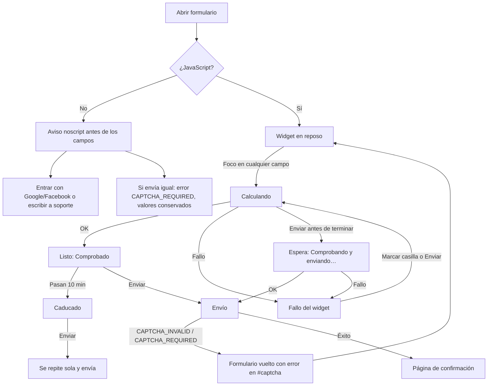

# Protección antibots (ALTCHA) — Diseño UX

[← Índice](../README.md) · Complementa: [Diseño técnico de ALTCHA](captcha-diseno-tecnico.md), [H0 — Diseño UX](h0-diseno-ux.md), [Contacto — Diseño UX](contacto-diseno-ux.md) y [Verificación de correo y recuperación — Diseño UX](correo-diseno-ux.md)

Fecha: 22 de noviembre de 2026. Textos en español de España, con tuteo. Lo que no se redefine aquí se rige por H0 (plantilla, patrón de formulario y errores, accesibilidad, tokens). **Las claves y los nombres de campo son los del diseño técnico (§8.5); los textos de este documento sustituyen a los provisionales de ese apartado.** Este documento no modifica `contacto-diseno-ux.md` (§9 lista los cambios que hay que aplicarle después).

## 0. Alcance y principios

**Dentro**: `/register`, `/forgot-password`, `/contact` y los tres formularios de reenvío (§2.4): `/register/check-email`, `/forgot-password/check-email` y `/account` (reenvío de la verificación). El login y OAuth no llevan comprobación.

**Usuarios y objetivo.** Cualquier persona que use esos formularios, con o sin cuenta, en escritorio o en un móvil modesto, con o sin lector de pantalla. Objetivo: **que la comprobación antibots no se note**: ni una tarea que hacer, ni una espera inesperada, ni nada escrito que se pierda.

Principios:
1. **No pedir nada a la persona.** La prueba de trabajo corre sola. No hay que marcar, recordar, transcribir ni resolver nada (WCAG 3.3.8). La casilla del widget existe como control de reintento, no como tarea.
2. **Que la espera no se vea.** El cálculo empieza al entrar en el primer campo y casi siempre termina mientras se escribe (~0,7 s en escritorio, 2-4 s en móvil medio).
3. **Hablar solo cuando importa.** Estado visible siempre, pero anunciado a lector de pantalla solo cuando algo falla o cuando la persona está esperando (§4).
4. **Nunca perder lo escrito.** Cualquier fallo de la comprobación (cliente o servidor) devuelve el formulario con todos los valores, como cualquier otro error de campo.
5. **Sin JavaScript, avisar antes de escribir** y ofrecer otra vía.
6. **El error de la comprobación no culpa a nadie** y siempre dice qué hacer: «vuelve a enviar».

## 1. Flujo



## 2. Dónde y cómo se muestra el widget

### 2.1 Regla general

- `CaptchaField` se pinta **solo si `captcha.enabled` es `true`** (`GET /config`). Con `false` no hay widget ni aviso.
- El widget es **un control de una línea, siempre visible, sin desafío**. Se decide no ocultarlo del todo (modo invisible) en los formularios con campos, por tres razones: (1) hay que poder mostrar el fallo en el mismo sitio donde se arregla (la casilla); (2) la persona de lector de pantalla y de teclado encuentra un control con estado, no una espera sin explicación; (3) evita saltos de diseño cuando aparece un error. Para que no parezca una tarea, va **después** de todos los campos, con un aspecto sereno (no destaca más que una casilla de condiciones) y con una ayuda que dice que se hace sola.
- Posición: inmediatamente antes de `SubmitButton`, con la separación de campo de H0. Nunca fijo ni flotante.
- Se monta solo en el navegador (tras `onMount`). Para evitar un salto de maquetación cuando aparece, el contenedor `#captcha` **reserva su altura mínima** (`min-height: var(--alto-control)`) desde el HTML del servidor; con JavaScript se rellena y sin él se sustituye por el aviso `<noscript>` (§6), que ocupa su sitio normal encima del formulario, no aquí.
- Sin pie «Protegido por ALTCHA» (`hideFooter`), sin firma de interacción, sin enlaces a terceros.

### 2.2 Estructura del widget (wireframe)

```
Reposo
+----------------------------------------------+
| [ ]  Comprobación automática contra robots   |
+----------------------------------------------+
Se hace sola cuando empiezas a rellenar el formulario. No tienes que resolver nada.

Calculando                      Listo
+---------------------------+   +---------------------------+
| (·)  Comprobando que no   |   | [✓]  Comprobado           |
|      eres un robot…       |   +---------------------------+
+---------------------------+

Fallo                            Caducado
+--------------------------------------+   +--------------------------------------+
| ⚠  No hemos podido hacer la          |   | ⓘ  La comprobación ha caducado.      |
|    comprobación. Marca la casilla    |   |    Se repetirá sola al enviar.       |
|    para intentarlo otra vez.  [ ]    |   +--------------------------------------+
+--------------------------------------+
```

- Caja de ancho completo del campo, borde `--borde-fino` `--color-borde`, radio `--radio-s`, fondo `--color-fondo`, texto `--texto-base` (la ayuda, `--texto-pequeno` en `--color-texto-suave`). Altura mínima de la fila táctil: `--tactil-minimo` (2,75 rem). La casilla es `--casilla` (1,5 rem), como el resto de casillas.
- El estado **nunca va solo en color**: texto + icono (✓ comprobado, ⚠ fallo, ⓘ caducado, indicador de progreso al calcular).
- Fallo: borde `--borde-grueso` `--color-error`, icono ⚠ y texto en `--color-texto` (el color de error solo en el borde y el icono, para cumplir contraste 4,5:1 del texto).
- Calculando: indicador de progreso. Con `prefers-reduced-motion: reduce` no gira: se muestra «…» estático. Con `forced-colors` el borde y los iconos usan colores del sistema.
- La ayuda `captcha.ayuda` está asociada al control con `aria-describedby`. Se oculta (`display: none`) cuando el estado es «Listo» para no repetir ruido; sigue en reposo, calculando y fallo.
- Mismo aspecto en los tres formularios con campos. Variables `--altcha-*` mapeadas a los tokens de `app.css` (`--color-borde`, `--color-error`, `--color-foco`, `--radio-s`, `--fuente-base`); el programador elige los nombres exactos.

### 2.3 Por formulario

| Formulario | Posición exacta | Notas |
|---|---|---|
| `/register` | Tras `TermsCheckbox`, antes de `SubmitButton`. `auto="onfocus"` | El error de la comprobación entra en el resumen en último lugar (orden visual). Con proveedores OAuth configurados, los botones sociales siguen donde estén y no llevan comprobación |
| `/forgot-password` | Tras el campo de correo, antes de «Enviar enlace». `auto="onfocus"` | Es un formulario de un solo campo: el cálculo empieza al enfocar el correo (en móvil, al tocarlo). Con sesión (crear contraseña) se pinta igual |
| `/contact` | Tras la casilla de privacidad (y su enlace/ayuda), antes de «Enviar mensaje». `auto="onfocus"` | El campo trampa no cambia. Escribir un mensaje largo da tiempo de sobra: el cálculo acaba antes de que la persona llegue al botón |

**Cuando un formulario vuelve con error de validación (sin error de comprobación)**: el widget se vuelve a montar y empieza al enfocar. Para no obligar a otro cálculo en el rato que la persona tarda en corregir, y para que no haya espera al enviar, se usa `auto="onload"` en esa remontada (cuando `form` trae errores). Si el error es el propio `CAPTCHA_*`, también `onload` (§3.6).

### 2.4 Formularios de reenvío (solo botón, sin campos)

Son: `/register/check-email` (`?/resend`), `/forgot-password/check-email` (`?/resend`) y `/account` (`?/resendVerification`, banda de «Correo sin confirmar»; solo con la cuenta sin verificar). **Pendiente de confirmar por el programador**: el botón «Enviar otro mensaje» de las páginas de enlace de verificación inválido (`enlace.verificar.sesion_sin_confirmar`) también envía a `/account?/resendVerification`; si está en una página distinta debe llevar el mismo tratamiento.

> **Aviso para el CTO (incoherencia con el diseño técnico).** El diseño técnico deja fuera `POST /auth/email-verification/request` (reenvío de la verificación). Tu decisión lo incluye. Además, el reenvío de `/forgot-password/check-email` llama a `POST /auth/password-reset/request`, que **ya** lleva `@RequiresCaptcha()`: sin cambios en este documento, ese botón fallaría siempre con `CAPTCHA_REQUIRED`. Hay que añadir `@RequiresCaptcha()` a `email-verification/request` y el widget a estos tres formularios (T6/T8 del plan técnico).

No hay ningún campo en el que enfocar, así que `auto="onfocus"` no sirve y `onfocus` sobre el botón haría esperar al tocarlo. Solución: **`auto="onload"` y presentación mínima**.

```
[ Enviar otro mensaje ]
(estado, solo si hace falta)  Comprobando y enviando…
```

- El widget va **antes del botón y casi invisible**: en reposo, calculando y listo no se muestra ninguna caja (`display="invisible"` si la versión 3.5.0 lo admite; si no, la misma caja de §2.2 pero reducida a una línea de texto pequeño sin casilla). Solo se hace visible en **fallo**: aparece la caja de §2.2 con su texto de error y la casilla de reintento, encima del botón.
- El botón **no se desactiva ni cambia** mientras calcula: si la persona lo pulsa antes de terminar, se aplica §3.4 (espera con «Enviando…» y región de estado `captcha.estado.enviando`).
- El resultado del reenvío no cambia: `revisar.aviso.reenviado`, `olvido.revisar.aviso_reenviado`, `correo.aviso.reenviado`, `comun.error.limite`, etc.
- Si la comprobación falla tras pulsar el botón: error de comprobación **en el sitio** (la caja visible con `role="alert"`), sin redirigir ni vaciar nada; el foco va a la casilla de reintento.
- Con sesión y la revisión de datos pendiente, el reto sigue funcionando (el diseño técnico añade `/captcha/challenge` a `DATA_REVIEW_ROUTES`).
- En `/account` la banda no debe crecer más de una línea más: el estado de fallo va como bloque propio bajo el texto de la banda, no dentro de ella.
- Para estos formularios, si `captcha.enabled` es `true` sin JavaScript, el botón no puede funcionar: aviso `<noscript>` (§6) encima del botón y se muestra también la dirección de soporte.

## 3. Estados y qué ve la persona

Estados del widget (`statechange`): `unverified` (reposo), `verifying`, `verified`, `error`, `expired`; más los dos errores del servidor.

| Estado | Qué ve | Anuncio a lector de pantalla | Foco | Siguiente paso |
|---|---|---|---|---|
| **Reposo** (antes de enfocar un campo) | Casilla sin marcar, `captcha.widget.etiqueta`, ayuda `captcha.ayuda` | Ninguno (es una casilla normal al llegar con tabulador: nombre, estado y ayuda) | No se mueve | Foco en cualquier campo del formulario → calculando |
| **Calculando** | Indicador de progreso y `captcha.widget.comprobando`. Casilla con `aria-busy="true"`. Los campos y el botón siguen activos | Ninguno automático al enfocar (evita interrumpir mientras escribe). Solo se anuncia si la persona pulsa Enviar (§3.4) | No se mueve | Termina en ~0,7 s (escritorio) / 2-4 s (móvil) |
| **Listo** | ✓ y `captcha.widget.comprobado`, casilla marcada, ayuda oculta | Ninguno. Quien navegue hasta la casilla oirá «casilla, marcada, Comprobado» | No se mueve | Enviar |
| **Fallo del widget** (no se pudo pedir el reto: 404/503/429, sin red, worker o memoria) | Borde de error, ⚠, `captcha.widget.error`, casilla sin marcar | **`role="alert"`**, una sola vez al entrar en este estado | **No se roba**: sigue donde esté (la persona está escribiendo) | Marcar la casilla (reintenta) o pulsar Enviar (reintenta y envía si va bien) |
| **Caducado** (10 min desde el reto) | ⓘ y `captcha.widget.caducado`, casilla sin marcar | Ninguno (no es un error y no requiere acción: al enviar se repite sola) | No se mueve | Enviar → se repite sola (§3.5) |
| **Error del servidor `CAPTCHA_REQUIRED` / `CAPTCHA_INVALID`** | Página vuelta (400): resumen de errores con enlace a `#captcha`, error de campo bajo la ayuda y encima de la caja del widget, widget remontado en reposo o calculando, todos los valores conservados | Lo habitual del patrón de error: foco al resumen y lectura de su título | Al resumen (`data-result-focus`) | §3.6 |

### 3.4 Pulsar «Enviar» antes de que termine el cálculo

Es el caso más importante para quien rellena rápido o usa un móvil lento (2-4 s, hasta 5-6 s).

1. El envío se **cancela y se retiene** (la persona no pierde nada: los campos siguen igual).
2. Botón: texto `*.boton.enviando` («Enviando…») con `aria-disabled="true"`; los clics repetidos se ignoran (como hoy). Región `role="status"` oculta del botón: **`captcha.estado.enviando`** («Comprobando y enviando…»). Este es **el único anuncio** de la espera.
3. Los campos siguen editables, pero **un cambio en un campo durante la espera no interrumpe nada**: lo enviado es lo que haya al terminar (el formulario se reenvía con `requestSubmit` leyendo los valores actuales).
4. Termina bien → se envía una sola vez automáticamente.
5. Termina mal (error del widget) → el botón vuelve a su texto normal, se anuncia el `role="alert"` del widget, el foco va a la casilla del widget (que ahora muestra el error) y la persona pulsa Enviar otra vez o marca la casilla.
6. **Tope de espera (propuesta, a confirmar con el programador)**: si pasan **20 s** sin terminar, se trata como fallo del widget (paso 5). Nadie debería esperar indefinidamente (WCAG 2.2.1 no aplica a límites impuestos al sistema, pero sí es un problema de usabilidad).
7. Si el reto ya había caducado, el comportamiento es el mismo (§3.5).

### 3.5 Reto caducado a los 10 minutos

- El estado «Caducado» se muestra en cuanto el widget lo detecta (el widget lo avisa solo): no hace falta que la persona haga nada.
- Al pulsar Enviar, se repite la comprobación sola con la misma espera de §3.4. **No se pierde nada de lo escrito** y no hay mensaje de error.
- Una persona que deja abierto `/contact` 12 minutos y envía debe ver solo «Comprobando y enviando…» durante 1-4 s y llegar a `/contact/sent` (criterio CA21 del diseño técnico).
- El texto `captcha.widget.caducado` le avisa de antemano sin alarmar.

### 3.6 Errores del servidor (`CAPTCHA_REQUIRED`, `CAPTCHA_INVALID`)

Deben ser **raros** con JavaScript (la web ya comprueba antes de enviar), pero pasan: reinicio de la API con otra clave, reto ya usado en otra pestaña, lectura de `GET /config` desfasada (60 s), cabecera perdida.

- La acción devuelve `fail(400)` con el error en `errors.fields.captcha`. Valores conservados (menos las contraseñas, como hoy).
- Resumen de errores: un enlace más, al final, `captcha.error.requerido` o `captcha.error.invalido`, que lleva a `#captcha`. Error de campo bajo la ayuda del widget con `aria-describedby` y `aria-invalid="true"` en la casilla.
- El widget se remonta (`{#key form}`) con `auto="onload"`: empieza a calcular nada más aparecer la página, así cuando la persona vuelva a pulsar Enviar ya habrá terminado o estará a punto. Si no terminó, rige §3.4.
- **Sin bucles**: si el servidor devuelve `CAPTCHA_INVALID` dos veces seguidas en el mismo formulario (mismo `form` sin cambio de acción), el texto cambia a `captcha.error.invalido_repetido` (§5) con la dirección de soporte. Se cuenta en el cliente con el campo oculto de intentos del formulario devuelto (no es un contador en el servidor); si el programador prefiere no contarlo, se deja siempre `captcha.error.invalido`.
- Con `CAPTCHA_REQUIRED` y JavaScript activo es casi seguro que la API tiene la comprobación activada y la web no lo sabía (caché de 60 s): el formulario vuelve ya con el widget (la página se vuelve a cargar con `captcha.enabled` correcto) y el error pide «vuelve a enviar».
- Con 429 en la petición del reto, el widget muestra el error normal (el cuerpo no se lee): «No hemos podido hacer la comprobación…». Es aceptable; si se repite, la persona usa la vía de soporte.

## 4. Accesibilidad

### 4.1 Anuncios (`aria-live`) sin saturar

Presupuesto: **en un recorrido normal sin fallos, cero anuncios propios de la comprobación**, salvo que la persona pulse Enviar antes de tiempo (entonces uno: «Comprobando y enviando…»). En un fallo, uno: el error.

| Momento | Anuncio | Mecanismo |
|---|---|---|
| Foco en el primer campo → calculando | Ninguno | El estado es texto visible, sin `aria-live` |
| Calculando → listo | Ninguno | Ídem |
| Listo → caducado | Ninguno | Ídem |
| Enviar con la comprobación incompleta | «Comprobando y enviando…» | Región `role="status"` oculta del botón (`captcha.estado.enviando`), una vez |
| Fallo del widget | `captcha.widget.error` | `role="alert"` del widget, una vez por fallo (no repetir si el texto no cambia) |
| Error del servidor | El de la página vuelta | Patrón de H0 (foco al resumen) |

- **Verificación obligatoria para el programador** (el widget es un componente externo): en la 3.5.0, comprobar qué regiones `aria-live` pone el propio widget por defecto. Si anuncia «Comprobando…» y «Comprobado» al instante (`role="status"`/`aria-live="polite"` en su texto), eso interrumpe a una persona que está escribiendo el primer campo. Hay que desactivarlo (quitar `aria-live` de su etiqueta de estado, o `aria-hidden` al texto de estado y exponer el estado solo con `aria-checked`/`aria-busy`) **dejando solo** el `role="alert"` del fallo. Si no es configurable, hay que envolver el widget y silenciar esa región. Si no hay forma, se asume un máximo de 2 anuncios por recorrido (criterio 19).
- No se usan `aria-live="assertive"` salvo el `role="alert"` del fallo.
- La región de estado de `SubmitButton` ya existe y está en el DOM desde el principio (las regiones vivas deben existir antes de recibir texto).

### 4.2 Foco

- El widget **nunca roba el foco** (`disableAutoFocus: true`): ni al montarse, ni al calcular, ni al terminar.
- `#captcha` (`tabindex="-1"`) es el destino del enlace del resumen. Al recibirlo con JavaScript, el foco pasa al **primer control interactivo del widget (la casilla)** para que la persona pueda actuar de inmediato; sin JavaScript queda en el contenedor con el aviso.
- El anillo de foco es el de H0 (`--color-foco`, `--foco-anillo` 3px, `--foco-margen` 2px), también en la casilla del widget.
- Orden de tabulación: ... último campo → casilla de privacidad/condiciones y su enlace (si hay) → **casilla del widget** → botón de enviar. El widget **no añade más paradas** (sin pie). En los formularios de reenvío, el widget solo es tabulable en fallo.
- Tras un fallo del widget que viene de pulsar Enviar, el foco va a la casilla del widget (§3.4, paso 5). Tras el envío automático con éxito, el flujo es el de cada formulario (redirección).

### 4.3 WCAG 3.3.8 (Autenticación accesible, mínimo) y otros

- **3.3.8**: registro y recuperación son autenticación. La prueba de trabajo **no es cognitiva** (no memoria, transcripción, reconocimiento ni resolución). El reto de código (imagen/audio) **no se activa nunca** (el diseño técnico lo rechaza por esquema). La casilla no es una tarea: nadie tiene que marcarla.
- **2.5.8 Tamaño del objetivo**: la fila táctil de la casilla mide al menos 2,75 rem (44 px), por encima del mínimo AA de 24 px.
- **1.4.1 Uso del color**: texto + icono + borde grueso en fallo.
- **1.4.3 / 1.4.11 Contraste**: texto 4,5:1 (`--color-texto` sobre `--color-fondo`), borde de la casilla 3:1 (`--color-borde` #7a7377 sobre blanco, 4,7:1). Ayuda en `--color-texto-suave` (7,3:1 sobre blanco, según contacto §4).
- **1.3.5 / 3.3.2**: etiqueta visible y programática (`captcha.widget.etiqueta`), ayuda asociada con `aria-describedby`; la casilla tiene nombre accesible igual al texto visible (2.5.3 Label in Name).
- **2.2.1 Tiempo ajustable**: la caducidad de 10 min no limita a la persona (se repite sola).
- **4.1.3 Mensajes de estado**: ver §4.1.
- **Teclado**: la casilla se marca con Espacio; Intro envía el formulario como siempre (si la comprobación no ha terminado, §3.4). No hay trampas de teclado.
- **Zoom/reflow**: a 320 px y al 200 % la caja ocupa el ancho del campo, el texto se parte (no desborda), y un texto de error largo no recorta el botón.
- **Lector de pantalla**: nombre «Comprobación automática contra robots, casilla de verificación, no marcada» → tras el cálculo «marcada». Quien lo oiga puede no marcar nada.
- **Preferencias**: `prefers-reduced-motion` (sin giro), `forced-colors` (sistema).

## 5. Textos de interfaz (claves para `texts.ts`)

Convención `pantalla.tipo.nombre` (como H0). `{soporte}` es `support.email` y **va siempre en una frase propia que se omite si no se conoce**. Estas claves **no las lee `texts.spec.ts`** (solo lee H0, terceros y correo) salvo que se añada este documento a la prueba.

### 5.1 Widget (los usa `$altcha.i18n`, §8.2 del diseño técnico)

| Clave | Texto | Estado del widget (propiedad `i18n`) |
|---|---|---|
| `captcha.widget.etiqueta` | Comprobación automática contra robots | `label` |
| `captcha.ayuda` | Se hace sola cuando empiezas a rellenar el formulario. No tienes que resolver nada. | (no es del widget; la pinta `CaptchaField`) |
| `captcha.widget.comprobando` | Comprobando que no eres un robot… | `verifying`, `waitAlert` |
| `captcha.widget.comprobado` | Comprobado | `verified` |
| `captcha.widget.error` | No hemos podido hacer la comprobación. Marca la casilla para intentarlo otra vez. | `error` |
| `captcha.widget.caducado` | La comprobación ha caducado. Se repetirá sola al enviar. | `expired` |
| `captcha.widget.requerida` | Falta la comprobación. Marca la casilla o pulsa Enviar. | `verificationRequired` |
| `captcha.estado.enviando` | Comprobando y enviando… | (región de estado del botón) |

Cambios respecto a §8.5 del diseño técnico: `etiqueta` (de «No soy un robot» a «Comprobación automática contra robots», para no sugerir una tarea ni una afirmación que haya que hacer), y `requerida` (más accionable). `captcha.ayuda` es nueva.

Nota de lenguaje: «robot» es la palabra habitual para el público; no se usa «bot» ni «captcha» en la interfaz, y no se acusa a nadie («no eres un robot» describe la prueba, no el comportamiento de la persona).

### 5.2 Errores del servidor (campo `captcha`)

| Clave | Texto |
|---|---|
| `captcha.error.requerido` | Falta la comprobación automática. Vuelve a enviar el formulario: se hará sola. Si no funciona, activa JavaScript en tu navegador. |
| `captcha.error.invalido` | La comprobación automática ha caducado o no es válida. Vuelve a enviar el formulario: se repetirá sola. |
| `captcha.error.invalido_repetido` | No conseguimos completar la comprobación automática. Prueba a recargar la página o a usar otro navegador. |
| `captcha.error.tiempo` | La comprobación está tardando demasiado. Marca la casilla para intentarlo otra vez. |
| `captcha.frase.soporte` | Si sigue fallando, escríbenos a {soporte}. |

`captcha.error.tiempo` es el `captcha.widget.error` del tope de espera de §3.4 (se muestra en el widget, no en el resumen). Las claves `requerido` e `invalido` se mapean en `messages.ts` (§8.4 del diseño técnico). La frase `captcha.frase.soporte` se añade al final del mensaje de error del campo, separada por un espacio, solo si `support.email` es conocido y solo en `invalido_repetido` y `requerido`.

Cambio en `requerido`: el provisional decía «Activa JavaScript y vuelve a enviar, o escríbenos a {soporte}». Con JavaScript activo es casi siempre un desajuste momentáneo, así que el primer consejo es reenviar; lo de activar JavaScript queda al final. Sin JavaScript se aplica además el aviso `captcha.sin_js.*` (que ya dice qué hacer), así que el error no necesita extenderse.

### 5.3 Sin JavaScript (`<noscript>`, componente `Notice` tipo info)

| Clave | Texto |
|---|---|
| `captcha.sin_js.titulo` | Este formulario necesita JavaScript |
| `captcha.sin_js.registro` | Para frenar los registros automáticos hacemos una comprobación en tu navegador y necesita JavaScript. Actívalo para crear tu cuenta. |
| `captcha.sin_js.olvido` | Para frenar los envíos automáticos hacemos una comprobación en tu navegador y necesita JavaScript. Actívalo para recibir el enlace. |
| `captcha.sin_js.contacto` | Para frenar el spam hacemos una comprobación en tu navegador y necesita JavaScript. Actívalo para enviar tu mensaje. |
| `captcha.sin_js.reenvio` | Para reenviar el mensaje hacemos una comprobación en tu navegador y necesita JavaScript. Actívalo y vuelve a intentarlo. |
| `captcha.sin_js.oauth` | También puedes entrar con {proveedores}. |
| `captcha.sin_js.soporte` | O escríbenos a {soporte}. |
| `captcha.sin_js.conservado` | Si lo envías sin activarlo, no se enviará nada y tendrás que volver a escribir las contraseñas; el resto se conserva. |

Composición del aviso (de arriba abajo): `titulo` (negrita, `<strong>`), texto del formulario, `oauth` **solo en `/register` y solo si hay proveedores** (`{proveedores}` nombra solo los configurados: «Google», «Facebook» o «Google o Facebook»), `soporte` solo si se conoce la dirección, y `conservado` **solo en `/register`** (único formulario con contraseñas). En `/forgot-password` y `/contact` no se menciona el conservado (no hay contraseñas, y todo se conserva: no hace falta decirlo).

Ejemplo, `/register` con todo configurado:

> **Este formulario necesita JavaScript.** Para frenar los registros automáticos hacemos una comprobación en tu navegador y necesita JavaScript. Actívalo para crear tu cuenta. También puedes entrar con Google o Facebook. O escríbenos a ayuda@cupidilla.example. Si lo envías sin activarlo, no se enviará nada y tendrás que volver a escribir las contraseñas; el resto se conserva.

La frase de contraseñas solo cuenta cuando el formulario se envía igualmente; si resulta larga, el programador puede mostrarla solo en el error posterior (`captcha.error.requerido` ya vuelve con valores conservados). Alternativa más corta aceptable: omitir `conservado` del aviso.

## 6. Comportamiento sin JavaScript

Con `captcha.enabled = true`, los formularios de §2 necesitan JavaScript (decisión del CTO). Con `false`, nada cambia.

1. **Aviso antes de escribir.** `<noscript>` dentro de `CaptchaField`... **ojo con la posición**: el diseño técnico lo coloca dentro de `#captcha` (antes del botón). Para que se vea **antes de escribir**, hay que **sacarlo** a la cabecera del formulario: justo bajo la `<h1>`/texto introductorio y antes del primer campo. Es lo que dice la decisión del CTO y el diseño técnico §7.1 («encima del formulario, antes del primer campo»). `#captcha` queda vacío sin JavaScript (el contenedor con `min-height` no debe dejar un hueco: usar `:has` o clase solo con JS para la reserva de altura, §2.1).
2. **Estilo**: `Notice` informativo (ℹ + texto, no rojo): no es un error, es una condición. Ancho completo del formulario. Contraste 4,5:1.
3. **Si envía igual**: la API responde 400 `CAPTCHA_REQUIRED`; la página vuelve con (a) resumen de errores (primero en `<main>`, título `Error: …`), con un enlace al contenedor `#captcha` (que sin JavaScript queda en el aviso del encabezado: el enlace apunta al propio aviso, `id="captcha"`), (b) **todos los valores conservados** salvo contraseñas (y la casilla de aceptación marcada si lo estaba), (c) el mismo aviso `<noscript>` visible, (d) mensaje `captcha.error.requerido` en el resumen.
4. **Otras vías**:
   - `/register`: botones de Google/Facebook (son POST de formulario, funcionan sin JavaScript) si hay proveedores.
   - Los tres formularios con campos: la dirección de soporte `{soporte}` (de `GET /config`, `support.email`) como enlace `mailto:`.
   - Reenvíos: dirección de soporte (el aviso la incluye).
5. **Sin dirección de soporte** (`null`): se omite la frase. En `/forgot-password` y `/contact` el aviso queda sin otra vía; es la limitación que reconoce el diseño técnico (§7.2) y debe documentarse en el despliegue.
6. **Orden de tabulación** sin JavaScript: no añade paradas (el aviso no es interactivo salvo el enlace de soporte y, en `/register`, los botones de OAuth ya existentes).

## 7. Responsive

- Una columna, ancho del campo. Menos de 30em: caja a ancho completo y el texto de estado se parte en varias líneas sin cortar el icono. Desde 48em: dentro de la tarjeta de `--ancho-formulario` (28 rem).
- Móvil modesto: el cálculo es 2-4 s (hasta 5-6 s). Con `auto="onfocus"` empieza al tocar el primer campo; para formularios de un campo (`/forgot-password`) la ventana de «cálculo escondido» es corta y es el caso donde más se verá «Comprobando y enviando…» (§3.4).
- Teclado virtual: el widget queda entre el último campo y el botón; al aparecer el estado de fallo no debe desplazar el foco (`scroll-margin` suficiente para que el error sea visible al enfocarse).
- Textos largos: `overflow-wrap: anywhere` en la caja (incluida la dirección de soporte, `translate="no"`).
- Muchos elementos/zoom: sin posición fija ni flotante.

## 8. Casos límite

- Entrar y salir del primer campo varias veces: un solo reto (el widget no reinicia el cálculo).
- Pestañas múltiples con el mismo formulario: cada una pide su reto. Un reto solo vale una vez: no se comparten entre pestañas.
- «Atrás» del navegador al formulario ya enviado: el widget se remonta; el estado «Listo» del bfcache puede mostrar una comprobación ya gastada. Al enviar, el servidor responderá `CAPTCHA_INVALID` y se aplica §3.6; para evitarlo, el widget debe reiniciarse en `pageshow` con `persisted` (el programador lo comprueba).
- Gestor de contraseñas o autocompletado que rellena todo y envía sin foco previo: el widget nunca estuvo en foco de campo; `ensureVerified()` lanza el cálculo (§3.4).
- Sin conexión: error del widget; los valores no se pierden.
- Lector de pantalla con exploración por tabulación rápida: encuentra la casilla en cualquier estado con su nombre y estado.
- Tema oscuro/alto contraste: usar los tokens, ningún color propio del widget.
- Dos clics rápidos en Enviar durante el cálculo: un solo envío (§3.4).
- Cambio de `CAPTCHA_ENABLED` con la web cacheada (60 s): ver §3.6.

## 9. Lista de cambios para aplicar después en `docs/contacto-diseno-ux.md`

No se aplican ahora (el programador está implementando contacto). Aplicar cuando contacto esté fusionado y el programador del captcha empiece T9/T12. Las líneas son las del documento a fecha de hoy.

| # | Dónde | Dice ahora | Debe decir |
|---|---|---|---|
| 1 | §0 «Fuera» (línea 10) | «… selector de categorías, captcha, respuesta desde la web …» | Quitar «captcha» de la lista de lo que queda fuera. En «Dentro», añadir al final: «, la comprobación antibots ALTCHA (ver [Protección antibots, diseño UX](captcha-diseno-ux.md))». |
| 2 | §0 principio 1 (línea 20) | «Pedir lo mínimo. Cuatro datos obligatorios y uno opcional. Sin categorías, sin captcha, sin adjuntos.» | «Pedir lo mínimo. Cuatro datos obligatorios y uno opcional. Sin categorías ni adjuntos, y sin pedir nada a la persona para la comprobación antibots (se hace sola, ver el diseño UX de la comprobación).» |
| 3 | §2.1 wireframe (tras la línea de la casilla de privacidad, antes del botón) | (nada) | Insertar el widget: `[ ] Comprobación automática contra robots` y debajo la ayuda `Se hace sola cuando empiezas a rellenar el formulario. No tienes que resolver nada.` (con las claves `captcha.*`). |
| 4 | §2.1 «Campos» (tabla, tras «Versión») | (nada) | Añadir fila: `Comprobación antibots`, `<altcha-widget name="captcha">`, no obligatorio (automático), ver diseño UX de la comprobación. |
| 5 | §2.1.3 título y texto (líneas 132-134) | «Trampa antispam (sin captcha)» … «No hay captcha ni prueba cognitiva (WCAG 3.3.8). El límite de envíos del servidor (§2.1.4) es la defensa real.» | Título: «Trampa antispam». Frase final: «La comprobación antibots ALTCHA (prueba de trabajo, sin ninguna tarea para la persona ni prueba cognitiva, WCAG 3.3.8) y el límite de envíos del servidor (§2.1.4) son las defensas principales; el campo trampa es un complemento.» Añadir: «Con la comprobación activa, un envío sin ella recibe `CAPTCHA_REQUIRED` antes de llegar a la trampa: la trampa solo actúa con una comprobación válida.» |
| 6 | §2.1.4 tabla de estados | Filas «Enviando», «Sin JavaScript» | En «Enviando (JS)», añadir: «Si la comprobación no ha terminado, el botón pasa a «Enviando…» y la región de estado dice «Comprobando y enviando…» hasta que termina; después se envía sola.» Sustituir la fila «Sin JavaScript» por: «**Sin JavaScript**: con la comprobación activa, no se puede enviar. Aviso `<noscript>` antes del primer campo con alternativa (dirección de soporte), valores conservados si se envía igual (error `CAPTCHA_REQUIRED` en el resumen). Con la comprobación desactivada, `<form method="POST">` y recarga completa; sin contador (la ayuda dice el máximo); el resto igual». Añadir fila nueva «Error de comprobación (400 `CAPTCHA_REQUIRED` / `CAPTCHA_INVALID`)»: «Resumen con `captcha.error.*`, error en el widget, valores conservados». |
| 7 | §2.1.5 orden de tabulación (línea 154) | «… mensaje → casilla → enlace «Leer la política de privacidad» → «Enviar mensaje» → …» | «… mensaje → casilla → enlace «Leer la política de privacidad» → **casilla del widget de comprobación** → «Enviar mensaje» → …» |
| 8 | §2.1.2 resumen de errores | Lista de enlaces `#name … #acceptPrivacy` | Añadir `#captcha` como último enlace del resumen. |
| 9 | §7 «Responsive», última viñeta (línea 429) | «Sin límite de tiempo en el formulario ni sesión que caduque: es público.» | «Sin límite de tiempo para la persona: ni el formulario ni la sesión caducan. La comprobación antibots caduca a los 10 minutos, pero se repite sola al enviar sin perder lo escrito.» |
| 10 | §7 «Foco» (tras línea 420) | (nada) | Añadir: «El widget de comprobación no roba nunca el foco. Un error de comprobación lleva el foco al resumen y el enlace `#captcha` a la casilla del widget.» |
| 11 | §7 «Teclado» | «todo funciona sin ratón…» | Añadir al final: «; la casilla del widget está entre la casilla de privacidad y el botón.» |
| 12 | §8 «Casos límite» (línea 434) | «… sin JavaScript; con sesión …» | Sustituir «sin JavaScript» por «sin JavaScript (con la comprobación activa, aviso y valores conservados al enviar)»; añadir: «reto caducado tras 12 minutos (se repite solo)»; «Enviar antes de que termine la comprobación». |
| 13 | §9 criterio 17 | «Orden de tabulación como en §2.1.5…» | Sin cambio de texto: el orden ahora incluye el widget (ver cambio 7). |
| 14 | §9 criterio 34 (línea 480) | «El formulario completo se puede rellenar y enviar solo con teclado y funciona con JavaScript desactivado (excepto el contador y el anuncio de «Enviando…»).» | «El formulario completo se puede rellenar y enviar solo con teclado y con JavaScript. Con JavaScript desactivado y la comprobación activa, se ve el aviso antes de escribir y, si se envía igual, vuelve con todo conservado y el error de comprobación; con la comprobación desactivada, funciona sin JavaScript (excepto el contador y el anuncio de «Enviando…»).» |
| 15 | §9 criterio 35 (línea 481) | «No hay captcha ni prueba cognitiva.» | «No hay ninguna prueba cognitiva ni reto de imagen o audio: la comprobación antibots (ALTCHA) es una prueba de trabajo que no requiere ninguna acción de la persona.» |
| 16 | §9 (criterios nuevos) | (nada) | Añadir tras el 35 (o referenciar): «36. Con la comprobación activa, el widget aparece entre la casilla de privacidad y el botón y el envío con la comprobación terminada no muestra ningún error. 37. Pulsar «Enviar mensaje» antes de que termine hace un solo envío tras «Comprobando y enviando…». 38. Los criterios 1–30 de §10 de [Protección antibots, diseño UX](captcha-diseno-ux.md) se aplican a `/contact`.» (Ver §10.) |
| 17 | §10 «Preguntas abiertas» | (nada sobre captcha) | Sin cambio obligatorio. |
| 18 | Cabecera (línea 3) | «Complementa: H0 … y correo» | Añadir: «y [Protección antibots, diseño UX](captcha-diseno-ux.md)». |

Frases concretas obsoletas, a localizar con búsqueda: «sin captcha», «captcha» (§0 y §2.1.3), «funciona con JavaScript desactivado» (criterio 34), «No hay captcha ni prueba cognitiva» (criterio 35 y §2.1.3), «Sin JavaScript | `<form method="POST">` y recarga completa» (§2.1.4: ya no es verdad por defecto), «Sin límite de tiempo en el formulario» (§7).

## 10. Criterios de aceptación (para tester-qa)

Se ejecutan con `CAPTCHA_ENABLED=true` salvo que se diga otra cosa. «Los tres formularios» son `/register`, `/forgot-password` y `/contact`; «los reenvíos» son los de §2.4. Los marcados **(QA)** son manuales.

**Presencia y aspecto**
1. Con `captcha.enabled=true`, en los tres formularios hay un `<altcha-widget name="captcha">` entre el último campo (o la casilla de condiciones/privacidad) y el botón de envío, con la etiqueta `captcha.widget.etiqueta` y la ayuda `captcha.ayuda` en reposo. Con `false`, no hay widget ni aviso en ninguna de las seis páginas.
2. No hay pie «Protegido por ALTCHA», ni enlaces a altcha.org, ni imagen ni audio de desafío en ningún estado.
3. En los reenvíos, el widget no se ve en reposo, calculando ni listo; solo se ve en fallo.

**Estados**
4. Al enfocar el primer campo del formulario, el widget pasa a «Comprobando que no eres un robot…» y después a «Comprobado» sin intervención. El foco no se mueve en ningún momento.
5. (CA19 del técnico, **QA**) Con `CAPTCHA_DIFFICULTY=normal`: desde el foco hasta «Comprobado» ≤ 2 s en escritorio y ≤ 5 s en móvil de gama media (media de 5 intentos).
6. Con la petición del reto fallando (`page.route` → 503), el widget muestra `captcha.widget.error` con `role="alert"`, y los valores del formulario no cambian. Al marcar la casilla se reintenta y, si va bien, pasa a «Comprobado».
7. Reto caducado (simulado adelantando el reloj 601 s): el widget muestra `captcha.widget.caducado`; al enviar se repite solo y el envío termina bien; no aparece ningún error; no se pierde nada de lo escrito. (CA21 manual con 12 min reales.)
8. Pulsar Enviar (o Intro) con el reto retrasado 2 s (CA15 del técnico): el botón dice «Enviando…» con `aria-disabled="true"`, la región `role="status"` dice «Comprobando y enviando…», se hace **un solo envío**, y se llega a la página de confirmación. Dos pulsaciones = un envío.
9. Con el reto retrasado más de 20 s (o fallando) tras pulsar Enviar: el botón vuelve a su texto normal, aparece el error del widget (`role="alert"`), el foco va a la casilla del widget, los valores se conservan y no se ha enviado nada. Marcar la casilla reintenta.
10. En los reenvíos: pulsar el botón antes de que termine el cálculo da el mismo comportamiento que (8) y termina en el resultado normal de ese reenvío (`revisar.aviso.reenviado` etc.).

**Errores del servidor**
11. Enviar con `X-Captcha` inválido (por ejemplo, una solución ya usada) en cada uno de los tres formularios: 400, resumen con el enlace a `#captcha` como último elemento, error de campo `captcha.error.invalido` junto al widget, valores conservados (sin contraseñas), widget remontado calculando, foco en el resumen. El enlace del resumen lleva el foco a la casilla del widget.
12. Sin comprobación (JavaScript desactivado o cabecera ausente): 400 `CAPTCHA_REQUIRED` con `captcha.error.requerido`, mismos criterios que (11). Con soporte conocido, el mensaje no incluye la frase de soporte a menos que sea `invalido_repetido`; sin soporte, ninguna frase de soporte.
13. Dos `CAPTCHA_INVALID` seguidos en el mismo formulario muestran `captcha.error.invalido_repetido`. (Si el programador decide no implementar el contador, se acepta `captcha.error.invalido` en ambos.)

**Sin JavaScript** (`chromium-no-js`)
14. Los tres formularios y los tres reenvíos muestran el aviso `captcha.sin_js.titulo` + el texto de su formulario **antes del primer campo** (en los reenvíos, encima del botón). No muestran el widget.
15. En `/register` el aviso incluye la frase de OAuth si hay algún proveedor configurado (nombrando solo los configurados); en los demás formularios no aparece. La frase `captcha.sin_js.soporte` aparece solo si `GET /config` devuelve `support.email` y esa dirección es un enlace `mailto:`.
16. Enviar igualmente un formulario válido: la página vuelve con `captcha.error.requerido` en el resumen (primero en `<main>`, `<title>` con «Error: »), conserva todos los valores (menos contraseñas) y no ha creado cuenta, no ha enviado correo ni guardado mensaje. En `/contact` se conservan nombre, asunto y mensaje.
17. Con `CAPTCHA_ENABLED=false`, los tres formularios y los reenvíos funcionan sin JavaScript como antes y sin aviso.

**Accesibilidad**
18. Orden de tabulación: último campo → (casilla de condiciones/privacidad y su enlace, si hay) → casilla del widget → botón. No hay ninguna otra parada del widget. En los reenvíos, el widget solo es tabulable en fallo.
19. **(QA, NVDA y VoiceOver)** En un recorrido normal sin fallos no se anuncia nada de la comprobación (máximo 2 anuncios si el widget no permite silenciar su región, anotar cuál); al pulsar Enviar antes de tiempo se oye «Comprobando y enviando…» una sola vez; en un fallo se oye el error una sola vez. La casilla se anuncia con su nombre, su estado y la ayuda.
20. **(QA)** El widget nunca roba el foco: se escribe el primer campo mientras calcula sin interrupciones ni saltos del cursor.
21. Todo se puede hacer solo con teclado, incluido reintentar tras un fallo (Espacio en la casilla). Anillo de foco visible (≥ 3 px, contraste 3:1).
22. Contraste: texto del estado 4,5:1; borde de la casilla 3:1; ayuda 4,5:1. Estado de fallo con icono y texto además del color. Fila táctil ≥ 44 px de alto.
23. Con `prefers-reduced-motion: reduce`, el indicador de progreso no gira (texto estático).
24. Sin scroll horizontal a 320 px y con zoom del 200 %, también con un texto de error largo y con una dirección de soporte larga; el botón de enviar sigue visible/alcanzable.
25. **(QA, WCAG 3.3.8)** En ningún momento hay que recordar, transcribir ni resolver nada; no aparece reto de imagen ni de audio.

**Textos y consistencia**
26. Todos los textos visibles de la comprobación salen de `texts.ts` con las claves de §5 y coinciden con las tablas (si se añade este documento a `texts.spec.ts`, la prueba los compara).
27. El resumen de errores enlaza a `#captcha` y el orden del resumen respeta el orden visual (la comprobación, la última).
28. Las contraseñas no se conservan tras un error de comprobación, como en cualquier otro error.
29. Los reenvíos con sesión y revisión de datos pendiente funcionan (CA23 del técnico).
30. El login y OAuth no muestran el widget ni el aviso.

## 11. Preguntas abiertas

**Para el CTO**
1. **Reenvíos**: ver el aviso de §2.4. Hay que confirmar que `@RequiresCaptcha()` pasa a `POST /auth/email-verification/request` y que el widget va a los tres formularios (`/register/check-email`, `/forgot-password/check-email`, `/account`). El reenvío de `/forgot-password/check-email` ya está obligado hoy por el decorador de la recuperación.
2. **`display="invisible"` y `auto="onload"` en los reenvíos**: el diseño técnico solo prevé `type="checkbox"`, `display="standard"` y `auto="onfocus"`. Confirmar con el programador que la 3.5.0 admite los modos de §2.4 y, si no, aceptar la caja de línea reducida.
3. **Tope de espera de 20 s** (§3.4) y **contador de `CAPTCHA_INVALID` repetido** (§3.6): propuestas de UX, no están en el diseño técnico.
4. **Posición del `<noscript>`**: el diseño técnico lo mete dentro de `CaptchaField` (más abajo); este documento lo saca a la cabecera del formulario (§6) para que se vea antes de escribir, como pide la decisión. Requiere que la página lo pinte, no el componente.
5. **Lista de cambios de §9** y de `texts.spec.ts`: si se quiere que las tablas de §5 se comprueben, añadir este documento a la lista que lee la prueba.

**Para el programador (comprobar al implementar)**
1. Qué regiones `aria-live` y `role` trae el widget 3.5.0 (§4.1) y si se pueden silenciar.
2. Si `$altcha.i18n` admite todas las propiedades de §5.1 (`label`, `verifying`, `waitAlert`, `verified`, `error`, `expired`, `verificationRequired`).
3. Si el estado del widget se conserva en el bfcache («atrás») y cómo reiniciarlo (§8).

## Decisiones del CTO (22-11-2026)

Donde este documento y [el diseño técnico](captcha-diseno-tecnico.md) no coinciden, manda esto:

1. **Reenvíos incluidos.** `POST /auth/email-verification/request` lleva `@RequiresCaptcha()`. Todos los formularios de un solo botón que llaman a rutas protegidas (`/register/check-email`, `/forgot-password/check-email`, `/account` y los botones de reenvío de las páginas del enlace de verificación) llevan el widget en modo `auto="onload"`, casi invisible y visible solo en fallo (§2.4).
2. **Modos del widget.** Si la versión 3.5.0 no admite `display="invisible"` o `auto="onload"`, se usa la caja reducida. El programador lo comprueba y lo anota.
3. **Se aceptan** el tope de espera de 20 s tras pulsar Enviar y el contador de `CAPTCHA_INVALID` repetido.
4. **`<noscript>`**: va en la cabecera del formulario, antes del primer campo, como dice este documento, no dentro de `CaptchaField`.
5. **Anuncios**: si el widget trae regiones `aria-live` propias que anuncien mientras se escribe, se silencian. Si no se puede, el programador lo avisa antes de seguir.
6. **`MAIL_SUPPORT_ADDRESS`** se publica en `GET /config`.
7. **`CAPTCHA_ENABLED`** va activada por defecto; `.env.example` explica cómo generar `CAPTCHA_HMAC_KEY` en desarrollo.
