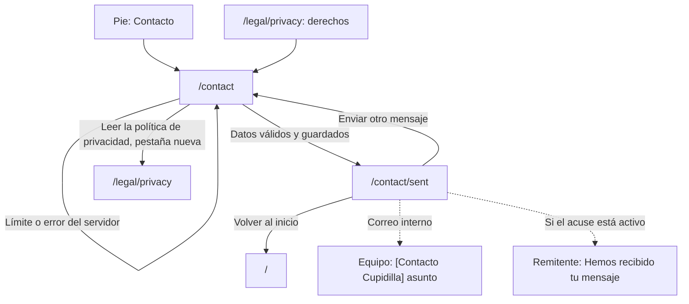

# Contacto y política de privacidad (borrador) — Diseño UX

[← Índice](../README.md) · Complementa: [H0 — Diseño UX](h0-diseno-ux.md), [Verificación de correo y recuperación — Diseño UX](correo-diseno-ux.md) y [Protección antibots, diseño UX](captcha-diseno-ux.md)

Especificación de `/contact`, `/contact/sent`, `/legal/privacy` (borrador), el enlace «Contacto» en el pie y los dos correos nuevos (aviso interno y acuse al remitente). Fecha del documento: 22 de noviembre de 2026. Textos en español de España, con tuteo. Todo lo que no se redefine aquí se rige por H0: plantilla (§2.1), patrón de formulario y errores (§2.2), accesibilidad (§6) y tokens (§7); y por el documento de correo: reglas comunes de los correos (§5) y marcador `{soporte}`.

## 0. Alcance, usuarios y principios

**Dentro**: `/contact` (formulario), `/contact/sent` (confirmación), `/legal/privacy` (borrador), «Contacto» y «Política de privacidad» en el pie, correo interno al equipo y acuse opcional al remitente, la comprobación antibots ALTCHA (ver [Protección antibots, diseño UX](captcha-diseno-ux.md)).
**Fuera**: adjuntos, chat, tickets con seguimiento, selector de categorías, respuesta desde la web, bandeja de administración.

**Usuarios y objetivo.** Cualquier persona, con o sin cuenta:
1. *Visitante con una duda* antes de registrarse.
2. *Persona con un problema de cuenta* (no puede entrar, no le llega un correo). Puede no tener sesión: por eso la página es pública y no exige estar dentro.
3. *Persona que quiere ejercer derechos de protección de datos* o denunciar algo.

Objetivo: **escribir un mensaje en menos de un minuto, saber qué pasa con sus datos y tener la certeza de que se ha enviado.**

Principios:
1. **Pedir lo mínimo.** Cuatro datos obligatorios y uno opcional. Sin categorías ni adjuntos, y sin pedir nada a la persona para la comprobación antibots (se hace sola, ver el diseño UX de la comprobación).
2. **Nunca perder lo escrito.** Un mensaje largo cuesta escribirlo: tras cualquier error (validación, límite, servidor, conexión) el formulario vuelve con todo, incluido el mensaje.
3. **Honestidad sobre los datos.** Se dice quién los trata, para qué y qué derechos hay, antes de pulsar «Enviar».
4. **No prometer lo que no hay.** Ningún texto promete un plazo de respuesta ni un acuse que no vaya a existir (el acuse es configurable).
5. **El acuse no es un canal de abuso.** El correo al remitente no repite nada de lo que ha escrito (§7.2).

## 1. Flujo



1. La persona abre `/contact` (pie de cualquier página, o desde la política de privacidad). Con o sin sesión.
2. Rellena nombre, correo, teléfono (opcional), asunto y mensaje, y marca la casilla de privacidad (llega desmarcada). Puede abrir la política en pestaña nueva sin perder lo escrito.
3. Pulsa «Enviar mensaje».
4. El servidor valida **todo a la vez** (forma de cada campo y casilla). Con errores, devuelve el formulario con resumen y valores conservados.
5. Con datos válidos: guarda el mensaje (con la versión de la política aceptada y la fecha), encola el correo al equipo y, si está activado y no se ha superado el límite, el acuse. **Solo después de guardar** responde éxito: lo guardado es la fuente de verdad; el correo sale de la cola y no puede hacer fallar el envío al usuario.
6. 303 a `/contact/sent`.

### 1.1 Decisión: pantalla propia `/contact/sent`, no la misma página

Se elige `/contact/sent` por cuatro razones: (1) refrescar o pulsar «atrás» no reenvía el formulario ni duplica el mensaje (POST-redirect-GET, como el resto de la web); (2) el formulario no queda relleno en un equipo compartido con un mensaje que puede ser personal; (3) una página nueva con foco en el `<h1>` es lo más claro para lector de pantalla y sin JavaScript; (4) coincide con el patrón de `/register/check-email` y `/forgot-password/check-email`.

Sin ningún dato en la URL. El servidor pone una cookie de un solo uso `cupidilla_contact_sent` (`httpOnly`, `SameSite=Lax`, `Secure` fuera de desarrollo, `path=/contact/sent`, 15 min) con el correo escrito y un booleano «acuse encolado». `/contact/sent` la lee y la borra al servirse; **sin cookie, 303 a `/contact` sin mensaje** (recarga, «atrás» días después, enlace compartido). Con `Cache-Control: no-store`.

## 2. Pantallas

### 2.1 `/contact`

```
<h1> Escríbenos
<p>  Cuéntanos tu duda, sugerencia o problema y te responderemos por correo electrónico.
<p>  Todos los campos son obligatorios salvo el teléfono.
[resumen de errores / error general]                       (solo con errores)

Nombre
Cómo quieres que te llamemos al responderte.
[ __________________________ ]

Correo electrónico
Te responderemos a esta dirección.
[ __________________________ ]

Teléfono (opcional)
Solo si quieres que podamos llamarte. Por ejemplo: 600 123 456 o +34 600 123 456.
[ __________________________ ]

Asunto
De qué trata, en pocas palabras. Hasta 120 caracteres. Por ejemplo: Duda sobre mi cuenta.
[ __________________________ ]

Mensaje
Cuéntanos qué necesitas con todo el detalle que puedas. No escribas tu contraseña ni
datos que no sean necesarios para tu consulta.
[                                  ]
[                                  ]   (textarea, 8 filas)
[                                  ]
                         0 de 3000 caracteres   (solo con JS; sin JS, la ayuda ya dice el máximo)

[ ] He leído y acepto la política de privacidad.
    Leer la política de privacidad (se abre en una pestaña nueva)
    Usaremos tus datos solo para atender tu mensaje. Es un texto provisional, pendiente de revisión jurídica.

[ ] Comprobación automática contra robots                (captcha.widget.etiqueta)
    Se hace sola cuando empiezas a rellenar el formulario. No tienes que resolver nada.   (captcha.ayuda)

[ Enviar mensaje ]

Información básica sobre protección de datos
Responsable: …  Finalidad: …  Derechos: …  (cláusula, §4)
```

**Nota de ayuda sin placeholders.** Se decide **no usar `placeholder`** (H0 §6: no se usan; bajo contraste, desaparece al escribir y algunos lectores no lo anuncian). Los ejemplos van dentro de las ayudas, visibles siempre. Si se quiere un ejemplo, es el de la ayuda (`contacto.ayuda.*`).

**Campos**

| Campo | Control (`id` = `name`) | Obligatorio | Límites | Atributos |
|---|---|---|---|---|
| Nombre | `<input type="text" id="name" name="name">` | Sí | 1 a 100 | `autocomplete="name"`, `autocapitalize="words"` |
| Correo | `<input type="email" id="email" name="email">` | Sí | máx. 254 | `autocomplete="email"`, `inputmode="email"`, `autocapitalize="none"`, `spellcheck="false"` |
| Teléfono | `<input type="tel" id="phone" name="phone">` | No | 7 a 15 cifras; hasta 30 caracteres escritos | `autocomplete="tel"`, `inputmode="tel"` |
| Asunto | `<input type="text" id="subject" name="subject">` | Sí | 3 a 120 | `autocomplete="off"` |
| Mensaje | `<textarea id="message" name="message" rows="8">` | Sí | 10 a 3000 | `autocomplete="off"`, sin `maxlength` |
| Privacidad | `<input type="checkbox" id="acceptPrivacy" name="acceptPrivacy">` | Sí | — | desmarcada siempre, salvo recuperar el valor tras un error |
| Versión | `<input type="hidden" name="privacyVersion">` | — | `PRIVACY_POLICY_VERSION` | como `termsVersion` en `TermsCheckbox` |
| Trampa antispam | `<input type="text" name="hp_contact">` | — | debe llegar vacío | ver 2.1.3 |
| Comprobación antibots | `<altcha-widget name="captcha">` | No (automático) | — | ver el [diseño UX de la comprobación](captcha-diseno-ux.md) |

- Los obligatorios llevan `aria-required="true"`. No hay asteriscos: se dice una vez arriba (`contacto.texto.obligatorios`) y el teléfono se marca en su propia etiqueta con «(opcional)».
- **Sin `maxlength`** (H0 §2.3: cortar en silencio es peor): el contador avisa y el servidor valida.
- **Qué es un carácter**: punto de código Unicode tras normalizar saltos de línea a `\n` y recortar espacios del principio y del final. Un emoji cuenta 1. El contador del cliente y la validación del servidor usan **la misma regla** (si no, el contador diría 3000 y el servidor rechazaría).
- Espacios sobrantes al principio y al final se recortan; un campo solo de espacios cuenta como vacío. Los saltos de línea del mensaje se conservan.
- **Teléfono**: se aceptan cifras, espacios, guiones, puntos, paréntesis y un `+` inicial. Se cuentan las cifras (7 a 15, el máximo del formato internacional). Vacío es válido (se guarda como «sin teléfono»).
- **Con sesión**: el correo sale relleno con el de la cuenta y es editable. El nombre no se rellena (la cuenta no guarda nombre). Sin sesión, todo vacío. No hay `autofocus`.

#### 2.1.1 Contador del mensaje

- Solo con JavaScript (se añade al montar). Texto `contacto.contador`: «0 de 3000 caracteres», debajo del textarea, alineado a la izquierda en móvil y a la derecha desde 48em. Color `--color-texto-suave`.
- Al superar el límite cambia a `contacto.contador.exceso` («3012 de 3000 caracteres: te sobran 12»), con icono ⚠ y borde del textarea de error (2 px `--color-error`): texto, icono y color, no solo color. **No impide escribir ni pegar.** El botón sigue activo: el servidor devuelve el error de campo.
- El contador forma parte de `aria-describedby` del textarea (se lee al entrar, no en cada pulsación).
- Anuncio para lector de pantalla: región `role="status"` oculta visualmente, actualizada **solo** al cruzar el 90 % (`contacto.contador.aviso_quedan`, «Te quedan 300 caracteres.»), y al pasar el límite (`contacto.contador.aviso_exceso`). Se actualiza con retardo de 1 s tras dejar de escribir, nunca por pulsación.

#### 2.1.2 Resumen de errores

Patrón de H0 §2.2: `ErrorSummary` antes de la `<h1>`, `<h2>` «Revisa esto antes de seguir», un enlace por error al control (`#name`, `#email`, `#phone`, `#subject`, `#message`, `#acceptPrivacy` y, el último, `#captcha`) **en el orden visual de los campos**. Error de campo: `FieldError` bajo la ayuda y encima del control, con «Error:» oculto, icono ⚠ y `aria-describedby` + `aria-invalid="true"`. Errores sin campo (límite, servidor, conexión): bloque `role="alert"` sin lista. `<title>` con prefijo «Error: ». Con JavaScript, el foco pasa al resumen; sin él, es lo primero de `<main>`.

#### 2.1.3 Trampa antispam

Un campo oculto `hp_contact` que las personas no ven ni rellenan. Fuera de pantalla (no `display:none`), con `tabindex="-1"`, `aria-hidden="true"` y `autocomplete="off"`; nombre deliberadamente raro (un nombre como `website` o `url` lo rellenarían los gestores de formularios de personas reales). Si llega relleno, el servidor **responde como si todo hubiera ido bien** (303 a `/contact/sent` con acuse a `false`) y no guarda ni envía nada. La comprobación antibots ALTCHA (prueba de trabajo, sin ninguna tarea para la persona ni prueba cognitiva, WCAG 3.3.8) y el límite de envíos del servidor (§2.1.4) son las defensas principales; el campo trampa es un complemento. Con la comprobación activa, un envío sin ella recibe `CAPTCHA_REQUIRED` antes de llegar a la trampa: la trampa solo actúa con una comprobación válida.

#### 2.1.4 Estados

| Estado | Comportamiento |
|---|---|
| Inicial | Vacío (con sesión, correo relleno), casilla desmarcada, sin errores, sin `autofocus` |
| Escribiendo (JS) | Contador del mensaje actualizado; nada más cambia |
| Enviando (JS) | Botón «Enviando…», `aria-disabled="true"`, segundo envío ignorado, región `role="status"` oculta con «Enviando tu mensaje…». Los campos siguen editables y conservan lo escrito. Si la comprobación no ha terminado, el botón pasa a «Enviando…» y la región de estado dice «Comprobando y enviando…» hasta que termina; después se envía sola |
| Error de validación | Resumen + error por campo, **todos los valores conservados** (también el mensaje y la casilla). 400 |
| Demasiados envíos | Bloque `role="alert"` con `contacto.error.limite`; valores conservados. 429 |
| Error del servidor (no se guardó nada) | Bloque `role="alert"` con `contacto.error.servidor`; valores conservados. 5xx |
| Resultado incierto (503, se perdió la conexión) | Bloque `role="alert"` con `contacto.error.resultado_incierto`; valores conservados; no hay enlace de comprobación (no hay dónde comprobarlo). El botón vuelve a «Enviar mensaje» |
| Éxito | 303 a `/contact/sent` |
| Error de comprobación (400 `CAPTCHA_REQUIRED` / `CAPTCHA_INVALID`) | Resumen con `captcha.error.*`, error en el widget, valores conservados |
| **Sin JavaScript** | Con la comprobación activa, no se puede enviar. Aviso `<noscript>` antes del primer campo con alternativa (dirección de soporte), valores conservados si se envía igual (error `CAPTCHA_REQUIRED` en el resumen). Con la comprobación desactivada, `<form method="POST">` y recarga completa; sin contador (la ayuda dice el máximo); el resto igual |

**Límite de envíos** (decide el diseño técnico; propuesta): 3 mensajes por hora y 10 al día por IP, y 3 cada 24 h por correo del remitente. El acuse se limita por separado (1 cada 24 h por correo): si se supera, **el mensaje se guarda y se envía al equipo igual**, solo se omite el acuse y la cookie de §1.1 lleva `ack=false`.

#### 2.1.5 Orden de tabulación

Saltar al contenido → encabezado → (resumen de errores) → nombre → correo → teléfono → asunto → mensaje → casilla → enlace «Leer la política de privacidad» → **casilla del widget de comprobación** → «Enviar mensaje» → enlace de la política dentro de la cláusula informativa → pie. El campo trampa no es tabulable.

### 2.2 `/contact/sent`

```
<h1> Mensaje enviado
<p>  Hemos recibido tu mensaje.
<p>  Lo leeremos y te responderemos a persona@ejemplo.com.
<p>  Te enviaremos un correo breve para confirmar la recepción. Si no lo ves en unos
     minutos, mira en la carpeta de correo no deseado.              (solo si ack = true)
[ Volver al inicio ]
Enviar otro mensaje                                                  (enlace a /contact)
```

- Página de **resultado**, no formulario: sin `autofocus`; con JavaScript, el foco va al `<h1>` (`tabindex="-1"`), igual que `/register/check-email`.
- El correo se escribe en texto con `overflow-wrap: anywhere` y `translate="no"`. No se muestra nada más de lo enviado (ni asunto ni mensaje).
- La frase del acuse **solo aparece si la cookie dice `ack=true`**: si el acuse está desactivado, se ha superado su límite o era trampa, no se promete.
- No se promete plazo de respuesta.
- Estados: solo el normal. Sin cookie: 303 a `/contact`. Botón principal «Volver al inicio»; «Enviar otro mensaje» es un enlace con aspecto de botón secundario. `<title>`: «Mensaje enviado — Cupidilla». Responsive: botones apilados a ancho completo en menos de 30em.

### 2.3 `/legal/privacy` (borrador)

Mismo patrón que `/legal/terms`: texto a ancho de lectura (`--ancho-lectura`), una sola `<h1>`, `<h2>` numerados, banner de borrador con la palabra «Borrador» en texto, enlace «Volver al inicio». Público, con o sin sesión. El contenido vive en `lib/legal/privacy-2026-11-borrador.svelte` (con `minAge` por propiedad, como las condiciones), no en `texts.ts`; versión en una constante `PRIVACY_POLICY_VERSION = '2026-11-borrador'` junto a `SERVICE_TERMS_VERSION`. Los `[PENDIENTE]` se muestran tal cual y los rellena quien tenga la información; no los inventa el equipo de desarrollo.

```
[Banner] Borrador pendiente de revisión jurídica. No es el texto definitivo y puede cambiar.
<h1> Política de privacidad
<p>  Versión 2026-11-borrador
<h2> 1. Quién es el responsable
<h2> 2. Qué datos tratamos y para qué
<h2> 3. Por qué podemos tratarlos
<h2> 4. Cuánto tiempo los conservamos
<h2> 5. Con quién los compartimos
<h2> 6. Transferencias fuera de la Unión Europea
<h2> 7. Tus derechos y cómo ejercerlos
<h2> 8. Menores de edad
<h2> 9. Seguridad
<h2> 10. Cookies y almacenamiento en tu navegador
<h2> 11. Cambios
Volver al inicio
```

Texto borrador (los títulos son literales; el cuerpo es propuesta para revisión jurídica):

| Clave | Texto |
|---|---|
| `privacidad.meta.titulo` | Política de privacidad (borrador) |
| `privacidad.aviso` | Borrador pendiente de revisión jurídica. No es el texto definitivo y puede cambiar. |
| `privacidad.titulo` | Política de privacidad |
| `privacidad.version` | Versión 2026-11-borrador |
| `privacidad.s1.titulo` | 1. Quién es el responsable |
| `privacidad.s1.texto` | [PENDIENTE: nombre o razón social, NIF, domicilio y correo de contacto del responsable del tratamiento. Debe coincidir con la sección 1 de las condiciones de uso.] |
| `privacidad.s2.titulo` | 2. Qué datos tratamos y para qué |
| `privacidad.s2.texto` | Tu cuenta: tu correo, tu contraseña (que no guardamos en claro), tu fecha de nacimiento y qué versión de las condiciones aceptaste y cuándo, para que puedas entrar y para comprobar que eres mayor de edad. Si entras con Google o Facebook: un identificador tuyo en ese servicio y tu correo. Correos del servicio: te escribimos para confirmar tu correo, ayudarte a recuperar tu contraseña y avisarte de cambios en tu cuenta. Formulario de contacto: tu nombre, tu correo, tu teléfono si lo escribes, el asunto y el mensaje, y qué versión de esta política aceptaste y cuándo, para atender tu mensaje y responderte. Seguridad: datos técnicos mínimos, como la dirección IP, para proteger el servicio y limitar abusos. [PENDIENTE: confirmar la lista con lo que guarda realmente el sistema.] |
| `privacidad.s3.titulo` | 3. Por qué podemos tratarlos |
| `privacidad.s3.texto` | [PENDIENTE: base jurídica de cada finalidad. Propuesta: cuenta y correos del servicio, ejecución de las condiciones de uso; formulario de contacto, tu consentimiento al marcar la casilla; seguridad y límites de uso, interés legítimo; comprobación de edad, cumplimiento de las condiciones de uso.] |
| `privacidad.s4.titulo` | 4. Cuánto tiempo los conservamos |
| `privacidad.s4.texto` | Los datos de tu cuenta, hasta que la elimines. Los mensajes de contacto, 180 días desde que los recibimos; después se borran automáticamente. Los datos técnicos de seguridad, [PENDIENTE: plazo]. |
| `privacidad.s5.titulo` | 5. Con quién los compartimos |
| `privacidad.s5.texto` | No vendemos tus datos ni los cedemos a terceros para sus propios fines. Usamos proveedores que tratan datos por nuestra cuenta: [PENDIENTE: alojamiento, envío de correo y cualquier otro encargado, con su país]. Si entras con Google o Facebook, esos servicios tratan tus datos según sus propias políticas. Podemos comunicar datos a las autoridades cuando una ley nos obligue. |
| `privacidad.s6.titulo` | 6. Transferencias fuera de la Unión Europea |
| `privacidad.s6.texto` | [PENDIENTE: indicar si hay transferencias y con qué garantías.] |
| `privacidad.s7.titulo` | 7. Tus derechos y cómo ejercerlos |
| `privacidad.s7.texto` | Puedes pedirnos acceder a tus datos, rectificarlos, suprimirlos, limitar su tratamiento, oponerte a él y recibirlos en un formato reutilizable. Si el tratamiento se basa en tu consentimiento, puedes retirarlo en cualquier momento, sin que afecte a lo ya hecho. Puedes eliminar tu cuenta tú mismo desde «Tu cuenta». Para cualquier otro derecho, escríbenos desde la página de contacto indicando «Derechos de protección de datos» en el asunto, o a [PENDIENTE: correo]. Si crees que no tratamos bien tus datos, puedes reclamar ante la Agencia Española de Protección de Datos (www.aepd.es). |
| `privacidad.s8.titulo` | 8. Menores de edad |
| `privacidad.s8.texto` | Cupidilla es solo para personas de {edad} años o más. No queremos datos de menores: si descubrimos que los tenemos, los borraremos. |
| `privacidad.s9.titulo` | 9. Seguridad |
| `privacidad.s9.texto` | [PENDIENTE: resumen de las medidas técnicas y organizativas, revisado por quien las conozca.] |
| `privacidad.s10.titulo` | 10. Cookies y almacenamiento en tu navegador |
| `privacidad.s10.texto` | Usamos solo cookies técnicas necesarias para el funcionamiento (mantener tu sesión y recordar un aviso de un solo uso). No usamos cookies de publicidad ni de seguimiento. [PENDIENTE: comprobar al desplegar que es cierto.] |
| `privacidad.s11.titulo` | 11. Cambios |
| `privacidad.s11.texto` | Si cambiamos esta política publicaremos una nueva versión y la fecha. [PENDIENTE: criterio para avisar de los cambios importantes.] |
| `privacidad.enlace.volver` | Volver al inicio |

En el borrador de las condiciones (§5 de `terms-2026-11-borrador-2`) hay un `[PENDIENTE]` que dice que los datos «irán en la política de privacidad»: al publicar esta página, actualizarlo es cambio de texto legal y de versión, y no se hace aquí.

## 3. Textos de interfaz

> **Claves sugeridas para `texts.ts`.** Convención `pantalla.tipo.nombre`. `{x}` es un valor variable (`fill`). Los valores numéricos (`{max}`, `{min}`) salen de las constantes de límites compartidas (`@cupidilla/contracts`), nunca se escriben a mano. Esta tabla **no la lee `texts.spec.ts`** (solo lee H0, terceros y correo); si se quiere que la compruebe, hay que añadir este documento a la prueba.

### 3.1 Pie de página (cambios en comunes)

| Clave | Texto |
|---|---|
| `comun.pie.etiqueta` | Información y contacto |
| `comun.pie.privacidad` | Política de privacidad |
| `comun.pie.contacto` | Contacto |

(`comun.pie.condiciones` y `comun.pie.edad` no cambian.)

### 3.2 Formulario

| Clave | Texto |
|---|---|
| `contacto.meta.titulo` | Contacto |
| `contacto.titulo` | Escríbenos |
| `contacto.texto.intro` | Cuéntanos tu duda, sugerencia o problema y te responderemos por correo electrónico. |
| `contacto.texto.obligatorios` | Todos los campos son obligatorios salvo el teléfono. |
| `contacto.campo.nombre` | Nombre |
| `contacto.ayuda.nombre` | Cómo quieres que te llamemos al responderte. |
| `contacto.campo.correo` | Correo electrónico |
| `contacto.ayuda.correo` | Te responderemos a esta dirección. |
| `contacto.campo.telefono` | Teléfono (opcional) |
| `contacto.ayuda.telefono` | Solo si quieres que podamos llamarte. Por ejemplo: 600 123 456 o +34 600 123 456. |
| `contacto.campo.asunto` | Asunto |
| `contacto.ayuda.asunto` | De qué trata, en pocas palabras. Hasta {max} caracteres. Por ejemplo: Duda sobre mi cuenta. |
| `contacto.campo.mensaje` | Mensaje |
| `contacto.ayuda.mensaje` | Cuéntanos qué necesitas con todo el detalle que puedas. No escribas tu contraseña ni datos que no sean necesarios para tu consulta. Máximo {max} caracteres. |
| `contacto.contador` | {n} de {max} caracteres |
| `contacto.contador.exceso` | {n} de {max} caracteres: te sobran {sobran} |
| `contacto.contador.aviso_quedan` | Te quedan {quedan} caracteres. |
| `contacto.contador.aviso_exceso` | Te has pasado por {sobran} caracteres. Acorta el mensaje para poder enviarlo. |
| `contacto.campo.privacidad` | He leído y acepto la política de privacidad. |
| `contacto.enlace.privacidad` | Leer la política de privacidad |
| `contacto.ayuda.privacidad` | Usaremos tus datos solo para atender tu mensaje. Es un texto provisional, pendiente de revisión jurídica. |
| `contacto.boton.enviar` | Enviar mensaje |
| `contacto.boton.enviando` | Enviando… |
| `contacto.estado.enviando` | Enviando tu mensaje… |

**Casilla y enlace (literales).** Etiqueta de la casilla: «He leído y acepto la política de privacidad.» Enlace: «Leer la política de privacidad», seguido de `comun.nueva_pestana` («(se abre en una pestaña nueva)»), a `/legal/privacy` con `target="_blank" rel="noopener"`. **Mismo patrón que `TermsCheckbox`**: el enlace va **fuera** de la `<label>`, justo debajo, para que pulsarlo no marque la casilla; la ayuda `contacto.ayuda.privacidad` va debajo y se asocia con `aria-describedby`. La etiqueta solo contiene el texto de aceptación, y la fila entera es clicable.

### 3.3 Errores por campo (aparecen en el campo y en el resumen)

Los del correo reutilizan los del registro: `registro.error.correo_vacio`, `registro.error.correo_formato`, `registro.error.correo_largo`.

| Clave | Texto |
|---|---|
| `contacto.error.nombre_vacio` | Escribe tu nombre. |
| `contacto.error.nombre_largo` | El nombre es demasiado largo. Usa {max} caracteres como máximo. |
| `contacto.error.telefono_formato` | Ese teléfono no parece válido. Escribe entre 7 y 15 cifras; puedes usar espacios y el prefijo del país, por ejemplo +34 600 123 456. O déjalo vacío. |
| `contacto.error.asunto_vacio` | Escribe un asunto. |
| `contacto.error.asunto_corto` | El asunto es demasiado corto. Escribe al menos {min} caracteres. |
| `contacto.error.asunto_largo` | El asunto es demasiado largo. Usa {max} caracteres como máximo. |
| `contacto.error.mensaje_vacio` | Escribe tu mensaje. |
| `contacto.error.mensaje_corto` | El mensaje es muy corto. Escribe al menos {min} caracteres para que podamos ayudarte. |
| `contacto.error.mensaje_largo` | El mensaje es demasiado largo: tiene {n} caracteres y el máximo es {max}. Acórtalo o envíanos el resto en otro mensaje. |
| `contacto.error.privacidad` | Para enviar el mensaje tienes que aceptar la política de privacidad. |
| `contacto.error.privacidad_version` | La política de privacidad ha cambiado mientras rellenabas el formulario. Léela de nuevo y vuelve a marcar la casilla. |

### 3.4 Errores generales (sin campo)

| Clave | Texto |
|---|---|
| `contacto.error.limite` | Has enviado varios mensajes seguidos. Espera unos minutos e inténtalo de nuevo. Tu mensaje sigue en el formulario. |
| `contacto.error.servidor` | Algo ha fallado por nuestra parte y no hemos podido enviar tu mensaje. No se ha enviado nada. Inténtalo de nuevo en unos minutos: tu mensaje sigue en el formulario. |
| `contacto.error.resultado_incierto` | No sabemos si tu mensaje se ha enviado: se ha perdido la conexión antes de recibir la respuesta. Puedes volver a enviarlo; si el primero sí había llegado, es posible que lo recibamos dos veces. Tu mensaje sigue en el formulario. |

Orden de los errores en el resumen: nombre, correo, teléfono, asunto, mensaje, privacidad. Un campo con dos fallos muestra solo uno (el primero de esta lista: vacío, formato/corto, largo).

### 3.5 Confirmación

| Clave | Texto |
|---|---|
| `contacto.enviado.meta.titulo` | Mensaje enviado |
| `contacto.enviado.titulo` | Mensaje enviado |
| `contacto.enviado.texto1` | Hemos recibido tu mensaje. |
| `contacto.enviado.texto2` | Lo leeremos y te responderemos a {correo}. |
| `contacto.enviado.texto_acuse` | Te enviaremos un correo breve para confirmar la recepción. Si no lo ves en unos minutos, mira en la carpeta de correo no deseado. |
| `contacto.enviado.enlace_otro` | Enviar otro mensaje |

El botón principal reutiliza `comun.boton.volver_inicio`.

## 4. Cláusula informativa de protección de datos (RGPD, primera capa)

Va **bajo el botón «Enviar mensaje»**, en una `<section aria-labelledby="contacto-info-titulo">` con una `<h2>` y una lista de descripción `<dl>`. Texto pequeño (`--texto-pequeno`, 14 px, `--color-texto-suave`, contraste 7,3:1). El enlace de la política es el texto «política de privacidad» dentro de la última línea, subrayado, en la misma pestaña (el formulario no se pierde si se vuelve atrás; si se prefiere no perderlo nunca, `target="_blank"` con `comun.nueva_pestana`, como la casilla: **se recomienda pestaña nueva**).

| Clave | Texto |
|---|---|
| `contacto.info.titulo` | Información básica sobre protección de datos |
| `contacto.info.responsable.etiqueta` | Responsable |
| `contacto.info.responsable.texto` | [PENDIENTE: nombre o razón social y correo del responsable del tratamiento.] |
| `contacto.info.finalidad.etiqueta` | Finalidad |
| `contacto.info.finalidad.texto` | Atender tu mensaje y responderte. Si lo activamos, también enviarte un correo de confirmación de recepción. |
| `contacto.info.base.etiqueta` | Base jurídica |
| `contacto.info.base.texto` | Tu consentimiento, que das al marcar la casilla de arriba. |
| `contacto.info.destinatarios.etiqueta` | Destinatarios |
| `contacto.info.destinatarios.texto` | No cedemos tus datos a terceros salvo obligación legal. Usamos proveedores, como el de envío de correo, que los tratan por nuestra cuenta. |
| `contacto.info.derechos.etiqueta` | Derechos |
| `contacto.info.derechos.texto` | Puedes acceder a tus datos, rectificarlos, suprimirlos, limitar su tratamiento, oponerte a él y retirar tu consentimiento escribiéndonos a [PENDIENTE: correo]. También puedes reclamar ante la Agencia Española de Protección de Datos. |
| `contacto.info.mas.texto` | Más información en la política de privacidad. |

La frase «Si lo activamos» de la finalidad es honesta con el interruptor de configuración; si se decide dejar el acuse siempre activo, se quita. «Base jurídica: consentimiento» es propuesta y está pendiente de la revisión jurídica de `privacidad.s3`: debe coincidir con ella.

## 5. Dónde enlazar «Contacto»

- **Pie de página (obligatorio), en todas las páginas**, incluidas las privadas y las de error. Orden: «Condiciones de uso», «Política de privacidad», «Contacto» y después, como texto, «Solo para mayores de 18 años». Los tres enlaces dentro de un `<nav aria-label="Información y contacto">` (`comun.pie.etiqueta`) para que sean un landmark propio; en la página actual, `aria-current="page"`.
- **No va en la cabecera.** La navegación principal es de cuenta (Entrar / Crear cuenta o Mi cuenta) y a 320 px ya ocupa la línea; añadir un tercer enlace la rompería. El pie cumple igual: es el lugar donde se busca.
- **Pie responsive**: en móvil, enlaces apilados, cada uno con zona táctil de al menos 44×44 px y 8 px de separación; en escritorio, en una fila con separación (no con el carácter `|` como único separador).
- **Extras recomendados** (no bloquean la entrega): en `/legal/privacy` §7 el texto «página de contacto» es un enlace a `/contact`; en la página 500, bajo el botón «Ir al inicio», un enlace «Contacto» (clave sugerida `error500.enlace.contacto`: «Si sigue pasando, escríbenos») para quien ve el error repetido.
- `/contact` y `/contact/sent` son públicas. Con sesión, y aunque tenga pendiente `/account/review`, se pueden abrir: no son rutas privadas.

## 6. Correos

Los textos viven en la API, como los de correo (correo UX §5), no en `texts.ts`. Texto plano **y** HTML (multipart/alternative), mismas palabras, esqueleto HTML y pie fijo del correo UX §5. Sin imágenes, rastreadores ni enlaces redirigidos. Todo valor escrito por la persona se escapa en el HTML y se trata como texto.

### 6.1 Correo interno al equipo

Destinatario: dirección configurable del equipo (propuesta: reutilizar `MAIL_SUPPORT_ADDRESS` o una `CONTACT_INBOX_ADDRESS` propia; lo decide el diseño técnico). Remitente: `MAIL_FROM`. **`Reply-To`: el correo de la persona**, para que «Responder» le conteste a ella.

- **Asunto**: `[Contacto Cupidilla] {asunto}`
  - `{asunto}` es el escrito por la persona, **sin saltos de línea** (se sustituyen por espacio, para que no se pueda inyectar cabeceras) y ya limitado a 120 caracteres.
  - Lleva el nombre del proyecto y la etiqueta entre corchetes para filtrarlo en el buzón. No lleva el nombre de la persona ni su correo.
- **Titular**: Nuevo mensaje de contacto
- **Texto plano** (el HTML tiene los mismos datos en una lista de definición; el mensaje en un `<p style="white-space:pre-wrap">`):

```
Nuevo mensaje de contacto

Nombre: {nombre}
Correo: {correo}
Teléfono: {telefono, o «No indicado»}
Asunto: {asunto}
Recibido: {fecha y hora, Europe/Madrid}
Referencia: {referencia}
Política de privacidad aceptada: versión {version}
Acuse enviado al remitente: {sí / no}

Mensaje:
{mensaje}

Para contestar, usa «Responder»: la respuesta irá a {correo}.

Cupidilla. Este mensaje es automático; no hace falta que lo respondas. Si necesitas ayuda, escribe a {soporte}.
```

- Sin IP ni datos de la sesión. `{referencia}` es un código corto opaco (el mismo del acuse) que permite localizar el mensaje guardado. La última línea del pie es la regla común; en este correo es inocua (lo lee el equipo).

### 6.2 Acuse al remitente (opcional)

Se envía solo si está activado por configuración (propuesta de nombre: `CONTACT_ACK_ENABLED`, activado por defecto como los demás avisos, desactivable) y no se ha superado el límite del acuse (§2.1.4). Ningún flujo depende de él (principio 7 del correo UX).

- **Asunto**: `Hemos recibido tu mensaje`
- **Titular**: Hemos recibido tu mensaje
- **Sin botón ni enlaces.** Una sola idea: está recibido.
- **Texto plano**:

```
Hemos recibido tu mensaje

Alguien ha enviado un mensaje desde el formulario de contacto de Cupidilla con este correo ({correo}). Si has sido tú, no tienes que hacer nada más: lo leeremos y te contestaremos a esta misma dirección.

Referencia: {referencia}

Por seguridad, este correo no repite lo que escribiste.

Si no has sido tú, ignora este mensaje: no se ha creado ninguna cuenta ni se hará nada con tu correo, aparte de atender ese mensaje. Si quieres que lo borremos, escribe a {soporte} indicando la referencia.

Cupidilla. Este mensaje es automático; no hace falta que lo respondas. Si necesitas ayuda, escribe a {soporte}.
```

- **No repite el nombre, el asunto ni el mensaje** (decisión de diseño): el acuse sale hacia una dirección que escribe quien rellena el formulario, y si repitiera su texto serviría para enviar mensajes ofensivos o engañosos a terceros con nuestro remitente. Por eso tampoco saluda por el nombre. La referencia es un código opaco.
- Se limita por correo (1 cada 24 h) y por IP para que no sirva para llenar un buzón ajeno.

## 7. Responsive y accesibilidad

Rige H0 §6 y §7.4. Añadidos de esta pantalla:

**Estructura y etiquetas**
- Una `<h1>` («Escríbenos»); la cláusula informativa lleva `<h2>`. `<title>`: «Contacto — Cupidilla»; con errores, «Error: Contacto — Cupidilla». `/contact/sent`: «Mensaje enviado — Cupidilla».
- Cada control con `<label for>` visible y ayuda con `id` referenciada en `aria-describedby` (ayuda, error y, en el mensaje, contador). `aria-invalid="true"` solo con error. No hay placeholders.
- `autocomplete` (WCAG 1.3.5): `name`, `email`, `tel` en los tres campos personales; `off` en asunto y mensaje.
- **Componentes**: `EmailField` fija hoy `autocomplete="username"` y `id="email"`; para `/contact` necesita `autocomplete="email"` (la propuesta de `/forgot-password` también lo pide). Es una prop nueva, no un cambio de comportamiento para los demás usos. `TermsCheckbox` está atado a las condiciones: hace falta una casilla equivalente para la política (generalizar el componente con nombre, texto y destino, o crear una hermana) que conserve el patrón (enlace fuera de la etiqueta, versión en campo oculto).

**Foco**
- Con errores y JavaScript: foco al resumen (`data-result-focus`, `tabindex="-1"`). Sin JavaScript: el resumen es lo primero de `<main>`.
- `/contact/sent`: foco al `<h1>` con JavaScript.
- Tras un error de límite o de servidor, el foco va al bloque `role="alert"`; el mensaje del textarea no se toca ni se mueve el cursor.
- El anillo de foco, el contraste y el objetivo táctil de 44×44 px son los de H0. El contador y el texto de error no dependen del color.
- El widget de comprobación no roba nunca el foco. Un error de comprobación lleva el foco al resumen y el enlace `#captcha` a la casilla del widget.

**Teclado**: todo funciona sin ratón; Intro envía desde los campos de una línea y añade un salto de línea en el textarea (comportamiento nativo, no se intercepta); la barra espaciadora marca la casilla; la casilla del widget está entre la casilla de privacidad y el botón.

**Responsive**
- Una columna. Menos de 30em: botones de ancho completo; el textarea a todo el ancho, sin scroll horizontal a 320 px. Desde 48em: formulario en la tarjeta de `--ancho-formulario` (28rem) como `/forgot-password`.
- Textarea: 8 filas por defecto (≈ 12rem), `resize: vertical`, tamaño de letra 16 px o más (evita el zoom de iOS), `overflow-wrap: anywhere` para pegar texto sin espacios. A 200 % de zoom no se pierde contenido.
- Correo de 254 caracteres y asunto de 120 sin espacios se parten, no desbordan. En la página de confirmación el correo se parte igual.
- Sin límite de tiempo para la persona: ni el formulario ni la sesión caducan. La comprobación antibots caduca a los 10 minutos, pero se repite sola al enviar sin perder lo escrito.
- `Cache-Control: no-store` en `/contact/sent` (lleva el correo). `/contact` no necesita `no-store`, pero el navegador puede restaurar lo escrito al volver atrás: es comportamiento deseado.

## 8. Casos límite

Mensaje de 3000 caracteres exactos (válido) y de 3001 (error); asunto de 2 y de 3 caracteres; correo de 254 caracteres; nombre con acentos, apóstrofos, emojis; mensaje solo de espacios o saltos de línea (cuenta como vacío); pegar 10 000 caracteres (contador en error, nada se corta, error de campo al enviar); teléfono con `+34 (600) 123-456` (válido) y `12345` (error) y vacío (válido); doble clic en «Enviar mensaje» (un solo mensaje); recargar `/contact/sent` (se vuelve al formulario vacío); abrir `/contact/sent` sin haber enviado (303 a `/contact`); sin JavaScript (con la comprobación activa, aviso y valores conservados al enviar); reto caducado tras 12 minutos (se repite solo); enviar antes de que termine la comprobación; con sesión (correo relleno); con lector de pantalla; sin conexión durante el envío (resultado incierto); envío con el campo trampa relleno (parece éxito, no se guarda).

## 9. Criterios de aceptación (para tester-qa)

**Acceso y navegación**
1. `/contact` carga sin sesión y con sesión (200), con `<h1>` «Escríbenos» y `<title>` «Contacto — Cupidilla».
2. El pie de todas las páginas (portada, registro, entrar, cuenta, condiciones, 404 y 500) contiene los enlaces «Condiciones de uso», «Política de privacidad» y «Contacto», en un `<nav aria-label="Información y contacto">`. «Contacto» lleva a `/contact`, «Política de privacidad» a `/legal/privacy`.
3. En `/contact` el enlace «Contacto» tiene `aria-current="page"`. No hay «Contacto» en la cabecera.
4. `/legal/privacy` carga (200) sin sesión, muestra el banner de borrador, «Versión 2026-11-borrador», un `<h1>` y los 11 `<h2>` de la §2.3 en orden, y «Volver al inicio».

**Formulario**
5. Existen los campos con las etiquetas exactas de §3.2: Nombre, Correo electrónico, Teléfono (opcional), Asunto, Mensaje y la casilla «He leído y acepto la política de privacidad.»; botón «Enviar mensaje». Ningún campo tiene `placeholder`.
6. Atributos: nombre `autocomplete="name"`; correo `type="email"` y `autocomplete="email"`; teléfono `type="tel"` y `autocomplete="tel"`; textarea de 8 filas sin `maxlength`; los cuatro obligatorios con `aria-required="true"`; la casilla llega desmarcada.
7. Enviar el formulario vacío devuelve 400 con un resumen de errores con 5 enlaces (nombre, correo, asunto, mensaje, privacidad; no teléfono), cada uno lleva al control correspondiente; los textos son los de §3.3 (y los `registro.error.correo_*` para el correo).
8. Cada campo con error tiene `aria-invalid="true"` y `aria-describedby` apuntando a su error; el error empieza con «Error:» oculto y lleva ⚠; el `<title>` empieza por «Error: ».
9. Con JavaScript, tras un envío con errores el foco está en el resumen; sin JavaScript, el resumen es lo primero de `<main>`.
10. Tras un error de validación se conservan nombre, correo, teléfono, asunto, **mensaje** y la casilla marcada.
11. Límites: nombre de 100 válido y de 101 error; asunto de 3 válido, 2 error, 120 válido, 121 error; mensaje de 10 válido, 9 error, 3000 válido, 3001 error; correo de 254 válido y de 255 error. Un mensaje o asunto solo de espacios es «vacío». El conteo cuenta un emoji como 1 carácter y el contador del cliente coincide con el del servidor.
12. Teléfono vacío es válido; `+34 600 123 456` y `(600) 123-456` válidos; `12345` y `600abc123` dan `contacto.error.telefono_formato`.
13. Sin marcar la casilla, error `contacto.error.privacidad` en la casilla y en el resumen. Si la versión de la política enviada no es la vigente, `contacto.error.privacidad_version`.
14. El enlace «Leer la política de privacidad» está **fuera** de la `<label>`, abre `/legal/privacy` en pestaña nueva con `rel="noopener"` y anuncia «(se abre en una pestaña nueva)»; pulsarlo no cambia la casilla; lo escrito se conserva.
15. Con JavaScript aparece el contador «0 de 3000 caracteres»; se actualiza al escribir; al pasar de 3000 cambia a «… te sobran N» con icono ⚠ y no impide escribir. El anuncio de lector de pantalla no se dispara en cada pulsación. Sin JavaScript no hay contador y la ayuda del mensaje dice «Máximo 3000 caracteres».
16. Con sesión, el correo sale relleno con el de la cuenta y es editable; sin sesión, vacío.
17. Orden de tabulación como en §2.1.5; el campo trampa no recibe foco ni se anuncia.
18. Doble clic o doble Intro en «Enviar mensaje» crea un único mensaje. Con JavaScript, durante el envío el botón dice «Enviando…» con `aria-disabled="true"` y hay un anuncio «Enviando tu mensaje…».

**Envío y estados**
19. Con datos válidos: 303 a `/contact/sent`; el mensaje queda guardado con nombre, correo, teléfono (o ninguno), asunto, mensaje, fecha, versión de la política aceptada y referencia; se encola el correo al equipo.
20. `/contact/sent` muestra «Mensaje enviado», «Hemos recibido tu mensaje.» y «Lo leeremos y te responderemos a {correo}.», con el correo escrito; el foco con JavaScript está en el `<h1>`; tiene `Cache-Control: no-store`; no muestra asunto ni mensaje.
21. Con el acuse activado y no limitado, aparece además `contacto.enviado.texto_acuse`; con el acuse desactivado, limitado o por trampa, esa frase **no** aparece.
22. Recargar `/contact/sent` o abrirla sin haber enviado redirige (303) a `/contact` sin mensaje de error y con el formulario vacío. «Enviar otro mensaje» lleva a `/contact`.
23. Superado el límite de envíos: 429, bloque `role="alert"` con `contacto.error.limite`, valores (incluido el mensaje) conservados, nada guardado.
24. Fallo del servidor al guardar: bloque `role="alert"` con `contacto.error.servidor`, valores conservados, nada guardado ni enviado. Si se guardó pero falla el envío del correo, el usuario ve éxito (el correo se reintenta desde la cola).
25. Pérdida de conexión tras enviar (503 o sin respuesta): `contacto.error.resultado_incierto`, valores conservados, el botón vuelve a «Enviar mensaje».
26. Con `hp_contact` relleno: se redirige a `/contact/sent` como si fuera éxito, pero no se guarda nada ni se envía ningún correo.

**Correos**
27. El correo interno tiene asunto `[Contacto Cupidilla] {asunto}` sin saltos de línea aunque el asunto original los tuviera (probar con `\r\n` en el asunto), `Reply-To` igual al correo de la persona, y los campos de §6.1 en texto plano y HTML. Los valores con `<script>` o HTML se muestran como texto, escapados.
28. El acuse tiene asunto `Hemos recibido tu mensaje`, el texto de §6.2, **no contiene el nombre, el asunto ni el mensaje** escritos, no tiene botones ni enlaces y lleva el pie común.
29. Con la configuración del acuse en «no», no se envía ningún acuse; el correo interno se envía igual.
30. Con el acuse limitado por correo (segundo mensaje en 24 h), el mensaje se guarda y se envía al equipo, y no se envía acuse.

**Textos y accesibilidad**
31. Todos los textos visibles de `/contact`, `/contact/sent` y el pie salen de `texts.ts` con las claves de §3 y coinciden con las tablas.
32. La cláusula de §4 aparece **bajo** el botón «Enviar mensaje», con su `<h2>`, las seis etiquetas (Responsable, Finalidad, Base jurídica, Destinatarios, Derechos) y el enlace a la política; el texto cumple el contraste 4,5:1.
33. Sin scroll horizontal a 320 px y con zoom del 200 %, también con un correo de 254 caracteres y un asunto de 120 caracteres sin espacios. Objetivos táctiles de 44×44 px. Botones apilados a ancho completo por debajo de 30em.
34. El formulario completo se puede rellenar y enviar solo con teclado y con JavaScript. Con JavaScript desactivado y la comprobación activa, se ve el aviso antes de escribir y, si se envía igual, vuelve con todo conservado y el error de comprobación; con la comprobación desactivada, funciona sin JavaScript (excepto el contador y el anuncio de «Enviando…»).
35. No hay ninguna prueba cognitiva ni reto de imagen o audio: la comprobación antibots (ALTCHA) es una prueba de trabajo que no requiere ninguna acción de la persona.
36. Con la comprobación activa, el widget aparece entre la casilla de privacidad y el botón y el envío con la comprobación terminada no muestra ningún error.
37. Pulsar «Enviar mensaje» antes de que termine hace un solo envío tras «Comprobando y enviando…».
38. Los criterios 1–30 de §10 de [Protección antibots, diseño UX](captcha-diseno-ux.md) se aplican a `/contact`.

## 10. Preguntas abiertas

**Para el cliente / asesoría jurídica**
1. **Responsable del tratamiento, correo para derechos, plazo de conservación de los mensajes, encargados y transferencias**: todo lo marcado `[PENDIENTE]` de `/legal/privacy` y de la cláusula de §4. La cláusula y `privacidad.s1` y `s3` deben decir lo mismo.
2. **Base jurídica del formulario**: se ha propuesto «consentimiento» por la casilla obligatoria. Si la asesoría prefiere interés legítimo o medidas precontractuales, cambian la casilla (puede dejar de ser consentimiento), `contacto.info.base.texto` y `privacidad.s3`.
3. **Acuse activado por defecto o no.** Se recomienda activado, con los límites de §6.2.

**Para el CTO**
1. Nombres y valores por defecto de la configuración (`CONTACT_ACK_ENABLED`, destinatario del equipo) y límites de §2.1.4. Las constantes de longitud (100, 120, 3000, mínimos 3 y 10) deben estar en `@cupidilla/contracts` para que cliente, servidor y textos usen las mismas.
2. Posible deduplicación del reenvío tras `resultado_incierto` (mismo correo, asunto y mensaje en los últimos 10 minutos): si se implementa, el texto de `contacto.error.resultado_incierto` puede dejar de avisar del duplicado.
3. Cookie `cupidilla_contact_sent` y `no-store` de §1.1 y §7; honeypot de §2.1.3.
4. `EmailField` y `TermsCheckbox`: ver §7 (prop de `autocomplete` y casilla de privacidad).
5. Si se quiere que `texts.spec.ts` compruebe las tablas de este documento, añadirlo a la lista de documentos que lee y no editar las filas sin cambiar el código.
