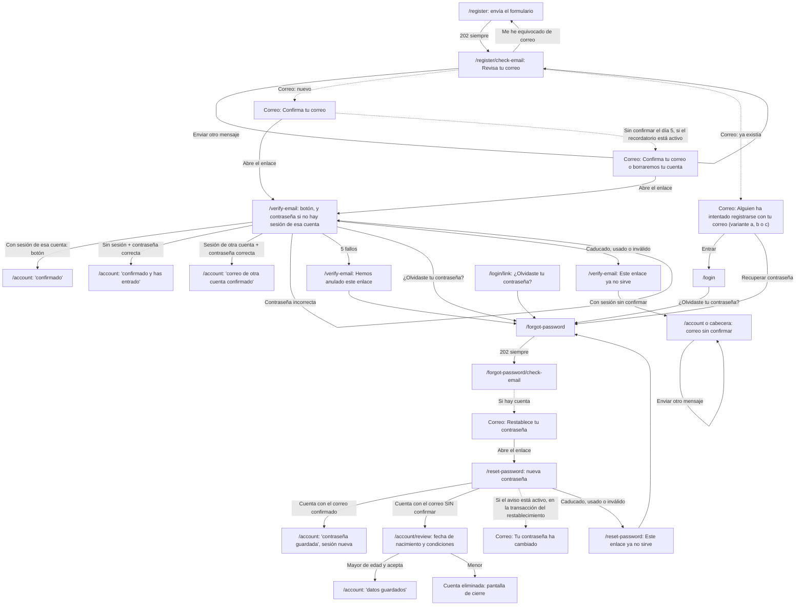

# Verificación de correo, recuperación de contraseña y registro uniforme — Diseño UX

[← Índice](../README.md) · Complementa: [H0 — Diseño UX](h0-diseno-ux.md) y [Entrada con Google y Facebook — Diseño UX](login-terceros-diseno-ux.md) · Parte técnica: [correo-diseno-tecnico.md](correo-diseno-tecnico.md)

Especificación de interfaz y de los cinco correos del hito. Fecha del documento: 14 de noviembre de 2026. Textos en español de España, con tuteo. Todo lo que no se redefine aquí se rige por H0: plantilla de página (H0 §2.1), patrón de formulario y errores (§2.2), control de contraseña (§2.3), accesibilidad (§6), tokens de estilo (§7) y convención de claves (§5); y por el documento de terceros: avisos y errores por `?notice=` / `?error=` (§2.2 y §5.8), `UrlMessage`, panel y campos de `/account`.

**Reparto con el diseño técnico.** El técnico manda en esquema, API, TTL, límites y seguridad; este documento, en pantallas, textos, correos y flujo visible. Las rutas web, los nombres de configuración y los contratos de este documento son los del técnico (§1.3, §5.11, §8.1 y §9.1 de ese documento). **No queda nada pendiente con arquitectura** (§10.1).

**Respuestas del cliente (14-11-2026) incorporadas**: recordatorio antes del borrado (cuarto correo, `EMAIL_UNVERIFIED_REMINDER`) y aviso «Tu contraseña ha cambiado» (quinto, `EMAIL_PASSWORD_CHANGED_NOTICE`), los dos activados por defecto y configurables; recuperar con un correo sin cuenta no envía nada; sin cambio de correo; confirmar no cambia la sesión y restablecer entra con la cuenta del enlace; sin subir la versión de las condiciones; remitente `MAIL_FROM` y buzón de contacto `MAIL_SUPPORT_ADDRESS` configurables (los textos usan el marcador `{soporte}`); **K3** (confirmar el correo sin la sesión de esa cuenta pide la contraseña, §3.2); **opción B** (quien recupera una cuenta que tenía el correo sin confirmar revisa su fecha de nacimiento y vuelve a aceptar las condiciones, §3.10). Ver §10.2.

## 0. Alcance y principios

**Dentro**: pantalla «Revisa tu correo» tras el alta; `/verify-email` (con contraseña si no hay sesión de esa cuenta); `/forgot-password` y su pantalla de «Revisa tu correo»; `/reset-password`; `/account/review` (revisión de datos tras recuperar una cuenta sin confirmar); aviso de correo sin confirmar en `/account` y en la cabecera; enlace «¿Olvidaste tu contraseña?» en `/login` y en `/login/link`; los cinco correos (el de aviso de alta en tres variantes); cambios en textos ya existentes (§7).
**Fuera**: cambiar el correo de una cuenta, cambiar una contraseña que se recuerda (sigue fuera, decisión 21), funciones sociales (solo se deja el aviso), reenvío por otros canales, segundo factor.

**Usuarios y objetivo.**
1. *Persona nueva*: quiere abrir su cuenta sin pasos raros. Acepta confirmar su correo si entiende por qué y qué tiene que hacer.
2. *Persona que olvidó su contraseña o que solo tenía Google/Facebook*: quiere volver a su cuenta (o crearle una contraseña) sin pedir ayuda a nadie.
3. *Persona que ya tenía cuenta y se registra otra vez sin acordarse*: debe acabar sabiendo que ya tenía una y cómo entrar, sin que la pantalla se lo diga a nadie más.
4. *Persona que recibe un correo que no pidió*: debe entender en diez segundos que no tiene que hacer nada, o qué hacer si algo va mal.
5. *Persona cuyo correo usó otra persona para abrir una cuenta*: debe poder quedarse con su correo y su cuenta sin sentirse acusada ni quedar atrapada en pasos que no entiende.

Decisiones del cliente que se aplican (no se reabren): (1) quien no confirmó el correo entra con límites, y mientras tanto ve un aviso persistente con «reenviar»; (2) el alta responde siempre «Revisa tu correo», no abre sesión y no dice si el correo existía; (3) la recuperación por correo sirve también para crear contraseña en cuentas de proveedor, y al cambiarla se cierran las demás sesiones.

Principios (añaden a los de H0):

1. **Una sola respuesta.** Ninguna pantalla, texto, tiempo visible, `?notice=` ni cookie de registro, olvido o reenvío público varía según el correo exista o no. Los textos usan «Si hay una cuenta…» donde no se puede afirmar nada.
2. **Un enlace de correo no cambia nada con solo abrirlo y nunca es un inicio de sesión de un clic.** Los escáneres de enlaces y las vistas previas hacen GET: confirmar y guardar la contraseña son siempre un POST con botón. Confirmar sin la sesión de esa cuenta exige además su contraseña (K3).
3. **El correo dice qué es, qué hacer, cuándo caduca y qué hacer si no fuiste tú**, en ese orden, y no lleva imágenes, rastreadores ni enlaces redirigidos.
4. **Un enlace roto nunca es un callejón.** Todo estado de enlace caducado, usado, anulado o inválido ofrece el siguiente paso concreto.
5. **Ninguna acción por correo cambia en silencio quién eres en este navegador** (§1.5).
6. **Se avisa de lo que cuesta no confirmar**: los límites de la cuenta y el borrado en la fecha que toque, con o sin recordatorio por correo. El aviso en la cuenta es completo por sí solo: el recordatorio es un añadido, no una condición.
7. **Los correos de aviso no son el único camino a nada**: ningún flujo depende de que se envíen o se lean (§5).
8. **Sin acusar.** Cuando una cuenta pudo abrirla otra persona con tu correo, los textos describen lo que ocurre y lo que puedes hacer, no lo que alguien «ha hecho mal» (§3.10).

## 1. Flujos

### 1.1 Mapa



### 1.2 Recorrido A: alta → correo → confirmar

1. En `/register` la persona rellena correo, contraseña, fecha y condiciones y envía. La validación de forma (campos vacíos, formato, menor de edad, casilla) es la de siempre y sale en la misma pantalla.
2. Con datos válidos, 303 a `/register/check-email` (§3.1). **No hay sesión.** Es idéntico exista o no el correo.
3. Cuenta nueva: llega «Confirma tu correo». Correo ya existente: llega «Alguien ha intentado registrarse con tu correo» a su dueño (variante a, b o c, §5.3).
4. La persona abre el enlace de «Confirma tu correo». Aterriza en `/verify-email` (§3.2). **Sin sesión, escribe la contraseña de la cuenta (la que acaba de elegir)** y pulsa «Confirmar mi correo».
5. Éxito: se abre sesión, 303 a `/account` con `notice=email-verified-signin` y el token ya no está en la URL. El aviso de correo sin confirmar desaparece.

Mientras no confirma, **puede entrar** por `/login` con su correo y contraseña (decisión 1) y ve el aviso del §3.7; si entonces abre el enlace en ese mismo navegador, solo pulsa el botón. Si pasa el plazo sin confirmar, ocurre el **recorrido F**.

### 1.3 Recorrido B: olvido → correo → contraseña nueva → sesión

1. En `/login` pulsa «¿Olvidaste tu contraseña?» (o llega desde la pantalla de unión, desde `/verify-email` o desde el correo de aviso). `/forgot-password` (§3.3).
2. Escribe su correo y envía. 303 a `/forgot-password/check-email` (§3.4): «Si hay una cuenta con ese correo, te hemos enviado un enlace.» Igual exista o no. Si no hay cuenta, **no se envía nada** (decidido).
3. Abre el enlace del correo. `/reset-password` (§3.5): escribe una contraseña nueva (mismas reglas que el registro) y pulsa «Guardar contraseña».
4. Éxito: contraseña fijada (creada, si la cuenta solo tenía proveedor), correo confirmado, **todas las demás sesiones cerradas** y sesión nueva abierta. Si el aviso está activado, llega además «Tu contraseña ha cambiado» (§5.5), que se encola en la misma transacción del restablecimiento: llega aunque no se termine la revisión de datos.
   - Cuenta que **ya tenía el correo confirmado**: 303 a `/account?notice=password-reset`.
   - Cuenta que **lo tenía sin confirmar**: 303 a `/account/review?notice=password-reset` (§3.10, opción B del cliente): hasta que no revise su fecha de nacimiento y vuelva a aceptar las condiciones, no puede usar nada más.

### 1.4 Recorrido C: enlace caducado, usado, anulado o inválido

Caducado, usado e inválido son **un solo estado** (la API tiene un único código `TOKEN_INVALID_OR_EXPIRED`, y distinguirlos no ayuda a quien lee). Se ve «Este enlace ya no sirve» (§3.6) con el paso siguiente según el contexto. El enlace **anulado por intentos** (5 contraseñas erróneas en `/verify-email`) tiene su propia pantalla (§3.6).

| Enlace | Contexto | Paso que se ofrece |
|---|---|---|
| Confirmar | Con sesión y correo sin confirmar | Botón «Enviar otro mensaje» |
| Confirmar | Con sesión y correo ya confirmado | «Tu cuenta ya tiene el correo confirmado» y enlace a Tu cuenta |
| Confirmar | Sin sesión | «Entra y pide otro mensaje desde Tu cuenta» (enlaces Entrar y ¿Olvidaste tu contraseña?) |
| Restablecer | Cualquiera | Botón «Pedir un enlace nuevo» a `/forgot-password` |

Un enlace del recordatorio (§5.4) caduca igual: si ya se ha borrado la cuenta, el enlace da este mismo estado; no se distingue.

### 1.5 Recorrido D: con sesión abierta, enlace de otra cuenta

Regla (**aceptada por el cliente**): **confirmar un correo no cambia la sesión de este navegador; restablecer una contraseña sí lo hace, y la pantalla lo avisa antes.** Razón: confirmar es pasivo; restablecer es una acción deliberada de recuperar *esa* cuenta, y la sesión nueva es parte del resultado. Confirmar con la contraseña es lo que impide que un enlace ajeno entre en una cuenta sin que su dueño lo sepa (K3).

| Situación | Qué pide `/verify-email` | Resultado |
|---|---|---|
| Sesión de **esa** cuenta | Solo el botón | `/account?notice=email-verified` |
| Sin sesión | Contraseña de la cuenta + botón | Se abre sesión: `/account?notice=email-verified-signin` |
| Sesión de **otra** cuenta | Contraseña de la cuenta + botón, y una frase que dice que la sesión actual no cambiará | Se confirma esa cuenta, **la sesión no cambia**: `/account?notice=email-verified-other`, sin nombrar el correo |
| Restablecer, con sesión (misma u otra cuenta) | `restablecer.texto.sesion` antes del campo | La sesión del navegador pasa a la cuenta del enlace |

Decide la API, no la web: la consulta de validez devuelve `sessionMatches` (¿la sesión es de esa cuenta?) y `emailHint` (correo ya enmascarado), y confirmar devuelve `session: 'same' | 'opened' | 'kept-other'`. Ninguna pantalla muestra el correo de la otra cuenta, salvo la pista enmascarada que ve quien tiene el enlace.

### 1.6 Recorrido E: ya existía el correo (quien se registra otra vez)

La persona ve exactamente `/register/check-email`. Recibe «Alguien ha intentado registrarse con tu correo» en una de tres variantes (§5.3): cuenta verificada, cuenta **sin confirmar** (no es «tu cuenta»: explica cómo quedarse con el correo o que se borrará) o correo de un **proveedor** unido a una cuenta con otro correo. No se crea nada, no se guarda su contraseña, fecha ni consentimiento.

### 1.7 Recorrido F: cuenta sin confirmar que se acerca al borrado

1. La cuenta con contraseña y correo sin confirmar se borra a los **7 días** de su creación; la fecha (`unverifiedDeletionAt`, escrita como día en Europe/Madrid) se ve en `/account` y en los correos. La cuenta no se borra antes de ese instante; el barrido, que corre cada hora, puede tardar como mucho una hora más.
2. **El 5.º día, si `EMAIL_UNVERIFIED_REMINDER` está activa** (por defecto): llega «Confirma tu correo o borraremos tu cuenta» (§5.4), con un enlace nuevo de confirmación y la fecha de borrado. Al confirmar, la cuenta se conserva.
3. Llegado el plazo sin confirmar, la cuenta y sus datos se borran. Con sesión abierta, la siguiente petición vuelve a `/login` como una sesión caducada (H0 §1.7), sin mensaje especial.
4. **Si el recordatorio está desactivado**: se salta el paso 2. La persona ya ha visto la fecha en `/account` y en el correo 1.

Quien se equivocó al escribir el correo no tiene nada que hacer: se registra de nuevo con el correcto (§3.1) y la cuenta errónea se borra sola. El recordatorio del correo erróneo llega a un tercero, y su texto dice qué hacer en ese caso.

### 1.8 Recorrido G: recuperar una cuenta que otra persona abrió con tu correo

Quien creó la cuenta (el ocupante) no puede confirmarla (no tiene el buzón). La dueña del correo, Ana, tiene tres salidas, todas sin acusar a nadie:
1. **Pulsa el enlace de «Confirma tu correo»**: `/verify-email` le pide la contraseña de la cuenta, que no sabe. Bajo el campo ve «¿Olvidaste tu contraseña?» con la frase que cubre justo este caso (§3.2).
2. **Intenta registrarse**: recibe la variante (b) del aviso, que le explica que hay una cuenta sin confirmar con su correo y cómo quedarse con él.
3. **Pide recuperar la contraseña**: crea una nueva, el correo queda confirmado, las sesiones del ocupante se cierran y entra ella. Como la cuenta no tenía el correo confirmado, pasa por `/account/review` (§3.10): escribe **su** fecha de nacimiento y acepta **ella** las condiciones.

## 2. Estructura común nueva

### 2.1 Rutas web

| Ruta | Método | Uso | Sin sesión | Con sesión |
|---|---|---|---|---|
| `/register` | GET, POST | Existente; el POST válido acaba en 303 a `/register/check-email` | Normal | 303 a `/account` (H0) |
| `/register/check-email` | GET, POST `?/resend` | «Revisa tu correo» tras el alta | Sin cookie de §2.3: 303 a `/register` sin mensaje | 303 a `/account` |
| `/verify-email` | GET (`?token=`), POST `?/confirm` | Confirmar el correo | Normal | Normal |
| `/forgot-password` | GET, POST | Pedir el enlace | Normal | Normal (también sirve para crear contraseña) |
| `/forgot-password/check-email` | GET, POST `?/resend` | «Revisa tu correo» tras pedir el enlace | Sin cookie: 303 a `/forgot-password` sin mensaje | Normal |
| `/reset-password` | GET (`?token=`), POST | Nueva contraseña | Normal | Normal, con aviso (§3.5) |
| `/account/review` | GET, POST, `?/logout` | Revisar fecha de nacimiento y condiciones tras recuperar una cuenta sin confirmar (§3.10) | 303 a `/login?next=/account/review` | Solo si la revisión está pendiente (`locals.user.dataReviewRequired`); si no, 303 a `/account` |
| `/account` | POST `?/resendVerification` | Reenviar desde Tu cuenta | 303 a `/login?next=/account` | Normal |

**El token no va en un campo oculto ni se queda en la URL**: al abrir el enlace, la web guarda el token en una cookie `httpOnly` de su ruta (`cupidilla_email_token`, 60 min) y hace un 303 a la misma página **sin consulta, antes de pintar nada**. El formulario no lleva el token. Para la persona no cambia nada, salvo que recargar la página no pierde el enlace y el token no queda ni en el historial. Tras un POST con efecto, siempre 303. Las páginas con token (`/verify-email`, `/reset-password`) y las de «Revisa tu correo» llevan `Cache-Control: no-store`; las dos con token, además `Referrer-Policy: no-referrer` y `X-Robots-Tag: noindex`. `/account/review` lleva `no-store`.

### 2.2 Avisos y errores en la URL

Misma mecánica que login-terceros §2.2 (listas cerradas, valor fuera de lista no muestra nada, `UrlMessage`). Valores nuevos en §6.10. Los avisos de éxito usan `role="status"` y borde verde; los errores, `role="alert"` y foco con JavaScript.

### 2.3 Cookie «correo pendiente»

Para mostrar «Te hemos enviado un mensaje a {correo}» tras un 303 sin poner el correo en la URL, y para que «Enviar otro mensaje» funcione sin pedirlo otra vez, el servidor web guarda `cupidilla_pending_email` (`httpOnly`, `SameSite=Lax`, `Secure` fuera de desarrollo, `path=/`, 1 h, con el **propósito** `signup` o `reset` y el correo escrito). Se pone igual exista o no la cuenta y se borra al entrar, al confirmar con sesión abierta y al restablecer. La API no la ve.

## 3. Pantallas

### 3.1 `/register/check-email`: «Revisa tu correo» tras el alta

```
<h1> Revisa tu correo
<p>  Te hemos enviado un mensaje a persona@ejemplo.com.
<p>  Ábrelo y sigue las instrucciones. Si es la primera vez que usas ese correo en
     Cupidilla, tendrás que pulsar el enlace del mensaje para confirmarlo.
[aviso de reenvío o error]
<h2> ¿No te llega?
<p>  Puede tardar unos minutos. Mira también en la carpeta de correo no deseado.
     Comprueba que has escrito bien tu correo: persona@ejemplo.com.
[ Enviar otro mensaje ]                 (formulario POST)
Me he equivocado de correo               (enlace a /register)
¿Ya has confirmado tu correo? Entra      (enlace a /login)
```

- Es una página de **resultado**, no un formulario: sin `autofocus`; con JavaScript, al llegar el foco va al `<h1>` (`tabindex="-1"`) para que el lector de pantalla lo lea.
- El correo escrito se muestra con `overflow-wrap: anywhere` y en texto, no en `<input>`.
- **«Enviar otro mensaje»**: `<button type="submit">` en `<form method="POST" action="?/resend">`. Con JavaScript (`use:enhance`) pasa a «Enviando…», `aria-disabled`, segundo clic ignorado, región de estado `correo.estado.reenviando`. Resultado: 303 a la misma página con `?notice=resent` → `revisar.aviso.reenviado` (`role="status"`, primero en `<main>`).
- Respuesta **uniforme**: reenviar nunca dice si había algo que reenviar.
- **Por qué los dos textos son distintos y los dos son verdad.** «Te hemos enviado un mensaje a {correo}» (primer envío) es cierto siempre: un alta válida encola un correo, de confirmación si el correo es nuevo o de aviso si ya existía. El aviso del **reenvío** público es condicional («Si hay una cuenta con {correo}, te hemos enviado otro mensaje») porque con un correo sin cuenta, o ya confirmado, no se envía nada y la pantalla no puede afirmarlo.
- **Límite de reenvíos** (por IP y por correo; el mismo contador exista o no la cuenta): 5 cada 24 h por correo. No hay un límite de «uno por minuto» ni cuenta atrás en pantalla (WCAG 2.2.1): las ráfagas ya las corta la API. Al pasarse: `?error=rate-limited` → `comun.error.limite`.
- **Errata en el correo.** «Me he equivocado de correo» lleva a `/register`: se crea otra cuenta con el correo bueno y la errónea se borra sola (§1.7). No hay «cambiar correo» (decidido).

| Estado | Comportamiento |
|---|---|
| Inicial | Como arriba |
| Enviando (JS) | «Enviando…», `aria-disabled`, anuncio |
| Reenviado | Aviso `revisar.aviso.reenviado`, `role="status"` |
| Límite | `comun.error.limite`, `role="alert"`, foco con JS |
| Error del servidor | `correo.error.servidor` |
| Sin cookie (caducada, otra pestaña, «atrás» tras confirmar) | 303 a `/register`, sin mensaje |
| Sin JavaScript | Formularios POST + 303; aviso primero en `<main>` |

### 3.2 `/verify-email`: confirmar el correo (botón, y contraseña si no hay sesión de esa cuenta)

**Qué pide depende de `sessionMatches`** (consulta de validez, que no consume el token; la web llama a la API con la sesión si la hay):

*Variante 1: hay sesión de esa misma cuenta.*

```
<h1> Confirma tu correo
<p>  Pulsa el botón para confirmar que este correo es tuyo.
[ Confirmar mi correo ]
```

*Variante 2: no hay sesión, o es de otra cuenta.*

```
<h1> Confirma tu correo
<p>  Pulsa el botón para confirmar que este correo es tuyo.
[solo con sesión de otra cuenta, aviso informativo]
     Ahora mismo estás dentro con otra cuenta. No la cambiaremos.
<p>  Para confirmar que esta cuenta es tuya, escribe su contraseña.
<dl> Cuenta     p•••@ejemplo.com
[resumen de errores]
Contraseña   [ ________ ] [Mostrar contraseña]
  Es la que elegiste al crear la cuenta.
¿Olvidaste tu contraseña?            (enlace a /forgot-password)
  Si no la recuerdas, o si no creaste tú esta cuenta, puedes recuperarla con tu correo:
  al crear una contraseña nueva, también quedará confirmado.
[ Confirmar mi correo ]
```

- **GET nunca consume el token.** La página solo se pinta; no hay efecto ni redirección automática (tampoco con `<meta refresh>` ni JavaScript al cargar). El token vive en la cookie de §2.1.
- **Por qué la contraseña** (K3): sin ella, el enlace sería un inicio de sesión de un clic. Un atacante podría mandar a otra persona el enlace de *su* cuenta, y la víctima de una ocupación podría confirmar sin querer la cuenta que creó el ocupante.
- Control de contraseña de H0 §2.3: `type="password"`, `name="password"`, `autocomplete="current-password"`, `autocapitalize="none"`, `spellcheck="false"`, «Mostrar contraseña» solo con JavaScript. El campo nunca reaparece relleno.
- **Cuenta** muestra la pista que da la API (`emailHint`, ya enmascarada, p. ej. `a•••@ejemplo.com`), **tal cual, sin recomponerla**, para que quien tiene varias cuentas sepa cuál es. Es un `<dl>`, no un campo. La pista lleva `translate="no"`. Los lectores de pantalla pueden leer los puntos de forma desigual: la etiqueta «Cuenta» y el hecho de que es solo una ayuda lo hacen aceptable, y nada depende de que se lea.
- **«¿Olvidaste tu contraseña?»** va **entre el campo y el botón**, en el DOM y en pantalla (como en `/login`). Lleva a `/forgot-password` en la misma pestaña; el token queda en su cookie (60 min) y no se destruye. La frase de debajo cubre los dos casos: contraseña olvidada y cuenta abierta por otra persona, sin acusar.
- **Contraseña incorrecta sin revelar nada.** Texto único `confirmar.error.contrasena`, el mismo para cualquier fallo de contraseña (incluida la carrera en la que la contraseña cambia entre medias). No dice cuántos intentos quedan, ni si la cuenta tiene contraseña, ni da ninguna pista distinta de la ya visible (`emailHint`, que solo ve quien tiene el enlace). Se muestra en campo y resumen, el campo queda vacío, el token sigue valiendo.
- **A los 5 fallos** el enlace se anula: 303 a `/verify-email?error=attempts-exceeded` → pantalla «Hemos anulado este enlace» (§3.6). Salida: recuperar la contraseña.
- Un solo botón principal, sin «Cancelar» (no hay nada que cancelar; cerrar la pestaña basta).
- Con JavaScript (`use:enhance`): «Confirmando…», `aria-disabled`, anuncio `confirmar.estado.enviando`. Sin JavaScript: POST + 303.
- Éxito: según `session` de la respuesta (§1.5). `same` → `/account?notice=email-verified`; `opened` → cookie de sesión y `/account?notice=email-verified-signin`; `kept-other` → `/account?notice=email-verified-other`. Foco con JS al aviso (patrón `UrlMessage`).
- Enlace inválido: la consulta de validez responde antes de pintar y se muestra §3.6 (410). Tras un POST rechazado: 303 a `/verify-email?error=token-invalid`.
- `<title>`: «Confirma tu correo — Cupidilla»; con error, «Error: …».
- Orden de tabulación (variante 2): saltar → cabecera → contraseña → «Mostrar contraseña» (JS) → ¿Olvidaste tu contraseña? → Confirmar mi correo → pie. En la variante 1: saltar → cabecera → Confirmar mi correo → pie.

| Estado | Comportamiento |
|---|---|
| Inicial, sesión de esa cuenta | Solo el botón |
| Inicial, sin sesión | Contraseña, enlace de olvido y botón |
| Inicial, sesión de otra cuenta | Igual, más `confirmar.texto.sesion_otra` |
| Enviando (JS) | «Confirmando…» |
| Contraseña vacía | `confirmar.error.contrasena_vacia` en campo y resumen |
| Contraseña incorrecta | `confirmar.error.contrasena`, campo vacío, token vivo |
| 5 fallos | Pantalla de §3.6 «Hemos anulado este enlace» |
| Token caducado, usado o inválido | §3.6 «Este enlace ya no sirve» |
| Límite | `comun.error.limite`, se queda en la pantalla con el token intacto |
| Error del servidor (5xx sin efecto) | `confirmar.error.servidor`, el botón sigue y el token vale |
| Resultado incierto (503) | `confirmar.error.resultado_incierto` y enlace `confirmar.enlace.comprobar` a `/account` |
| Éxito | 303 a `/account` con aviso |

### 3.3 `/forgot-password`: pedir el enlace

```
<h1> Recupera tu contraseña
<p>  Escribe el correo de tu cuenta y te enviaremos un enlace para crear una contraseña nueva.
     También sirve si tu cuenta solo entra con Google o Facebook y quieres añadirle una contraseña.
[resumen de errores]
Correo electrónico   [ ______ ]
[ Enviar enlace ]
Volver a entrar      (enlace a /login)
```

- Patrón de H0 (§2.2, `EmailField`, `ErrorSummary`, `SubmitButton`). `autocomplete="email"`, `inputmode="email"`, sin `autofocus`.
- Errores de campo: `registro.error.correo_vacio`, `registro.error.correo_formato`, `registro.error.correo_largo` (los mismos que el alta). **Un correo con formato válido siempre da éxito**; no existe «no hemos encontrado ese correo».
- Éxito (siempre): 303 a `/forgot-password/check-email` (§3.4).
- Límite (IP o correo, 5 cada 24 h por correo): `comun.error.limite`, valores conservados.
- Error del servidor: `olvido.error.servidor`, valor conservado.
- Los formularios del hito solo ofrecen «Mostrar contraseña» donde se escribe una contraseña (`/verify-email` sin sesión y `/reset-password`).

| Estado | Comportamiento |
|---|---|
| Inicial | Vacío (con sesión: vacío también; no se rellena con el correo de la sesión) |
| Enviando (JS) | «Enviando…», `aria-disabled`, anuncio |
| Error de campo | Resumen + error en campo, valor conservado |
| Límite / servidor | Bloque general, valor conservado |
| Éxito | 303 a la pantalla de «Revisa tu correo» |

### 3.4 `/forgot-password/check-email`: «Revisa tu correo» tras pedir el enlace

```
<h1> Revisa tu correo
<p>  Si hay una cuenta con persona@ejemplo.com, te hemos enviado un enlace para crear una
     contraseña nueva. Caduca en 1 hora y solo sirve una vez.
[aviso de reenvío o error]
<h2> ¿No te llega?
<p>  Puede tardar unos minutos. Mira también en la carpeta de correo no deseado. Si no llega,
     comprueba que has escrito bien tu correo o prueba con otro que uses.
[ Enviar otro enlace ]
Usar otro correo        (enlace a /forgot-password)
```

Mismo comportamiento que §3.1 (cookie, foco, reenvío con `?notice=resent`, límite). «Enviar otro enlace» vuelve a pedir la recuperación (la API no distingue). El texto es siempre condicional («Si hay una cuenta…»): si no la hay, no se envía nada (decidido), y la pantalla es idéntica. El enlace anterior deja de funcionar al pedir otro (un solo token vivo): lo dice `olvido.revisar.aviso_reenviado`.

### 3.5 `/reset-password`: contraseña nueva

```
<h1> Crea tu contraseña nueva
<p>  Elige una contraseña nueva para tu cuenta. Al guardarla cerraremos las demás sesiones
     de tu cuenta y entrarás con esta.
<dl> Cuenta     p•••@ejemplo.com
[solo con sesión abierta, aviso informativo]
     Ahora mismo tienes una sesión abierta en este navegador. Al terminar, entrarás con la
     cuenta de este enlace.
[resumen de errores]
Contraseña nueva   [ ________ ] [Mostrar contraseña]
  Mínimo 10 caracteres, sin más reglas: una frase larga vale. Si la olvidas, podrás crear otra desde tu correo.
[ Guardar contraseña ]
```

- Control de H0 §2.3: `type="password"`, `name="password"`, `autocomplete="new-password"`, `autocapitalize="none"`, `spellcheck="false"`, 10 a 128 caracteres, **sin segundo campo**, se permite pegar, «Mostrar contraseña» solo con JavaScript. Errores: `registro.error.contrasena_vacia`, `.contrasena_corta`, `.contrasena_larga` (campo y resumen; el campo nunca reaparece relleno).
- **Cuenta** muestra la pista enmascarada de la API (`emailHint`), tal cual y con `translate="no"`, como en §3.2. Ayuda a quien tiene varias cuentas; no revela nada a quien no tenga el enlace.
- El aviso de sesión abierta (`restablecer.texto.sesion`) va **antes del campo**, `role` no alert, borde neutro con icono ℹ, y se asocia al campo con `aria-describedby`.
- El token vive en la cookie de §2.1; el formulario no lo lleva. La comprobación de validez al cargar evita que la persona teclee una contraseña para un enlace que ya no sirve.
- Éxito: contraseña fijada, sesión nueva. 303 a `/account?notice=password-reset`, **o a `/account/review?notice=password-reset` si la cuenta tenía el correo sin confirmar** (§3.10). Un solo envío: segundo clic ignorado.

| Estado | Comportamiento |
|---|---|
| Inicial | Campo vacío, sin `autofocus` |
| Enviando (JS) | «Guardando…», `aria-disabled`, anuncio `restablecer.estado.enviando` |
| Contraseña vacía, corta o larga | Error de campo y resumen; el token sigue valiendo |
| Límite | `comun.error.limite` |
| Token caducado, usado o inválido | §3.6 (303 a `/reset-password?error=token-invalid`) |
| Error del servidor | `restablecer.error.servidor`, campo vacío, el token sigue valiendo |
| Resultado incierto (503) | `restablecer.error.resultado_incierto` y enlace a `/login` |
| Éxito, correo ya confirmado | 303 a `/account` con aviso |
| Éxito, correo sin confirmar | 303 a `/account/review` con aviso |

### 3.6 Enlaces que no sirven: «Este enlace ya no sirve» y «Hemos anulado este enlace»

**Este enlace ya no sirve** (`/verify-email` y `/reset-password`):

```
<h1> Este enlace ya no sirve
<p>  Ha caducado, ya se usó o no está completo. Los enlaces de los correos solo sirven una vez y
     durante un tiempo limitado.
[paso siguiente, según §1.4]
```

- Se llega: (a) directo, si la consulta previa lo detecta (la API responde 400 `TOKEN_INVALID_OR_EXPIRED`) o falta el token; (b) por 303 a `…?error=token-invalid` tras un POST rechazado. **Misma pantalla**; HTTP 410 si se detecta al cargar, 200 tras el 303.
- No es un bloque `role="alert"` dentro de otra pantalla: **la pantalla es el estado**. `<title>` «Error: Este enlace ya no sirve — Cupidilla»; con JavaScript el foco va al `<h1>` (`tabindex="-1"`). Sin formulario del enlace.
- No se dice *por qué* falló.
- Pasos según contexto (§1.4): `enlace.verificar.sesion_sin_confirmar` + botón «Enviar otro mensaje» (POST a `/account?/resendVerification`, vuelve a `/account` con el aviso); `enlace.verificar.sesion_confirmado` + enlace «Ir a mi cuenta»; `enlace.verificar.sin_sesion` + enlaces «Entrar» (a `/login?next=/account`) y «¿Olvidaste tu contraseña?»; `enlace.restablecer.siguiente` + botón «Pedir un enlace nuevo» (a `/forgot-password`).

**Hemos anulado este enlace** (`/verify-email?error=attempts-exceeded`, tras 5 contraseñas erróneas):

```
<h1> Hemos anulado este enlace
<p>  Has fallado la contraseña varias veces y, por seguridad, este enlace ya no se puede usar.
<p>  Para confirmar tu correo, crea una contraseña nueva con tu correo.
[ Recuperar mi cuenta ]        (enlace a /forgot-password)
```

Misma regla de pantalla-estado (`<title>` con «Error: », foco al `<h1>`). No es acusatoria: el motivo es de seguridad, no de la persona. Con sesión de esa cuenta no ocurre (no se pide contraseña).

### 3.7 Aviso de correo sin confirmar: cabecera privada y `/account`

**Banda en la cabecera** (todas las páginas con sesión y correo sin confirmar, salvo `/account`, `/account/review` y `/verify-email`):

```
┌ región, borde neutro, fondo --color-superficie ──────────────────────────────┐
│ ℹ Tu correo aún no está confirmado.  Confirmarlo                            │
└──────────────────────────────────────────────────────────────────────────────┘
```

- Es un `<div role="region" aria-label="Aviso sobre tu correo">` **debajo de la cabecera y antes de `<main>`**, no un `role="alert"` ni una región viva: es persistente y no se anuncia en cada navegación. No se puede descartar (decisión 1: aviso persistente).
- «Confirmarlo» es un enlace a `/account#correo` (no un botón de reenvío: mantiene la banda en una línea y la acción real vive en un sitio). Texto + icono ℹ, nunca solo color. Móvil: una o dos líneas, sin tapar contenido ni quedar fijo (no `position: fixed`).
- Datos: `locals.user.emailVerified`, que la web ya guarda y pasa desde `+layout.server.ts`.

**Sección en `/account`** (primera tras el aviso/errores de la URL, antes de «Tus datos», solo si el correo no está confirmado):

```
<section id="correo" aria-labelledby="correo-titulo">
<h2 id="correo-titulo"> Confirma tu correo
<p>  Te enviamos un mensaje a persona@ejemplo.com. Ábrelo y pulsa el enlace para confirmar que es tuyo.
<p>  Mientras no lo confirmes puedes ver y gestionar tu cuenta, pero no podrás usar las funciones
     para conocer gente cuando estén disponibles, ni añadir Google o Facebook.
<p small> El enlace caduca en 24 horas y solo sirve una vez. Si pides otro mensaje, el anterior deja de funcionar.
<p small> Si no lo confirmas antes del 21 de noviembre de 2026, borraremos la cuenta.
<p small> [solo si el recordatorio está activado] Antes de borrarla te lo recordaremos por correo.
[ Enviar otro mensaje ]
</section>
```

- **Con o sin recordatorio, el aviso es completo.** `correo.texto.plazo` (la fecha de borrado, `unverifiedDeletionAt` escrita como día en Europe/Madrid con `formatSpanishDate`) se muestra siempre; `correo.texto.recordatorio` solo si `locals.mail.unverifiedReminder` es verdadero. Sin él, la persona sabe igual que la cuenta se borra y cuándo, y que debe confirmar ella. Ningún texto promete un recordatorio que no existe.
- «Tus datos» pasa a mostrar junto al correo su estado como **texto** («Confirmado» / «Sin confirmar»), no solo color.
- «Enviar otro mensaje»: `<button type="submit">` en formulario POST (`?/resendVerification`). Si `emailVerified` ya es verdadero al cargar la acción, la web no llama a la API y responde `?notice=verification-already`. Resultado (303 a `/account`): `?notice=verification-sent` → `correo.aviso.reenviado`; `?notice=verification-already` → `correo.aviso.ya_confirmado`; `?error=rate-limited` → `comun.error.limite`; `?error=verification-failed` → `correo.error.servidor`.
- Con JavaScript, «Enviando…» y `aria-disabled` como en el resto.
- Con el correo ya confirmado: ni banda ni sección.
- La sección y la banda las genera el estado **del servidor en cada carga**; tras confirmar en otra pestaña basta recargar.
- **No hay «cambiar el correo»** (decidido). Quien se equivocó al escribirlo en el alta vuelve a registrarse con el correo bueno desde `/register/check-email` (§3.1); la cuenta con el correo erróneo no confirmado se borra sola (§1.7).
- **«Formas de entrar» con el correo sin confirmar (K7).** Añadir un proveedor exige el correo confirmado. Para no ofrecer un botón que fallará, en la fila de cada proveedor no unido **no se dibuja el botón de marca ni el panel de confirmar**: en su lugar va el texto `cuenta.acceso.requiere_correo`, con enlace a `#correo`. Quitar o gestionar lo ya unido no cambia (una cuenta sin confirmar tiene contraseña y ningún proveedor). Si por una carrera (otra pestaña, sesión antigua) la API responde 403 `EMAIL_NOT_VERIFIED`, se vuelve a `/account?error=email-not-verified&provider=…` con `cuenta.error.correo_no_confirmado`.

### 3.8 Enlace «¿Olvidaste tu contraseña?» en `/login`

```
Contraseña   [ ________ ] [Mostrar contraseña]
¿Olvidaste tu contraseña?          (enlace a /forgot-password)
[ Entrar ]
```

- Va **entre el campo de contraseña y el botón** (en el DOM y en pantalla, sin reordenar visualmente). Orden de tabulación: botones de proveedor → correo → contraseña → «Mostrar contraseña» (JS) → ¿Olvidaste tu contraseña? → Entrar → «¿No tienes cuenta?».
- Es un enlace (`<a>`), siempre visible, no solo tras un error. Con `next` en la URL de login, el enlace no lo arrastra (tras restablecer se va a `/account`).
- `entrar.error.credenciales` y `entrar.ayuda.proveedor` no cambian. `entrar.ayuda.proveedor` («Si creaste tu cuenta con Google o Facebook, usa esos botones») sigue siendo cierto, y ahora quien solo tiene proveedor puede además crear contraseña desde `/forgot-password`.

### 3.9 Pantalla de unión (`/login/link`)

Sustituye a `union.ayuda.olvido` (D1 queda **cerrado**: ya no es un riesgo aceptado).

```
[solo si la cuenta tiene el correo sin confirmar]
  El correo de esa cuenta todavía no estaba confirmado. Si no recuerdas su contraseña o no la
  creaste tú, crea una nueva con tu correo: así la cuenta será tuya.
Contraseña   [ ________ ] [Mostrar contraseña]
  Es la que elegiste al crear tu cuenta. Solo te la pedimos esta vez.
¿Olvidaste tu contraseña?                   (enlace a /forgot-password)
  Si la recuperas, entrarás en tu cuenta y podrás añadir Google desde Tu cuenta.
[ Unir cuentas ]
Cancelar
```

- El enlace sale de la pantalla en la misma pestaña. El estado pendiente de la unión no se destruye al salir, pero ya no será utilizable: con sesión, `/login/link` redirige a `/account` (login-terceros §2.1). La frase `union.ayuda.olvido_destino` lo anticipa; no hace falta más aviso.
- **Cuenta sin confirmar** (la API devuelve `accountEmailVerified: false`): se añade el párrafo `union.texto.sin_confirmar` **antes del campo**, informativo (`role` no alert, icono ℹ), sin acusar y asociado al campo con `aria-describedby`. Si la persona completa la unión con la contraseña correcta, el correo queda confirmado (API).
- Orden de tabulación: … contraseña → mostrar → ¿Olvidaste tu contraseña? → Unir cuentas → Cancelar → pie.
- Los textos de `/account/password` y `registro.ayuda.contrasena` que decían «de momento no podemos recuperarla» cambian (§7).

### 3.10 `/account/review`: revisar fecha de nacimiento y condiciones (opción B)

**Cuándo.** Solo tras restablecer la contraseña de una cuenta que **tenía el correo sin confirmar**. Por qué: esa cuenta pudo abrirla otra persona con ese correo, y la fecha de nacimiento y la aceptación de condiciones guardadas pudieron ser de esa otra persona. Quien recupera la cuenta tiene que dar **sus** datos y aceptar **ella** las condiciones. La API lo marca con `users.data_review_required_at` (solo el restablecimiento lo pone; confirmar con contraseña y la unión no) y la web lo ve como `locals.user.dataReviewRequired`.

**Mientras esté pendiente, no se puede usar nada más.** La web redirige (303) a `/account/review` cualquier ruta privada, salvo `/account/review`, `/account/delete`, `/legal/terms`, `/verify-email`, `/forgot-password` y `/reset-password`. La API lo refuerza: toda ruta sin excepción responde 403 `DATA_REVIEW_REQUIRED` (solo escapan la sesión, el cierre de sesión, `GET /users/me`, la propia revisión y el borrado de la cuenta). Si una petición en vuelo recibe ese 403, la web hace 303 a `/account/review` sin mensaje de error. La pantalla no se puede saltar ni posponer: se puede salir cerrando sesión y se pedirá otra vez al entrar.

```
<h1> Revisa tus datos
[aviso de URL: contraseña guardada]
<p>  Antes de seguir, necesitamos que escribas tu fecha de nacimiento y que aceptes las condiciones de uso.
<p>  Lo pedimos siempre que se recupera una cuenta cuyo correo no se había confirmado: así nos aseguramos
     de que estos datos son tuyos. No hace falta nada más.
[resumen de errores]
<fieldset><legend> Fecha de nacimiento ...  Día [__] Mes [__] Año [____]
[ ] Acepto las condiciones de uso de Cupidilla (versión {version}).   [Leer las condiciones]
[ Guardar y continuar ]
<p small> Si prefieres hacerlo más tarde, puedes cerrar sesión. Cuando vuelvas a entrar, te lo pediremos otra vez.
(formulario aparte)  [ Cerrar sesión ]
Eliminar mi cuenta       (enlace a /account/delete)
```

- **La fecha sale vacía y la web no la pide a la API ni la pinta**: la guardada puede ser de otra persona, y verla no ayuda a nadie. El fieldset y la casilla de condiciones son exactamente los de H0 §3.2 (tres campos numéricos, mismos `autocomplete`, casilla desmarcada, enlace a condiciones fuera de la etiqueta y en pestaña nueva), con los textos `registro.*`. La persona puede escribir la misma fecha que había o otra.
- **Sin acusar**: el motivo (`revision.texto.motivo`) describe una regla que se aplica siempre, no un hecho que haya ocurrido. No menciona «otra persona», «ocupante» ni «suplantación».
- «Cerrar sesión» está en **su propio formulario** (acción `?/logout` de esta ruta) y después del principal en el DOM: Intro en un campo envía los datos, nunca cierra sesión. Reutiliza `cuenta.sesion.boton`. «Eliminar mi cuenta» es un enlace a `/account/delete` (`cuenta.eliminar.enlace`): quien no quiere la cuenta puede borrarla sin completar la revisión.
- Validación en el orden de H0 §1.2: forma de los campos → **menor** (pantalla inmediata) → versión de las condiciones → casilla de condiciones.
- **Menor de edad** (422 `UNDERAGE`): la API **elimina la cuenta** (como en el alta, decidido), la web borra la cookie de sesión y pinta la pantalla de cierre sin ningún valor escrito (H0 §3.2.2 adaptada): sin formulario ni enlace para corregir, único botón «Volver al inicio», `role="alert"`, `<title>` «No podemos mantener tu cuenta — Cupidilla».

```
<h1> No podemos mantener tu cuenta
<p>  Cupidilla es solo para personas de 18 años o más, así que hemos eliminado esta cuenta y los datos que tenía.
<p>  No es nada personal: es una condición del servicio.
[ Volver al inicio ]
```

- Éxito (`204`): 303 a `/account?notice=details-reviewed` → `revision.aviso.hecha`. Se guarda la fecha nueva y un consentimiento nuevo con la versión vigente (`2026-11-borrador-2`); el anterior queda como histórico.
- Sin la revisión pendiente: `GET` redirige a `/account` sin mensaje (y la API responde 404 a quien envíe la revisión sin tenerla pendiente). Sin sesión: `/login?next=/account/review`. `Cache-Control: no-store`.
- La banda de correo no aparece (la cuenta ya está confirmada tras restablecer).
- Orden de tabulación: saltar → cabecera → (resumen) → día → mes → año → casilla → enlace a condiciones → Guardar y continuar → Cerrar sesión → Eliminar mi cuenta → pie.

| Estado | Comportamiento |
|---|---|
| Inicial | Vacío, casilla desmarcada, aviso de contraseña guardada arriba. Sin `autofocus` |
| Enviando (JS) | «Guardando…», `aria-disabled`, anuncio `revision.estado.enviando` |
| Error de validación | Resumen y errores por campo como H0; se conservan día, mes, año y casilla |
| Menor | Pantalla de cierre; cuenta eliminada y sesión cerrada |
| Condiciones de otra versión (409) | `registro.error.condiciones_version` en el campo de condiciones |
| Límite | `comun.error.limite`, valores conservados |
| Error del servidor | `revision.error.servidor`, valores conservados |
| Resultado incierto (503) | `revision.error.resultado_incierto`; recargar la página dice si se guardó (si ya no pide los datos, está hecho) |
| Cualquier otra ruta privada con la revisión pendiente | 303 a `/account/review` |
| Éxito | 303 a `/account` con aviso |

## 4. Estados: resumen transversal

| Pantalla | Inicial | Enviando | Error por campo | Error general | Éxito |
|---|---|---|---|---|---|
| `/register/check-email` | resultado | «Enviando…» | n/a | límite, servidor | aviso de reenvío |
| `/verify-email` | botón, con o sin contraseña | «Confirmando…» | contraseña vacía o incorrecta | enlace no sirve, enlace anulado, límite, servidor, incierto | `/account` con aviso |
| `/forgot-password` | vacío | «Enviando…» | correo | límite, servidor | `/forgot-password/check-email` |
| `/forgot-password/check-email` | resultado | «Enviando…» | n/a | límite, servidor | aviso de reenvío |
| `/reset-password` | campo vacío | «Guardando…» | contraseña | enlace no sirve, límite, servidor, incierto | `/account` o `/account/review` |
| `/account/review` | fecha y condiciones | «Guardando…» | fecha, condiciones | menor, límite, servidor, incierto | `/account` con aviso |
| `/account` (sección correo) | sección y banda | «Enviando…» | n/a | límite, servidor | aviso |

Casos límite: correo de 254 caracteres (se parte); zoom 200 % y 320 px; sin JavaScript; doble envío; «atrás» tras confirmar o tras restablecer (el token ya no sirve y la pantalla muestra §3.6); dos pestañas con el mismo enlace (la segunda recibe §3.6); enlace abierto en otro navegador o dispositivo (funciona: el enlace no depende de la sesión, pero pedirá la contraseña); varios reenvíos seguidos (solo el último vale); escáner de enlaces del correo que hace GET (solo consigue una cookie en su propio navegador; no consume nada); recordatorio recibido tras haber confirmado en otra pestaña (el enlace da §3.6 y, con sesión confirmada, el paso de «ya confirmado»); recordatorio y cambio de contraseña con configuración desactivada (no se envían ni se mencionan); cerrar sesión en `/account/review` y volver a entrar (vuelve a pedirse); enlaces a las condiciones desde `/account/review` (se abren porque `/legal/terms` está exenta de la redirección).

## 5. Correos

Remitente: el de `MAIL_FROM`. Buzón de soporte: `MAIL_SUPPORT_ADDRESS`, que los textos nombran con el marcador `{soporte}`. **Los dos son configurables**; los textos de este documento y de la interfaz nunca llevan el valor fijo (por defecto, «Cupidilla &lt;no-reply@example.com&gt;» y `soporte@example.com`; en producción, valores reales). Idioma `es`, tuteo, sin emojis. Los cinco: texto plano **y** HTML (multipart/alternative), mismas palabras.

**Qué correos son opcionales.** Los tres primeros (confirmar, restablecer, aviso de alta con correo existente) son parte del flujo y no se desactivan. El cuarto (recordatorio, `EMAIL_UNVERIFIED_REMINDER`) y el quinto (contraseña cambiada, `EMAIL_PASSWORD_CHANGED_NOTICE`) llevan un interruptor, **activados por defecto**. Con un interruptor apagado el correo no se envía y la interfaz no lo menciona (§3.7, §6.9). Ningún flujo depende de ellos.

**Fechas.** `{fecha}` es `unverifiedDeletionAt` (creación de la cuenta más 7 días) escrito como el **día en Europe/Madrid** con `formatSpanishDate`, en español («18 de noviembre de 2026»); la API (correos 1 y 4, variante b) y la web (`/account`) usan la misma función, así que siempre coinciden. Los plazos (`24 horas`, `1 hora`) salen de las constantes de la API, nunca se escriben a mano.

**Reglas comunes (los cinco):**
- **Sin rastreadores**: ni píxeles, ni imágenes, ni fuentes remotas, ni acortadores ni enlaces redirigidos o con parámetros de campaña. Los enlaces apuntan directos a `PUBLIC_WEB_URL`.
- Asunto sin nombre de la persona ni del correo. Cuerpo sin la contraseña ni datos de la cuenta, salvo el correo destinatario en la frase del motivo.
- El enlace de acción (correos 1, 2 y 4) va **dos veces** en el HTML: botón (un `<a>` con fondo `#6b2d5c`, texto `#ffffff`, relleno de 12×20 px; contraste 10,4:1) y la URL completa en texto visible debajo, por si el cliente de correo no pinta el botón. En texto plano, la URL sola en su línea, sin paréntesis ni puntuación pegada.
- Una columna de 600 px como máximo, tamaño 16 px, texto `#1e1b1d` sobre blanco, `lang="es"`, `<title>` = asunto, estilos en línea, jerarquía con `<h1>` y `<p>` (sin tablas de maquetación anidadas; una tabla de una celda para centrar, con `role="presentation"`).
- Pie fijo, igual en los cinco: «Cupidilla. Este mensaje es automático; no hace falta que lo respondas. Si necesitas ayuda, escribe a {soporte}.» La dirección va como texto visible (los clientes de correo la enlazan solos).
- Nunca se pide la contraseña ni se enlaza a otra cosa que `/verify-email`, `/reset-password`, `/login`, `/forgot-password` y el buzón `{soporte}`.
- Cada correo dice qué hacer si no fuiste tú; los de aviso (3 y 5) además ofrecen `{soporte}` en el cuerpo.
- Los textos de los correos viven en la API, que es quien envía, no en `texts.ts`.

**Esqueleto HTML común** (el contenido cambia por correo; nada más):

```html
<!doctype html>
<html lang="es">
<head><meta charset="utf-8"><meta name="viewport" content="width=device-width, initial-scale=1">
<title>{asunto}</title></head>
<body style="margin:0;background:#f7f4f2;color:#1e1b1d;font:16px/1.5 Arial,Helvetica,sans-serif">
  <table role="presentation" width="100%"><tr><td align="center" style="padding:24px 12px">
    <div style="max-width:600px;background:#fff;padding:24px;text-align:left">
      <p style="margin:0 0 16px;font-weight:bold;color:#6b2d5c">Cupidilla</p>
      <h1 style="margin:0 0 16px;font-size:22px">{titular}</h1>
      <p>{motivo}</p>
      <!-- solo en 1, 2 y 4 -->
      <p><a href="{enlace}" style="display:inline-block;background:#6b2d5c;color:#fff;
         padding:12px 20px;text-decoration:none;font-weight:bold">{texto del botón}</a></p>
      <p style="font-size:14px">Si el botón no funciona, copia esta dirección en tu navegador:<br>
         <span style="word-break:break-all">{enlace}</span></p>
      <p>{caducidad}</p>
      <p><strong>{qué hacer si no fuiste tú}</strong></p>
    </div>
    <p style="font-size:13px;color:#5b5558">Cupidilla. Este mensaje es automático; no hace falta que lo respondas.
       Si necesitas ayuda, escribe a {soporte}.</p>
  </td></tr></table>
</body></html>
```

### 5.1 «Confirma tu correo»

Cuándo: alta con un correo nuevo, y reenvíos. Un solo enlace vivo (los anteriores dejan de valer).

- **Asunto**: `Confirma tu correo`
- **Titular**: Confirma tu correo
- **Botón**: Confirmar mi correo
- **Texto plano**:

```
Confirma tu correo

Alguien ha creado una cuenta de Cupidilla con este correo ({correo}). Si has sido tú, confírmalo para terminar:

{enlace}

Al abrir el enlace tendrás que escribir la contraseña de la cuenta (la que elegiste al crearla) y pulsar un botón. El enlace caduca en 24 horas y solo sirve una vez. Si pides otro mensaje, este deja de funcionar.

Si no has sido tú, no hagas nada: ignora este mensaje. Tu correo no se usará para nada más y, si nadie lo confirma, la cuenta se borra sola el {fecha}. Si quieres quedarte con tu correo antes de esa fecha, crea una contraseña nueva en {web}/forgot-password.

Cupidilla. Este mensaje es automático; no hace falta que lo respondas. Si necesitas ayuda, escribe a {soporte}.
```

(24 horas y `{fecha}`: constantes de la API. Si la limpieza de cuentas sin confirmar no se implementa, se quita de la última frase lo del borrado.)

### 5.2 «Restablece tu contraseña»

Cuándo: `/forgot-password` con un correo que tiene cuenta. Si no la tiene, **no se envía nada** (decidido). Un solo enlace vivo.

- **Asunto**: `Restablece tu contraseña`
- **Titular**: Restablece tu contraseña
- **Botón**: Crear una contraseña nueva
- **Texto plano**:

```
Restablece tu contraseña

Alguien ha pedido crear una contraseña nueva para la cuenta de Cupidilla con este correo ({correo}). Si has sido tú, abre este enlace:

{enlace}

El enlace caduca en 1 hora y solo sirve una vez. Si pides otro, este deja de funcionar.

Al guardar la contraseña nueva cerraremos las demás sesiones de tu cuenta. Si tu cuenta solo entraba con Google o Facebook, así podrás añadirle una contraseña.

Si no has sido tú, ignora este mensaje: tu contraseña no cambia mientras nadie abra el enlace y escriba una nueva. No compartas este enlace con nadie; con él se puede entrar en tu cuenta. Nunca te pediremos tu contraseña por correo.

Cupidilla. Este mensaje es automático; no hace falta que lo respondas. Si necesitas ayuda, escribe a {soporte}.
```

### 5.3 «Alguien ha intentado registrarse con tu correo»

Cuándo: alta con un correo que ya tiene cuenta. Sin token; no cambia nada. La API elige la variante **al enviar**. Mismo asunto y mismo pie en las tres; cambian titular, cuerpo y botones. Se limita por correo para que no sirva de spam (3 cada 24 h por correo).

- **Asunto** (las tres): `Alguien ha intentado registrarse con tu correo`

**Variante (a): cuenta con el correo confirmado** (con o sin contraseña; la recuperación sirve a las dos).

- **Titular**: Ya tienes una cuenta en Cupidilla
- **Botones**: Entrar en mi cuenta · Recuperar mi contraseña (dos `<a>`; el segundo, secundario: borde `#6b2d5c`, texto `#6b2d5c` sobre blanco; las URL también en texto)

```
Ya tienes una cuenta en Cupidilla

Alguien ha intentado crear una cuenta de Cupidilla con este correo ({correo}), pero ya hay una. No hemos cambiado nada.

Si has sido tú y no te acordabas de que ya tenías cuenta, entra aquí:

{web}/login

Si no recuerdas la contraseña, puedes crear una nueva aquí:

{web}/forgot-password

Si no has sido tú, no tienes que hacer nada: tu cuenta y tu contraseña siguen como estaban. Si temes que otra persona conozca tu contraseña, créate una nueva con el segundo enlace: así cerraremos todas las sesiones abiertas de tu cuenta. Si tienes dudas, escribe a {soporte}.

Cupidilla. Este mensaje es automático; no hace falta que lo respondas. Si necesitas ayuda, escribe a {soporte}.
```

**Variante (b): cuenta con el correo SIN confirmar.** No es «tu cuenta»: puede haberla abierto otra persona con tu correo, y el texto no lo da por hecho.

- **Titular**: Hay una cuenta sin confirmar con tu correo
- **Botones**: Quedarme con mi correo (a `{web}/forgot-password`) · Entrar (secundario, a `{web}/login`)

```
Hay una cuenta sin confirmar con tu correo

Alguien ha intentado crear una cuenta de Cupidilla con este correo ({correo}). Ya hay una cuenta con él, pero todavía no se ha confirmado. No hemos cambiado nada.

Si la creaste tú y no recuerdas haberla confirmado, entra y confírmala desde Tu cuenta (te enviaremos un enlace):

{web}/login

Si no la creaste tú, es posible que otra persona haya usado tu correo. Para quedarte con él, crea una contraseña nueva aquí:

{web}/forgot-password

Al entrar con la contraseña nueva te pediremos que escribas tu fecha de nacimiento y que aceptes las condiciones de uso.

Si no haces nada, la cuenta sin confirmar se borrará el {fecha} y tu correo quedará libre. Si tienes dudas, escribe a {soporte}.

Cupidilla. Este mensaje es automático; no hace falta que lo respondas. Si necesitas ayuda, escribe a {soporte}.
```

**Variante (c): correo de un proveedor unido a una cuenta con otro correo.** El correo de Google o Facebook de esta persona está unido a una cuenta de Cupidilla cuyo correo es otro. Recuperar la contraseña por este correo **no enviaría nada** (no hay cuenta con este correo), así que el texto no la ofrece; manda a entrar con el proveedor. No dice cuál es el otro correo de la cuenta.

- **Titular**: Tu correo ya está unido a una cuenta
- **Botón**: Entrar en mi cuenta (a `{web}/login`)
- `{proveedores}` es «Google», «Facebook» o «Google y Facebook».

```
Tu correo ya está unido a una cuenta

Alguien ha intentado crear una cuenta de Cupidilla con este correo ({correo}). Este correo ya está unido a una cuenta de Cupidilla a través de {proveedores}, aunque esa cuenta usa otro correo. No hemos cambiado nada.

Si has sido tú y no te acordabas de que ya tenías cuenta, entra con {proveedores}:

{web}/login

Si no has sido tú, no tienes que hacer nada: tu cuenta sigue como estaba. Si no puedes entrar o tienes dudas, escribe a {soporte}.

Cupidilla. Este mensaje es automático; no hace falta que lo respondas. Si necesitas ayuda, escribe a {soporte}.
```

**Qué no dicen estos correos**: ninguno afirma que la cuenta «está activada»; (a) y (b) no dicen si la cuenta tiene contraseña o es de Google; (c) dice los proveedores unidos, que el dueño del correo del proveedor ya conoce, pero no el otro correo.

### 5.4 «Confirma tu correo o borraremos tu cuenta» (recordatorio)

Cuándo: cuenta con contraseña y correo sin confirmar, **el 5.º día desde su creación** (dos días antes del borrado). **Se envía una sola vez** y solo si `EMAIL_UNVERIFIED_REMINDER` está activa (por defecto sí). Lleva un **enlace de confirmación nuevo** (el anterior deja de valer) y la fecha de borrado. No se envía a cuentas ya confirmadas ni a cuentas creadas con un proveedor.

- **Asunto**: `Confirma tu correo o borraremos tu cuenta`
- **Titular**: Tu cuenta se borrará pronto
- **Botón**: Confirmar mi correo
- **Texto plano**:

```
Tu cuenta se borrará pronto

Creaste una cuenta de Cupidilla con este correo ({correo}) y todavía no lo has confirmado. Si no lo confirmas, la borraremos el {fecha}, con todo lo que hay en ella.

Para conservarla, confirma tu correo:

{enlace}

Al abrir el enlace tendrás que escribir la contraseña de la cuenta y pulsar un botón. El enlace caduca en 24 horas y solo sirve una vez. Si pides otro mensaje, este deja de funcionar.

Si no has sido tú, no hagas nada: la cuenta se borrará sola y tu correo no se usará para nada más. Si quieres quedarte con tu correo antes de esa fecha, crea una contraseña nueva en {web}/forgot-password. Si tienes dudas, escribe a {soporte}.

Cupidilla. Este mensaje es automático; no hace falta que lo respondas. Si necesitas ayuda, escribe a {soporte}.
```

Si el recordatorio está desactivado, este correo no existe y no cambia ningún otro texto.

### 5.5 «Tu contraseña ha cambiado»

Cuándo: al guardar con éxito una contraseña en `/reset-password` (tanto si la cuenta tenía contraseña como si se creó), **solo si `EMAIL_PASSWORD_CHANGED_NOTICE` está activa** (por defecto sí). Se encola en la misma transacción del restablecimiento, así que llega aunque la persona no termine `/account/review`. Sin token. Se envía al correo de la cuenta, nunca a otro. No se envía en el registro ni al crear contraseña desde `/account/password`: la persona ya tiene una sesión confirmada con su proveedor.

- **Asunto**: `Tu contraseña ha cambiado`
- **Titular**: Hemos cambiado tu contraseña
- **Botón**: Recuperar mi cuenta (un solo `<a>` a `{web}/forgot-password`; la URL también en texto)
- **Texto plano**:

```
Hemos cambiado tu contraseña

Se ha guardado una contraseña nueva en la cuenta de Cupidilla con este correo ({correo}) y hemos cerrado las demás sesiones abiertas de tu cuenta.

Si has sido tú, no tienes que hacer nada más.

Si no has sido tú, alguien ha podido abrir un enlace de tu correo. Haz esto ya:

1. Crea otra contraseña ahora, para que la de esa persona deje de valer y se cierren sus sesiones:

{web}/forgot-password

2. Revisa la seguridad de tu correo: cambia su contraseña si crees que otra persona puede entrar.

3. Si no puedes entrar o tienes dudas, escribe a {soporte}.

Cupidilla. Este mensaje es automático; no hace falta que lo respondas. Si necesitas ayuda, escribe a {soporte}.
```

No incluye la hora, el lugar ni el dispositivo (no se guardan; coherente con `cuenta.sesiones.intro`). No dice la contraseña ni una pista de ella. «Si no has sido tú» va en primer plano y con pasos numerados, porque este es el correo que se lee con prisa.

## 6. Textos de interfaz

Convención de H0 §5. Las claves nuevas se añaden a `apps/web/src/lib/texts.ts` en un bloque «Verificación de correo y recuperación (correo-diseno-ux.md §6)». `{duracion}` es «24 horas» o «1 hora» (valor del TTL real); `{fecha}`, la fecha de borrado de §5; `{proveedor}`, «Google» o «Facebook»; `{version}`, la de las condiciones vigentes. El marcador `{soporte}` solo aparece en los correos.

### 6.1 Alta: ayuda del correo y «Revisa tu correo»

| Clave | Texto |
|---|---|
| `registro.ayuda.correo` | Te enviaremos un mensaje para confirmarlo. |
| `revisar.meta.titulo` | Revisa tu correo |
| `revisar.titulo` | Revisa tu correo |
| `revisar.texto.enviado` | Te hemos enviado un mensaje a {correo}. |
| `revisar.texto.siguiente` | Ábrelo y sigue las instrucciones. Si es la primera vez que usas ese correo en Cupidilla, tendrás que pulsar el enlace del mensaje para confirmarlo. |
| `revisar.ayuda.titulo` | ¿No te llega? |
| `revisar.ayuda.texto` | Puede tardar unos minutos. Mira también en la carpeta de correo no deseado. Comprueba que has escrito bien tu correo: {correo}. |
| `revisar.aviso.reenviado` | Si hay una cuenta con {correo}, te hemos enviado otro mensaje. El enlace anterior ya no funciona. |
| `revisar.enlace.otro_correo` | Me he equivocado de correo |
| `revisar.enlace.entrar` | ¿Ya has confirmado tu correo? Entra |

### 6.2 Comunes de reenvío

| Clave | Texto |
|---|---|
| `correo.boton.reenviar` | Enviar otro mensaje |
| `correo.boton.reenviando` | Enviando… |
| `correo.estado.reenviando` | Enviando otro mensaje… |
| `correo.error.servidor` | Algo ha fallado por nuestra parte y no hemos podido enviar otro mensaje. Inténtalo de nuevo en unos minutos. |

### 6.3 Confirmar el correo

| Clave | Texto |
|---|---|
| `confirmar.meta.titulo` | Confirma tu correo |
| `confirmar.titulo` | Confirma tu correo |
| `confirmar.texto` | Pulsa el botón para confirmar que este correo es tuyo. |
| `confirmar.texto.contrasena` | Para confirmar que esta cuenta es tuya, escribe su contraseña. |
| `confirmar.texto.sesion_otra` | Ahora mismo estás dentro con otra cuenta. No la cambiaremos. |
| `confirmar.campo.contrasena` | Contraseña |
| `confirmar.ayuda.contrasena` | Es la que elegiste al crear la cuenta. |
| `confirmar.enlace.olvido` | ¿Olvidaste tu contraseña? |
| `confirmar.ayuda.olvido` | Si no la recuerdas, o si no creaste tú esta cuenta, puedes recuperarla con tu correo: al crear una contraseña nueva, también quedará confirmado. |
| `confirmar.boton` | Confirmar mi correo |
| `confirmar.boton.enviando` | Confirmando… |
| `confirmar.estado.enviando` | Confirmando tu correo… |
| `confirmar.aviso.hecho` | Hemos confirmado tu correo. |
| `confirmar.aviso.hecho_entrada` | Hemos confirmado tu correo y has entrado en tu cuenta. |
| `confirmar.aviso.hecho_otra` | Hemos confirmado el correo de otra cuenta de Cupidilla. Sigues dentro con tu cuenta actual. Para usar la otra, cierra sesión y entra con ella. |
| `confirmar.error.contrasena_vacia` | Escribe la contraseña de la cuenta para confirmar tu correo. No hemos confirmado nada. |
| `confirmar.error.contrasena` | La contraseña no es correcta. No hemos confirmado nada. |
| `confirmar.error.servidor` | Algo ha fallado por nuestra parte y no hemos podido confirmar tu correo. Puedes volver a intentarlo con este enlace mientras no caduque. |
| `confirmar.error.resultado_incierto` | No sabemos si se ha confirmado tu correo: se ha perdido la conexión antes de recibir la respuesta. Para comprobarlo, ve a tu cuenta: si ya no ves el aviso de correo sin confirmar, está hecho. Si lo ves, vuelve a abrir el enlace del correo; si te dice que ya no sirve, es que la primera vez sí se confirmó. |
| `confirmar.enlace.comprobar` | Ir a mi cuenta para comprobarlo |

`confirmar.error.contrasena` no cambia según el motivo del fallo (contraseña errónea, cambiada entre medias) y no dice cuántos intentos quedan.

### 6.4 Enlaces que no sirven

| Clave | Texto |
|---|---|
| `enlace.meta.titulo` | Este enlace ya no sirve |
| `enlace.titulo` | Este enlace ya no sirve |
| `enlace.texto` | Ha caducado, ya se usó o no está completo. Los enlaces de los correos solo sirven una vez y durante un tiempo limitado. |
| `enlace.verificar.sesion_sin_confirmar` | Pide otro mensaje y confirma tu correo con el enlace nuevo. |
| `enlace.verificar.sesion_confirmado` | Tu cuenta ya tiene el correo confirmado, así que no hace falta nada más. |
| `enlace.verificar.sin_sesion` | Entra con tu correo y tu contraseña y pide otro mensaje desde Tu cuenta. |
| `enlace.restablecer.siguiente` | Pide un enlace nuevo para crear tu contraseña. |
| `enlace.boton.nuevo` | Pedir un enlace nuevo |
| `enlace.enlace.cuenta` | Ir a mi cuenta |
| `enlace.intentos.meta.titulo` | Hemos anulado este enlace |
| `enlace.intentos.titulo` | Hemos anulado este enlace |
| `enlace.intentos.texto` | Has fallado la contraseña varias veces y, por seguridad, este enlace ya no se puede usar. |
| `enlace.intentos.siguiente` | Para confirmar tu correo, crea una contraseña nueva con tu correo. |
| `enlace.boton.recuperar` | Recuperar mi cuenta |
| `enlace.campo.cuenta` | Cuenta |

Se reutilizan `comun.nav.entrar` («Entrar») y `entrar.enlace.olvido` (§6.7). `enlace.campo.cuenta` se usa también en `/reset-password`.

### 6.5 Pedir el enlace y «Revisa tu correo» del olvido

| Clave | Texto |
|---|---|
| `olvido.meta.titulo` | Recuperar contraseña |
| `olvido.titulo` | Recupera tu contraseña |
| `olvido.texto.intro` | Escribe el correo de tu cuenta y te enviaremos un enlace para crear una contraseña nueva. También sirve si tu cuenta solo entra con Google o Facebook y quieres añadirle una contraseña. |
| `olvido.campo.correo` | Correo electrónico |
| `olvido.boton.enviar` | Enviar enlace |
| `olvido.boton.enviando` | Enviando… |
| `olvido.estado.enviando` | Enviando el enlace… |
| `olvido.enlace.entrar` | Volver a entrar |
| `olvido.error.servidor` | Algo ha fallado por nuestra parte y no hemos podido enviar el enlace. Inténtalo de nuevo en unos minutos. |
| `olvido.revisar.meta.titulo` | Revisa tu correo |
| `olvido.revisar.titulo` | Revisa tu correo |
| `olvido.revisar.texto` | Si hay una cuenta con {correo}, te hemos enviado un enlace para crear una contraseña nueva. Caduca en {duracion} y solo sirve una vez. |
| `olvido.revisar.ayuda` | Puede tardar unos minutos. Mira también en la carpeta de correo no deseado. Si no llega, comprueba que has escrito bien tu correo o prueba con otro que uses. |
| `olvido.revisar.boton` | Enviar otro enlace |
| `olvido.revisar.aviso_reenviado` | Si hay una cuenta con {correo}, te hemos enviado otro enlace. El enlace anterior ya no funciona. |
| `olvido.revisar.enlace_otro` | Usar otro correo |

Errores de campo: `registro.error.correo_vacio`, `registro.error.correo_formato`, `registro.error.correo_largo`. Para el estado de envío del reenvío: `correo.boton.reenviando` y `correo.estado.reenviando`.

### 6.6 Contraseña nueva

| Clave | Texto |
|---|---|
| `restablecer.meta.titulo` | Contraseña nueva |
| `restablecer.titulo` | Crea tu contraseña nueva |
| `restablecer.texto.intro` | Elige una contraseña nueva para tu cuenta. Al guardarla cerraremos las demás sesiones de tu cuenta y entrarás con esta. |
| `restablecer.texto.sesion` | Ahora mismo tienes una sesión abierta en este navegador. Al terminar, entrarás con la cuenta de este enlace. |
| `restablecer.campo.contrasena` | Contraseña nueva |
| `restablecer.boton.enviar` | Guardar contraseña |
| `restablecer.boton.enviando` | Guardando… |
| `restablecer.estado.enviando` | Guardando tu contraseña… |
| `restablecer.aviso.hecho` | Hemos guardado tu contraseña nueva y confirmado tu correo. Por seguridad, hemos cerrado las demás sesiones de tu cuenta: tendrás que volver a entrar en ellas. |
| `restablecer.aviso.correo_enviado` | También te hemos enviado un correo para avisarte del cambio. |
| `restablecer.error.servidor` | Algo ha fallado por nuestra parte y no hemos podido guardar tu contraseña. Tu contraseña anterior sigue como estaba. Puedes volver a intentarlo con este enlace mientras no caduque. |
| `restablecer.error.resultado_incierto` | No sabemos si se ha guardado tu contraseña: se ha perdido la conexión antes de recibir la respuesta. Prueba a entrar con la contraseña nueva. Si no puedes, vuelve a abrir el enlace del correo; si te dice que ya no sirve, pide uno nuevo. |
| `restablecer.enlace.comprobar` | Probar a entrar |

`restablecer.aviso.correo_enviado` se añade como segunda frase de `restablecer.aviso.hecho` **solo si `locals.mail.passwordChangedNotice` es verdadero**. Ayuda y errores de la contraseña: `registro.ayuda.contrasena` (nuevo texto, §7) y `registro.error.contrasena_vacia`, `.contrasena_corta`, `.contrasena_larga`.

### 6.7 Enlaces de recuperación, aviso en la cuenta y proveedores

| Clave | Texto |
|---|---|
| `entrar.enlace.olvido` | ¿Olvidaste tu contraseña? |
| `union.enlace.olvido` | ¿Olvidaste tu contraseña? |
| `union.ayuda.olvido_destino` | Si la recuperas, entrarás en tu cuenta y podrás añadir {proveedor} desde Tu cuenta. |
| `union.texto.sin_confirmar` | El correo de esa cuenta todavía no estaba confirmado. Si no recuerdas su contraseña o no la creaste tú, crea una nueva con tu correo: así la cuenta será tuya. |
| `correo.banda.etiqueta` | Aviso sobre tu correo |
| `correo.banda.texto` | Tu correo aún no está confirmado. |
| `correo.banda.enlace` | Confirmarlo |
| `correo.titulo` | Confirma tu correo |
| `correo.texto.pendiente` | Te enviamos un mensaje a {correo}. Ábrelo y pulsa el enlace para confirmar que es tuyo. |
| `correo.texto.limites` | Mientras no lo confirmes puedes ver y gestionar tu cuenta, pero no podrás usar las funciones para conocer gente cuando estén disponibles, ni añadir Google o Facebook. |
| `correo.texto.caducidad` | El enlace caduca en {duracion} y solo sirve una vez. Si pides otro mensaje, el anterior deja de funcionar. |
| `correo.texto.plazo` | Si no lo confirmas antes del {fecha}, borraremos la cuenta. |
| `correo.texto.recordatorio` | Antes de borrarla te lo recordaremos por correo. |
| `correo.aviso.reenviado` | Te hemos enviado otro mensaje a {correo}. El enlace anterior ya no funciona. |
| `correo.aviso.ya_confirmado` | Tu correo ya estaba confirmado. No hace falta hacer nada. |
| `cuenta.datos.correo_confirmado` | Confirmado |
| `cuenta.datos.correo_pendiente` | Sin confirmar |
| `cuenta.acceso.requiere_correo` | Para añadir {proveedor}, primero confirma tu correo. |
| `cuenta.acceso.enlace_requiere_correo` | Confirmar mi correo |
| `cuenta.error.correo_no_confirmado` | No hemos añadido {proveedor} porque tu correo aún no está confirmado. Confírmalo e inténtalo de nuevo. No hemos hecho ningún cambio. |

`union.ayuda.olvido` y `registro.error.correo_existente` **se eliminan** (§7). `{proveedor}` en `union.ayuda.olvido_destino` es el de la unión en curso. `correo.texto.plazo` se muestra siempre; `correo.texto.recordatorio`, solo con el recordatorio activo.

### 6.8 Revisión de datos (`/account/review`)

Reutiliza `registro.campo.nacimiento`, `registro.ayuda.nacimiento`, `registro.campo.dia`, `.mes`, `.anio`, `registro.campo.condiciones`, `registro.enlace.condiciones`, `registro.ayuda.condiciones`, `registro.error.dia`, `.mes`, `.anio`, `.fecha_vacia`, `.fecha_inexistente`, `.fecha_futura`, `.condiciones`, `.condiciones_version`, `registro.menor.texto2`, `cuenta.sesion.boton`, `cuenta.eliminar.enlace` y `comun.boton.volver_inicio`.

| Clave | Texto |
|---|---|
| `revision.meta.titulo` | Revisa tus datos |
| `revision.titulo` | Revisa tus datos |
| `revision.texto.intro` | Antes de seguir, necesitamos que escribas tu fecha de nacimiento y que aceptes las condiciones de uso. |
| `revision.texto.motivo` | Lo pedimos siempre que se recupera una cuenta cuyo correo no se había confirmado: así nos aseguramos de que estos datos son tuyos. No hace falta nada más. |
| `revision.texto.salir` | Si prefieres hacerlo más tarde, puedes cerrar sesión. Cuando vuelvas a entrar, te lo pediremos otra vez. |
| `revision.boton.enviar` | Guardar y continuar |
| `revision.boton.enviando` | Guardando… |
| `revision.estado.enviando` | Guardando tus datos… |
| `revision.aviso.hecha` | Gracias, hemos guardado tus datos. Ya puedes usar tu cuenta. |
| `revision.error.servidor` | Algo ha fallado por nuestra parte y no hemos podido guardar tus datos. Inténtalo de nuevo en unos minutos. |
| `revision.error.resultado_incierto` | No sabemos si se han guardado tus datos: se ha perdido la conexión antes de recibir la respuesta. Recarga esta página: si te vuelve a pedir la fecha de nacimiento, no se han guardado y puedes repetirlo; si entras en tu cuenta, ya está hecho. |
| `revision.menor.meta.titulo` | No podemos mantener tu cuenta |
| `revision.menor.titulo` | No podemos mantener tu cuenta |
| `revision.menor.texto1` | Cupidilla es solo para personas de 18 años o más, así que hemos eliminado esta cuenta y los datos que tenía. |

### 6.9 Qué texto cambia según la configuración

Dos interruptores de la API (activados por defecto) cambian la interfaz. La web los recibe en `GET /config` (pública, la misma que da `minAge`, con la caché de 60 s de la web) como `mail: { unverifiedReminder, passwordChangedNotice }` y los deja en `locals.mail`; los dos textos que dependen de ellos solo se ven con sesión. No se usan variables `PUBLIC_*`. Los textos no se contradicen en ningún caso.

| Configuración | Activada | Desactivada |
|---|---|---|
| `EMAIL_UNVERIFIED_REMINDER` (`locals.mail.unverifiedReminder`, correo 4) | Se envía el correo 4. En la sección de `/account` se añade `correo.texto.recordatorio` | No se envía. No se muestra `correo.texto.recordatorio`. `correo.texto.plazo` se muestra igual |
| `EMAIL_PASSWORD_CHANGED_NOTICE` (`locals.mail.passwordChangedNotice`, correo 5) | Se envía el correo 5. `restablecer.aviso.hecho` va seguido de `restablecer.aviso.correo_enviado` | No se envía. Solo `restablecer.aviso.hecho` |

El borrado a los 7 días no tiene interruptor: `correo.texto.plazo` y la última frase del correo 1 se muestran siempre que la limpieza exista.

### 6.10 Correspondencia con `?notice=` y `?error=`

| Página | Valor | Texto |
|---|---|---|
| `/account` | `notice=email-verified` | `confirmar.aviso.hecho` |
| | `notice=email-verified-signin` | `confirmar.aviso.hecho_entrada` |
| | `notice=email-verified-other` | `confirmar.aviso.hecho_otra` |
| | `notice=password-reset` | `restablecer.aviso.hecho` (más `restablecer.aviso.correo_enviado` si el aviso de cambio está activo) |
| | `notice=details-reviewed` | `revision.aviso.hecha` |
| | `notice=verification-sent` | `correo.aviso.reenviado` |
| | `notice=verification-already` | `correo.aviso.ya_confirmado` |
| | `error=rate-limited` | `comun.error.limite` |
| | `error=verification-failed` | `correo.error.servidor` |
| | `error=email-not-verified`* | `cuenta.error.correo_no_confirmado` |
| `/account/review` | `notice=password-reset` | `restablecer.aviso.hecho` (más `restablecer.aviso.correo_enviado` si el aviso de cambio está activo) |
| `/register/check-email` | `notice=resent` | `revisar.aviso.reenviado` |
| | `error=rate-limited` | `comun.error.limite` |
| | `error=resend-failed` | `correo.error.servidor` |
| `/forgot-password/check-email` | `notice=resent` | `olvido.revisar.aviso_reenviado` |
| | `error=rate-limited` | `comun.error.limite` |
| | `error=resend-failed` | `correo.error.servidor` |
| `/verify-email`, `/reset-password` | `error=token-invalid` | pantalla `enlace.*` (§3.6) |
| `/verify-email` | `error=attempts-exceeded` | pantalla `enlace.intentos.*` (§3.6) |

`*` exige `&provider=` válido (como en login-terceros §5.8).

## 7. Cambios en lo ya existente

| Dónde | Cambio |
|---|---|
| `registro.error.correo_existente` y `errorMessages.register.EMAIL_TAKEN` | **Se eliminan.** El alta con contraseña ya no devuelve `EMAIL_TAKEN`. El alta con proveedor lo conserva (login-terceros §1.3) |
| `errorMessages` (`messages.ts`) | Nuevo formulario `verify` (confirmar el correo): `PASSWORD_INCORRECT` y `VALIDATION_FAILED` → `confirmar.error.contrasena`; `TOKEN_ATTEMPTS_EXCEEDED` → pantalla `enlace.intentos.*`; `TOKEN_INVALID_OR_EXPIRED` → pantalla `enlace.*`; `RATE_LIMITED` → `comun.error.limite`; `OUTCOME_UNKNOWN` → `confirmar.error.resultado_incierto`; resto → `confirmar.error.servidor`. Nuevo formulario `review` (`/account/review`): `UNDERAGE` → pantalla `revision.menor.*`; `TERMS_VERSION_OUTDATED` → `registro.error.condiciones_version`; `RATE_LIMITED` → `comun.error.limite`; `OUTCOME_UNKNOWN` → `revision.error.resultado_incierto`; resto → `revision.error.servidor`. `EMAIL_NOT_VERIFIED` (en `/account`) → `cuenta.error.correo_no_confirmado`. `DATA_REVIEW_REQUIRED` no tiene texto: la web redirige a `/account/review` |
| `registro.ayuda.contrasena` | Nuevo texto: «Mínimo 10 caracteres, sin más reglas: una frase larga vale. Si la olvidas, podrás crear otra desde tu correo.» (quita «De momento no podemos recuperarla…»). Se usa también en `/account/password` y `/reset-password` |
| `registro.error.resultado_incierto` | Añade al final de «si entras, la cuenta ya existe»: «(con el correo sin confirmar, tendrás acceso limitado hasta que lo confirmes)». Sigue siendo válida: se puede entrar sin confirmar (decisión 1) |
| `union.ayuda.olvido` | **Se elimina.** Sustituida por `union.enlace.olvido` y `union.ayuda.olvido_destino` (§3.9, §6.7), más `union.texto.sin_confirmar` si la cuenta no tiene el correo confirmado. Criterio 36b de login-terceros queda sustituido por el escenario 66 de este documento |
| `condiciones.s4.texto` | Sustituir «Por ahora no hay forma de recuperar una contraseña si la pierdes.» por «Si pierdes tu contraseña, puedes crear una nueva desde tu correo.» |
| `condiciones.s5.texto` | Añadir: «Te escribimos al correo solo para confirmarlo, para ayudarte a recuperar tu contraseña, para avisarte si alguien intenta registrarse con él, para recordarte que lo confirmes antes de que se borre una cuenta sin confirmar y para avisarte de que tu contraseña ha cambiado.» **Va en la versión actual `2026-11-borrador-2`, sin subir la versión** (decidido) |
| `/register` | Bajo el correo, `registro.ayuda.correo`. Sin otro cambio de campos; tras éxito, 303 a `/register/check-email` en vez de abrir sesión (H0 §1.2 paso final y §3.2) |
| `/login` | Enlace de §3.8 |
| `/login/link` | Enlace de §3.9 y, con la cuenta sin confirmar, `union.texto.sin_confirmar` |
| `/account` | Sección y aviso de §3.7; fila de correo con estado; filas de proveedor sin botón mientras el correo no esté confirmado; avisos de §6.10 |
| Cabecera (`+layout.svelte`) | Banda de §3.7 (`emailVerified` en los datos del layout) |
| Rutas privadas | Con la revisión de §3.10 pendiente, redirigen a `/account/review` (salvo las exentas listadas allí) |
| H0 §1.2/§3.2 | El alta con contraseña deja de iniciar sesión y de ir a `/account` |
| login-terceros D1 y D12 | **Resueltas**: ya hay recuperación por correo. Se retira el riesgo aceptado. Actualizar login-terceros §1.5, §3.3, §3.7, §8.1 (D1) y §8.3 (D12) al integrar este hito |

## 8. Responsive y accesibilidad

Aplica H0 §6 y §7.4 y login-terceros §6. Lo específico:

**Estructura y nombres**
- Una `<h1>` por pantalla, y es el contenido principal en `/register/check-email`, `/forgot-password/check-email` y §3.6. En §3.7, la sección tiene `<h2>` y `aria-labelledby`; la banda es una región con nombre, no un encabezado.
- Cada botón de acción tiene nombre visible único dentro de la página; «Enviar otro mensaje» y «Enviar otro enlace» no se repiten con el mismo nombre en la misma pantalla.
- El token no existe en el HTML: vive en una cookie (§2.1).
- El correo mostrado va en el texto de la frase, sin enlace `mailto:`.
- La **pista de correo** (`p•••@ejemplo.com`) se muestra tal como la da la API, con `translate="no"`, dentro de un `<dl>` con la etiqueta «Cuenta». Es una ayuda: nada depende de que el lector de pantalla pronuncie los puntos.
- En `/account/review`, el fieldset de fecha y la casilla son los de H0 §3.2, con las mismas etiquetas, ayudas y errores asociados.

**Títulos de página** (patrón `pageTitle`, con «Error: » si la pantalla es un error o tiene errores):

| Ruta | `<title>` |
|---|---|
| `/register/check-email` | Revisa tu correo — Cupidilla |
| `/verify-email` | Confirma tu correo — Cupidilla |
| `/forgot-password` | Recuperar contraseña — Cupidilla |
| `/forgot-password/check-email` | Revisa tu correo — Cupidilla |
| `/reset-password` | Contraseña nueva — Cupidilla |
| `/account/review` | Revisa tus datos — Cupidilla |
| Estado «Este enlace ya no sirve» | Error: Este enlace ya no sirve — Cupidilla |
| Estado «Hemos anulado este enlace» | Error: Hemos anulado este enlace — Cupidilla |
| Menor en `/account/review` | No podemos mantener tu cuenta — Cupidilla |

**Foco y anuncios**
- Pantallas de resultado (`check-email`, §3.6): con JavaScript, el foco va al `<h1>` (`tabindex="-1"`). Sin JavaScript, el navegador carga la página desde arriba.
- Formularios: sin `autofocus`. Errores y avisos de la URL: primero en `<main>`, con el patrón de login-terceros §2.2 (errores `role="alert"` y foco con JS; éxitos y avisos `role="status"`, sin mover el foco).
- Envío con JavaScript: `aria-disabled`, segundo clic ignorado y texto de estado en región `role="status"` oculta visualmente (`*.estado.enviando`).
- **Contraseña incorrecta en `/verify-email`**: el error va en campo y resumen (patrón H0 §2.2); con JavaScript, el foco va al resumen de errores; el campo queda vacío y recibe el foco al activar el enlace del resumen.
- Banda de §3.7: `role="region"` con nombre, no viva; no se anuncia al navegar. Orden en el DOM: cabecera → banda → `<main>`; el enlace «Saltar al contenido» sigue llevando a `<main>`.
- Tras 303 con aviso, «atrás» puede repetir el aviso (es solo información). Nunca repite un efecto: el token ya no vale.
- Redirección automática a `/account/review`: llega con el aviso de URL como primer elemento de `<main>`; con JavaScript el foco va a ese aviso, no al `<h1>`.

**Contraste**: texto sobre fondo ≥ 4,5:1 y bordes e iconos ≥ 3:1 (tokens de H0 §7.1). La banda de §3.7 usa `--color-texto` sobre `--color-superficie` con borde `--color-borde`; el icono ℹ no es el único portador del significado. En el correo, botón `#6b2d5c`/`#ffffff` (10,4:1), enlace secundario `#6b2d5c` sobre `#ffffff` (10,4:1) y texto pie `#5b5558` sobre `#f7f4f2` (6,4:1, valor calculado, comprobar con herramienta).

**Tiempo.** Los TTL (confirmar: 24 h; restablecer: 1 h) y la fecha de borrado se dicen **siempre** en pantalla y en el correo (2.2.1). No hay cuentas atrás ni temporizadores en la interfaz. Un enlace caducado no pierde nada que no se pueda rehacer: §3.6 da el siguiente paso. `/account/review` no tiene límite de tiempo.

**Móvil (320 px a 48 em)**
- Botones principales a ancho completo, 44 px de alto mínimo y 8 px entre objetivos.
- Banda de §3.7 en una o dos líneas, el enlace «Confirmarlo» con zona táctil de 44 px (relleno vertical).
- En `/register/check-email` y `/forgot-password/check-email`, el botón de reenvío y los enlaces bajo él se apilan, enlaces con altura táctil de 44 px.
- El correo escrito se parte (`overflow-wrap: anywhere`) a 320 px y al 200 % de zoom.
- En `/account/review`, «Cerrar sesión» queda debajo de «Guardar y continuar», apilado y a ancho completo, y «Eliminar mi cuenta» debajo, con altura táctil de 44 px.

**Teclado.** Todo se completa solo con teclado. Orden de tabulación:
- `/register/check-email`: saltar → cabecera → botón «Enviar otro mensaje» → «Me he equivocado de correo» → «Entra» → pie.
- `/verify-email`: ver §3.2 (con y sin contraseña).
- `/forgot-password`: saltar → cabecera → correo → «Enviar enlace» → «Volver a entrar» → pie.
- `/reset-password`: saltar → cabecera → contraseña → «Mostrar contraseña» (JS) → «Guardar contraseña» → pie.
- `/account/review`: ver §3.10.

**Sin JavaScript**: todo con formularios POST y 303; las pantallas de resultado funcionan igual; «Mostrar contraseña» no existe.

**Privacidad de la interfaz**: pantallas con token, correo o datos personales en `no-store`; las dos con token con `Referrer-Policy: no-referrer`; ninguna carga recursos de terceros; el token solo viaja en cookie y nunca se escribe en la URL de destino, en un `aria-label` ni en un `<title>`; `/account/review` no pide a la API ni muestra ni rellena una fecha de nacimiento previa.

## 9. Criterios de aceptación

Formato Dado-Cuando-Entonces, numerados y agrupados por recorrido o pantalla. Salvo que se indique, valen con y sin JavaScript. Los datos son de ejemplo: **Ana** (`ana@example.com`), **Luis** (otra persona que usó el correo de Ana), **Marta** (`marta@example.com`) y **Pedro** (`pedro@example.com`, con Google). Los correos se verifican con Mailpit (`http://localhost:8025`, API HTTP).

### A. Alta uniforme

1. **Alta con correo nuevo.** Dado que Ana rellena `/register` con `ana@example.com`, una contraseña de 12 caracteres, fecha 14-3-1990 y las condiciones marcadas, cuando envía, entonces recibe 303 a `/register/check-email` **sin cookie de sesión** y ve «Te hemos enviado un mensaje a ana@example.com.», y en Mailpit hay un correo «Confirma tu correo» para ana@example.com.
2. **Alta con correo ya existente.** Dado que existe una cuenta confirmada de `ana@example.com`, cuando Luis envía `/register` con ese correo y cualquier otra contraseña, entonces ve la misma pantalla, con el mismo código HTTP, la misma redirección y el mismo HTML (salvo el correo escrito) que en el escenario 1, sin ningún `?notice=`, `?error=` ni cookie que los distinga; y en la base de datos no se ha creado cuenta, consentimiento ni sesión.
3. **Nunca se dice que el correo existía.** Dado cualquier alta válida, cuando termina, entonces ninguna pantalla contiene un texto que diga que el correo ya está registrado, y `texts.ts` no contiene `registro.error.correo_existente` ni `errorMessages.register.EMAIL_TAKEN`.
4. **Errores de forma.** Dado que Ana deja el correo vacío, o escribe `ana@`, o una contraseña de 9 caracteres, o una fecha del año actual, o no marca las condiciones, cuando envía, entonces sigue en `/register` con el error de H0 de ese campo y conserva los valores salvo la contraseña.
5. **Ayuda del correo.** Dado que Ana abre `/register`, cuando mira bajo el campo de correo, entonces lee `registro.ayuda.correo` («Te enviaremos un mensaje para confirmarlo.»).
6. **Pantalla sin cookie.** Dado que Marta abre `/register/check-email` sin haber enviado el alta, cuando carga, entonces recibe 303 a `/register` sin mensaje; y si tiene sesión abierta, 303 a `/account`.
7. **Reenviar.** Dado que Ana está en `/register/check-email` tras registrarse, cuando pulsa «Enviar otro mensaje», entonces vuelve a la misma pantalla con 303 y ve `revisar.aviso.reenviado` («Si hay una cuenta con ana@example.com, te hemos enviado otro mensaje. El enlace anterior ya no funciona.») con `role="status"`; y el enlace del primer correo ya no sirve.
8. **Reenviar sin enumerar.** Dado que existe `ana@example.com` pero no `nadie@example.com`, cuando se pulsa «Enviar otro mensaje» con cada uno, entonces la respuesta, el texto y las cookies son idénticos.
9. **Límite de reenvíos.** Dado que Ana ha pedido 5 reenvíos en 24 h con `ana@example.com`, cuando pide un sexto, entonces ve `comun.error.limite` con `role="alert"` en la misma pantalla; y lo mismo ocurre, con idéntico texto, con un correo sin cuenta.
10. **Errata en el correo.** Dado que Ana escribió `ana@exmaple.com`, cuando pulsa «Me he equivocado de correo», entonces va a `/register`, puede registrarse con `ana@example.com` y se crea otra cuenta; y no existe ninguna pantalla para cambiar el correo de una cuenta.
11. **Foco y doble clic (JS).** Dado que Ana llega a `/register/check-email` con JavaScript, cuando carga, entonces el foco está en el `<h1>`; y cuando pulsa dos veces «Enviar otro mensaje», solo se envía una y se anuncia «Enviando otro mensaje…».

### B. Confirmar el correo (`/verify-email`)

12. **El enlace del correo.** Dado que Ana se registró con `ana@example.com` y no ha confirmado, cuando abre el correo «Confirma tu correo», entonces contiene un único enlace a `/verify-email?token=…`, dice «caduca en 24 horas» y la fecha de borrado, y menciona que tendrá que escribir la contraseña.
13. **Abrir el enlace no consume nada.** Dado el enlace del escenario 12, cuando un escáner hace GET dos veces, entonces no cambia nada en la base de datos, y cuando Ana lo abre después, el enlace sigue valiendo.
14. **El token sale de la URL.** Dado el enlace del escenario 12, cuando Ana lo abre, entonces el navegador recibe 303 a `/verify-email` **sin consulta**, el token queda en una cookie `httpOnly` de esa ruta, y el HTML no contiene el token en ningún campo, enlace, `aria-label` ni `<title>`.
15. **Sin sesión, se pide la contraseña.** Dado que Ana no tiene sesión en ese navegador, cuando carga `/verify-email`, entonces ve «Cuenta: a•••@example.com» (la pista que da la API, sin recomponer), un campo de contraseña con `autocomplete="current-password"`, el enlace «¿Olvidaste tu contraseña?» entre el campo y el botón, y «Confirmar mi correo».
16. **Con sesión de esa cuenta, basta el botón.** Dado que Ana entró con `ana@example.com` y su contraseña, cuando abre el enlace en ese navegador, entonces solo ve el botón «Confirmar mi correo», sin campo de contraseña.
17. **Confirmar sin sesión.** Dado que Ana está en `/verify-email` sin sesión, cuando escribe su contraseña correcta y pulsa «Confirmar mi correo», entonces el correo queda confirmado, se abre sesión, va a `/account` con `confirmar.aviso.hecho_entrada` y la URL no contiene el token; y desaparece la banda de correo sin confirmar.
18. **Confirmar con la sesión de esa cuenta.** Dado el escenario 16, cuando Ana pulsa el botón, entonces va a `/account` con `confirmar.aviso.hecho`, sin cambiar de sesión, y la sección de correo desaparece.
19. **Con la sesión de otra cuenta.** Dado que Marta tiene sesión abierta con `marta@example.com` y abre el enlace de Ana, cuando carga `/verify-email`, entonces ve `confirmar.texto.sesion_otra` («Ahora mismo estás dentro con otra cuenta. No la cambiaremos.») y el campo de contraseña; y cuando escribe la contraseña de Ana y confirma, entonces la cuenta de Ana queda confirmada, la sesión sigue siendo la de Marta y `/account` muestra `confirmar.aviso.hecho_otra` sin ningún correo.
20. **Contraseña incorrecta, sin revelar nada.** Dado que Ana está en `/verify-email` sin sesión, cuando escribe una contraseña errónea, entonces ve `confirmar.error.contrasena` («La contraseña no es correcta. No hemos confirmado nada.») en el campo y en el resumen, el campo queda vacío, el enlace sigue valiendo, y el texto es idéntico a cualquier otro fallo de contraseña y no dice cuántos intentos quedan.
21. **Contraseña vacía.** Dado que Ana pulsa «Confirmar mi correo» sin escribir nada, cuando se envía, entonces ve `confirmar.error.contrasena_vacia` en campo y resumen y no se confirma nada.
22. **Cinco fallos.** Dado que Ana ha escrito 4 contraseñas erróneas, cuando escribe la quinta, entonces va a `/verify-email?error=attempts-exceeded` y ve «Hemos anulado este enlace» con el botón «Recuperar mi cuenta» a `/forgot-password`; y el enlace ya no sirve ni con la contraseña correcta.
23. **Llegar a «¿Olvidaste tu contraseña?» desde aquí.** Dado que Ana (o Luis, o la dueña real del correo) está en `/verify-email` sin sesión y no recuerda la contraseña, cuando pulsa «¿Olvidaste tu contraseña?», entonces va a `/forgot-password` en la misma pestaña y lee bajo el enlace «Si no la recuerdas, o si no creaste tú esta cuenta, puedes recuperarla con tu correo: al crear una contraseña nueva, también quedará confirmado.».
24. **Enlace usado o caducado.** Dado que Ana ya confirmó con ese enlace, o han pasado más de 24 h, cuando lo abre de nuevo, entonces ve «Este enlace ya no sirve» con HTTP 410, `<title>` «Error: Este enlace ya no sirve — Cupidilla», el foco en el `<h1>` (con JS) y el paso que corresponde: botón «Enviar otro mensaje» si tiene sesión sin confirmar; «Ir a mi cuenta» si tiene sesión confirmada; «Entrar» y «¿Olvidaste tu contraseña?» si no tiene sesión.
25. **Token ausente o mal formado.** Dado que alguien abre `/verify-email` sin token, o con `?token=abc`, cuando carga, entonces ve la misma pantalla de «Este enlace ya no sirve».
26. **Cabeceras.** Dado cualquier carga de `/verify-email` o `/reset-password`, entonces la respuesta lleva `Referrer-Policy: no-referrer`, `Cache-Control: no-store` y `X-Robots-Tag: noindex`.
27. **Errores del servidor.** Dado que la API falla con 5xx antes de confirmar, cuando Ana pulsa el botón, entonces ve `confirmar.error.servidor` y el mismo enlace sigue valiendo; y si no hay respuesta (503), ve `confirmar.error.resultado_incierto` con el enlace «Ir a mi cuenta para comprobarlo».
28. **«Atrás» tras confirmar.** Dado que Ana confirmó, cuando pulsa «atrás» hasta `/verify-email`, entonces no se confirma nada de nuevo y ve «Este enlace ya no sirve».

### C. Recuperar la contraseña

29. **Enlace en el login.** Dado que Ana abre `/login`, cuando mira el formulario, entonces «¿Olvidaste tu contraseña?» está entre el campo de contraseña y «Entrar», siempre visible, y lleva a `/forgot-password`.
30. **Pantalla de pedir el enlace.** Dado que Pedro abre `/forgot-password`, cuando lee, entonces ve solo el campo de correo y `olvido.texto.intro`, que menciona que sirve si la cuenta solo entra con Google o Facebook.
31. **Respuesta uniforme.** Dado que existe `ana@example.com` y no existe `nadie@example.com`, cuando se envía cada uno en `/forgot-password`, entonces ambos reciben 303 a `/forgot-password/check-email` con «Si hay una cuenta con {correo}, te hemos enviado un enlace…», con los mismos código, cuerpo y cookies.
32. **Correo vacío o mal formado.** Dado que se envía `/forgot-password` con el campo vacío o con `ana@`, cuando vuelve, entonces ve `registro.error.correo_vacio` o `registro.error.correo_formato` y conserva el valor.
33. **Con cuenta llega un correo; sin cuenta, nada.** Dado que existe `ana@example.com` y no `nadie@example.com`, cuando se piden los dos enlaces, entonces Mailpit recibe «Restablece tu contraseña» con un solo enlace a `/reset-password` para Ana y **ningún correo de ningún tipo** para `nadie@example.com`.
34. **Cuenta solo con proveedor.** Dado que Pedro tiene cuenta solo con Google, cuando pide el enlace con `pedro@example.com`, entonces recibe el correo de restablecer, y al guardar una contraseña puede después entrar con ella y con Google.
35. **Contraseña nueva.** Dado que Ana abre el enlace de restablecer, cuando carga `/reset-password`, entonces ve «Cuenta: a•••@example.com», un único campo de contraseña (`autocomplete="new-password"`, sin segundo campo, se puede pegar), «Mostrar contraseña» solo con JavaScript y `registro.ayuda.contrasena` sin el texto de «no podemos recuperarla».
36. **Reglas de contraseña.** Dado el escenario 35, cuando Ana escribe 9 caracteres, ve `registro.error.contrasena_corta`; con 10, se acepta; con 128, se acepta; con 129, ve `registro.error.contrasena_larga`; vacío, ve `registro.error.contrasena_vacia`; el campo nunca reaparece relleno y el enlace sigue valiendo tras el error.
37. **Restablecer con el correo ya confirmado.** Dado que Ana tiene el correo confirmado y sesiones abiertas en el móvil y en el portátil, cuando guarda una contraseña nueva en el portátil, entonces se cierran todas las demás sesiones, se abre una sesión nueva, va a `/account?notice=password-reset` con `restablecer.aviso.hecho`, y el enlace usado no vuelve a servir.
38. **Entrar con la contraseña nueva.** Dado el escenario 37, cuando Ana entra en `/login` con la contraseña nueva, entonces entra; y con la anterior, ve `entrar.error.credenciales`.
39. **Con sesión abierta de otra cuenta.** Dado que Marta tiene sesión abierta y abre el enlace de restablecer de Ana, cuando carga `/reset-password`, entonces ve `restablecer.texto.sesion` antes del campo (asociado por `aria-describedby`); y cuando guarda la contraseña, la sesión del navegador pasa a la cuenta de Ana.
40. **Enlace caducado o usado.** Dado que el enlace de restablecer tiene más de 1 hora o ya se usó, cuando Ana lo abre, entonces ve «Este enlace ya no sirve» con el botón «Pedir un enlace nuevo» a `/forgot-password`.
41. **Errores del servidor.** Dado que la API falla con 5xx, cuando Ana guarda, entonces ve `restablecer.error.servidor`, el campo vacío y el enlace sigue valiendo; y sin respuesta (503), ve `restablecer.error.resultado_incierto`.
42. **Límite.** Dado que se han pedido 5 enlaces en 24 h para `ana@example.com`, cuando se pide un sexto (exista o no la cuenta), entonces se ve `comun.error.limite`, igual en los dos casos.
43. **Pantalla «Revisa tu correo» del olvido.** Dado que Ana pidió el enlace, cuando pulsa «Enviar otro enlace», entonces vuelve con 303 y ve `olvido.revisar.aviso_reenviado`; y «Usar otro correo» vuelve a `/forgot-password`; y sin la cookie de correo pendiente, `/forgot-password/check-email` redirige a `/forgot-password` sin mensaje.
44. **El enlace desde la unión.** Dado que Pedro llega a `/login/link` para unir Google con la cuenta de `ana@example.com`, cuando mira, entonces ve «¿Olvidaste tu contraseña?» con `union.ayuda.olvido_destino` («…podrás añadir Google desde Tu cuenta.») entre el campo y «Unir cuentas», sin ninguna opción de saltarse la contraseña y sin ningún texto que diga que no se puede recuperar.

### D. Revisión de datos tras recuperar una cuenta sin confirmar (`/account/review`)

45. **Se llega solo si la cuenta no estaba confirmada.** Dado que Luis registró `ana@example.com` y no se confirmó, cuando Ana pide recuperar, abre el enlace y guarda una contraseña nueva, entonces va a `/account/review?notice=password-reset` con `restablecer.aviso.hecho`; y si la cuenta hubiera estado confirmada (escenario 37), va a `/account` y nunca pasa por la revisión.
46. **Qué ve.** Dado el escenario 45, cuando Ana carga `/account/review`, entonces ve «Revisa tus datos», `revision.texto.intro`, `revision.texto.motivo`, los campos día, mes y año **vacíos**, la casilla de condiciones desmarcada con la versión vigente, «Guardar y continuar», «Cerrar sesión» y «Eliminar mi cuenta»; no ve ni rellenada la fecha de nacimiento que escribió Luis y la web no la pide a la API.
47. **Sin acusar.** Dado el escenario 46, cuando se revisan todos los textos de la pantalla, entonces ninguno nombra a otra persona, ni habla de ocupación o suplantación, y `revision.texto.motivo` describe una regla («Lo pedimos siempre que se recupera una cuenta cuyo correo no se había confirmado»).
48. **No se puede usar nada más.** Dado que Ana tiene la revisión pendiente, cuando intenta abrir `/account`, `/account/password` o cualquier ruta privada, entonces recibe 303 a `/account/review`; cuando abre `/account/delete`, `/legal/terms`, `/verify-email`, `/forgot-password` o `/reset-password`, entonces la ruta carga sin redirección; y cuando llega a la API una petición suya a una ruta no exenta, recibe 403 `DATA_REVIEW_REQUIRED` y la web la convierte en 303 a `/account/review` sin mensaje de error. La banda de correo no aparece.
49. **Revisión correcta.** Dado que Ana escribe día 14, mes 3, año 1990 y marca las condiciones, cuando pulsa «Guardar y continuar», entonces se guarda su fecha y un consentimiento nuevo con la versión `2026-11-borrador-2` (el anterior queda como histórico), va a `/account?notice=details-reviewed` con `revision.aviso.hecha`, y puede usar su cuenta; y recargar `/account/review` redirige a `/account` sin mensaje.
50. **Errores de campo.** Dado que Ana deja el día en blanco, o escribe 31 de febrero, o no marca las condiciones, cuando envía, entonces ve `registro.error.fecha_vacia`/`.fecha_inexistente`/`.condiciones` en campo y resumen, y conserva día, mes, año y casilla.
51. **Menor de edad.** Dado que quien recupera la cuenta escribe una fecha que da 17 años (aunque haya otros errores), cuando envía, entonces la API responde 422 `UNDERAGE` y elimina la cuenta, la web borra la cookie de sesión y muestra «No podemos mantener tu cuenta» con `revision.menor.texto1`, sin formulario ni enlace para corregir, sin ningún valor escrito, con `role="alert"` y un único botón «Volver al inicio»; y `ana@example.com` queda libre.
52. **Salir sin completar.** Dado que Ana tiene la revisión pendiente, cuando pulsa «Cerrar sesión» y vuelve a entrar con su contraseña nueva, entonces vuelve a `/account/review`; y pulsar Intro en un campo de fecha envía los datos, nunca cierra la sesión.
53. **Sin sesión o sin revisión pendiente.** Dado que alguien sin sesión abre `/account/review`, cuando carga, entonces va a `/login?next=/account/review`; y si tiene sesión sin revisión pendiente, va a `/account`.
54. **Errores técnicos.** Dado que la API falla con 5xx al guardar, cuando Ana envía, entonces ve `revision.error.servidor` y conserva los valores; y sin respuesta (503), `revision.error.resultado_incierto`, y recargar muestra de nuevo el formulario si no se guardó o la cuenta si ya está hecho.
55. **Aviso de cambio de contraseña.** Dado que el aviso de cambio está activo, cuando Ana restablece en el escenario 45, entonces recibe «Tu contraseña ha cambiado» aunque no termine la revisión (se encola en la transacción del restablecimiento) y `restablecer.aviso.hecho` va seguido de `restablecer.aviso.correo_enviado` en la pantalla de revisión.

### E. Aviso y sección de correo sin confirmar

56. **Banda.** Dado que Ana tiene sesión y no ha confirmado, cuando abre cualquier página salvo `/account`, `/account/review` y `/verify-email`, entonces ve entre la cabecera y `<main>` una región «Aviso sobre tu correo» con «Tu correo aún no está confirmado.» y el enlace «Confirmarlo» a `/account#correo`, sin `role="alert"`, sin poder cerrarla y sin posición fija.
57. **Sin banda cuando no toca.** Dado que Marta tiene el correo confirmado, o que alguien no tiene sesión, cuando abre cualquier página, entonces no hay banda.
58. **Sección en `/account`.** Dado que Ana se registró el 14-11-2026 sin confirmar, cuando abre `/account`, entonces antes de «Tus datos» ve la sección `id="correo"` con `correo.texto.pendiente` («Te enviamos un mensaje a ana@example.com…»), `correo.texto.limites`, `correo.texto.caducidad`, «Si no lo confirmas antes del 21 de noviembre de 2026, borraremos la cuenta.» (el día de `unverifiedDeletionAt` en Europe/Madrid) y el botón «Enviar otro mensaje»; y en «Tus datos», su correo con «Sin confirmar» como texto.
59. **Reenviar desde la cuenta.** Dado el escenario 58, cuando Ana pulsa «Enviar otro mensaje», entonces va a `/account?notice=verification-sent` con `correo.aviso.reenviado`; el enlace anterior deja de funcionar y el nuevo funciona; y si en otra pestaña ya confirmó, ve `correo.aviso.ya_confirmado` y la sección desaparece.
60. **Límite del reenvío.** Dado que Ana ya pidió 5 reenvíos en 24 h, cuando pulsa otra vez, entonces ve `comun.error.limite`.
61. **Con y sin recordatorio.** Dado que `locals.mail.unverifiedReminder` es verdadero, cuando Ana abre `/account`, entonces ve también `correo.texto.recordatorio`; y con `EMAIL_UNVERIFIED_REMINDER=false`, no lo ve pero sigue viendo la fecha de borrado.
62. **Se puede usar la cuenta.** Dado que Ana no ha confirmado, cuando entra y navega por Tus datos, formas de entrar, sesiones y eliminar cuenta, entonces nada se bloquea; y no hay ninguna opción para cambiar el correo.
63. **Sin proveedores hasta confirmar.** Dado que Ana tiene la cuenta sin confirmar, cuando mira «Formas de entrar», entonces en la fila de Google y de Facebook no ve el botón de marca ni el panel «Confirma que eres tú», sino `cuenta.acceso.requiere_correo` con un enlace a `#correo`; y si una petición llega igualmente y la API responde 403 `EMAIL_NOT_VERIFIED`, vuelve a `/account?error=email-not-verified&provider=google` con `cuenta.error.correo_no_confirmado` y sin cambios.

### F. Unión y textos existentes

64. **Unión con cuenta sin confirmar.** Dado que existe la cuenta de Luis con `ana@example.com` sin confirmar y Ana entra con Google (correo verificado), cuando llega a `/login/link`, entonces ve `union.texto.sin_confirmar` antes del campo de contraseña y el enlace «¿Olvidaste tu contraseña?»; y si la cuenta tuviera el correo confirmado, no ve ese párrafo.
65. **Contraseña en el registro.** Dado cualquier pantalla con `registro.ayuda.contrasena` (`/register`, `/account/password`, `/reset-password`), cuando se lee, entonces no dice que no se pueda recuperar y dice «Si la olvidas, podrás crear otra desde tu correo.».
66. **La unión no se salta.** Dado `/login/link`, cuando se revisan sus opciones, entonces no hay forma de unir sin contraseña (sustituye al criterio 36b de login-terceros).
67. **Condiciones.** Dado que se abre `/legal/terms`, cuando se lee la sección 4 y la 5, entonces ofrecen recuperar la contraseña por correo y mencionan los correos que enviamos; la versión sigue siendo `2026-11-borrador-2` y la casilla del alta no pide aceptar otra versión.

### G. Correos

68. **Formato.** Dado que se envía cualquiera de los cinco correos, cuando se recibe en Mailpit, entonces es multipart/alternative (texto plano y HTML), el HTML lleva `lang="es"`, y el asunto es exactamente el de §5: «Confirma tu correo», «Restablece tu contraseña», «Alguien ha intentado registrarse con tu correo», «Confirma tu correo o borraremos tu cuenta» o «Tu contraseña ha cambiado».
69. **Sin rastreadores.** Dado cualquiera de los cinco, cuando se inspecta su HTML, entonces no contiene ``, píxeles, scripts, fuentes remotas, acortadores ni enlaces redirigidos o con parámetros de seguimiento, y todos los enlaces empiezan por `PUBLIC_WEB_URL` (más la dirección de soporte como texto).
70. **Enlaces de acción.** Dado «Confirma tu correo», «Restablece tu contraseña» y «Confirma tu correo o borraremos tu cuenta», cuando se leen, entonces cada uno tiene su enlace una vez como botón y una vez como URL visible, y en texto plano la URL sola en su línea; y «Alguien ha intentado registrarse…» y «Tu contraseña ha cambiado» solo llevan enlaces `/login` y `/forgot-password` **sin ningún token**.
71. **Caducidad y «no fuiste tú».** Dado cualquiera de los cinco, cuando se lee, entonces dice qué hacer si no fue la persona; y los tres con enlace de acción dicen cuándo caducan (24 horas, 1 hora y 24 horas) y «Confirma tu correo» y el recordatorio dicen la fecha de borrado.
72. **Pie y soporte.** Dado cualquiera de los cinco, cuando se lee el pie, entonces dice «Si necesitas ayuda, escribe a» seguido del valor de `MAIL_SUPPORT_ADDRESS`; y con `MAIL_SUPPORT_ADDRESS=ayuda@cupidilla.test` y `MAIL_FROM="Cupidilla <hola@cupidilla.test>"`, los cinco usan esos valores sin tocar plantillas ni `texts.ts`.
73. **Aviso de alta, variante (a).** Dado que Ana tiene cuenta confirmada con `ana@example.com`, cuando Luis intenta registrarse con él, entonces Ana recibe el titular «Ya tienes una cuenta en Cupidilla» con botones «Entrar en mi cuenta» y «Recuperar mi contraseña».
74. **Aviso de alta, variante (b).** Dado que existe una cuenta sin confirmar con `ana@example.com` creada el 14-11-2026, cuando alguien intenta registrarse con él, entonces el dueño recibe «Hay una cuenta sin confirmar con tu correo» con el botón «Quedarme con mi correo», la frase de que al entrar se le pedirá su fecha de nacimiento y las condiciones, y «se borrará el 21 de noviembre de 2026»; y el texto no dice que la cuenta sea suya.
75. **Aviso de alta, variante (c).** Dado que el correo `pedro@example.com` de Google está unido a una cuenta cuyo correo es `pedro.trabajo@example.com`, cuando alguien intenta registrarse con `pedro@example.com`, entonces Pedro recibe «Tu correo ya está unido a una cuenta» que le manda a entrar con Google, sin ofrecer recuperar la contraseña y sin nombrar `pedro.trabajo@example.com`.
76. **Aviso de alta limitado.** Dado que alguien intenta registrarse 4 veces con `ana@example.com` en 24 h, cuando se miran los correos, entonces Ana ha recibido como mucho 3 avisos.
77. **Recordatorio activado.** Dado `EMAIL_UNVERIFIED_REMINDER=true` y que Ana se registró hace 5 días sin confirmar, cuando pasa el barrido, entonces recibe «Confirma tu correo o borraremos tu cuenta» una sola vez, con un enlace nuevo que invalida el anterior y la fecha de borrado; y al confirmar con él, su cuenta no se borra a los 7 días.
78. **Recordatorio no se envía a quien no toca.** Dado `EMAIL_UNVERIFIED_REMINDER=true`, cuando pasa el barrido, entonces no se envía a cuentas ya confirmadas ni a cuentas creadas con un proveedor, y no se repite.
79. **Recordatorio desactivado.** Dado `EMAIL_UNVERIFIED_REMINDER=false` y la misma cuenta sin confirmar a los 5 días, cuando pasa el barrido, entonces no se envía ningún recordatorio, `/account` sigue mostrando la fecha de borrado y ningún texto menciona un recordatorio.
80. **Tu contraseña ha cambiado.** Dado `EMAIL_PASSWORD_CHANGED_NOTICE=true`, cuando Ana restablece su contraseña, entonces recibe «Tu contraseña ha cambiado» en su correo (nunca en otro), sin token, hora, dispositivo ni contraseña, con los pasos numerados de «Si no has sido tú» y el enlace a `/forgot-password`.
81. **Cuándo no se envía el aviso de cambio.** Dado `EMAIL_PASSWORD_CHANGED_NOTICE=true`, cuando alguien se registra, confirma su correo o crea una contraseña desde `/account/password`, entonces no se envía «Tu contraseña ha cambiado».
82. **Aviso de cambio desactivado.** Dado `EMAIL_PASSWORD_CHANGED_NOTICE=false`, cuando Ana restablece, entonces no se envía el correo y `restablecer.aviso.hecho` aparece sin `restablecer.aviso.correo_enviado`.
83. **Todo desactivado.** Dado `EMAIL_UNVERIFIED_REMINDER=false` y `EMAIL_PASSWORD_CHANGED_NOTICE=false`, cuando se recorren los recorridos A a G, entonces todo funciona y ninguna pantalla menciona esos correos.
84. **Ninguna fuga de cuentas.** Dado cualquier pantalla o correo del hito, cuando se revisa, entonces ninguno revela si un correo tiene cuenta, salvo los correos de aviso y de cambio, que solo recibe el dueño, y la entrada con credenciales ya existente.

### H. Accesibilidad y textos

85. **Textos.** Dado el código de la web, cuando se compara con §6 y §7, entonces cada texto nuevo coincide palabra por palabra, las claves están en `texts.ts` y no hay textos fuera de ellas.
86. **Teclado.** Dado que Ana usa solo teclado, cuando recorre los recorridos A a G, entonces los completa en el orden descrito en §8, sin trampas de foco y con JavaScript desactivado también.
87. **Títulos y foco.** Dado cada pantalla de §8, cuando carga, entonces su `<title>` es el de la tabla (con «Error: » si es un error), hay una sola `<h1>` y, con JavaScript, las pantallas de resultado dan el foco al `<h1>`.
88. **Responsive y contraste.** Dado un móvil de 320 px y el zoom al 200 %, cuando se abren las pantallas del hito, entonces no hay desplazamiento horizontal, los botones miden al menos 44 px y el correo largo (254 caracteres) se parte; y el texto cumple 4,5:1 y bordes e iconos 3:1.
89. **Pista de correo.** Dado que Ana usa un lector de pantalla en `/verify-email` o `/reset-password`, cuando llega a «Cuenta», entonces la pista (`a•••@example.com`) se muestra tal cual la devuelve la API, con `translate="no"`, sin que ninguna acción dependa de que se pronuncien los puntos; y cuando escribe una contraseña errónea, el lector anuncia el error («Error: La contraseña no es correcta…») y el foco va al resumen.
90. **Sin JavaScript.** Dado que el navegador de Ana no ejecuta JavaScript, cuando recorre los recorridos A a G, entonces todo funciona con formularios POST y 303, y «Mostrar contraseña» no existe.
91. **Token fuera del historial.** Dado que Ana confirma o restablece, cuando termina, entonces el token no aparece en la URL final, en el historial del navegador, en el HTML del destino, en un `<title>` ni en un `aria-label`; y pulsar «atrás» no repite el efecto.

### I. Configuración y complementos de la revisión

92. **Configuración pública.** Dado que la API arranca con `EMAIL_UNVERIFIED_REMINDER=false` y `EMAIL_PASSWORD_CHANGED_NOTICE=true`, cuando la web llama a `GET /config` (sin sesión), entonces la respuesta trae `minAge` y `mail: { unverifiedReminder: false, passwordChangedNotice: true }`, la web lo guarda en `locals.mail`, y la interfaz se comporta como en los escenarios 61 y 82 sin variables `PUBLIC_*`.
93. **Eliminar la cuenta desde la revisión.** Dado que Ana tiene la revisión pendiente, cuando pulsa «Eliminar mi cuenta» en `/account/review` y completa la eliminación de `/account/delete` con su contraseña nueva, entonces la cuenta se elimina sin haber completado la revisión.
94. **Revisión no pendiente en la API.** Dado que Marta, con el correo confirmado y sin revisión pendiente, envía `POST /users/me/data-review` con una fecha y las condiciones, cuando la API lo recibe, entonces responde 404 y no cambia su fecha de nacimiento ni sus consentimientos.

## 10. Dudas y decisiones

### 10.1 Pendiente con arquitectura

**No queda nada pendiente con arquitectura.** El documento técnico ha cerrado todo lo que este diseño dejó abierto: reenvío público, consulta de validez, TTL, respuesta de confirmar, `emailVerified`, límites, cookie del correo pendiente, token en cookie, código HTTP de «Este enlace ya no sirve», sesión tras restablecer, configuración (`EMAIL_UNVERIFIED_REMINDER`, `EMAIL_PASSWORD_CHANGED_NOTICE`, `MAIL_FROM`, `MAIL_SUPPORT_ADDRESS`, visible para la web como `mail` en `GET /config` y `locals.mail`), `{fecha}` (`unverifiedDeletionAt` como día en Europe/Madrid con `formatSpanishDate`), `emailHint` ya enmascarado, la variante (c) del aviso, el correo 5 encolado en la transacción del restablecimiento y la revisión de datos (`users.data_review_required_at`, `DataReviewGuard`, 403 `DATA_REVIEW_REQUIRED`, `POST /users/me/data-review`, menor con 422 `UNDERAGE` y cuenta eliminada). Este documento ya usa todos esos nombres.

### 10.2 Preguntas al cliente: resueltas (14-11-2026)

| # | Pregunta | Respuesta | Dónde se refleja |
|---|---|---|---|
| 1 | Aviso del borrado y recordatorio previo | **Resuelta.** El aviso en la cuenta y en el correo 1 se mantiene. El recordatorio (cuarto correo) se envía por defecto, el día 5, y es configurable (`EMAIL_UNVERIFIED_REMINDER`) | §1.7, §3.7, §5.4, §6.9, escenarios 61 y 77 a 79 |
| 2 | Correo «Tu contraseña ha cambiado» | **Resuelta.** Sí por defecto, configurable (`EMAIL_PASSWORD_CHANGED_NOTICE`) | §5.5, §6.6, §6.9, escenarios 55 y 80 a 82 |
| 3 | Olvido con un correo sin cuenta | **Resuelta.** No se envía nada | §1.3, §3.4, §5.2, escenario 33 |
| 4 | Cambiar el correo | **Resuelta.** No existe. Quien se equivoca se registra de nuevo y la cuenta errónea se borra sola | §1.7, §3.1, §3.7, escenarios 10 y 62 |
| 5 | Sesión abierta con otra cuenta | **Resuelta.** Confirmar no cambia la sesión; restablecer entra con la cuenta del enlace | §1.5, escenarios 19 y 39 |
| 6 | Condiciones | **Resuelta.** No se sube la versión: los cambios de `condiciones.s4` y `s5` van en `2026-11-borrador-2` | §7, escenario 67 |
| 7 | Remitente y contacto | **Resuelta.** `MAIL_FROM` (por defecto «Cupidilla &lt;no-reply@example.com&gt;») y `MAIL_SUPPORT_ADDRESS` (por defecto `soporte@example.com`), configurables; los textos usan `{soporte}` | §5, escenario 72 |
| 8 | K3: confirmar el correo sin la sesión de esa cuenta | **Resuelta.** Se pide la contraseña de la cuenta además del botón; con la sesión de esa cuenta basta el botón | §1.5, §3.2, escenarios 15 a 23 |
| 9 | Quien recupera una cuenta ocupada hereda fecha y condiciones del ocupante | **Resuelta, opción B.** Quien recupera una cuenta con el correo sin confirmar revisa su fecha de nacimiento y vuelve a aceptar las condiciones antes de usar nada más | §1.8, §3.10, escenarios 45 a 55 |
| 10 | Menor de edad que recupera una cuenta en la revisión | **Resuelta (decidido por el CTO).** Se elimina la cuenta, como en el alta: 422 `UNDERAGE`, cookie de sesión borrada y pantalla de cierre sin valores | §3.10, escenario 51 |
| 11 | La revisión también para quien recupera su propia cuenta sin confirmar | **Resuelta.** Aceptado: no se puede distinguir a quien creó la cuenta de quien la recupera de un ocupante, y el cliente eligió la opción B sabiéndolo. Es una pantalla, sin acusar | §1.8, §3.10, escenarios 45 a 47 |

### 10.3 Preguntas abiertas

Ninguna.
