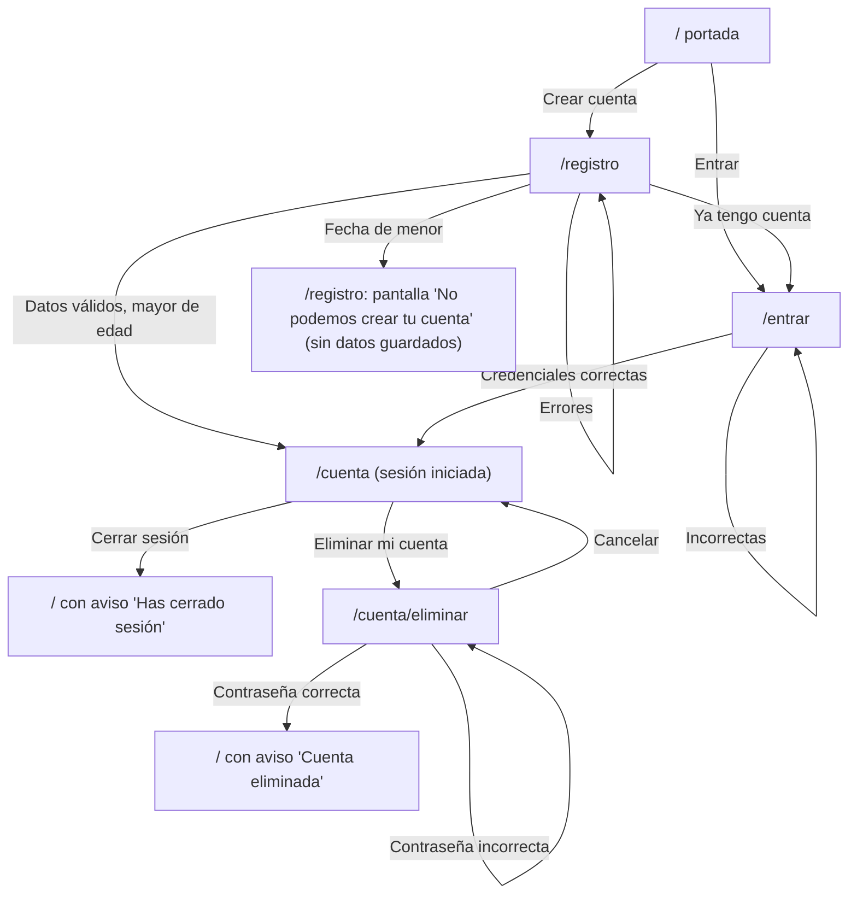

# H0 — Diseño UX

[← Índice](../README.md) · Hito: [H0 — Base mínima](mvp.md#h0--base-mínima)

Especificación de interfaz de registro, inicio y cierre de sesión y eliminación de cuenta. Fecha del documento: 11 de noviembre de 2026. Los textos están en español de España, con tuteo.

## 0. Alcance y principios

**Dentro**: `/`, `/registro`, `/entrar`, `/cuenta`, `/cuenta/eliminar`, `/legal/condiciones` y las páginas de error.
**Fuera**: entrevista, perfil, recomendaciones, chat, pagos, recuperación de contraseña, verificación de correo. H0 no envía correos.

**Usuarios y objetivo.** Una persona adulta que ha llegado por curiosidad o por invitación. Quiere tres cosas: crear la cuenta sin sentir que le piden de más, saber qué acepta y poder irse del todo cuando quiera. El camino más corto es un formulario de cuatro elementos y un botón.

Principios:

1. **Formulario real primero.** Todo funciona con `<form method="POST">` y recarga completa; el JavaScript solo mejora (`use:enhance`, mostrar contraseña, foco).
2. **Pedir lo mínimo.** Solo: correo, contraseña, fecha de nacimiento, aceptación de las condiciones. Ningún campo más, ni opcional.
3. **Honestidad.** Se dice qué se acepta, qué se borra y que Cupidilla aún no conversa. Nada de urgencia, culpa ni humor a costa de un error.
4. **Sobrio y sustituible.** Estilo provisional con tokens; la identidad visual llegará después.

## 1. Flujos

### 1.1 Mapa



### 1.2 Registro (camino feliz)

1. La persona llega a `/registro` (desde la portada, el encabezado o el enlace de `/entrar`).
2. Rellena correo, contraseña, fecha de nacimiento (día, mes, año) y marca la casilla de condiciones (llegó desmarcada). Puede abrir las condiciones en una pestaña nueva sin perder lo escrito.
3. Pulsa «Crear cuenta».
4. El servidor valida, crea la cuenta, guarda el consentimiento (fecha y versión del texto) e inicia sesión.
5. Redirección 303 a `/cuenta`. No hay pantalla intermedia de «cuenta creada»: `/cuenta` ya es la confirmación.

**Orden de validación en el servidor** (importa para la privacidad):

1. Forma de cada campo (vacío, formato, longitud, fecha real y no futura).
2. **Si la fecha es válida y corresponde a un menor: se muestra la pantalla de menor de edad inmediatamente**, aunque haya otros errores; no se comprueba nada más ni se guarda nada.
3. Casilla de condiciones.
4. Si hay errores de 1 o 3 se devuelve el formulario con todos a la vez.
5. Unicidad del correo.
6. Creación de cuenta y consentimiento en una sola operación atómica.

### 1.3 Registro de un menor de edad

- Se comprueba que tiene 18 años cumplidos **el día del registro**, con la fecha de hoy en la zona horaria Europe/Madrid (quien cumple 18 hoy puede registrarse hoy).
- No se crea cuenta, no se guarda el correo ni la fecha, no se registra consentimiento, no se escriben esos datos en los registros del servidor.
- La respuesta (código 422) **no devuelve el formulario relleno**: sustituye el contenido de `/registro` por una pantalla de cierre con el mensaje `registro.menor.*` y un único botón «Volver al inicio». No hay botón «Corregir la fecha» ni enlace de vuelta al formulario.
- No se impide técnicamente volver a intentarlo (no se guarda ninguna marca en el navegador: sería almacenar un dato para bloquear a alguien y es fácil de saltar; la fecha es declarada, decisión ya tomada).

### 1.4 Inicio de sesión

1. `/entrar`: correo y contraseña, botón «Entrar».
2. Éxito: 303 a `/cuenta`, o a la ruta privada que se intentaba abrir (ver 1.7).
3. Fallo de credenciales, sea porque el correo no existe o porque la contraseña es incorrecta: un único mensaje genérico, `entrar.error.credenciales`. El correo escrito se conserva; la contraseña, no. Los campos no se marcan individualmente como erróneos.
4. Campos vacíos: error por campo (no revela nada). Un correo mal formado se trata igual que uno que no existe (mensaje genérico).
5. Demasiados intentos: `comun.error.limite`.

### 1.5 Cierre de sesión

- Botón «Cerrar sesión» en `/cuenta` dentro de un `<form method="POST">` (nunca un enlace GET).
- Se destruye la sesión en el servidor y se borra la cookie. 303 a `/?aviso=sesion-cerrada`.
- La portada muestra el aviso `portada.aviso.sesion_cerrada`.

### 1.6 Eliminación de cuenta

1. Desde `/cuenta`, enlace «Eliminar mi cuenta» a `/cuenta/eliminar`.
2. La pantalla explica qué se borra y que no se puede deshacer; pide la contraseña.
3. Contraseña correcta: se elimina la cuenta de forma inmediata e irreversible, se cierra la sesión y se redirige a `/?aviso=cuenta-eliminada`.
4. Contraseña incorrecta: `eliminar.error.contrasena`; no se borra nada. Contraseña vacía: `eliminar.error.contrasena_vacia`.
5. «Cancelar» es un enlace a `/cuenta`.
6. No hay ventana emergente de confirmación (`confirm()`): volver a escribir la contraseña ya es la confirmación y funciona sin JavaScript.

### 1.7 Rutas privadas y de acceso según la sesión

| Situación | Resultado |
|---|---|
| Sin sesión abre `/cuenta` o `/cuenta/eliminar` | 303 a `/entrar?siguiente=<ruta>`. En `/entrar` aparece el aviso `entrar.aviso.necesita_sesion`. Tras entrar se va a la ruta pedida |
| Con sesión abre `/registro` o `/entrar` | 303 a `/cuenta`, sin mensaje |
| Con sesión abre `/` | Se muestra la portada con el botón «Ir a mi cuenta» en lugar de los de entrar y crear cuenta |
| Con o sin sesión abre `/legal/condiciones` | Se muestra siempre |
| Sesión caducada o cuenta eliminada en otra pestaña, y se envía un formulario de `/cuenta/eliminar` | Igual que sin sesión: 303 a `/entrar?siguiente=/cuenta`. No se muestra «error»  |
| Ruta que no existe | Página de error 404 |
| Fallo inesperado del servidor al cargar una página | Página de error 500 |

Reglas de `siguiente`: solo se acepta si es una ruta interna de una lista permitida (`/cuenta`, `/cuenta/eliminar`). Cualquier otro valor se ignora y se va a `/cuenta`.

## 2. Estructura común

### 2.1 Plantilla de página

```
[Saltar al contenido]                     (primer elemento tabulable, visible al recibir foco)
┌────────────────────────────────────────────┐
│ Cupidilla                  Entrar  Crear cuenta │  <header> + <nav aria-label="Principal">
├────────────────────────────────────────────┤
│ <main id="contenido">                      │
│   [resumen de errores / aviso]             │
│   <h1>                                     │
│   contenido                                │
├────────────────────────────────────────────┤
│ Condiciones de uso · Solo mayores de 18 años │  <footer>
└────────────────────────────────────────────┘
```

- `<html lang="es">`.
- Una sola `<h1>` por página, igual al título visible. `<title>`: `«Título» — Cupidilla`; con errores: `Error: «Título» — Cupidilla`.
- «Cupidilla» (texto, sin logotipo) enlaza a `/`.
- Navegación sin sesión: «Entrar», «Crear cuenta». Con sesión: «Mi cuenta».
- Todos los campos de H0 son obligatorios: se dice una vez al inicio del formulario («Todos los campos son obligatorios») y no se usan asteriscos.

### 2.2 Patrón de formulario y errores

- `<form method="POST" novalidate>` con `use:enhance` encima. `novalidate` evita las burbujas nativas del navegador, que son distintas en cada uno y no usan nuestros textos; el servidor es la fuente de verdad.
- Cada campo: `<label for>` visible, ayuda opcional en un elemento con `id`, error en un elemento con `id`. El control lleva `aria-describedby="<ayuda> <error>"`, y `aria-invalid="true"` solo si tiene error.
- El mensaje de error de campo empieza con el texto oculto «Error:» y lleva un icono ⚠ además del color rojo (no depende del color). Va debajo de la etiqueta y de la ayuda, encima del control.
- **Resumen de errores** al inicio de `<main>`, antes de la `<h1>`: contenedor con `tabindex="-1"`, un `<h2>` («Revisa esto antes de seguir») y una lista de enlaces, uno por error, que apuntan al control afectado (`href="#correo"`). Para la fecha el enlace apunta al primer subcampo con error.
- Los errores generales (sin campo) aparecen en el mismo contenedor, sin lista de enlaces, con `role="alert"`.
- Tras una respuesta con errores: sin JavaScript, la página se recarga, el resumen es lo primero de `<main>` y el título empieza por «Error:». Con JavaScript, además se mueve el foco al contenedor del resumen.
- Botón de envío: con JavaScript, al enviar se muestra «Enviando…», se pone `aria-disabled="true"` (no `disabled`, para no perder el foco) y se ignoran pulsaciones repetidas. Sin JavaScript, el navegador gestiona la carga.
- Se conservan los valores escritos tras un error (correo, día, mes, año, casilla de condiciones). La contraseña nunca.

### 2.3 Control de contraseña

`<input type="password">` con un botón «Mostrar contraseña» que **solo existe con JavaScript** (se añade al montar el componente). Alterna entre `type="password"` y `type="text"` y cambia su propio texto a «Ocultar contraseña». Es un `<button type="button">`, tabulable, justo tras el campo. Sin JavaScript no hay botón y el campo se queda oculto. No hay segundo campo de «repetir contraseña»: el botón de mostrar cubre el mismo riesgo con menos fricción. Sin `maxlength` (cortar en silencio es peor): el servidor valida y avisa. Se permite pegar. Se cuentan caracteres, no bytes; se admiten espacios y cualquier carácter.

## 3. Pantallas

Notación de textos: `[clave]` remite a la tabla de la sección 5.

### 3.1 `/` Portada

```
Cupidilla                         Entrar  Crear cuenta
-----------------------------------------------------
[aviso opcional: role="status"]
<h1> Menos deslizar. Más conectar.
<p>  Cupidilla es una celestina con inteligencia artificial: te
     conoce conversando, te propone pocas personas y te presenta
     solo si las dos partes quieren.
<p>  Cupidilla está en construcción. Puedes crear tu cuenta ya...
[Crear cuenta]  [Entrar]           (con sesión: [Ir a mi cuenta])
<p pequeño> Solo para mayores de 18 años.
```

- Botón primario «Crear cuenta», secundario «Entrar». En móvil, apilados a ancho completo; en escritorio, en fila.
- Sin ilustración, sin imágenes (no hace falta texto alternativo).
- Estados: normal; con aviso (sesión cerrada, cuenta eliminada); con sesión (botón distinto). No hay carga ni error propios.
- El aviso es un bloque con borde verde, icono ✓ y texto, `role="status"`, primero dentro de `<main>`. Se identifica por `?aviso=` con una lista cerrada de valores (`sesion-cerrada`, `cuenta-eliminada`); un valor desconocido no muestra nada. El aviso no tiene botón de cerrar; desaparece al navegar. (El CTO puede cambiar el parámetro por una cookie de un solo uso; lo que ve la persona es igual.)

### 3.2 `/registro`

```
<h1> Crea tu cuenta
<p>  Todos los campos son obligatorios.
[resumen de errores]                         (solo con errores)

Correo electrónico
[ _______________________ ]

Contraseña
Mínimo 10 caracteres, sin más reglas: una frase larga vale.
De momento no podemos recuperarla, guárdala en un gestor.
[ _______________________ ] [Mostrar contraseña]   (botón solo con JS)

<fieldset><legend> Fecha de nacimiento
La necesitamos para comprobar que tienes 18 años o más. Por ejemplo: 14 3 1990
Día [__]  Mes [__]  Año [____]

[ ] Acepto las condiciones de uso de Cupidilla (versión 2026-11-borrador).
    Es un borrador pendiente de revisión jurídica. [Leer las condiciones]

[ Crear cuenta ]
¿Ya tienes cuenta? Entra
```

| Campo | Control | Atributos |
|---|---|---|
| Correo | `<input type="email" id="correo" name="correo">` | `autocomplete="username"`, `inputmode="email"`, `autocapitalize="none"`, `spellcheck="false"` |
| Contraseña | `<input type="password" id="contrasena" name="contrasena">` | `autocomplete="new-password"`, `autocapitalize="none"`, `spellcheck="false"` |
| Día | `<input type="text" id="dia" name="dia">` | `inputmode="numeric"`, `maxlength="2"`, `autocomplete="bday-day"`, ancho ≈ 2 cifras |
| Mes | `<input type="text" id="mes" name="mes">` | `inputmode="numeric"`, `maxlength="2"`, `autocomplete="bday-month"` |
| Año | `<input type="text" id="anio" name="anio">` | `inputmode="numeric"`, `maxlength="4"`, `autocomplete="bday-year"` |
| Condiciones | `<input type="checkbox" id="condiciones" name="condiciones">` | sin `checked` nunca, salvo recuperar el valor tras un error |

Detalles:

- **Fecha de nacimiento: tres campos de texto numéricos, no selector nativo.** Razones: (1) el selector `type="date"` obliga a retroceder décadas con rueda o flechas y en móvil abre una rueda que hay que girar decenas de años; (2) su aspecto, orden y accesibilidad cambian entre navegadores y lectores de pantalla, y no admite mensajes de error por parte; (3) la persona se sabe su fecha de memoria: escribir 14, 3, 1990 es más rápido; (4) con `inputmode="numeric"` el móvil abre el teclado numérico; (5) permite mensajes por parte («Escribe el mes») y funciona sin JavaScript. Va dentro de `<fieldset>` con `<legend>`. Cada parte tiene su `<label>` visible («Día», «Mes», «Año»). Se aceptan el día y el mes con una o dos cifras. El año, cuatro. Se recortan espacios. No se usa `type="number"` (flechas de incremento, rueda del ratón que cambia el valor y problemas con los ceros a la izquierda).
- El mensaje de error de la fecha va una vez, en el `<fieldset>` (descrito por `aria-describedby` en el fieldset y en cada subcampo con error); solo se marca con `aria-invalid` y borde de error la parte que falla (todas si la fecha no existe).
- La casilla va dentro de una `<label>` que contiene solo el texto `registro.campo.condiciones`; toda esa fila es clicable. El enlace «Leer las condiciones» (`/legal/condiciones`) va **justo debajo, fuera de la etiqueta**, para que pulsarlo no marque ni desmarque la casilla. Se abre en pestaña nueva (`target="_blank" rel="noopener"`) y lo anuncia en su texto con `comun.nueva_pestana`: así no se pierde lo escrito, también sin JavaScript.
- La casilla significa solo «uso del servicio». Se deja claro con la ayuda `registro.ayuda.condiciones`, que va debajo del enlace y se asocia a la casilla con `aria-describedby`.
- No se pregunta «¿tienes 18 años?» con otra casilla: la fecha ya lo declara.
- Orden de tabulación: saltar al contenido → encabezado → (resumen) → correo → contraseña → mostrar contraseña (JS) → día → mes → año → casilla → enlace a las condiciones → Crear cuenta → enlace «Entra» → pie.

Estados:

| Estado | Comportamiento |
|---|---|
| Inicial | Campos vacíos, casilla desmarcada, sin errores. No hay `autofocus` |
| Enviando (JS) | Botón «Creando cuenta…», `aria-disabled`, campos editables pero un segundo envío se ignora; región `role="status"` oculta visualmente con «Creando tu cuenta…» |
| Error de validación | Resumen arriba, errores por campo, valores conservados salvo contraseña (queda vacía; el error de contraseña no cambia por ello) |
| Correo ya registrado | Error en el campo correo con enlace a `/entrar` (ver 3.2.1) |
| Menor de edad | Pantalla de cierre sin formulario (ver 3.2.2) |
| Error general | Demasiados intentos o servidor caído: bloque `role="alert"` arriba; el formulario se conserva con los valores |
| Resultado incierto (503) | La petición se envió pero no hubo respuesta: no sabemos si la cuenta se creó. Misma página, sin cookie de sesión, valores conservados salvo contraseña. Bloque general de 2.2 (`role="alert"`, `tabindex="-1"`, sin lista de enlaces, primero de `<main>`, `<title>` con «Error:», foco con JS) con `registro.error.resultado_incierto` y debajo el enlace `registro.enlace.comprobar_entrada` (a `/entrar`, pestaña nueva). Es un aviso general, no un error de campo: no marca ningún `aria-invalid`. El botón vuelve a «Crear cuenta». Si la cuenta sí se creó, volver a enviar daría `registro.error.correo_existente` (3.2.1) y entrar funcionaría. |
| Éxito | 303 a `/cuenta` |

#### 3.2.1 Correo que ya existe

Decisión: se dice, sin rodeos pero con un mensaje neutro, que ese correo no se puede usar y se ofrece entrar. Texto: «No hemos podido crear la cuenta con ese correo. Si ya tienes una, entra; si no, comprueba que está bien escrito o prueba con otro.» con «entra» enlazando a `/entrar`.

Por qué: la única forma de no revelar nada es responder siempre lo mismo y avisar por correo («si es tuyo, ya tienes cuenta»), y H0 no envía correos. Sin ese canal, un mensaje idéntico para «cuenta creada» y «correo existente» dejaría a la persona sin saber qué ha pasado y sin forma de entrar. Entre una experiencia rota y revelar lo que cualquiera deduciría probando, se elige lo menos malo: un texto que no afirma «ese correo está registrado» pero ayuda a quien se equivoca, más el límite de intentos para que no sirva para listar correos en masa. La fuga es real y está asumida: se reevalúa cuando haya envío de correo (ver sección 8). La comprobación de duplicado se hace **después** de la de edad, así que un menor nunca llega a ella.

#### 3.2.2 Pantalla de menor de edad (misma ruta, sin formulario)

```
<h1> No podemos crear tu cuenta
<p>  Cupidilla es solo para personas de 18 años o más, así que no hemos
     creado tu cuenta ni hemos guardado ningún dato.
<p>  No es nada personal: es una condición del servicio.
[ Volver al inicio ]
```

Sin tono de reproche, sin «¿seguro que has puesto bien la fecha?», sin invitar a corregir ni a volver más adelante. El `<title>` es «No podemos crear tu cuenta — Cupidilla» (sin prefijo «Error:»: no es un error que se pueda corregir). El texto va en un `role="alert"` para anunciarlo, y el foco con JS pasa al `<h1>` (`tabindex="-1"`).

### 3.3 `/entrar`

```
[aviso si venía de ruta privada]
<h1> Entra en tu cuenta
[resumen de errores]
Correo electrónico   [ _______ ]
Contraseña           [ _______ ] [Mostrar contraseña]
[ Entrar ]
¿No tienes cuenta? Crea una
```

| Campo | Control | Atributos |
|---|---|---|
| Correo | `type="email"`, `name="correo"` | `autocomplete="username"`, `inputmode="email"`, `autocapitalize="none"`, `spellcheck="false"` |
| Contraseña | `type="password"`, `name="contrasena"` | `autocomplete="current-password"` |
| Siguiente | `<input type="hidden" name="siguiente">` | solo si viene de una ruta privada válida |

Sin «Recordarme» ni «¿Olvidaste tu contraseña?» (la recuperación está fuera de H0; no se pone un enlace que no lleva a ninguna parte).

| Estado | Comportamiento |
|---|---|
| Inicial | Vacío. Si llega con `?siguiente=` válido: aviso `entrar.aviso.necesita_sesion` |
| Enviando (JS) | «Entrando…», `aria-disabled` |
| Error de validación | Correo vacío o contraseña vacía: error por campo y en el resumen |
| Credenciales incorrectas | Resumen/alerta con `entrar.error.credenciales`; correo conservado, contraseña vacía; sin marcar campos individuales; el foco con JS va al resumen |
| Error general | `comun.error.limite` o `entrar.error.servidor` |
| Éxito | 303 a `siguiente` o `/cuenta` |

### 3.4 `/cuenta`

```
<h1> Tu cuenta
<section> <h2> Tus datos
  Correo: persona@ejemplo.com            (lista de descripción <dl>)
  Condiciones aceptadas: versión 2026-11-borrador, el 11 de noviembre de 2026
<section> <h2> Cupidilla
  Cupidilla todavía no conversa. Pronto te hará unas preguntas para
  conocerte; cuando esté lista, lo verás aquí.
<section> <h2> Sesión
  [ Cerrar sesión ]
<section> <h2> Eliminar tu cuenta
  Si quieres irte, puedes borrar tu cuenta y tus datos cuando quieras.
  Eliminar mi cuenta  (enlace con aspecto de botón secundario)
```

- El correo largo se parte (`overflow-wrap: anywhere`).
- La fecha de aceptación se formatea en español (`11 de noviembre de 2026`).
- «Cerrar sesión»: `<button type="submit">` dentro de un `<form method="POST" action="/cuenta?/salir">`. Es el único sitio donde se cierra sesión; no hay botón en la cabecera.
- «Eliminar mi cuenta» es un enlace (navega), con estilo secundario con borde rojo; no es el botón de más peso visual de la página.
- No hay estados de carga ni vacío. Error: si falla cerrar sesión, `cuenta.error.servidor` en un `role="alert"` arriba. Con sesión caducada: ver 1.7.

### 3.5 `/cuenta/eliminar`

```
<h1> Eliminar tu cuenta
[resumen de errores]
<p>  Se borrará de inmediato tu cuenta y todo lo que hemos guardado
     de ti (correo, contraseña, fecha de nacimiento y consentimientos).
<p>  No se puede deshacer. Si más adelante quieres volver, tendrás que
     crear una cuenta nueva.
Contraseña           [ _______ ] [Mostrar contraseña]
  Escríbela para confirmar que eres tú.
[ Eliminar mi cuenta definitivamente ]       (botón de peligro)
Cancelar                                       (enlace a /cuenta)
```

- Contraseña: `type="password"`, `name="contrasena"`, `autocomplete="current-password"`.
- Botón de peligro: fondo rojo con texto blanco y la palabra «Eliminar» explícita (no «Aceptar»). Cancelar es un enlace visible, con subrayado, justo debajo/al lado.
- Orden de tabulación: contraseña → mostrar (JS) → Eliminar → Cancelar. Pulsar Intro en el campo envía el formulario (el botón de eliminar es el único de envío).

| Estado | Comportamiento |
|---|---|
| Inicial | Campo vacío, sin `autofocus` |
| Enviando (JS) | «Eliminando…», `aria-disabled` |
| Contraseña vacía o incorrecta | Error en el campo y en el resumen. No se borra nada. Este mensaje sí puede ser específico (la persona ya tiene sesión) |
| Error general | `comun.error.limite` o `eliminar.error.servidor` («Tu cuenta sigue como estaba») |
| Resultado incierto (503) | La petición se envió pero no hubo respuesta: no sabemos si se borró. Misma página, cookie conservada, campo de contraseña vacío. Bloque general de 2.2 (`role="alert"`, `tabindex="-1"`, sin lista de enlaces, primero de `<main>`, `<title>` con «Error:», foco con JS) con `eliminar.error.resultado_incierto` y debajo el enlace `eliminar.enlace.comprobar` (a `/cuenta`). Nunca se afirma que la cuenta sigue ni que se borró; no se usa `eliminar.error.servidor`. El botón vuelve a «Eliminar mi cuenta definitivamente» y se puede reintentar a mano. Ir a `/cuenta` lleva a `/entrar` (1.7) tanto si la cuenta se borró como si la sesión caducó o se cerró con la cuenta activa, así que ese salto no confirma nada. |
| Éxito | La cuenta ya no existe, sesión cerrada, 303 a `/?aviso=cuenta-eliminada` |

### 3.6 `/legal/condiciones`

```
[Banner: Borrador pendiente de revisión jurídica · versión 2026-11-borrador]
<h1> Condiciones de uso
<p>  Versión 2026-11-borrador (borrador). 
<h2> secciones numeradas (ver 5.9)
[Volver]  (enlace «Volver al inicio»)
```

Texto a ancho de lectura (máx. 65 caracteres por línea aprox.), jerarquía `h1` → `h2`. Público. Estados: solo el normal. El banner es un bloque con borde y la palabra «Borrador» en texto (no solo color).

### 3.7 Páginas de error (404 y 500)

`<h1>` + una frase + botón «Ir al inicio» (ver `error404.*` y `error500.*`). El 500 no muestra trazas ni códigos internos.

## 4. Estados: resumen transversal

| Pantalla | Inicial | Enviando | Error por campo | Error general | Éxito |
|---|---|---|---|---|---|
| `/registro` | vacío, casilla desmarcada | botón «Creando cuenta…» | correo, contraseña, fecha, condiciones | límite, servidor o resultado incierto (503) | `/cuenta` |
| `/registro` (menor) | n/a | n/a | n/a | pantalla de cierre | n/a |
| `/entrar` | vacío (+ aviso si viene de ruta privada) | «Entrando…» | correo vacío, contraseña vacía | credenciales (genérico), límite, servidor | `/cuenta` o `siguiente` |
| `/cuenta` | datos | n/a | n/a | fallo al cerrar sesión | `/` con aviso |
| `/cuenta/eliminar` | contraseña vacía | «Eliminando…» | vacía, incorrecta | límite, servidor o resultado incierto (503) | `/` con aviso |

Casos límite: correo de hasta 254 caracteres (se parte, no desborda); contraseña de 128 caracteres; zoom 200 %; texto ampliado; sin JavaScript; doble envío; botón «atrás» tras cerrar sesión (la página privada debe pedir sesión de nuevo, no mostrar datos en caché: cabecera `Cache-Control: no-store` en rutas privadas).

## 5. Textos de interfaz

Convención de claves: `pantalla.tipo.nombre`. Tipos: `meta` (título del documento), `titulo`, `campo` (etiqueta), `ayuda`, `boton`, `enlace`, `error`, `aviso`, `texto`. Los textos con `«…»` son literales; `{x}` es un valor variable.

### 5.1 Comunes

| Clave | Texto |
|---|---|
| `comun.marca` | Cupidilla |
| `comun.meta.sufijo` | ` — Cupidilla` |
| `comun.meta.prefijo_error` | `Error: ` |
| `comun.saltar` | Saltar al contenido |
| `comun.nav.etiqueta` | Principal |
| `comun.nav.entrar` | Entrar |
| `comun.nav.registro` | Crear cuenta |
| `comun.nav.cuenta` | Mi cuenta |
| `comun.pie.condiciones` | Condiciones de uso |
| `comun.pie.edad` | Solo para mayores de 18 años |
| `comun.error.prefijo_oculto` | Error: |
| `comun.error.resumen_titulo` | Revisa esto antes de seguir |
| `comun.error.limite` | Demasiados intentos. Espera unos minutos e inténtalo de nuevo. |
| `comun.campos_obligatorios` | Todos los campos son obligatorios. |
| `comun.contrasena.mostrar` | Mostrar contraseña |
| `comun.contrasena.ocultar` | Ocultar contraseña |
| `comun.nueva_pestana` | (se abre en una pestaña nueva) |
| `comun.boton.volver_inicio` | Volver al inicio |

### 5.2 Portada

| Clave | Texto |
|---|---|
| `portada.meta.titulo` | Menos deslizar. Más conectar. |
| `portada.titulo` | Menos deslizar. Más conectar. |
| `portada.texto.intro` | Cupidilla es una celestina con inteligencia artificial: te conoce conversando, te propone pocas personas y te presenta solo si las dos partes quieren. |
| `portada.texto.estado` | Cupidilla está en construcción. Puedes crear tu cuenta ya; la conversación con ella llegará pronto. |
| `portada.boton.registro` | Crear cuenta |
| `portada.boton.entrar` | Entrar |
| `portada.boton.cuenta` | Ir a mi cuenta |
| `portada.aviso.sesion_cerrada` | Has cerrado sesión. |
| `portada.aviso.cuenta_eliminada` | Tu cuenta se ha eliminado. Hemos borrado tus datos y cerrado tu sesión. |

### 5.3 Registro

| Clave | Texto |
|---|---|
| `registro.meta.titulo` | Crear cuenta |
| `registro.titulo` | Crea tu cuenta |
| `registro.campo.correo` | Correo electrónico |
| `registro.campo.contrasena` | Contraseña |
| `registro.ayuda.contrasena` | Mínimo 10 caracteres, sin más reglas: una frase larga vale. De momento no podemos recuperarla, así que guárdala en un gestor de contraseñas o donde no se te pierda. |
| `registro.campo.nacimiento` | Fecha de nacimiento |
| `registro.ayuda.nacimiento` | La necesitamos para comprobar que tienes 18 años o más. Por ejemplo: 14 3 1990 |
| `registro.campo.dia` | Día |
| `registro.campo.mes` | Mes |
| `registro.campo.anio` | Año |
| `registro.campo.condiciones` | Acepto las condiciones de uso de Cupidilla (versión {version}). |
| `registro.enlace.condiciones` | Leer las condiciones |
| `registro.ayuda.condiciones` | Es el permiso para usar el servicio. Es un texto provisional, pendiente de revisión jurídica. Más adelante, para cualquier otra cosa, te pediremos permiso aparte. |
| `registro.boton.enviar` | Crear cuenta |
| `registro.boton.enviando` | Creando cuenta… |
| `registro.estado.enviando` | Creando tu cuenta… |
| `registro.enlace.entrar` | ¿Ya tienes cuenta? Entra |
| `registro.error.correo_vacio` | Escribe tu correo electrónico. |
| `registro.error.correo_formato` | Ese correo no parece válido. Comprueba que tiene el formato nombre@dominio.es. |
| `registro.error.correo_largo` | Ese correo es demasiado largo. |
| `registro.error.correo_existente` | No hemos podido crear la cuenta con ese correo. Si ya tienes una, entra; si no, comprueba que está bien escrito o prueba con otro. |
| `registro.error.contrasena_vacia` | Elige una contraseña. |
| `registro.error.contrasena_corta` | La contraseña necesita al menos 10 caracteres. |
| `registro.error.contrasena_larga` | La contraseña no puede tener más de 128 caracteres. |
| `registro.error.fecha_vacia` | Escribe tu fecha de nacimiento. |
| `registro.error.dia` | Escribe el día con uno o dos números, del 1 al 31. |
| `registro.error.mes` | Escribe el mes con uno o dos números, del 1 al 12. |
| `registro.error.anio` | Escribe el año con cuatro números. |
| `registro.error.fecha_inexistente` | Esa fecha no existe. Revisa el día, el mes y el año. |
| `registro.error.fecha_futura` | La fecha de nacimiento no puede ser posterior a hoy. |
| `registro.error.condiciones` | Para crear la cuenta tienes que aceptar las condiciones de uso. |
| `registro.error.condiciones_version` | Las condiciones han cambiado mientras rellenabas el formulario. Léelas de nuevo y vuelve a marcar la casilla. |
| `registro.error.servidor` | Algo ha fallado por nuestra parte y no hemos podido crear tu cuenta. Inténtalo de nuevo en unos minutos. |
| `registro.error.resultado_incierto` | No sabemos si tu cuenta se ha creado: se ha perdido la conexión antes de recibir la respuesta. Antes de volver a registrarte, prueba a entrar con este correo y esta contraseña. Si entras, la cuenta ya existe. Si no puedes entrar, pulsa «Crear cuenta» otra vez. |
| `registro.enlace.comprobar_entrada` | Probar a entrar con este correo |
| `registro.menor.meta.titulo` | No podemos crear tu cuenta |
| `registro.menor.titulo` | No podemos crear tu cuenta |
| `registro.menor.texto1` | Cupidilla es solo para personas de 18 años o más, así que no hemos creado tu cuenta ni hemos guardado ningún dato. |
| `registro.menor.texto2` | No es nada personal: es una condición del servicio. |

`registro.error.servidor` solo se usa cuando sabemos que no se creó nada; si no lo sabemos, `registro.error.resultado_incierto`. El enlace `registro.enlace.comprobar_entrada` va dentro del mismo bloque, tras el texto, lleva a `/entrar` y se abre en pestaña nueva con `comun.nueva_pestana`. No se rellena el correo en `/entrar`: no se pasan datos por la URL.

Si un error de fecha afecta a una sola parte (día, mes o año), se usa el mensaje de esa parte; si faltan varias, `registro.error.fecha_vacia` si están todas vacías y, si no, el de la primera parte con problema. Año menor de 1900: `registro.error.anio`.

### 5.4 Entrar

| Clave | Texto |
|---|---|
| `entrar.meta.titulo` | Entrar |
| `entrar.titulo` | Entra en tu cuenta |
| `entrar.aviso.necesita_sesion` | Entra para ver esa página. |
| `entrar.campo.correo` | Correo electrónico |
| `entrar.campo.contrasena` | Contraseña |
| `entrar.boton.enviar` | Entrar |
| `entrar.boton.enviando` | Entrando… |
| `entrar.estado.enviando` | Entrando en tu cuenta… |
| `entrar.enlace.registro` | ¿No tienes cuenta? Crea una |
| `entrar.error.correo_vacio` | Escribe tu correo electrónico. |
| `entrar.error.contrasena_vacia` | Escribe tu contraseña. |
| `entrar.error.credenciales` | Correo o contraseña incorrectos. |
| `entrar.error.servidor` | Algo ha fallado por nuestra parte y no hemos podido iniciar tu sesión. Inténtalo de nuevo en unos minutos. |

### 5.5 Cuenta

| Clave | Texto |
|---|---|
| `cuenta.meta.titulo` | Tu cuenta |
| `cuenta.titulo` | Tu cuenta |
| `cuenta.datos.titulo` | Tus datos |
| `cuenta.datos.correo` | Correo |
| `cuenta.datos.condiciones` | Condiciones aceptadas |
| `cuenta.datos.condiciones_valor` | versión {version}, el {fecha} |
| `cuenta.cupidilla.titulo` | Cupidilla |
| `cuenta.cupidilla.texto` | Cupidilla todavía no conversa. Pronto te hará unas preguntas para conocerte; cuando esté lista, lo verás aquí. |
| `cuenta.sesion.titulo` | Sesión |
| `cuenta.sesion.boton` | Cerrar sesión |
| `cuenta.eliminar.titulo` | Eliminar tu cuenta |
| `cuenta.eliminar.texto` | Si quieres irte, puedes borrar tu cuenta y tus datos cuando quieras. |
| `cuenta.eliminar.enlace` | Eliminar mi cuenta |
| `cuenta.error.servidor` | Algo ha fallado por nuestra parte y no hemos podido cerrar tu sesión. Inténtalo de nuevo en unos minutos. |

### 5.6 Eliminar cuenta

| Clave | Texto |
|---|---|
| `eliminar.meta.titulo` | Eliminar tu cuenta |
| `eliminar.titulo` | Eliminar tu cuenta |
| `eliminar.texto.alcance` | Se borrará de inmediato tu cuenta y todo lo que hemos guardado de ti: correo, contraseña, fecha de nacimiento y consentimientos. |
| `eliminar.texto.irreversible` | No se puede deshacer. Si más adelante quieres volver, tendrás que crear una cuenta nueva. |
| `eliminar.campo.contrasena` | Contraseña |
| `eliminar.ayuda.contrasena` | Escríbela para confirmar que eres tú. |
| `eliminar.boton.enviar` | Eliminar mi cuenta definitivamente |
| `eliminar.boton.enviando` | Eliminando… |
| `eliminar.estado.enviando` | Eliminando tu cuenta… |
| `eliminar.enlace.cancelar` | Cancelar |
| `eliminar.error.contrasena_vacia` | Escribe tu contraseña para confirmar. |
| `eliminar.error.contrasena` | La contraseña no es correcta. No hemos borrado nada. |
| `eliminar.error.servidor` | Algo ha fallado por nuestra parte y no hemos podido eliminar tu cuenta. Tu cuenta sigue como estaba. Inténtalo de nuevo en unos minutos. |
| `eliminar.error.resultado_incierto` | No sabemos si tu cuenta se ha eliminado: se ha perdido la conexión antes de recibir la respuesta. Para comprobarlo, ve a tu cuenta. Si la ves, sigue activa y puedes volver a intentarlo. Si te pide entrar, entra con tu correo y tu contraseña: si entras, la cuenta sigue activa. Si no puedes entrar con la contraseña correcta, lo más probable es que se haya eliminado. |
| `eliminar.enlace.comprobar` | Ir a mi cuenta para comprobarlo |

`eliminar.error.servidor` solo se usa cuando sabemos que no se borró nada; si no lo sabemos, `eliminar.error.resultado_incierto`. El enlace `eliminar.enlace.comprobar` va en el mismo bloque, tras el texto, a `/cuenta` y en la misma pestaña. Ir a `/cuenta` no da una respuesta por sí solo: si se ve la cuenta, sigue activa; si lleva a `/entrar` con `entrar.aviso.necesita_sesion`, puede ser que la cuenta se haya borrado (el borrado cierra todas las sesiones) o que la sesión haya caducado o se haya cerrado (duran 30 días) con la cuenta activa. Por eso el texto no afirma ninguna de las dos cosas y pide entrar con correo y contraseña. En `/entrar`, un correo inexistente y una contraseña incorrecta dan el mismo mensaje genérico (`entrar.error.credenciales`) para no revelar qué correos existen, así que «no puedo entrar con la contraseña correcta» es un indicio («lo más probable»), no una confirmación. No se cambia `/entrar` para esto.

### 5.7 Errores de página

| Clave | Texto |
|---|---|
| `error404.titulo` | No encontramos esta página |
| `error404.texto` | Puede que el enlace esté mal escrito o que la página ya no exista. |
| `error500.titulo` | Algo ha fallado |
| `error500.texto` | Ha sido cosa nuestra. Inténtalo de nuevo en unos minutos. |
| `error.boton.inicio` | Ir al inicio |

### 5.8 Textos para lectores de pantalla (ocultos visualmente)

| Clave | Texto |
|---|---|
| `a11y.error.prefijo` | Error: |
| `a11y.nueva_pestana` | (se abre en una pestaña nueva) |

### 5.9 Borrador de `/legal/condiciones`

> Marcado en pantalla: «Borrador pendiente de revisión jurídica. No es el texto definitivo.» Los `[PENDIENTE]` los rellena quien tenga la información; no los inventa el equipo de desarrollo.

| Clave | Texto |
|---|---|
| `condiciones.meta.titulo` | Condiciones de uso (borrador) |
| `condiciones.aviso` | Borrador pendiente de revisión jurídica. No es el texto definitivo y puede cambiar. |
| `condiciones.titulo` | Condiciones de uso |
| `condiciones.version` | Versión 2026-11-borrador |
| `condiciones.s1.titulo` | 1. Quién está detrás de Cupidilla |
| `condiciones.s1.texto` | [PENDIENTE: nombre o razón social, domicilio y correo de contacto de la persona o entidad responsable.] |
| `condiciones.s2.titulo` | 2. Qué es Cupidilla |
| `condiciones.s2.texto` | Cupidilla es una web de contactos que utiliza una asistente con inteligencia artificial. Todavía está en construcción: hoy solo puedes crear, usar y eliminar tu cuenta. Las funciones de conversación, recomendaciones y presentaciones llegarán más adelante y, cuando lleguen, te pediremos lo que haga falta para usarlas. |
| `condiciones.s3.titulo` | 3. Quién puede usarla |
| `condiciones.s3.texto` | Solo personas que hayan cumplido 18 años. Al registrarte declaras tu fecha de nacimiento; de momento no la verificamos. Debe ser la tuya y debe ser cierta. |
| `condiciones.s4.titulo` | 4. Tu cuenta |
| `condiciones.s4.texto` | Te registras con un correo y una contraseña. Cuida tu contraseña y no la compartas. Por ahora no hay forma de recuperarla si la pierdes. |
| `condiciones.s5.titulo` | 5. Qué datos pedimos y para qué |
| `condiciones.s5.texto` | Para crear la cuenta pedimos solo tu correo, tu contraseña y tu fecha de nacimiento. Los usamos para que puedas entrar y para comprobar que eres mayor de edad. Guardamos también que has aceptado estas condiciones: qué versión y cuándo. [PENDIENTE: base jurídica, plazos de conservación, encargados del tratamiento, derechos y cómo ejercerlos. Irá en la política de privacidad.] |
| `condiciones.s6.titulo` | 6. Qué aceptas al registrarte |
| `condiciones.s6.texto` | Aceptas estas condiciones para usar el servicio. No aceptas ninguna otra cosa: el tratamiento de datos más personales, si algún día hace falta, y cada presentación con otra persona se te pedirán por separado, y podrás decir que no. |
| `condiciones.s7.titulo` | 7. Eliminar tu cuenta |
| `condiciones.s7.texto` | Puedes eliminar tu cuenta cuando quieras desde «Tu cuenta». Es inmediato y no se puede deshacer. [PENDIENTE: confirmar si debe conservarse alguna prueba del consentimiento tras el borrado y por cuánto tiempo; si se conserva, este párrafo y el de la pantalla de eliminar deben decirlo.] |
| `condiciones.s8.titulo` | 8. Cómo esperamos que te comportes |
| `condiciones.s8.texto` | Con respeto. No suplantes a otras personas, no uses datos falsos y no uses Cupidilla para acosar, estafar o dañar a nadie. [PENDIENTE: medidas ante incumplimientos.] |
| `condiciones.s9.titulo` | 9. Cambios |
| `condiciones.s9.texto` | Si cambiamos estas condiciones publicaremos una nueva versión y te pediremos que la aceptes antes de seguir usando el servicio. |
| `condiciones.s10.titulo` | 10. Ley aplicable y reclamaciones |
| `condiciones.s10.texto` | [PENDIENTE: jurisdicción, ley aplicable y vías de reclamación.] |
| `condiciones.enlace.volver` | Volver al inicio |

## 6. Accesibilidad (WCAG 2.2 AA)

Objetivo: **WCAG 2.2 nivel AA**. Comprobable con teclado, un lector de pantalla (NVDA con Firefox y VoiceOver con Safari en iOS, como mínimo) y una herramienta de contraste.

**Etiquetas y estructura**
- Todo control tiene `<label for>` visible; no se usa `placeholder` como etiqueta ni se usan placeholders.
- La fecha va en `<fieldset>` con `<legend>`.
- Una `<h1>` por página; los `<h2>` siguen el orden de las secciones; no se saltan niveles.
- Landmarks: `<header>`, `<nav aria-label>`, `<main>`, `<footer>`.
- `lang="es"` en `<html>`.
- Todo enlace distingue su destino por su texto («Leer las condiciones», no «Aquí»).

**Errores**
- Cada error de campo está asociado con `aria-describedby` y el campo lleva `aria-invalid="true"`.
- El resumen es el primer elemento de `<main>`, con enlaces que llevan al campo.
- Tras enviar con errores el foco (con JS) está en el resumen; sin JS, el resumen es lo primero tras la cabecera y el título empieza por «Error:».
- Los errores se identifican con texto, icono y color, nunca solo con color. Cada mensaje dice qué falló y cómo arreglarlo.
- Los errores generales se anuncian (`role="alert"`); los avisos de éxito, con `role="status"`.

**Teclado**
- Todo funciona solo con teclado en el orden visual y del DOM (ver 3.2, 3.3, 3.5). Sin trampas de foco ni tabindex positivos.
- El foco siempre es visible: anillo de 3 px, color `--color-foco`, con margen de 2 px; contraste ≥ 3:1 contra el fondo (WCAG 2.4.11 y 2.4.13).
- «Saltar al contenido» es el primer tabulable y aparece al recibir el foco.
- Intro envía el formulario desde cualquier campo de texto. La barra espaciadora activa la casilla.
- Nada obstaculizado por elementos fijos (no hay cabecera fija).

**Zonas táctiles y gestos**
- Botones, enlaces de acción, campos y la fila de la casilla: **mínimo 44×44 px** (el AA exige 24×24 de WCAG 2.5.8; se exige más por usabilidad en móvil). Separación de al menos 8 px entre objetivos.
- Casilla: la caja de 24×24 px y la etiqueta clicable.
- Sin gestos complejos ni arrastre.

**Contraste** (ver tokens en 7): texto normal ≥ 4,5:1; texto grande ≥ 3:1; bordes de campos, iconos e indicador de foco ≥ 3:1.

**Otros**
- Reflow: sin scroll horizontal a 320 px de ancho ni con zoom del 200 %; el texto se puede ampliar al 200 % sin perder contenido.
- Tamaño base 16 px en `rem`; los campos usan 16 px o más (evita el zoom automático de iOS).
- Autocompletado (WCAG 1.3.5): `autocomplete` en todos los campos (ver tablas). Los gestores de contraseñas y el pegado no se bloquean (3.3.8 Autenticación accesible: no hay pruebas de memoria ni de transcripción).
- No hay límites de tiempo en los formularios; la sesión caducada se gestiona con el flujo de 1.7.
- Entradas redundantes (3.3.7): los valores escritos se conservan tras un error; no se pide dos veces lo mismo.
- Sin movimiento ni animaciones salvo una transición de color de 100 ms, desactivada con `prefers-reduced-motion`.
- Sin captcha en H0.

## 7. Estilo provisional

Sobrio, claro, sin ilustración ni logotipo (la marca es el texto «Cupidilla» en negrita). Todo el estilo sale de variables CSS en `:root`; cambiar la paleta, tipografía o radios es sustituir estos valores. Los componentes no deben usar colores o medidas «a mano» fuera de los tokens.

### 7.1 Colores

Contrastes calculados con la fórmula de WCAG; son aproximados al segundo decimal, QA debe comprobarlos con una herramienta.

| Token | Valor | Uso | Contraste |
|---|---|---|---|
| `--color-fondo` | `#FFFFFF` | Fondo de página | — |
| `--color-superficie` | `#F7F4F2` | Tarjetas, avisos, pie | — |
| `--color-texto` | `#1E1B1D` | Texto principal | 17:1 sobre fondo; 15,6:1 sobre superficie |
| `--color-texto-suave` | `#5B5558` | Ayudas, texto secundario | 7,3:1 sobre fondo; 6,6:1 sobre superficie |
| `--color-primario` | `#6B2D5C` (ciruela) | Botón principal, enlaces | 9,7:1 sobre fondo; con texto blanco encima, 9,7:1 |
| `--color-primario-hover` | `#4E2043` | Hover y pulsado del primario | 13:1 sobre fondo |
| `--color-borde` | `#7A7377` | Borde de campos y casilla | 4,6:1 sobre fondo |
| `--color-borde-suave` | `#D9D3D0` | Separadores decorativos (no de controles) | decorativo |
| `--color-error` | `#B3261E` | Texto, borde e icono de error; botón de peligro (texto blanco encima: 6,5:1) | 6,5:1 sobre fondo; 6,0:1 sobre superficie |
| `--color-exito` | `#1B6B3A` | Borde e icono de confirmación | 6,5:1 sobre fondo |
| `--color-foco` | `#0B57D0` | Anillo de foco | 6,4:1 sobre fondo |

Reglas: el texto de los mensajes de error y de éxito se escribe en `--color-texto`, no en el color del estado (el color va en el borde y el icono); eso garantiza contraste y no depende del color. Los enlaces dentro de párrafos siempre van subrayados. El primario (ciruela) y el de error (rojo) son distintos a propósito para no confundir una acción con un problema.

### 7.2 Tipografía

- Fuente: la del sistema, sin descargar nada: `system-ui, -apple-system, "Segoe UI", Roboto, "Helvetica Neue", Arial, sans-serif` (`--fuente-base`).
- `--texto-base` 1rem (16 px), interlineado 1,5. `--texto-pequeno` 0,875rem (14 px, solo pie y ayudas muy cortas). `--texto-h2` 1.25rem. `--texto-h1` 1.75rem en móvil y 2.25rem desde 48em. Interlineado de títulos 1,2.
- Negrita (600) para títulos, etiquetas y la marca.
- Etiquetas encima del campo, nunca dentro.

### 7.3 Espaciado, radios y tamaños

| Token | Valor |
|---|---|
| `--espacio-1` / `-2` / `-3` / `-4` / `-6` / `-8` / `-12` | 0,25 / 0,5 / 0,75 / 1 / 1,5 / 2 / 3 rem |
| `--radio-s` | 6 px (campos, botones) |
| `--radio-m` | 12 px (tarjeta de formulario, avisos) |
| `--alto-control` | 3rem (48 px) |
| `--ancho-pagina` | 40rem |
| `--ancho-formulario` | 28rem |
| `--ancho-lectura` | 40rem (≈ 65 caracteres) |

- Borde de los campos 1 px `--color-borde`; con error, 2 px `--color-error`. Botones sin sombra.
- Botón primario: fondo `--color-primario`, texto blanco. Secundario: fondo blanco, borde 2 px `--color-primario`, texto `--color-primario`. Peligro: fondo `--color-error`, texto blanco.

### 7.4 Comportamiento responsive

- **Primero móvil.** Columna única; márgenes laterales de 1 rem; el contenido ocupa todo el ancho disponible hasta su máximo.
- **Menos de 30em (≈ 480 px):** los botones son de ancho completo y se apilan; el encabezado lleva la marca a la izquierda y los enlaces a la derecha en una línea.
- **Día, mes y año** en fila, con anchos fijos (4,5rem / 4,5rem / 6rem). Caben a 320 px.
- **48em (768 px) o más:** el contenido queda centrado con `--ancho-pagina`; los formularios, en una tarjeta de `--ancho-formulario` con borde `--color-borde-suave` y relleno de 2 rem; los botones dejan de ser de ancho completo y se alinean en fila (en `/cuenta/eliminar`, el de peligro a la izquierda y «Cancelar» a su lado).
- **Pie:** apilado en móvil; en una fila en escritorio.
- **Tema:** claro como mínimo en H0, con `color-scheme: light`. Recomendación: **el oscuro más adelante**, con la identidad visual, porque ahora duplicaría la comprobación de contraste de cada estado sin que haya marca que adaptar. Al usar tokens, añadirlo después es redefinir valores bajo `prefers-color-scheme: dark`.

## 8. Dudas y decisiones

### 8.1 Para el CEO (el usuario)

1. **¿El registro es abierto o por invitación en H0?** Afecta al texto de la portada (`portada.texto.estado`) y a la lógica de límites de intentos. Se ha escrito en abierto.
2. **Contraseña perdida = cuenta perdida.** Sin recuperación ni correo, quien olvida su contraseña no vuelve a entrar. Se avisa en la ayuda de la contraseña (`registro.ayuda.contrasena`). ¿Se acepta para H0, mientras sea beta cerrada? (Recomendación: sí.)
3. **¿Se conserva una prueba del consentimiento tras borrar la cuenta?** Es una cuestión legal. La interfaz dice ahora «se borra todo lo que hemos guardado de ti, incluidos los consentimientos» (`eliminar.texto.alcance`); si la asesoría exige conservar algo, hay que cambiar ese texto y el de `condiciones.s7.texto`.
4. **Fuga del correo ya registrado.** Se asume que el mensaje de `registro.error.correo_existente` permite deducir qué correos están registrados (3.2.1). ¿Se acepta hasta que haya envío de correo?
5. **Texto definitivo de las condiciones**, política de privacidad y datos de la entidad responsable (marcados `[PENDIENTE]`).
6. **Tono de la portada y del «no es nada personal» del menor de edad.** Revisar que son los que quieres para la marca.

### 8.2 Para el CTO (los puede cerrar él)

**Cerrados el 11 de noviembre de 2026.** Las respuestas están en los acuerdos A1 a A14 de [el diseño técnico](h0-diseno-tecnico.md#1-bis-acuerdos-entre-este-diseño-y-el-de-ux) y en sus secciones 8 a 10. En resumen: se guarda la fecha de nacimiento completa; el aviso va en `?aviso=`; se sale con `POST /cuenta?/salir`; el borrado es una sola operación atómica. La lista original se conserva como referencia.

1. Duración y caducidad de la sesión; cookie `HttpOnly`, `SameSite=Lax`, `Secure`; `Cache-Control: no-store` en rutas privadas.
2. Límite de intentos: valores concretos por IP y por correo para registro, entrada y eliminación, y uso de `comun.error.limite`. Que el tiempo de respuesta del inicio de sesión no distinga correo inexistente de contraseña errónea.
3. Fecha de hoy en Europe/Madrid para calcular la edad. **Confirmar qué se guarda: la fecha completa o solo que es mayor de edad**; el texto de la ayuda («Solo la usamos para comprobar que tienes 18 años o más») y de `eliminar.texto.alcance` deben coincidir con lo que se guarda.
4. No registrar en logs ni en herramientas de errores los datos de un formulario de registro rechazado por edad, ni correos ni fechas.
5. El borrado de cuenta debe ser una sola operación atómica: el texto «tu cuenta sigue como estaba» (`eliminar.error.servidor`) solo es cierto si lo es.
6. Aviso tras redirección: parámetro `?aviso=` con lista cerrada (aquí) o cookie de un solo uso.
7. Nombre de la acción de cierre de sesión y estructura de rutas (`/salir` o `?/salir` en `/cuenta`).
8. Versión del texto legal (`2026-11-borrador`) en una sola constante, usada en la casilla, en el consentimiento guardado y en la pantalla `/cuenta`.
9. Cómo se muestra la falta de JavaScript: no se necesita ninguna nota; todo funciona. Se recomienda una prueba automática con JavaScript desactivado de los tres formularios.

## 9. Criterios de aceptación

Cada criterio se puede comprobar uno a uno. Salvo que se indique, aplica con y sin JavaScript.

### Flujos

1. Desde `/` se puede llegar a `/registro` y `/entrar` con un solo clic cada uno.
2. Con datos válidos y mayoría de edad, «Crear cuenta» lleva a `/cuenta`, con la sesión iniciada y mostrando el correo escrito.
3. Quien cumple 18 años hoy puede registrarse; quien los cumple mañana, no.
4. Con una fecha de menor, se muestra la pantalla `registro.menor.*`; no hay formulario ni enlace para corregir la fecha; no existe ninguna fila nueva en usuarios ni en consentimientos (comprobar en base de datos); ese mismo correo puede registrarse después con una fecha válida.
5. Con una fecha de menor y, además, otros campos incorrectos, se muestra igualmente la pantalla de menor de edad.
6. Con un correo ya registrado y fecha de adulto, el campo correo muestra `registro.error.correo_existente` y el resto de valores se conservan.
7. Con un correo ya registrado y fecha de menor, se muestra la pantalla de menor (nunca el mensaje de correo existente).
8. En `/entrar`, un correo inexistente y un correo existente con contraseña errónea muestran exactamente el mismo texto (`entrar.error.credenciales`) y el mismo aspecto.
9. En `/entrar`, un correo mal formado muestra el mismo mensaje genérico, no uno de formato.
10. Tras un inicio de sesión correcto se va a `/cuenta`, o a la ruta privada que se pidió si es `/cuenta` o `/cuenta/eliminar`; con `?siguiente=https://otro.sitio` o `//otro.sitio`, se va a `/cuenta`.
11. «Cerrar sesión» envía un `POST`, lleva a `/` con el aviso `portada.aviso.sesion_cerrada`, y tras volver con el botón «atrás» del navegador, `/cuenta` no muestra datos y pide entrar.
12. Sin sesión, `/cuenta` y `/cuenta/eliminar` redirigen a `/entrar?siguiente=…` y muestran `entrar.aviso.necesita_sesion`.
13. Con sesión, `/registro` y `/entrar` redirigen a `/cuenta`.
14. En `/cuenta/eliminar`, una contraseña incorrecta muestra `eliminar.error.contrasena`, no borra nada y la sesión sigue activa; con la correcta, la cuenta deja de existir (no se puede entrar con ese correo), la sesión se cierra y se muestra `/` con `portada.aviso.cuenta_eliminada`.
15. Tras eliminar, el mismo correo puede registrarse de nuevo.
16. «Cancelar» lleva a `/cuenta` sin cambios.
17. En el registro, tras aceptar, existe un consentimiento con fecha y versión `2026-11-borrador`; `/cuenta` muestra esa versión y la fecha en español.
18. Un `?aviso=` con un valor desconocido no muestra ningún aviso.
19. Ninguna pantalla de H0 pide ni muestra otros datos que correo, contraseña, fecha de nacimiento y aceptación.

### Pantalla de registro

20. La casilla de condiciones llega desmarcada la primera vez; tras un error se conserva como estaba.
21. Con la casilla desmarcada no se crea la cuenta y aparece `registro.error.condiciones`.
22. El enlace a las condiciones se abre en pestaña nueva y avisa de ello; lo escrito en el formulario no se pierde.
23. El campo correo tiene `type="email"`, `autocomplete="username"`, `inputmode="email"`; el de contraseña, `type="password"` y `autocomplete="new-password"`; día, mes y año, `inputmode="numeric"` y `autocomplete="bday-day"`, `bday-month` y `bday-year`.
24. La fecha tiene tres campos de texto dentro de un `fieldset` con `legend` «Fecha de nacimiento»; no usa `type="date"` ni `type="number"`.
25. Una contraseña de 9 caracteres da `registro.error.contrasena_corta`; de 10 se acepta; de 128 se acepta; de 129 da `registro.error.contrasena_larga`. Una contraseña de solo minúsculas y sin símbolos de 10 caracteres es válida.
26. Fechas: 31/2/2000, 0/5/1990 y 12/13/1990 dan error de fecha; un año de tres cifras da `registro.error.anio`; una fecha futura da `registro.error.fecha_futura`; «5», «05» y «5 » (con espacio) se aceptan como día y mes.
27. Tras cualquier error del servidor se conservan correo, día, mes, año y casilla; la contraseña está vacía.
28. Se pueden pegar valores en todos los campos, incluida la contraseña.
29. Con JavaScript, aparece «Mostrar contraseña» y alterna la visibilidad y su propio texto; sin JavaScript no aparece y el formulario funciona.
30. Con JavaScript, al enviar el botón muestra el texto de «enviando» y un segundo clic no genera un segundo envío.
31. Con el servidor parado, se muestra `registro.error.servidor`, con los valores conservados y sin mensajes técnicos.
32. Tras exceder el límite de intentos, se muestra `comun.error.limite`.

### Accesibilidad

33. Todos los controles tienen una etiqueta visible asociada; ninguno depende de un `placeholder`.
34. Con errores, el primer elemento de `<main>` es el resumen con `comun.error.resumen_titulo`, y cada entrada de la lista enlaza al campo correspondiente y mueve el foco a él.
35. Con JavaScript, tras un envío con errores el foco está en el resumen; sin JavaScript, el resumen es lo primero tras la cabecera y el `<title>` empieza por «Error:».
36. Cada campo con error tiene `aria-invalid="true"` y `aria-describedby` que apunta al mensaje de error (y a la ayuda, si la hay); un campo sin error no tiene `aria-invalid`.
37. Los errores incluyen texto y un icono además del color; en una captura en escala de grises se siguen distinguiendo.
38. Todo el flujo de registro, entrada, cierre de sesión y eliminación se completa solo con teclado, en el orden descrito en la sección 3, sin trampas de foco.
39. El foco es siempre visible con un anillo de 3 px de contraste ≥ 3:1 y no queda tapado por otros elementos.
40. «Saltar al contenido» es el primer tabulable, se ve al recibir el foco y lleva a `<main>`.
41. Con NVDA (o VoiceOver) se oye, en cada campo, su etiqueta, su ayuda y su error; en el grupo de fecha, «Fecha de nacimiento» al entrar en el grupo; y los avisos de `role="status"` o `role="alert"` se anuncian.
42. Contrastes: texto ≥ 4,5:1; bordes de controles, iconos y anillo de foco ≥ 3:1, en todos los estados (normal, hover, foco, error, deshabilitado/enviando).
43. Botones, enlaces de acción, campos y la fila de la casilla miden al menos 44×44 px en móvil, con 8 px de separación entre ellos.
44. A 320 px de ancho y con zoom del 200 %, no hay desplazamiento horizontal ni se pierde contenido; un correo de 254 caracteres no desborda.
45. Los campos tienen un tamaño de fuente ≥ 16 px (en iOS no se amplía la página al enfocar).
46. Hay una única `<h1>` por página y los títulos no saltan de nivel; `<html lang="es">`.
47. Cada página tiene un `<title>` con el patrón «Título — Cupidilla».
48. La casilla se activa con la barra espaciadora y haciendo clic en cualquier parte de su etiqueta.

### Textos y tono

49. Todos los textos visibles y los mensajes coinciden palabra por palabra con la tabla de la sección 5 (claves `comun.*`, `portada.*`, `registro.*`, `entrar.*`, `cuenta.*`, `eliminar.*`, `error404.*`, `error500.*`, `condiciones.*`), sin textos fuera de ella.
50. La pantalla de menor de edad no contiene ninguna palabra que invite a cambiar la fecha ni la repite en pantalla.
51. La pantalla de eliminar dice que es inmediato e irreversible antes de pedir la contraseña.
52. `/legal/condiciones` muestra el aviso de borrador y la versión, es accesible sin sesión y con sesión, y los `[PENDIENTE]` se ven tal cual.
53. La interfaz de H0 no contiene diálogos de Cupidilla; `/cuenta` solo anuncia que aún no conversa.

### Estilo y adaptación

54. Los colores, espaciados, radios y tipografías salen de las variables definidas en la sección 7 (cambiar un token cambia todas sus apariciones).
55. En móvil (< 30em) los botones son de ancho completo y están apilados; a partir de 48em el formulario se centra con un ancho máximo de 28rem y el contenido de página con 40rem.
56. Día, mes y año caben en una sola fila a 320 px.

### Seguridad de interfaz

57. Los tres formularios funcionan con JavaScript desactivado (registro, entrada, cierre de sesión y eliminación) y recargan la página con los valores y errores.
58. Cerrar sesión no se puede hacer con un enlace GET (visitar la URL de la acción no cierra la sesión).
59. Los campos de contraseña nunca reaparecen rellenos en el HTML devuelto por el servidor.

### Resultado incierto (`OUTCOME_UNKNOWN`, solo registro y eliminación)

60. Si el POST de registro se envía pero no llega respuesta (tiempo agotado o conexión perdida), `/registro` se vuelve a mostrar con estado 503, sin cookie de sesión, con un bloque `role="alert"` al inicio de `<main>` que contiene `registro.error.resultado_incierto` y el enlace `registro.enlace.comprobar_entrada`. No aparece `registro.error.servidor` ni ningún otro texto «no se ha podido».
61. En ese caso se conservan correo, día, mes, año y casilla de condiciones; la contraseña está vacía (criterio 59). El enlace `registro.enlace.comprobar_entrada` apunta a `/entrar`, se abre en pestaña nueva y lo anuncia con `comun.nueva_pestana`; lo escrito no se pierde. La URL no lleva el correo ni ningún otro dato.
62. Si el POST de eliminación se envía pero no llega respuesta, `/cuenta/eliminar` se vuelve a mostrar con estado 503, con la cookie de sesión intacta y un bloque `role="alert"` al inicio de `<main>` que contiene `eliminar.error.resultado_incierto` y el enlace `eliminar.enlace.comprobar`. No aparece `eliminar.error.servidor` («Tu cuenta sigue como estaba») ni ninguna frase que afirme que la cuenta sigue activa o que se ha borrado, ni que ir a `/cuenta` y ser enviado a `/entrar` signifique que la cuenta ya no existe. El texto recoge los cuatro desenlaces de la comprobación: ves tu cuenta (sigue activa, puedes reintentar), te pide entrar (entra con correo y contraseña), entras (sigue activa) y no puedes entrar con la contraseña correcta (lo más probable es que se haya eliminado).
63. El enlace `eliminar.enlace.comprobar` apunta a `/cuenta` (misma pestaña). Si hay sesión válida y la cuenta existe, muestra `/cuenta`. Si no hay sesión válida (la cuenta se borró, o la sesión caducó o se cerró con la cuenta activa), lleva a `/entrar` (criterio 12); en ese caso la pantalla no afirma si la cuenta existe y `/entrar` conserva el mensaje genérico `entrar.error.credenciales` ante credenciales incorrectas, sin distinguir entre correo inexistente y contraseña incorrecta. La contraseña escrita no se conserva y el campo está vacío.
64. En ambos casos: el `<title>` empieza por «Error:»; con JavaScript el foco pasa al bloque (`tabindex="-1"`); sin JavaScript el bloque es lo primero de `<main>`; el botón de envío vuelve a su texto normal y es operable; no hay reintento automático (la API recibe una sola petición).
65. El texto de resultado incierto solo se muestra cuando la petición se envió y no hubo respuesta, palabra por palabra como en 5.3 y 5.6. Si la conexión se rechaza antes de enviar (API parada), se sigue mostrando `registro.error.servidor` o `eliminar.error.servidor`. `OUTCOME_UNKNOWN` nunca se muestra en `/entrar`, `/cuenta` ni al cerrar sesión.
