# Inicio de sesión con Google y Facebook — Diseño técnico

[← Índice](../README.md) · Base: [H0, diseño técnico](h0-diseno-tecnico.md) · UX: [login-terceros-diseno-ux.md](login-terceros-diseno-ux.md) · Fecha: 13 de noviembre de 2026

Documento para el programador. Amplía H0 sin cambiar sus principios: el navegador solo habla con SvelteKit, SvelteKit llama a la API con la clave interna, las sesiones son opacas con hash en PostgreSQL y cookie `httpOnly`, solo entran mayores de 18 y el consentimiento se guarda con fecha y versión. Las decisiones pendientes las cerraron el CTO y el CEO el 13 de noviembre de 2026 (§1.2).

## Resumen

Se añade «Continuar con Google» y «Continuar con Facebook» a `/login` y `/register`, y una sección «Formas de entrar» en `/account`:

- **Protocolo**: *Authorization Code* con PKCE (S256) y `state` en los dos. En Google es OpenID Connect, con `nonce` y `id_token`. En Facebook es OAuth 2 más la Graph API (`/me?fields=id,email`).
- **Reparto**: la API hace todo lo que lleva secretos o decide algo: genera `state`, `code_verifier` y `nonce`, construye la URL del proveedor, canjea el código, valida el `id_token`, llama a la Graph API y decide si se entra, si hay alta pendiente o si hay unión. SvelteKit solo guarda una cookie opaca, redirige al proveedor y reenvía a la API la consulta de la vuelta tal cual.
- **Estado temporal en tablas, no en cookies firmadas**: `oauth_states` (flujo en curso, 10 min) y `pending_identities` (alta o unión pendiente, 30 min). La cookie `cupidilla_oauth` solo lleva un token opaco cuyo SHA-256 es la clave de la fila, igual que la sesión.
- **Datos**: tabla `identities` (proveedor + `subject`, FK a `users` con `ON DELETE CASCADE`). `users.password_hash` pasa a admitir nulos y `sessions` gana `authenticated_at`, la base de la «sesión reciente».
- **`/account`**: añadir y quitar proveedores, crear una contraseña si no hay y borrar la cuenta sin contraseña. Con contraseña, cada cambio la pide en el mismo formulario; sin ella, crear una contraseña y añadir un proveedor exigen una sesión autenticada hace menos de 10 minutos (decisión 20, §9).
- **Biblioteca**: `openid-client` 6.8.8 con `jose` 6.2.14, en la API. La web no añade ninguna dependencia.
- **Pruebas**: un proveedor falso propio (`packages/fake-oauth-provider`, sin dependencias) que imita a Google y a Facebook. Se usa en integración y en e2e; nunca se llama a Google ni a Facebook en CI.

Por qué así: es la forma de mantener los secretos y las reglas en la API, como en H0, sin crear un segundo mecanismo de sesión ni una clave de firma nueva en la web. Las dos tablas son pequeñas, de un solo uso y se limpian solas.

---

## 1. Alcance, decisiones y relación con UX

**Dentro**:
- entrar y darse de alta con Google o Facebook;
- unir con una cuenta de correo y contraseña, pidiendo la contraseña una vez;
- en `/account`, añadir y quitar proveedores, crear una contraseña si la cuenta no tiene y borrar la cuenta sin contraseña;
- una versión nueva de las condiciones para las altas.

**Fuera**:
- cambiar una contraseña que ya existe;
- recuperar la contraseña y verificar el correo propio (siguen en «Antes de la beta»);
- más proveedores;
- guardar *tokens* del proveedor;
- las aplicaciones de Google y Meta para producción, que dependen de «Marca y dominio».

### 1.1 Respuestas a las preguntas de UX (T1–T12)

Responden a [UX §8.2](login-terceros-diseno-ux.md#82-para-el-arquitecto-pendientes-de-cerrar-en-el-diseño-técnico).

| # | Respuesta | Dónde |
|---|---|---|
| T1 | Rutas `/auth/{provider}` (POST) y `/auth/{provider}/callback` (GET), como propone UX. Los avisos van en la URL con listas cerradas (`?notice=`, `?error=`, `?provider=`), como el acuerdo A7 de H0. «Atrás» puede volver a mostrar el aviso, porque se identifica por la URL. `from` y `next` viajan en la fila de `oauth_states`, no en la URL del proveedor | §11 |
| T2 | 30 minutos, de un solo uso, en `pending_identities`. Se borra al cancelar, al completar y en el acto con un menor. Al caducar, se borra en la siguiente limpieza. Nunca va a los logs | §7 |
| T3 | El correo de Facebook **se acepta como verificado** cuando Meta lo devuelve (decisión del CTO). Queda un riesgo, documentado en R1 | §6 |
| T4 | Repetir el alta o la unión tras un 503 es **inocuo**: el estado pendiente es de un solo uso e `identities` tiene `UNIQUE`. Si la primera petición se hizo, el reintento da «caducado». La comprobación fiable es «entra con Google: si llegas a tu cuenta, ya está hecho» | §7, §8 |
| T5 | Tope de 5 fallos por estado pendiente. **Además**, la unión comparte con `/login` el contador por correo (5 cada 15 minutos). Siempre se calcula argon2, así que tarda lo mismo que `/login` | §8 |
| T6 | Se detecta y la vuelta da `use_other_provider` con la lista de proveedores de esa cuenta | §6 |
| T7 | Solo `subject`, correo del proveedor, si se considera verificado y dos fechas. Ni nombre, ni foto, ni *tokens* | §5 |
| T8 | Se escribe «ELIMINAR». La sesión reciente que pedía la decisión del CTO la quitó la decisión 20 | §9.2 |
| T9 | Quitar un proveedor bloquea la fila de `users` (`FOR UPDATE`) dentro de la transacción y comprueba que queda otra forma de entrar | §9.4 |
| T10 | Confirmado: manda `(provider, subject)`. El correo del proveedor solo se actualiza en `identities.provider_email` | §6 |
| T11 | No se guarda ningún *token*: no hay nada que revocar | §5 |
| T12 | `GET /auth/oauth/providers` dice qué proveedores tienen credenciales. La web solo dibuja esos botones | §10 |
| T13 | La reautenticación sirve a `/account`, `/account/password` y `/account/delete`, y vuelve a la pantalla que la pidió. No hace falta un `from` por pantalla: se envía `from=account`, `intent=reauthenticate` y `next` con la pantalla; la API guarda `returnPath` en `oauth_states` y lo devuelve en `reauthenticated` | §9.1, §11.3 |
| T14 | Añadidos todos los valores marcados con ✱ en UX §5.8, con `provider` en `linked` y `unlinked`. Tras la unión por contraseña se redirige con `?notice=linked&provider=…`. `/account/password` está en la lista cerrada de `next` y en el árbol de rutas | §11.1, §11.3, §11.4 |
| T15 | `POST /users/me/password`: sesión reciente, reglas de `newPasswordSchema`, argon2id y `UPDATE … WHERE password_hash IS NULL` (409 si ya hay contraseña). La invariante se mantiene, porque solo se añade una forma de entrar | §9.5 |
| T16 | `POST /users/me/reauthentication` `{ password }` pone `authenticated_at = now`. Usa el cubo `account` de la **sesión** (5 cada 15 min, compartido con borrado y crear contraseña), no el de correo de `/login`. Solo llega quien ya tiene la sesión, y así no se puede bloquear la cuenta de otra persona desde fuera. El límite es el mismo que el de `/login` | §9.1, §12.5 |
| T17 | Confirmado: ni crear contraseña ni añadir un proveedor cambian `authenticated_at`. La ventana de 10 minutos solo la amplían una entrada nueva o una reautenticación | §9.1 |
| T18 | Confirmado: una sesión creada con contraseña tiene `authenticated_at = created_at` y cuenta como reciente igual que una creada con proveedor (también la de la unión) | §5.1 |
| T19 | Confirmado: si el alta choca con una cuenta nueva, la API responde 409 `EMAIL_TAKEN` (la web va a `/login/link`) o `ACCOUNT_USES_OTHER_PROVIDER` (la web va a `/login?error=other-provider`, sin `provider`) | §7 |

Este documento manda en código, datos, API y seguridad; el de UX manda en pantallas, textos y flujo visible (mismo reparto que H0 §1 bis).

### 1.2 Decisiones cerradas (13 de noviembre de 2026)

| Decisión | Quién | Consecuencia en este diseño |
|---|---|---|
| Borrado sin contraseña: «ELIMINAR» + sesión de menos de 10 min o volver a entrar con el proveedor. **Sustituida por la decisión 20**: solo «ELIMINAR» | CTO | §9.2 |
| El correo de Facebook se acepta como verificado | CTO | §6; riesgo R1 |
| `openid-client` 6.8.8 con `jose` 6.2.14 | CTO | §2 |
| Quien pierde su único proveedor sin contraseña pierde la cuenta hasta que haya recuperación por correo | CTO | Riesgo aceptado R4. Tiene que figurar en «Antes de la beta» de `decisiones.md` |
| En `/account` se añade y se quita un proveedor, siempre que quede otra forma de entrar. Para añadir hace falta una sesión reciente. **Matizada por la decisión 20**: con contraseña, añadir y quitar la piden en el formulario; la sesión reciente queda solo para cuentas sin contraseña | CEO | §9.3, §9.4 |
| En `/account` se puede crear una contraseña si no hay. Cambiarla queda fuera | CEO | §9.5 |
| Las condiciones suben de versión para las altas nuevas; a quien aceptó la anterior no se le vuelve a pedir | CEO | §13 |
| Las apps de Google y Meta las crea el CEO, solo para `localhost`; producción, pendiente de «Marca y dominio» | CEO | §15 |

### 1.3 Diferencias con la propuesta de UX

| # | UX propone | Este diseño | Estado |
|---|---|---|---|
| U1 | Borrado sin contraseña solo con «ELIMINAR» | Solo «ELIMINAR» | **Resuelto**: la decisión 20 vuelve a la propuesta de UX |
| U2 | Añadir proveedor sin pedir nada, «porque ya hay sesión» | Con contraseña, la contraseña; sin ella, una sesión reciente | **Resuelto**: decisión del CEO, matizada por la decisión 20 |
| U3 | `alta.error.resultado_incierto` y `union.error.resultado_incierto` dicen «se puede reintentar sin riesgo» | Reintentar es inocuo, pero si la primera petición se hizo, el reintento da «caducado» (T4) | **Resuelto**: los textos de UX §5.3 y §5.4 ya lo explican |
| U4 | A la unión solo se llega si el proveedor asegura que el correo está verificado | Con Facebook, el correo se da por verificado por política nuestra; Meta no lo indica | **Resuelto**: UX §1.4 ya lo dice |
| U5 | Que «atrás» no repita el aviso | El aviso va en la URL y puede repetirse | Aceptado por UX («se identifica por la URL») |
| U6 | `from` con los valores `login`, `register`, `account` y `account_delete` | `from` solo vale `login`, `register` o `account`; la pantalla a la que se vuelve sale de `next` (T13). `account_delete` no hace falta | **Resuelto**: UX §2.1 ya lo dice |

---

## 2. Versiones fijadas

Comprobadas hoy, 13 de noviembre de 2026, con `npm view` y con una prueba en el scratchpad (abajo). Se fijan exactas.

| Paquete | Versión | Dónde | Notas verificadas |
|---|---|---|---|
| `openid-client` | **6.8.8** (5 de septiembre de 2026) | `apps/api` `dependencies` | Solo ESM (`"type": "module"`, `exports` con tipos). Sin scripts de instalación. Es cliente OpenID certificado y sirve también para OAuth 2 sin OIDC. La 6.8.9 (2 de noviembre, 11 días) **no** se usa porque no cumple las dos semanas |
| `oauth4webapi` | 3.8.8 (5 de septiembre de 2026) | transitiva | Del mismo autor. La pide `openid-client` con `^3.8.8` |
| `jose` | **6.2.14** (29 de octubre de 2026) | `overrides` en el `package.json` raíz | `openid-client@6.8.8` pide `^6.2.12`, y npm instalaría la 6.2.17 (9 de noviembre, 4 días). Con `"overrides": { "jose": "6.2.14" }` queda fijada. Al subir de versión se quita el *override* |

**Prueba hecha** (en `/tmp/claude-1000/-run-media-edu-Datos1-Edu-Projects-taller-cupidilla/90ecc7ea-620d-46a2-8202-fb825c485b87/scratchpad/ocdemo/`, Node 24.21.0, ejecutado con `node demo.ts`). Con `openid-client@6.8.8` y un proveedor falso por `http` sobre `127.0.0.1`:

- `buildAuthorizationUrl` genera `response_type`, `client_id`, `redirect_uri`, `scope`, `state`, `nonce` y `code_challenge` con `code_challenge_method=S256`.
- `authorizationCodeGrant` con `pkceCodeVerifier`, `expectedState` y `expectedNonce` canjea el código y entrega los *claims* del `id_token`.
- Un `state` distinto da `OAUTH_INVALID_RESPONSE`. Un `nonce` distinto da `OAUTH_JWT_CLAIM_COMPARISON_FAILED`. Si falta `iss` en la vuelta, con `authorization_response_iss_parameter_supported`, se rechaza (RFC 9207).
- Sin `allowInsecureRequests`, una URL `http:` da `OAUTH_HTTP_REQUEST_FORBIDDEN`. Esto confirma que el permiso para `http` tiene que activarse a propósito y solo en pruebas.
- Una respuesta OAuth 2 sin `id_token`, como la de Facebook (`token_type: "bearer"`), se acepta si no se pide `expectedNonce`.
- La firma de un `id_token` que llega por TLS directamente del *token endpoint* no se comprueba. Es lo que permite OIDC Core §3.1.3.7, punto 6. Sí se comprueban `iss`, `aud`, `exp`, `iat`, `azp` y `nonce`. No hace falta `jwks_uri`.

**Descartados**

| Opción | Por qué no |
|---|---|
| `arctic` 3.7.0 | Su clase `Google` fija `accounts.google.com` y `oauth2.googleapis.com` en el código: no se puede apuntar a un proveedor falso sin bajar a su `OAuth2Client` genérico. Su `Facebook` usa la Graph v16.0 y no envía PKCE. No valida el `id_token`. Última versión de mayo de 2025 |
| A mano | Son unas 300 líneas de código de seguridad (PKCE, comparación de `state`, *claims* del `id_token`, RFC 9207) que `openid-client` ya tiene probadas y certificadas |
| `passport` / `openid-client/passport` | Pensado para sesiones de Express en el propio servidor. Aquí la API no tiene sesión de navegador |
| `better-auth`, Auth.js | Pondrían la autenticación en SvelteKit (ya descartado en H0 §2) |
| OIDC de Facebook (`scope=openid`) | Meta dice de él que «todavía está en pruebas» ([guía](https://developers.facebook.com/documentation/facebook-login/guides/advanced/oidc-token)). Se usa el flujo manual estable ([guía](https://developers.facebook.com/docs/facebook-login/guides/advanced/manual-flow)), Graph **v27.0** |

---

## 3. Protocolo y reparto entre SvelteKit y la API

### 3.1 Quién hace cada paso

| Paso | SvelteKit | API |
|---|---|---|
| 1. Pulsar el botón | `POST /auth/{provider}` (formulario con `from`, `intent` y `next`). Comprueba si debe haber sesión según `from` | — |
| 2. Empezar | Llama a la API y guarda `flowToken` en la cookie `cupidilla_oauth`. Responde 303 a `authorizationUrl` | Genera `state`, `code_verifier`, `nonce` y `flowToken`; guarda la fila en `oauth_states` y devuelve la URL del proveedor |
| 3. Proveedor | — (el navegador va y vuelve) | — |
| 4. Vuelta | `GET /auth/{provider}/callback`: lee la cookie y envía a la API `flowToken` y la consulta tal cual, sin interpretarla | Consume la fila de un solo uso, comprueba `state`, `iss` y PKCE, canjea el código con el secreto, valida el `id_token` (Google) o llama a `/me` (Facebook) y decide el resultado (§6) |
| 5. Resultado | Pone la cookie de sesión, o cambia `cupidilla_oauth` por el token pendiente, y redirige | Crea la sesión o la fila pendiente |
| 6. Alta o unión | Páginas `/register/complete` y `/login/link` (acciones) | `POST /auth/oauth/signup` y `POST /auth/oauth/link` |

**Los secretos** (`GOOGLE_CLIENT_SECRET`, `FACEBOOK_APP_SECRET`) y los valores de PKCE solo existen en la API y en PostgreSQL. La web no ve el código canjeado, ni el `id_token`, ni el *access token*.

### 3.2 Flujo de un alta nueva con Google

```mermaid
sequenceDiagram
  participant B as Navegador
  participant W as SvelteKit
  participant A as API
  participant D as PostgreSQL
  participant G as Google
  B->>W: POST /auth/google (from=register, next)
  W->>A: POST /auth/oauth/google/authorization
  A->>D: INSERT oauth_states (hash del flowToken, state, verifier, nonce, 10 min)
  A-->>W: 201 {authorizationUrl, flowToken}
  W-->>B: 303 a Google · Set-Cookie cupidilla_oauth=flowToken (Lax, 10 min)
  B->>G: autoriza
  G-->>B: 302 /auth/google/callback?code&state&iss
  B->>W: GET callback (con la cookie: es una navegación GET de nivel superior y Lax la envía)
  W->>A: POST /auth/oauth/google/callback {flowToken, callbackQuery}
  A->>D: DELETE oauth_states … RETURNING (un solo uso)
  A->>G: POST token (code, code_verifier, client_secret, redirect_uri)
  G-->>A: id_token (sub, email, email_verified, nonce)
  A->>D: busca identities y users; INSERT pending_identities (signup, 30 min)
  A-->>W: 200 {result: signup_required, pending}
  W-->>B: 303 /register/complete · cupidilla_oauth=pendingToken
  B->>W: POST /register/complete (day, month, year, acceptTerms, termsVersion)
  W->>A: POST /auth/oauth/signup
  A->>D: BEGIN; DELETE pending RETURNING; INSERT users (sin hash), identities, consents, sessions; COMMIT
  A-->>W: 201 {user, session, returnPath}
  W-->>B: 303 /account · cookie de sesión · borra cupidilla_oauth
```

### 3.3 Parámetros con cada proveedor

| | Google (OIDC) | Facebook (OAuth 2 + Graph) |
|---|---|---|
| Autorización | `https://accounts.google.com/o/oauth2/v2/auth` | `https://www.facebook.com/v27.0/dialog/oauth` |
| *Token* | `https://oauth2.googleapis.com/token` | `https://graph.facebook.com/v27.0/oauth/access_token` |
| Identidad | *claims* del `id_token`: `sub`, `email`, `email_verified` | `GET https://graph.facebook.com/v27.0/me?fields=id,email&appsecret_proof=…` |
| `scope` | `openid email` | `email` (`public_profile` va implícito) |
| Comprobaciones | `state`, PKCE S256, `nonce`, `iss` (RFC 9207), `aud`, `exp`, `iat`, `azp` | `state`, PKCE S256 (ver R2), secreto de cliente; `appsecret_proof` = HMAC-SHA256 del *access token* con el secreto |
| Autenticación del cliente | `client_secret_post` | `client_secret_post` |
| Elegir cuenta | `prompt=select_account` **siempre**: salir de Cupidilla no cierra la sesión de Google, y sin él Google entraría con la cuenta abierta en el navegador sin preguntar (visto en la fase 7.2) | Facebook no tiene selector: usa la cuenta abierta en facebook.com |
| Reautenticación (§9.1) | Además, `login_hint` con el correo de la identidad | `auth_type=reauthenticate` |
| `response_mode` | `query` (nunca `form_post`: sería un POST entre sitios y la cookie `Lax` no viajaría) | `query` |

Los *endpoints* no se descubren al arrancar (`discovery`): se escriben como metadatos estáticos con `new Configuration(...)`. Así la API no depende de Google para arrancar y el proveedor falso usa las mismas rutas (§16.1). Google declara `authorization_response_iss_parameter_supported: true` en su documento de descubrimiento (comprobado hoy), así que se pone en los metadatos y `openid-client` exige el `iss` de vuelta.

Un *access token* de Facebook obtenido canjeando **nuestro** código con **nuestro** secreto es de nuestra app por construcción, así que no hace falta `debug_token`. Ese ataque, la sustitución del token, afecta a los flujos en el navegador.

---

## 4. Dónde vive el estado temporal

**Decisión: dos tablas en PostgreSQL y una cookie opaca.** Alternativa descartada: una cookie firmada (HMAC) o cifrada en SvelteKit.

| Criterio | Tabla (elegida) | Cookie firmada |
|---|---|---|
| Secretos | Ninguno nuevo | Una clave de firma más en la web, con su rotación |
| Un solo uso | `DELETE … RETURNING`, atómico | No se puede: se puede reenviar la misma cookie |
| Tope de intentos de unión | Columna `failed_attempts` | Imposible sin estado en el servidor |
| Alta pendiente | El correo y el `subject` del proveedor no salen del servidor | Tendrían que ir cifrados en el navegador |
| Coste | Una fila por clic, de vida corta | Nada |

La cookie es **`cupidilla_oauth`**: `httpOnly`, `SameSite=Lax`, `Secure` fuera de `dev`, `path=/` y `maxAge` igual a la caducidad de la fila. El valor es un token de 256 bits en base64url (43 caracteres, como la sesión); la API guarda solo su SHA-256. Hay una sola cookie para las dos fases: tras la vuelta, su valor pasa de `flowToken` a `pendingToken`, de modo que el token cambia entre fases.

`SameSite=Lax` basta: la vuelta del proveedor es una navegación GET de nivel superior y `Lax` la envía. `Strict` no serviría, porque no se envía en navegaciones iniciadas desde otro sitio.

**Limpieza sin tareas programadas** (como las sesiones en H0): cada `INSERT` en `oauth_states` o `pending_identities` borra antes las filas caducadas de esa tabla (`DELETE … WHERE expires_at <= now`, con índice). También se limpia al arrancar la API. Con poco tráfico, una fila caducada puede durar hasta el siguiente uso (R6).

Los tokens se generan y se hashean con las funciones de `sessions.service.ts`, que pasan a `common/crypto/opaque-token.ts` (`generateOpaqueToken`, `hashOpaqueToken`).

---

## 5. Modelo de datos

### 5.1 Cambios en tablas existentes

| Tabla | Cambio |
|---|---|
| `users` | `password_hash` pasa a `NULL` (cuenta solo de proveedor). La invariante «toda cuenta tiene contraseña o al menos una identidad» no puede ser una `CHECK` entre tablas: la garantizan el alta (misma transacción) y la retirada de proveedor (§9.4) |
| `sessions` | `authenticated_at timestamptz NOT NULL`: cuándo se demostró por última vez la identidad en esa sesión. Vale `created_at` al crearla y se actualiza al reautenticarse (§9.1) |

### 5.2 `identities`

| Columna | Tipo | Restricciones |
|---|---|---|
| `id` | `uuid` | PK, `DEFAULT gen_random_uuid()` |
| `user_id` | `uuid` | `NOT NULL`, FK → `users(id)` `ON DELETE CASCADE` |
| `provider` | `text` | `NOT NULL`, `CHECK (provider IN ('google','facebook'))` (`identities_provider_known`) |
| `subject` | `text` | `NOT NULL`, `CHECK (char_length(subject) BETWEEN 1 AND 255)`. `sub` de Google; `id` de Facebook, que es único por app |
| `provider_email` | `text` | `NULL`. Último correo que dio el proveedor, normalizado como `users.email` |
| `email_verified` | `boolean` | `NOT NULL`. Google: el *claim*. Facebook: `true` si Meta devuelve el correo (§6) |
| `created_at` | `timestamptz` | `NOT NULL DEFAULT now()`. Es la «unido el …» de `/account` |
| `last_used_at` | `timestamptz` | `NOT NULL DEFAULT now()` |

Restricciones: `UNIQUE (provider, subject)` (`identities_provider_subject_unique`), porque una identidad pertenece a una sola cuenta; y `UNIQUE (user_id, provider)` (`identities_user_provider_unique`), con un Google y un Facebook como mucho por cuenta. Su columna inicial cubre el borrado en cascada, así que no hace falta otro índice en `user_id`.

### 5.3 `oauth_states` (flujo en curso)

| Columna | Tipo | Restricciones |
|---|---|---|
| `token_hash` | `text` | PK, `CHECK (token_hash ~ '^[0-9a-f]{64}$')` |
| `provider` | `text` | `NOT NULL`, misma `CHECK` |
| `purpose` | `text` | `NOT NULL`, `CHECK (purpose IN ('sign_in','reauthenticate','connect'))` |
| `entry_point` | `text` | `NULL`, `CHECK (entry_point IN ('login','register'))`; obligatorio si `purpose = 'sign_in'` |
| `session_token_hash` | `text` | `NULL`, FK → `sessions(token_hash)` `ON DELETE CASCADE`; obligatorio si el propósito no es `sign_in` |
| `state` | `text` | `NOT NULL` |
| `code_verifier` | `text` | `NOT NULL` |
| `nonce` | `text` | `NOT NULL` (en Facebook se genera igual y no se usa) |
| `return_path` | `text` | `NULL`, `CHECK (char_length(return_path) <= 64)` |
| `created_at`, `expires_at` | `timestamptz` | `NOT NULL`; `expires_at = created_at + 10 min` |

`CHECK ((purpose = 'sign_in') = (entry_point IS NOT NULL) AND (purpose = 'sign_in') = (session_token_hash IS NULL))` (`oauth_states_purpose_shape`). Con `sign_in` exige `entry_point` y prohíbe `session_token_hash`; con `reauthenticate` y `connect`, al revés. Índice en `expires_at`. `state` y `code_verifier` van en claro: duran 10 minutos, son de un solo uso y por sí solos no sirven sin el código, que solo llega al navegador de la persona.

### 5.4 `pending_identities` (alta o unión pendiente)

| Columna | Tipo | Restricciones |
|---|---|---|
| `token_hash` | `text` | PK, misma `CHECK` |
| `kind` | `text` | `NOT NULL`, `CHECK (kind IN ('signup','link'))` |
| `provider`, `subject` | `text` | `NOT NULL` |
| `provider_email` | `text` | `NOT NULL` (sin correo fiable no se llega aquí, §6) |
| `email_verified` | `boolean` | `NOT NULL` |
| `user_id` | `uuid` | `NULL`, FK → `users(id)` `ON DELETE CASCADE`; obligatorio si `kind = 'link'` |
| `entry_point` | `text` | `NOT NULL`, `login` o `register` |
| `return_path` | `text` | `NULL`, ≤ 64 |
| `failed_attempts` | `smallint` | `NOT NULL DEFAULT 0`, `CHECK (failed_attempts BETWEEN 0 AND 5)` |
| `created_at`, `expires_at` | `timestamptz` | `NOT NULL`; `expires_at = created_at + 30 min` |

`CHECK ((kind = 'link') = (user_id IS NOT NULL))`. Índices en `expires_at` y en `user_id`.

### 5.5 Migración

- Esquemas Drizzle nuevos en `database/schema/identities.ts`, `oauth-states.ts` y `pending-identities.ts`, exportados en `index.ts`. En `users.ts` se quita `.notNull()` de `passwordHash`. En `sessions.ts` se añade `authenticatedAt`.
- `npm run db:generate -- --name oauth_identities`. **Hay que editar el SQL a mano** antes de aplicarlo: `ADD COLUMN authenticated_at timestamptz;`, después `UPDATE sessions SET authenticated_at = created_at;` y por último `ALTER … SET NOT NULL`. Con un `DEFAULT now()` las sesiones antiguas parecerían recién autenticadas.
- **Despliegue: parar la API antigua antes de migrar.** Tras la migración, `sessions.authenticated_at` es `NOT NULL` y sin `DEFAULT`. La API de H0 no escribe esa columna, así que fallaría al crear sesiones (registro y login). El orden es: parar la API, `npm run db:migrate` y arrancar la versión nueva. No se pone un `DEFAULT`: la aplicación escribe siempre la columna con el `Clock`, y un `DEFAULT now()` taparía que algún `INSERT` la olvide. Como todavía no hay producción ni varias instancias, parar unos segundos no cuesta nada.
- El test I-16 de H0 recorre las tablas con FK a `users`, así que cubre solo `identities` y `pending_identities`. `oauth_states` cuelga de `sessions`, y su comprobación se añade explícitamente (O-17).

---

## 6. Reglas en la vuelta del proveedor

**Correo fiable**: el normalizado con `emailSchema`. En Google, solo si `email_verified === true`. En Facebook, siempre que Meta lo devuelva (decisión del CTO). Meta solo da el correo principal confirmado, pero no lo documenta con un indicador.

Para `purpose = 'sign_in'`, en este orden:

| # | Situación | Resultado |
|---|---|---|
| 1 | El proveedor devuelve `error` (por ejemplo, `access_denied`) | `failed`, `reason: 'cancelled'` |
| 2 | Falla el canje, el `id_token`, la Graph API o se agota el tiempo | `failed`, `reason: 'provider_failed'` (se registra solo lo de §12.6) |
| 3 | `(provider, subject)` ya está en `identities` | Se actualizan `provider_email`, `email_verified` y `last_used_at`; se crea la sesión → `signed_in`. **El correo no importa** (T10) |
| 4 | Sin correo | `failed`, `reason: 'email_missing'` |
| 5 | Correo no verificado (Google) | `failed`, `reason: 'email_unverified'` |
| 6 | Hay un `users` con ese correo **y** contraseña | Fila `pending_identities` `kind = 'link'` → `link_required` |
| 7 | Hay un `users` con ese correo **sin** contraseña | `use_other_provider` con los proveedores de esa cuenta. No se une nada. Puede añadirlo después desde `/account` (§9.3) |
| 8 | No hay cuenta con ese correo | Fila `pending_identities` `kind = 'signup'` → `signup_required` |

Si la fila de `oauth_states` no existe, ha caducado, ya se usó, es de otro proveedor o el `state` no coincide, la respuesta es `400 OAUTH_FLOW_INVALID`, sin más detalle. Es lo que UX llama «caducado».

**Enumeración**: los casos 6 y 7 dicen que existe una cuenta solo a quien el proveedor acredita como dueño de ese correo. No es una fuga nueva respecto al registro de H0 (`EMAIL_TAKEN`). Los casos 4 y 5 no consultan `users`.

**Ataque de cuenta previa.** Un atacante registra con contraseña el correo de la víctima; después la víctima entra con Google. Nunca se une sin contraseña, así que el atacante no gana acceso a la cuenta Google de la víctima. Sí bloquea a la víctima, que no puede darse de alta con su correo: es el mismo riesgo aceptado en H0 hasta que haya verificación de correo (R7).

---

## 7. Alta pendiente

- **Dónde y cuánto**: `pending_identities` `kind = 'signup'`, 30 minutos y un solo uso. La cuenta **no** existe hasta completar.
- **`GET /auth/oauth/pending`** (cabecera `X-Oauth-Pending-Token`) devuelve `{ kind, provider, email, entryPoint, expiresAt }` para pintar `/register/complete`. El correo **no** viaja en el formulario: la API usa el de la fila.
- **`POST /auth/oauth/signup`** `{ pendingToken, birthDate, acceptTerms, termsVersion }`, en el orden de H0 §8.5:
  1. Esquema (`oauthSignupRequestSchema`).
  2. `checkBirthDate`, **antes de leer nada**. Con fecha futura, 400 `in_future`. Con un **menor**: `DELETE FROM pending_identities WHERE token_hash = $1` y 422 `UNDERAGE`. No se crea nada y se borra lo recibido del proveedor. La fecha no se registra.
  3. `termsVersion` igual a la vigente (§13); si no, 409 `TERMS_VERSION_OUTDATED`. El estado pendiente sigue.
  4. `Transactions.run`: `DELETE … WHERE token_hash = $1 AND kind = 'signup' AND expires_at > now RETURNING *` (si no hay fila, 400 `OAUTH_FLOW_INVALID`) → `INSERT users` con `password_hash = NULL` → `INSERT identities` → `ConsentsService.grant(service_use)` → `SessionsService.create`. `COMMIT`.
  5. Si salta `users_email_unique` (otra persona ha creado esa cuenta entre medias): `ROLLBACK`. Si la cuenta tiene contraseña, la fila pasa a `kind = 'link'` con su `user_id` y se responde 409 `EMAIL_TAKEN`; la web lleva a `/login/link` sin error (UX §1.3). Si no tiene contraseña, se borra la fila y se responde 409 `ACCOUNT_USES_OTHER_PROVIDER`. Si salta `identities_provider_subject_unique` (dos pestañas), 400 `OAUTH_FLOW_INVALID`.
- **En la web**: la acción aplica primero la regla de menor de H0 (acuerdo A3). Si es menor, llama a `POST /auth/oauth/pending/cancellation`, borra la cookie y devuelve `fail(422, { underage: true })` sin valores. Si la API no responde, la fila caduca sola en 30 minutos (R6).
- **Cancelar**: `POST /auth/oauth/pending/cancellation` `{ pendingToken }` → 204 siempre (idempotente).
- El alta es `nonIdempotent` en `api-client` (como `register`): un 503 o un corte da `OUTCOME_UNKNOWN`.

---

## 8. Unión con una cuenta de correo y contraseña

```mermaid
stateDiagram-v2
  [*] --> link_pending: vuelta con correo de una cuenta con contraseña
  link_pending --> linked: contraseña correcta (1 transacción)
  link_pending --> link_pending: contraseña incorrecta (fallos menos de 5)
  link_pending --> [*]: 5.º fallo, cancelación o 30 min → fila borrada
  linked --> [*]: sesión creada; próximas veces, entrada directa
```



`POST /auth/oauth/link` `{ pendingToken, email, password }`:

1. El *throttler* va antes del controlador: `ip`, 10 cada 15 minutos, y `account`, 5 cada 15 minutos con bloqueo de 15. **El cubo `account` es el mismo que el de `/auth/login`** (§12.5). Por eso la acción de la web envía `email` (el que le dio `GET /auth/oauth/pending`): el `accountTracker` actual lo lee del cuerpo sin cambios.
2. Se busca la fila (`kind = 'link'`, sin caducar) con el usuario. Si no existe, o si `email` no coincide con `users.email`, 400 `OAUTH_FLOW_INVALID`.
3. Se verifica la contraseña con argon2id. El usuario tiene hash por definición de la fila, así que el tiempo es el de `/login`.
4. Si falla: `UPDATE … SET failed_attempts = failed_attempts + 1 WHERE … AND failed_attempts < 5 RETURNING failed_attempts` (sin fila: `OAUTH_FLOW_INVALID`; así nunca se pasa de 5 con fallos simultáneos). Con menos de 5, 403 `PASSWORD_INCORRECT`, y la fila sigue. Con el 5.º fallo, se borra la fila y 403 `LINK_ATTEMPTS_EXCEEDED`; para reintentar hay que volver a pasar por el proveedor.
5. Si acierta: rehash si toca (como el login); `Transactions.run`: `DELETE` de la fila `RETURNING`, solo si `failed_attempts < 5` (una unión bloqueada no se completa aunque su fila aún no se haya borrado) → `INSERT identities` → `SessionsService.create`; `deleteExpiredForUser`. Responde 200 `{ user, session, returnPath }`.

La unión es `nonIdempotent` en la web. Un reintento tras `OUTCOME_UNKNOWN` no duplica nada (T4).

---

## 9. Cuentas sin contraseña y `/account`

> **Decisión 20 (13 de noviembre de 2026).** Cambia cómo se confirman los cambios de la cuenta, y este apartado ya la recoge:
>
> | Cambio | Cuenta con contraseña | Cuenta sin contraseña |
> |---|---|---|
> | Añadir un proveedor | La contraseña, en el mismo formulario | Sesión reciente o volver a entrar con el proveedor |
> | Quitar un proveedor | La contraseña, en el mismo formulario | Nada (si queda otra forma de entrar) |
> | Crear una contraseña | (No aplica) | Sesión reciente o volver a entrar con el proveedor |
> | Borrar la cuenta | La contraseña (H0) | Solo escribir «ELIMINAR» |
>
> Con contraseña no hay regla de los 10 minutos. Sin contraseña, solo la mantienen los dos cambios que convertirían una sesión robada en un acceso permanente: crear una contraseña y añadir un proveedor.

### 9.1 Sesión reciente

Una sesión es **reciente** si `now − sessions.authenticated_at < RECENT_AUTH_MAX_AGE_MINUTES` (10). Desde la decisión 20, solo la exigen, y solo en cuentas **sin** contraseña:
- añadir un proveedor;
- crear una contraseña.

Si no es reciente, la API responde 403 `REAUTHENTICATION_REQUIRED` y la web ofrece renovarla con el botón «Confirmar con {proveedor}», uno por cada identidad → `POST /auth/{provider}` con `from=account`, `intent=reauthenticate` y `next`. La API responde a `POST /users/me/oauth/:provider/authorization` `{ purpose: 'reauthenticate' }` guardando `session_token_hash` en la fila. En la vuelta exige tres cosas:
- que la web envíe el `Bearer` de esa misma sesión (si no, `OAUTH_FLOW_INVALID`);
- que la sesión siga viva;
- que `(provider, subject)` sea una identidad de ese usuario (si no, `failed`, `identity_mismatch`).

Entonces actualiza `authenticated_at` y responde `reauthenticated` con `returnPath`.

`POST /users/me/reauthentication` `{ password }` (renovar con la contraseña) sigue en la API, pero la web ya no lo usa: una cuenta con contraseña la escribe en el propio cambio.

`max_age` no sirve para forzar que la persona se identifique de nuevo: Google no publica `auth_time` entre sus `claims_supported` (comprobado hoy) ni admite `prompt=login`, y Facebook no permite comprobar en la respuesta que hubo `auth_type=reauthenticate`. Lo que garantiza la reautenticación es que se ha pasado por el proveedor con una identidad de la cuenta (R5).

**Confirmar con la contraseña** (`UsersService.confirmPassword`): si la cuenta tiene contraseña y no viene, 400 `required`; si no coincide, 403 `PASSWORD_INCORRECT`. Si la cuenta no tiene contraseña, no se comprueba nada y cada cambio decide qué pide.

### 9.2 Borrar la cuenta

`deleteAccountRequestSchema = z.strictObject({ password: passwordInputSchema.optional() })`. En `UsersService.deleteAccount`:

- Si hay `password_hash`: H0 sin cambios. Sin `password`, 400 `required`; si es incorrecta, 403 `PASSWORD_INCORRECT`.
- Si no lo hay: `DELETE FROM users`, sin sesión reciente (decisión 20). Un `password` en el cuerpo no cambia nada.
- La palabra «ELIMINAR» la valida la acción de la web: es una confirmación de intención y la API no la necesita. La web solo envía la petición si la palabra es correcta.

El `DELETE FROM users` arrastra en cascada `identities`, `pending_identities`, `sessions`, `consents` y, a través de `sessions`, `oauth_states`.

### 9.3 Añadir un proveedor

`POST /auth/{provider}` con `from=account` e `intent=connect`; con contraseña en la cuenta, el formulario lleva también el campo `password`, que la web reenvía en `POST /users/me/oauth/:provider/authorization` `{ purpose: 'connect', password }`. La API comprueba antes la contraseña (§9.1) o, sin contraseña en la cuenta, que la sesión sea reciente (403 `REAUTHENTICATION_REQUIRED`). Así una sesión robada no puede dejar unida una identidad del atacante como acceso permanente. Se guarda la fila con `purpose = 'connect'`, y en la vuelta se comprueba el `Bearer` como en §9.1. Después:

| Situación | Resultado |
|---|---|
| La identidad ya es de este usuario | `connected` sin cambios |
| La identidad es de otra cuenta | `failed`, `identity_in_use` |
| El usuario ya tiene otra identidad de ese proveedor (`identities_user_provider_unique`) | `failed`, `already_linked` |
| No existe | `INSERT identities` → `connected`. El correo del proveedor puede ser distinto del de la cuenta, y no hace falta que esté verificado: la contraseña o la sesión reciente ya prueban quién es |

### 9.4 Quitar un proveedor

`POST /users/me/identities/:provider/removal` (S) `{ password? }` → 204. Con contraseña en la cuenta, hay que escribirla (§9.1); sin ella, el cuerpo puede ir vacío. Después, dentro de `Transactions.run`:

1. `SELECT password_hash FROM users WHERE id = $1 FOR UPDATE`, que serializa dos peticiones simultáneas (T9).
2. Cuenta las identidades. Si no hay contraseña y es la única, 409 `LAST_SIGN_IN_METHOD`.
3. `DELETE FROM identities WHERE user_id = $1 AND provider = $2`; con 0 filas, 404 `NOT_FOUND`.

No cierra sesiones ni revoca nada en el proveedor.

### 9.5 Crear una contraseña

Solo para cuentas sin contraseña. Cambiar una contraseña existente queda fuera.

`POST /users/me/password` (S) `{ password }`, con `createPasswordRequestSchema = z.strictObject({ password: newPasswordSchema })`: las mismas reglas que el registro, de 10 a 128 puntos de código tras NFKC y sin reglas de composición.

1. El *throttler*: `account` (cubo de la sesión, compartido con borrado y reautenticación, §12.5) e `ip` general.
2. Si la sesión no es reciente, 403 `REAUTHENTICATION_REQUIRED`.
3. `PasswordService.hash` (argon2id con los parámetros de H0 §8.1 y NFKC), **fuera** de cualquier transacción.
4. `UPDATE users SET password_hash = $1, updated_at = now WHERE id = $2 AND password_hash IS NULL`. Es una sola sentencia y atómica: si afecta a 0 filas, ya había contraseña (otra pestaña) y se responde 409 `PASSWORD_ALREADY_SET`. Si afecta a 1, 204.
5. Se registra `{ event: 'password_created' }`, sin identificadores. No se cierran las otras sesiones: no ha cambiado una credencial existente.

Después, `/login` con `users.email` y esa contraseña funciona sin cambios, porque `findCredentialsByEmail` ya devuelve el hash. Desde ese momento, el borrado pide la contraseña (§9.2) y se puede quitar el último proveedor (§9.4). Lo comprueba O-24. En la web es `nonIdempotent`: un reintento tras un corte da 409, y la comprobación es entrar con esa contraseña.

### 9.6 Entrar con correo sin tener contraseña

`findCredentialsByEmail` devuelve `passwordHash: string | null`. Si es `null`, se ejecuta `verifyDummy` y se responde 401 `INVALID_CREDENTIALS`, con el mismo cuerpo y un tiempo parecido: no revela que la cuenta exista ni cómo se creó. La pantalla muestra siempre la ayuda fija de UX (`entrar.ayuda.proveedor`). La salida es crear una contraseña desde `/account` (§9.5).

---

## 10. API

### 10.1 Estructura

```
apps/api/src/
├─ common/crypto/opaque-token.ts          # generateOpaqueToken, hashOpaqueToken (salen de sessions.service)
├─ database/schema/identities.ts | oauth-states.ts | pending-identities.ts
├─ oauth/
│  ├─ oauth.module.ts
│  ├─ oauth.controller.ts                 # /auth/oauth/*
│  ├─ oauth-account.controller.ts         # /users/me/oauth/*, /users/me/identities/*
│  ├─ oauth-flow.service.ts               # start, callback, reglas de §6 y §9.3
│  ├─ pending-identities.service.ts       # lookup, signup, link, cancel
│  ├─ identities.service.ts               # find, create, touch, remove, listForUser
│  ├─ oauth-log.ts                        # saneado de errores de openid-client (§12.6)
│  ├─ providers/
│  │  ├─ provider-client.ts               # interfaz ProviderClient y tipo ProviderIdentity
│  │  ├─ provider-config.ts               # metadatos reales o del proveedor falso, timeouts
│  │  ├─ google.client.ts
│  │  └─ facebook.client.ts
│  └─ *.spec.ts
├─ users/
│  ├─ users.controller.ts                 # + POST /users/me/password, POST /users/me/reauthentication
│  └─ users.service.ts                    # + createPassword, reauthenticateWithPassword; deleteAccount cambia
└─ test/oauth-*.int.spec.ts, account-security.int.spec.ts
```

```ts
// providers/provider-client.ts
export interface ProviderIdentity {
  subject: string;
  email: string | null;          // ya normalizado con emailSchema; null si falta o no vale
  emailVerified: boolean;
}
export interface ProviderClient {
  readonly provider: OAuthProvider;
  authorizationUrl(input: {
    state: string; codeChallenge: string; nonce: string; reauthenticate: boolean; loginHint?: string;
  }): URL;
  /** Lanza ProviderCancelledError o ProviderFailedError; nunca devuelve tokens. */
  exchange(input: {
    callbackQuery: string; state: string; codeVerifier: string; nonce: string;
  }): Promise<ProviderIdentity>;
}
```

`OAuthModule` importa `UsersModule`, `ConsentsModule` y `AuthModule` (por `SessionsService`). Los dos clientes solo se registran si su pareja de credenciales está configurada. `SessionGuard` añade `authenticatedAt` a `ActiveSession`, y `SessionsService` ofrece `isRecent(session)` y `markAuthenticated(tokenHash)`.

- `redirect_uri` = `${OAUTH_REDIRECT_BASE_URL}/auth/${provider}/callback`. Se construye en un solo sitio y es la misma cadena en la autorización y en el canje.
- La URL que recibe `authorizationCodeGrant` es `redirect_uri + '?' + callbackQuery`.
- Las peticiones al proveedor usan `customFetch` de `openid-client`, con `AbortSignal.timeout(OAUTH_HTTP_TIMEOUT_MS)`.
- `allowInsecureRequests(config)` **solo** se llama si `OAUTH_FAKE_PROVIDER_URL` está definida.

### 10.2 Contratos (`packages/contracts/src/oauth.ts` y cambios)

```ts
export const OAUTH_PROVIDERS = ['google', 'facebook'] as const;
export const OAUTH_ENTRY_POINTS = ['login', 'register'] as const;
export const OAUTH_FLOW_TTL_MINUTES = 10;
export const OAUTH_PENDING_TTL_MINUTES = 30;
export const OAUTH_LINK_MAX_FAILURES = 5;
export const RECENT_AUTH_MAX_AGE_MINUTES = 10;

const opaqueToken = z.string().regex(/^[A-Za-z0-9_-]{43}$/);
const returnPath = z.string().max(64).regex(/^\/[a-z/-]*$/)
  .refine((v) => !v.includes('//'), 'invalid_format');          // la regex sola acepta «//x»; la web aplica además safeReturnPath

export const oauthStartRequestSchema = z.strictObject({ entryPoint: z.enum(OAUTH_ENTRY_POINTS), returnPath: returnPath.optional() });
export const oauthSessionStartRequestSchema = z.strictObject({ purpose: z.enum(['reauthenticate', 'connect']), returnPath: returnPath.optional(),
  password: passwordInputSchema.optional() });                   // con `connect`, en cuentas con contraseña (decisión 20)
export const removeIdentityRequestSchema = z.strictObject({ password: passwordInputSchema.optional() });
export const oauthStartResponseSchema = z.object({ authorizationUrl: z.url(), flowToken: opaqueToken, expiresAt: z.iso.datetime() });

export const oauthCallbackRequestSchema = z.strictObject({ flowToken: opaqueToken, callbackQuery: z.string().max(4096) });
export const oauthCallbackResponseSchema = z.discriminatedUnion('result', [
  z.object({ result: z.literal('signed_in'), user: publicUserSchema, session: sessionTokenSchema, returnPath: returnPath.nullable() }),
  z.object({ result: z.literal('signup_required'), pending: pendingTokenSchema }),
  z.object({ result: z.literal('link_required'), pending: pendingTokenSchema }),
  z.object({ result: z.literal('use_other_provider'), providers: z.array(z.enum(OAUTH_PROVIDERS)).min(1) }),
  z.object({ result: z.literal('reauthenticated'), returnPath: returnPath.nullable() }),
  z.object({ result: z.literal('connected') }),
  z.object({ result: z.literal('failed'), reason: z.enum(['cancelled', 'provider_failed', 'email_missing',
    'email_unverified', 'identity_mismatch', 'identity_in_use', 'already_linked']),
    entryPoint: z.enum([...OAUTH_ENTRY_POINTS, 'account']), returnPath: returnPath.nullable() }),
]);
// pendingTokenSchema = { token: opaqueToken, expiresAt }, sessionTokenSchema = { token, expiresAt }

export const pendingIdentityResponseSchema = z.object({ kind: z.enum(['signup', 'link']), provider: z.enum(OAUTH_PROVIDERS),
  email: z.string(), entryPoint: z.enum(OAUTH_ENTRY_POINTS), expiresAt: z.iso.datetime() });
export const oauthSignupRequestSchema = z.strictObject({ pendingToken: opaqueToken, birthDate: birthDateSchema,
  acceptTerms: z.literal(true, { error: 'required' }), termsVersion: /* el de registerRequestSchema */ });
export const oauthLinkRequestSchema = z.strictObject({ pendingToken: opaqueToken, email: emailSchema, password: passwordInputSchema });
export const oauthAuthResponseSchema = authResponseSchema.extend({ returnPath: returnPath.nullable() });
export const oauthProvidersResponseSchema = z.object({ providers: z.array(z.enum(OAUTH_PROVIDERS)) });

// users.ts
export const createPasswordRequestSchema = z.strictObject({ password: newPasswordSchema });
export const reauthenticateRequestSchema = z.strictObject({ password: passwordInputSchema });
export const deleteAccountRequestSchema = z.strictObject({ password: passwordInputSchema.optional() });
```

`failed` es una respuesta 200 y no un error porque la web necesita saber a qué página volver y con qué proveedor, y el formato de error de H0 no lleva datos. Solo `OAUTH_FLOW_INVALID` es un error: en ese caso no se conoce el origen y se vuelve a `/login` (UX §3.4).

`accountResponseSchema` añade:
- `signInMethods: { password: z.boolean(), identities: z.array({ provider, linkedAt: z.iso.datetime() }) }`;
- `session: { authenticatedAt: z.iso.datetime() }`.

No incluye el correo del proveedor, porque UX solo muestra la fecha. La web decide qué pintar comparando `authenticatedAt` con `RECENT_AUTH_MAX_AGE_MINUTES`; la API lo vuelve a comprobar siempre.

Códigos de error nuevos en `ERROR_CODES`:

| Código | HTTP | Cuándo |
|---|---|---|
| `OAUTH_FLOW_INVALID` | 400 | Flujo o estado pendiente inexistente, caducado, ya usado o de otro proveedor; `state` o `Bearer` que no coinciden; `email` que no coincide en la unión |
| `LINK_ATTEMPTS_EXCEEDED` | 403 | 5.º fallo de contraseña en una unión; la fila ya está borrada |
| `REAUTHENTICATION_REQUIRED` | 403 | En una cuenta sin contraseña, añadir un proveedor o crear una contraseña sin sesión reciente (decisión 20) |
| `ACCOUNT_USES_OTHER_PROVIDER` | 409 | Carrera en el alta contra una cuenta sin contraseña |
| `LAST_SIGN_IN_METHOD` | 409 | Quitar la última forma de entrar |
| `PASSWORD_ALREADY_SET` | 409 | Crear una contraseña cuando ya hay una |

`messages.ts` tiene que cubrirlos todos (el test W-1 de H0 lo exige).

### 10.3 Endpoints

Todos con `X-Internal-Api-Key`. **S** = exige sesión. **R** = exige sesión reciente.

| Método y ruta | S | Entrada | Éxito | Errores | Límite (× `RATE_LIMIT_FACTOR`) |
|---|---|---|---|---|---|
| `GET /auth/oauth/providers` | — | — | `200 { providers }` | — | general |
| `POST /auth/oauth/:provider/authorization` | — | `OAuthStartRequest` | `201 OAuthStartResponse` | 400, 404 (proveedor desconocido o sin configurar) | 20 por IP cada 15 min |
| `POST /auth/oauth/:provider/callback` | — (lee `Bearer` si viene) | `OAuthCallbackRequest` | `200 OAuthCallbackResponse` | 400 `OAUTH_FLOW_INVALID`, 404 | 20 por IP cada 15 min |
| `GET /auth/oauth/pending` | — | cabecera `X-Oauth-Pending-Token` | `200 PendingIdentityResponse` | 400 `OAUTH_FLOW_INVALID` | general |
| `POST /auth/oauth/signup` | — | `OAuthSignupRequest` | `201 OAuthAuthResponse` | 400, 400 `OAUTH_FLOW_INVALID`, 409 `TERMS_VERSION_OUTDATED`/`EMAIL_TAKEN`/`ACCOUNT_USES_OTHER_PROVIDER`, 422 `UNDERAGE` | 5 por IP y hora |
| `POST /auth/oauth/link` | — | `OAuthLinkRequest` | `200 OAuthAuthResponse` | 400, 400 `OAUTH_FLOW_INVALID`, 403 `PASSWORD_INCORRECT`/`LINK_ATTEMPTS_EXCEEDED`, 429 | 10 por IP + cubo de correo |
| `POST /auth/oauth/pending/cancellation` | — | `{ pendingToken }` | `204` | 400 | general |
| `POST /users/me/oauth/:provider/authorization` | S (con `connect`: contraseña o, sin ella en la cuenta, R) | `OAuthSessionStartRequest` | `201 OAuthStartResponse` | 400, 401, 403 `PASSWORD_INCORRECT`/`REAUTHENTICATION_REQUIRED`, 404 (con `reauthenticate`, si no hay identidad de ese proveedor) | 5 por sesión cada 15 min + cubo de sesión |
| `POST /users/me/reauthentication` | S | `{ password }` | `204` | 400, 401, 403 `PASSWORD_INCORRECT`, 404 (cuenta sin contraseña), 429 | cubo de sesión |
| `POST /users/me/password` | S, R | `{ password }` | `204` | 400, 401, 403 `REAUTHENTICATION_REQUIRED`, 409 `PASSWORD_ALREADY_SET`, 429 | cubo de sesión |
| `POST /users/me/identities/:provider/removal` | S (contraseña si la cuenta la tiene) | `{ password? }` | `204` | 400, 401, 403 `PASSWORD_INCORRECT`, 404, 409 `LAST_SIGN_IN_METHOD` | 10 por sesión cada 15 min + cubo de sesión |
| `POST /users/me/deletion` (cambia) | S | `{ password? }` | `204` | 400, 401, 403 `PASSWORD_INCORRECT`, 429 | cubo de sesión |

`:provider` se valida con `z.enum(OAUTH_PROVIDERS)`. `POST /users/me/password` y `/users/me/deletion` usan `@HttpCode(204)`, y la web les pasa `expectStatus: 204` (como en H0).

### 10.4 Configuración (`envSchema`)

```ts
OAUTH_REDIRECT_BASE_URL: z.url().optional(),      // solo origen: sin ruta, sin barra final, sin query
GOOGLE_CLIENT_ID: z.string().min(1).optional(),
GOOGLE_CLIENT_SECRET: z.string().min(1).optional(),
FACEBOOK_APP_ID: z.string().regex(/^\d+$/).optional(),
FACEBOOK_APP_SECRET: z.string().min(1).optional(),
OAUTH_HTTP_TIMEOUT_MS: z.coerce.number().int().min(500).max(4000).default(3000),
OAUTH_FAKE_PROVIDER_URL: z.url().optional(),      // solo pruebas
```

Reglas del `superRefine`. Si no se cumplen, la API no arranca y el error nombra la variable sin mostrar su valor:

- Cada pareja va completa o vacía.
- Si hay algún proveedor, `OAUTH_REDIRECT_BASE_URL` es obligatoria. Tiene que ser `https:`, salvo en un *host* de *loopback* (`localhost`, `127.0.0.1`, `::1`).
- `OAUTH_FAKE_PROVIDER_URL` solo con `NODE_ENV` distinto de `production` y con un *host* de *loopback*.

`.env.example` (se añade):

```sh
# Inicio de sesión con terceros (API). Un proveedor solo se activa con su pareja completa.
# Origen público de la web, sin barra final: la redirect URI es <base>/auth/<proveedor>/callback
OAUTH_REDIRECT_BASE_URL=http://localhost:5173
GOOGLE_CLIENT_ID=
GOOGLE_CLIENT_SECRET=
FACEBOOK_APP_ID=
FACEBOOK_APP_SECRET=
# OAUTH_HTTP_TIMEOUT_MS=3000
# Solo pruebas (nunca en producción): apunta los dos proveedores al proveedor falso local
# OAUTH_FAKE_PROVIDER_URL=http://127.0.0.1:4400
```

La web no necesita variables nuevas en tiempo de ejecución.

---

## 11. Web (SvelteKit)

### 11.1 Rutas y archivos

| Ruta | Archivo | Qué hace |
|---|---|---|
| `POST /auth/{provider}` | `src/routes/auth/[provider=provider]/+server.ts` | Campos `from` (`login`, `register`, `account`), `intent` (`reauthenticate`, `connect`; solo con `account`) y `next`. Con `login`/`register`: si hay sesión, 303 `/account`; si no, `POST /auth/oauth/:provider/authorization`. Con `account`: si no hay sesión, 303 `/login?next=…`; si la hay, `POST /users/me/oauth/:provider/authorization`. Pone `cupidilla_oauth` y responde 303 a `authorizationUrl`. Si la API falla: 303 a la página de origen con `?error=provider-failed` (o `rate-limited` con 429, o `reauth-required` con 403 `REAUTHENTICATION_REQUIRED`) |
| `GET /auth/{provider}/callback` | `src/routes/auth/[provider=provider]/callback/+server.ts` | Sin cookie → 303 `/login?error=provider-expired`, sin llamar a la API. Con cookie → `api.oauthCallback(event, { flowToken, callbackQuery: url.search.slice(1) }, sessionToken)` y redirige según §11.3. Siempre `Cache-Control: no-store`. Nunca pinta HTML |
| `/register/complete` | `src/routes/(guest)/register/complete/+page.svelte \| +page.server.ts` | `load`: `GET /auth/oauth/pending`; si `kind = 'link'`, 303 `/login/link`. Acciones: `default` (alta) y `cancel` |
| `/login/link` | `src/routes/(guest)/login/link/+page.svelte \| +page.server.ts` | Igual con `kind = 'link'`. Acciones `default` (unión) y `cancel` |
| `/account` | existente | Sección «Formas de entrar». Acción `removeIdentity` (campo `provider`) → 303 `/account?notice=unlinked&provider=…`. El botón «Añadir {proveedor}» es un formulario `POST /auth/{provider}` con `intent=connect`. Con contraseña en la cuenta, se dibuja siempre, y ese formulario y el de quitar llevan el campo `password` (decisión 20). Sin contraseña, solo con sesión reciente; con sesión antigua, el bloque «Confirma que eres tú» de UX §3.5.2 |
| `/account/password` | `src/routes/(private)/account/password/+page.svelte \| +page.server.ts` | Solo si la cuenta no tiene contraseña; si la tiene, 303 `/account`. Sesión reciente: campo `password` (`autocomplete="new-password"`), acción `default` → `POST /users/me/password` y 303 `/account?notice=password-created`; con 409, 303 `/account`. Sesión antigua: bloque «Confirma que eres tú» con botones de proveedor (`intent=reauthenticate`, `next=/account/password`) |
| `/account/delete` | existente | Con contraseña, H0 (acción `password`). Sin ella: campo `confirmation` («ELIMINAR», UX §3.6, acción `confirm`), sin sesión reciente (decisión 20) |

**Bloque «Confirma que eres tú» (UX §3.5.2)**, solo para cuentas sin contraseña (decisión 20), en `/account` y `/account/password`: un formulario `POST /auth/{provider}` por cada proveedor unido, con `from=account`, `intent=reauthenticate` y `next` igual a la página actual.
- Si cualquier acción protegida recibe 403 `REAUTHENTICATION_REQUIRED` (la sesión envejeció entre cargar y enviar): 303 a la misma página con `?error=reauth-required`, sin haber hecho nada.

- `src/params/provider.ts`: `match = (p) => p === 'google' || p === 'facebook'`.
- `/auth/...` va fuera de los grupos: sirve a invitados y a personas con sesión, y cada manejador decide.
- `/register/complete` y `/login/link` están en `(guest)`: con sesión, 303 `/account` (UX §2.1). Llevan `Cache-Control: no-store`.
- `RETURN_PATHS` (`return-path.ts`) añade `/account/password`. La lista sigue cerrada y la comparación, exacta.
- Archivos nuevos en `#lib/server/`: `oauth-cookie.ts` (`getOAuthToken`, `setOAuthToken(cookies, token, expiresAt)`, `clearOAuthToken`) y `oauth-notices.ts` (las listas cerradas de §11.4).
- Componente nuevo: `#lib/components/ProviderButtons.svelte` (props `from`, `intent`, `next`, `providers`). Los `+page.server.ts` de `/login` y `/register` añaden `api.oauthProviders` a su `load`; los de `/account` también, para saber qué se puede añadir.
- `next`: se pasa por `safeReturnPath` al empezar y otra vez al redirigir con el `returnPath` que devuelve la API.
- `api-client.ts` añade:
  - `oauthProviders`, `oauthStart`, `oauthSessionStart`, `oauthCallback`, `oauthPending` y `oauthCancelPending`;
  - `oauthSignup`, `oauthLink` y `createPassword`, que son `nonIdempotent`;
  - `reauthenticate` y `removeIdentity`;
  - la opción `timeoutMs`: `oauthCallback` usa 12 000 ms, porque la API hace hasta dos peticiones al proveedor (máx. 2 × `OAUTH_HTTP_TIMEOUT_MS`) más la base de datos. El resto sigue con 5000.

Los formularios de proveedor **no** usan `use:enhance`. Son POST nativos que acaban en un 303 a otro origen; el JavaScript solo pone `aria-disabled` (UX §3.1.3).

`/account/password` y el campo `confirmation` coinciden con UX §3.6 y §3.7.

### 11.2 La cookie en cada paso

| Momento | `cupidilla_oauth` |
|---|---|
| Tras `POST /auth/{provider}` | `flowToken`, 10 min |
| Vuelta con `signup_required` o `link_required` | `pendingToken`, hasta su `expiresAt` |
| Cualquier otro resultado o error de la vuelta | Se borra |
| Alta o unión correctas, cancelación, menor, `OAUTH_FLOW_INVALID`, `LINK_ATTEMPTS_EXCEEDED` | Se borra |

### 11.3 Redirecciones de la vuelta

| Respuesta de la API | Redirección (303) |
|---|---|
| `signed_in` | Cookie de sesión y `safeReturnPath(returnPath)` |
| `signup_required` / `link_required` | `/register/complete` / `/login/link` |
| `use_other_provider` | `/login?error=other-provider&provider=<primero>` |
| `reauthenticated` | `safeReturnPath(returnPath)?notice=reauthenticated`: vuelve a la pantalla que la pidió (`/account`, `/account/password` o `/account/delete`) |
| `connected` | `/account?notice=linked&provider=…` |
| `failed` con `login` o `register` | `/{login\|register}` con `?notice=provider-cancelled` si `cancelled` y `?error=<reason en kebab-case>` en otro caso, más `&provider=` |
| `failed` con `account` | `safeReturnPath(returnPath)` con el mismo `notice` o `error` y `&provider=` |
| 400 `OAUTH_FLOW_INVALID` | `/login?error=provider-expired` |
| `API_UNAVAILABLE` u otro | `/login?error=provider-failed` |

Tras la unión por contraseña (`/login/link`, §8), la acción redirige a `safeReturnPath(returnPath)?notice=linked&provider=…`. Por eso `linked` está en las listas de las tres páginas privadas a las que puede llevar `next`.

### 11.4 Listas cerradas de avisos

Un valor fuera de lista no muestra nada (como el acuerdo A7). UX relaciona cada valor con su clave de texto.

| Página | `notice` | `error` |
|---|---|---|
| `/login`, `/register` | `provider-cancelled`, `signup-cancelled`, `link-cancelled` | `provider-failed`, `provider-expired`, `email-missing`, `email-unverified`, `other-provider`, `link-limit`, `rate-limited` |
| `/account` | `linked`\*, `unlinked`\*, `password-created`, `reauthenticated`, `provider-cancelled` | `provider-failed`, `identity-in-use`, `already-linked`, `identity-mismatch`, `last-method`, `reauth-required`, `rate-limited` |
| `/account/password` | `reauthenticated`, `provider-cancelled`, `linked`\* | `provider-failed`, `identity-mismatch`, `reauth-required`, `rate-limited` |
| `/account/delete` | `reauthenticated`, `provider-cancelled`, `linked`\* | `provider-failed`, `identity-mismatch`, `reauth-required`, `rate-limited` |

\* Llevan `&provider=` obligatorio, como `other-provider` en `/login`. Si falta o no es válido, no se muestra nada. En los demás valores, `provider` es opcional.

`provider` ∈ `google`, `facebook`.

---

## 12. Seguridad

### 12.1 *Redirect URI* exacta

Se construye en un único sitio de la API con `OAUTH_REDIRECT_BASE_URL`. Se registra **idéntica** en cada consola (§15), con el mismo esquema, *host*, puerto y ruta, y sin barra final. `localhost` y `127.0.0.1` son URIs distintas para Google. En producción, `ORIGIN` de SvelteKit y `OAUTH_REDIRECT_BASE_URL` deben ser el mismo origen. El proveedor falso rechaza cualquier `redirect_uri` no registrada (O-13).

### 12.2 Redirección abierta

- `next` pasa por `safeReturnPath` (lista cerrada de H0) al entrar y al salir.
- La API además limita `returnPath` a 64 caracteres con `^/[a-z/-]*$` y rechaza cualquier valor que contenga `//`, porque la regex sola acepta `//x`.
- Las páginas de destino tras un error son una lista fija.
- `authorizationUrl` la construye la API con *endpoints* de configuración, nunca a partir de la petición.

### 12.3 CSRF de la vuelta e inyección de código

- `state` aleatorio, ligado al navegador por la cookie y a la fila. Se compara exacto (lo hace `openid-client`) y es de un solo uso (`DELETE … RETURNING`). Un atacante que haga llegar a la víctima su propio `code` falla, porque la víctima no tiene su fila.
- Con `reauthenticate` y `connect`, la fila va ligada además al hash de la sesión, y la vuelta exige el mismo `Bearer`.
- PKCE S256 impide canjear un código robado sin el `verifier`.
- `nonce` (Google) impide reutilizar un `id_token`.
- `iss` (RFC 9207) y una vuelta distinta por proveedor, con `provider` en la fila, impiden confundir proveedores.
- Todos los POST de la web tienen la comprobación de `Origin` de SvelteKit, que siempre está activa.

### 12.4 CSP

| Directiva | Cambio | Por qué |
|---|---|---|
| `form-action` | `'self' https://accounts.google.com https://www.facebook.com https://m.facebook.com` | El botón es un POST que responde 303 a otro origen. Chrome aplica `form-action` también a las redirecciones que siguen a un envío. `m.facebook.com`, por si Meta redirige a su versión móvil (comprobación manual, fase 7) |
| `form-action` en e2e | Además, el origen de `OAUTH_FAKE_PROVIDER_URL` si está definida **al compilar** (`process.env` en `vite.config.ts`) | Los e2e compilan con esa variable; la compilación de producción no la tiene |
| `connect-src` | **Sin cambios** | El navegador nunca hace `fetch` al proveedor: no hay SDK de Google ni de Facebook ni `use:enhance` en esos formularios |
| `img-src` | **Sin cambios** | Los logos son SVG servidos por Cupidilla (UX §3.1.2) |

Alternativa descartada: un enlace GET, que no necesitaría tocar `form-action`. Permitiría empezar flujos desde otras webs: con `reauthenticate` o `connect`, un sitio ajeno podría cambiar el estado de la sesión con un GET. UX también lo pide como POST.

### 12.5 Límites de intentos

En la tabla de §10.3. Lo nuevo:

- **Cubos compartidos.** `AppThrottlerGuard.generateKey` deja de incluir clase y método en el conjunto `account`: el cubo depende solo del *tracker*.
  - Correo (`email:`): `/auth/login` y `/auth/oauth/link`.
  - Sesión (`session:`): `/users/me/deletion`, `/users/me/reauthentication`, `/users/me/password` y, desde la decisión 20, `/users/me/oauth/:provider/authorization` y `/users/me/identities/:provider/removal`, que también comprueban la contraseña.
  - Todas esas rutas declaran el mismo límite: 5 cada 15 minutos con bloqueo de 15. El borrado gana así el bloqueo que no tenía en H0.
  - Efecto: con una sesión robada no se pueden probar más de 5 contraseñas cada 15 minutos sumando todas las rutas.
- El tope de 5 fallos por unión está en PostgreSQL, así que sobrevive a un reinicio de la API, a diferencia del *throttler* en memoria (R5 de H0).
- Empezar y volver tienen límite por IP, porque escriben filas sin sesión.

### 12.6 Logs (amplía H0 §8.9)

- **Nunca**: `code`, `state`, `code_verifier`, `nonce`, `id_token`, *access token*, `appsecret_proof`, `flowToken`, `pendingToken`, `subject`, correo del proveedor, `callbackQuery`, la URL de autorización ni la contraseña creada.
- Los errores de `openid-client` (`ClientError`, `ResponseBodyError`, `AuthorizationResponseError`, `WWWAuthenticateChallengeError`) llevan en `cause` el cuerpo de la respuesta, con tokens. `oauth-log.ts` registra solo `{ event: 'oauth_provider_error', provider, stage, name, code, oauthError }`, donde `oauthError` es el `error` estándar (`invalid_grant`…). Si la Graph API falla, solo el estado HTTP. Nunca `message`, `stack` ni `cause` de estos errores.
- Eventos, sin identificadores: `oauth_signed_in`, `oauth_signup_completed`, `oauth_linked`, `oauth_link_locked`, `oauth_flow_failed { provider, reason }`, `identity_connected { provider }`, `identity_removed { provider }`, `session_reauthenticated { method }` y `password_created`.
- En la web, `handleError` ya registra solo `routeId`, nunca la URL (que en la vuelta lleva `code`).

### 12.7 Borrado

El borrado elimina las identidades y el estado temporal por cascada (§9.2), y el test lo comprueba tabla por tabla (O-17). No queda nada que revocar en el proveedor: no se guardan tokens.

---

## 13. Versión nueva de las condiciones

Decisión del CEO: las altas nuevas aceptan una versión que menciona a Google y Facebook; a quien aceptó la anterior no se le vuelve a pedir.

- La constante sigue siendo `SERVICE_TERMS_VERSION` (`contracts`) y su valor pasa de `'2026-11-borrador'` a **`'2026-11-borrador-2'`**, como propone UX §5.9. Lo comprueban igual `POST /auth/register` y `POST /auth/oauth/signup`.
- Texto nuevo en `apps/web/src/lib/legal/terms-2026-11-borrador-2.svelte`, y `/legal/terms` lo importa. Como dice el comentario del archivo actual, una versión nueva es un archivo nuevo. **El archivo anterior se conserva** sin enlazar, como registro de lo que aceptaron las cuentas existentes.
- El contenido (qué se recibe de Google y Facebook, que no se guardan *tokens*, cómo se quita la unión) lo redactan UX y la parte legal. Este documento solo fija el mecanismo.
- **No hay re-consentimiento.** Ningún código compara el consentimiento guardado con la versión vigente, salvo el alta. Las filas de `consents` con `'2026-11-borrador'` siguen activas y `/account` sigue mostrando la versión que cada persona aceptó.
- Pruebas: las de H0 que escriben la versión a mano pasan a usar la constante. Un caso nuevo (O-25) comprueba que una cuenta con la versión antigua entra, ve su versión en `/account` y no se le pide nada; y que un alta con la versión antigua da 409 `TERMS_VERSION_OUTDATED`.

---

## 14. Pruebas

### 14.1 Proveedor falso

| Opción | Valoración |
|---|---|
| Google y Facebook reales en CI | No: hacen falta cuentas, hay captchas y límites, y las pruebas dependerían de una red externa |
| `oauth2-mock-server` 9.3.0 | ESM y Node `^22.12 \|\| ^24 \|\| ^26`, con PKCE. Pero su README dice que **no valida las peticiones** («any client ID, secret… is accepted»), así que no probaría la *redirect URI* exacta ni el secreto. No tiene pantalla de inicio de sesión para el e2e ni imita la Graph API. Habría que envolverlo de todos modos |
| **Propio, en `packages/fake-oauth-provider` (elegido)** | Unas 250 líneas con `node:http` y `node:crypto` (firma RS256), sin dependencias. Valida lo que importa y sirve igual a Vitest y a Playwright |

Paquete privado `@cupidilla/fake-oauth-provider`, solo fuente TypeScript y sin compilar:

- `src/index.ts`: `startFakeOAuthProvider({ port, clients, redirectUris }) → { url, close }`.
- `src/main.ts`: CLI para Playwright, que lo ejecuta con `node` por ruta. Node aplica *type stripping* fuera de `node_modules`. Vitest lo importa por nombre y Vite lo transforma.
- Va como `devDependency` de `apps/api` y `apps/web`.

| Ruta | Comportamiento |
|---|---|
| `GET /google/authorize`, `GET /facebook/dialog/oauth` | Valida `client_id`, la `redirect_uri` **exacta**, `response_type=code`, `code_challenge` con S256, `state` y `nonce` (Google). Pinta un formulario HTML sin JavaScript: `sub`, `email`, `email_verified` (casilla), `scenario` y los botones «Autorizar» y «Cancelar» |
| `POST` de esos mismos formularios | «Autorizar»: crea un código de un solo uso (60 s) ligado a la identidad y al escenario, y responde 303 `redirect_uri?code&state&iss` (Google: `iss` = `<url>/google`). «Cancelar»: `?error=access_denied&state` |
| `POST /google/token`, `POST /facebook/oauth/access_token` | Valida `client_secret`, el código, la `redirect_uri` y el `code_verifier`. Google: `id_token` RS256 con `iss`, `aud`, `sub`, `email`, `email_verified`, `nonce`, `iat` y `exp`. Facebook: `{ access_token, token_type: 'bearer', expires_in }` |
| `GET /facebook/me` | Valida el *Bearer* y el `appsecret_proof`; devuelve `{ id, email? }` (sin `email` si el campo se dejó vacío) |

`scenario` (por código, así que no hay estado global y las pruebas pueden ir en paralelo): `ok`, `token_error` (400 `invalid_grant`), `wrong_nonce`, `wrong_audience`, `wrong_issuer`, `expired_id_token`, `slow_token` (más que `OAUTH_HTTP_TIMEOUT_MS`) y `graph_error`.

- **Integración**: `globalSetup` arranca el proveedor en `127.0.0.1:4401`. Los tests hacen la autorización por HTTP (`GET` y `POST` del formulario con `fetch`) y pasan a la API la consulta de la redirección.
- **E2E**: tercer `webServer` en `127.0.0.1:4400`. Playwright rellena el formulario como lo haría una persona. Así también se prueba la cookie `Lax` en una navegación real entre `127.0.0.1` y `localhost`, con y sin JavaScript.

### 14.2 Casos

**Contratos**: C-O1, `oauthCallbackResponseSchema` acepta cada variante y rechaza un `result` desconocido; `returnPath` rechaza `//x`, `/X` y más de 64 caracteres; `oauthLinkRequestSchema` normaliza el correo; `createPasswordRequestSchema` aplica los límites de `newPasswordSchema` (9 → `too_short`, 129 → `too_long`).

**API (integración)**:

- O-1. Empezar: URL con `response_type=code`, `scope`, S256, `state`, `nonce` y la `redirect_uri` exacta. La fila caduca en 10 min y la fila caducada de otro flujo se limpia.
- O-2. Google nuevo con correo verificado → `signup_required`; la fila de `oauth_states` ya no existe y hay un `pending_identities` de 30 min.
- O-3. Alta de una persona adulta → 201: `users.password_hash IS NULL`, una `identities`, un `consents` con la versión vigente y la fecha del `Clock`, una sesión con `authenticated_at = created_at`.
- O-4. **Menor** → 422. 0 filas en `users`, `identities`, `consents` y `sessions`, y **la fila pendiente borrada**. La fecha no aparece en los logs.
- O-5. Versión de condiciones antigua → 409 y la fila sigue. Fecha futura → 400.
- O-6. Identidad existente → `signed_in`, aunque el correo del proveedor haya cambiado (se actualiza `provider_email`).
- O-7. **Unión**: con correo de una cuenta con contraseña → `link_required`. 4 fallos → 403 `PASSWORD_INCORRECT`; el 5.º → 403 `LINK_ATTEMPTS_EXCEEDED` y la fila borrada. En un flujo nuevo, la contraseña correcta → 200 con identidad y sesión. La siguiente entrada con Google → `signed_in` directo.
- O-8. Cubo compartido: 3 logins fallidos y 2 uniones fallidas con el mismo correo → el siguiente intento de cualquiera de los dos da 429 con `Retry-After`.
- O-9. Unión con un `email` distinto del de la fila → `OAUTH_FLOW_INVALID`, y la contraseña no se verifica.
- O-10. Google con `email_verified: false` → `failed`, `email_unverified`. Facebook sin correo → `failed`, `email_missing`. En ninguno de los dos se consulta `users` (se comprueba que no cambia nada y que la respuesta es la misma exista o no la cuenta).
- O-11. Facebook con correo de una cuenta sin contraseña creada con Google → `use_other_provider` con `['google']`. Facebook con correo de una cuenta con contraseña → `link_required`.
- O-12. Carrera en el alta: alguien registra el correo con contraseña antes de completar → 409 `EMAIL_TAKEN` y la fila pasa a `link`. Dos altas simultáneas con el mismo `subject` → una 201 y otra `OAUTH_FLOW_INVALID`.
- O-13. Flujo inválido: `flowToken` inventado, `state` cambiado, fila de otro proveedor, segundo uso, `Clock` + 11 min → 400 `OAUTH_FLOW_INVALID`, sin escribir nada. El proveedor falso rechaza una `redirect_uri` distinta (prueba del falso).
- O-14. Escenarios del proveedor (`token_error`, `wrong_nonce`, `wrong_audience`, `wrong_issuer`, `expired_id_token`, `slow_token`, `graph_error`) → `failed`, `provider_failed`, en menos de `OAUTH_HTTP_TIMEOUT_MS` + 1 s. Cancelar en el proveedor → `failed`, `cancelled`, y la fila consumida.
- O-15. Fila pendiente con `Clock` + 31 min → `OAUTH_FLOW_INVALID` en `pending`, `signup` y `link`. La cancelación es idempotente.
- O-16. Login con correo de una cuenta sin contraseña → 401 con un cuerpo **idéntico** al de una contraseña errónea.
- O-17. **Borrado sin contraseña** (decisión 20):
  - Con una sesión de horas → 204, sin pedir nada más; un `password` en el cuerpo no cambia nada.
  - Después, 0 filas en todas las tablas con FK a `users` y en `oauth_states`.
  - Reautenticación con otro `subject` → `failed`, `identity_mismatch` (se prueba en el flujo de reautenticación).
  - Con contraseña, H0 sin cambios (I-15 e I-16 siguen en verde).
- O-18. Vuelta de una reautenticación con el `Bearer` de otra sesión, o sin él → `OAUTH_FLOW_INVALID`. Cerrar la sesión borra en cascada su `oauth_states`.
- O-19. Quitar un proveedor: con contraseña en la cuenta, sin ella 400, errónea 403 y correcta 204 (decisión 20). Con única identidad y sin contraseña → 409. Con dos identidades, dos retiradas simultáneas → una 204 y otra 409.
- O-20. **Logs**: en todos los casos anteriores no aparecen `code`, `state`, `verifier`, `nonce`, `id_token`, *access token*, `appsecret_proof`, `flowToken`, `pendingToken`, `subject`, el correo del proveedor, el `client_secret`, la `callbackQuery` ni la contraseña creada.
- O-21. Configuración: la API no arranca con `OAUTH_FAKE_PROVIDER_URL` y `NODE_ENV=production`, con media pareja de credenciales, sin `OAUTH_REDIRECT_BASE_URL` o con una base `http:` que no sea *loopback*. Un proveedor sin configurar falta en `providers` y da 404 al empezar.
- O-22. Límites: el 21.º inicio en 15 min desde una IP → 429. Cubo de sesión: 3 reautenticaciones fallidas y 2 borrados fallidos → el siguiente da 429.
- O-23. **Añadir proveedor**:
  - Sesión no reciente → 403 `REAUTHENTICATION_REQUIRED`.
  - Reciente → `connected`, con un correo distinto y sin verificar.
  - Identidad de otra cuenta → `identity_in_use`.
  - Segundo Google con otro `subject` → `already_linked`.
  - La reautenticación por contraseña renueva `authenticated_at`; con una contraseña errónea, 403 y no se renueva.
- O-24. **Crear contraseña**:
  - Sesión no reciente → 403.
  - 9 caracteres → 400 `too_short`.
  - Correcta → 204, con hash `$argon2id$`.
  - Después, `POST /auth/login` con `users.email` y esa contraseña → 200; el borrado pasa a pedir la contraseña.
  - Segunda creación → 409 `PASSWORD_ALREADY_SET`; dos simultáneas → una 204 y otra 409.
  - Con contraseña, quitar el último proveedor → 204.
- O-25. **Condiciones**: una cuenta con `'2026-11-borrador'` entra y `GET /users/me` devuelve esa versión; el alta (con correo o con proveedor) con la versión antigua → 409.

**Web (unitarios)**:

- W-O1. `messages.ts` cubre los códigos nuevos.
- W-O2. `oauth-notices` ignora valores fuera de lista.
- W-O3. La vuelta sin cookie no llama a la API, reenvía `url.search` sin tocarlo y responde con `no-store`.
- W-O4. `safeReturnPath` se aplica al `returnPath` de la API, y `/account/password` está en la lista.
- W-O5. `oauthSignup`, `oauthLink` y `createPassword` dan `OUTCOME_UNKNOWN` con un corte tras enviar.

**E2E** (`oauth-*.e2e.ts` y `account-security.e2e.ts`, proyectos `chromium` y `chromium-no-js`):

- E-O1. Alta con Google: `/register`, el botón, el formulario falso, `/register/complete`, la fecha y las condiciones → `/account`. La cookie de sesión es `httpOnly`, `Lax` y `Secure`, y `cupidilla_oauth` ya no existe.
- E-O2. Menor → pantalla de cierre; en la base de datos no hay usuario ni fila pendiente.
- E-O3. Unión: registro con contraseña, salir y entrar con Google con el mismo correo → `/login/link`. Contraseña errónea → error. Correcta → `/account` con aviso. Salir y entrar con Google → `/account` directamente.
- E-O4. Cancelar en el proveedor → página de origen con el aviso informativo.
- E-O5. Ir a la vuelta con un `state` manipulado, o desde un contexto sin la cookie → `/login?error=provider-expired`, sin sesión.
- E-O6. `next=/account/delete` se conserva a través del proveedor; `next=//evil.example` → `/account`.
- E-O7. Borrado sin contraseña: sesión recién creada, «ELIMINAR» → `/` con aviso. El caso de sesión antigua lo cubre O-17, porque en e2e no se puede adelantar el reloj de la API.
- E-O8. Facebook sin correo → `/login?error=email-missing`. Alta con Facebook → `/account`.
- E-O9. Sin violaciones de CSP en `/login`, `/register/complete`, `/login/link`, `/account` y `/account/password`, ni al enviar el formulario hacia el proveedor (`form-action`).
- E-O10. CSRF: `POST /auth/google` con `Origin: https://evil.example` → 403.
- E-O11. Cuenta de Google recién creada: añadir Facebook en `/account` → «Facebook, unido». Quitar Google → aviso. Quitar Facebook → no aparece el botón (última forma).
- E-O12. Cuenta de Google recién creada: crear una contraseña en `/account/password`, salir y entrar con correo y contraseña → `/account`.

**Comprobación manual con los proveedores reales** (fase 7; no se automatiza): entrar, darse de alta, unir, añadir, crear contraseña y borrar, con una cuenta de prueba de Google y otra de Facebook en `npm run dev`. Comprobar que Facebook acepta PKCE y el canje por POST (R2), qué redirecciones hace Facebook en móvil (para `form-action`) y que `auth_type=reauthenticate` y `prompt=select_account` se comportan como se espera.

---

## 15. Pasos del CEO en Google y Meta (solo `localhost`)

Decisión del CEO: las apps las crea él y, por ahora, solo para desarrollo. El dominio de producción depende de «Marca y dominio» (`decisiones.md`, «Antes de H0»). Cuando exista, se crean un cliente de Google y una app de Meta aparte, con `https://<dominio>/auth/google/callback` y `https://<dominio>/auth/facebook/callback`. Mientras tanto, las apps se quedan en modo de pruebas y solo pueden entrar las cuentas que se añadan como probadoras.

**URIs de desarrollo exactas** (sin barra final, con `localhost` y no `127.0.0.1`, con el puerto 5173 de `npm run dev`):

- Google: `http://localhost:5173/auth/google/callback`
- Facebook: `http://localhost:5173/auth/facebook/callback`

### 15.1 Google Cloud Console

1. Entrar en `https://console.cloud.google.com/` y crear un proyecto llamado «Cupidilla dev».
2. Menú **Google Auth Platform** → *Get started* (o *Branding*): nombre de la app «Cupidilla (desarrollo)», correo de soporte y correo de contacto del desarrollador. **No subir logo**: con logo, Google exige verificar la marca.
3. *Audience*: tipo **External**. Dejarla en **Testing**. En *Test users*, añadir las cuentas de Google con las que se vaya a probar (en Testing solo pueden entrar esas, hasta 100).
4. *Data access* → *Add or remove scopes*: marcar solo `openid` y `.../auth/userinfo.email`. Ni `profile` ni ningún otro.
5. *Clients* → *Create client*:
   - *Application type*: **Web application**. Nombre: «Cupidilla localhost».
   - *Authorized JavaScript origins*: vacío.
   - *Authorized redirect URIs* → *Add URI*: `http://localhost:5173/auth/google/callback`.
   - *Create*.
6. Copiar el *Client ID* y el *Client secret*, o descargar el JSON. El secreto solo se muestra al crearlo: guardarlo en el gestor de contraseñas.
7. En el `.env` de la raíz: `GOOGLE_CLIENT_ID=…`, `GOOGLE_CLIENT_SECRET=…` y `OAUTH_REDIRECT_BASE_URL=http://localhost:5173`. Reiniciar `npm run dev`.

### 15.2 Meta for Developers

1. Entrar en `https://developers.facebook.com/` con la cuenta de Facebook que vaya a administrar la app. Si es la primera vez, registrarse como desarrollador.
2. *My Apps* → *Create app*:
   - Nombre: «Cupidilla dev»; correo de contacto.
   - Caso de uso: **Authenticate and request data from users with Facebook Login**.
   - *Business portfolio*: «I don't want to connect a business portfolio yet».
   - Crear.
3. *Use cases* → Facebook Login → *Customize* → *Permissions*: añadir `email`. `public_profile` ya viene. No pedir nada más; estos dos no necesitan *App Review*.
4. Facebook Login → *Settings*:
   - *Client OAuth login*: **Yes**. *Web OAuth login*: **Yes**.
   - *Enforce HTTPS*: **Yes** (`localhost` queda exento).
   - *Use Strict Mode for redirect URIs*: **Yes**.
   - *Valid OAuth Redirect URIs*: `http://localhost:5173/auth/facebook/callback`.
   - *Login with the JavaScript SDK*: **No**.
   - Si aparece una opción de PKCE, activarla.
   - *Save changes*.
5. *App settings* → *Advanced* → *Security*: **Require App Secret**: **Yes**. La API envía `appsecret_proof`.
6. *App settings* → *Basic*: copiar el *App ID* y, con *Show*, el *App Secret*. Guardar el secreto en el gestor de contraseñas.
7. *App roles* → *Roles* → *Add people* → *Testers*: añadir a quienes vayan a probar. Cada persona acepta la invitación en `https://developers.facebook.com/requests/`. La app se queda en modo **Development**: solo entran sus roles.
8. Comprobar que la versión de la Graph API que muestra el panel es la v27.0 o posterior. Si es posterior, avisar para actualizar la constante de §3.3.
9. En el `.env`: `FACEBOOK_APP_ID=…` y `FACEBOOK_APP_SECRET=…`. Reiniciar `npm run dev`.

**Lo que no hay que hacer ahora**: pasar la app de Meta a *Live* ni la de Google a *In production*. Las dos cosas piden la URL de la política de privacidad y, en Meta, la de eliminación de datos (*Data deletion*). Llegarán con el dominio y la revisión legal.

---

## 16. Riesgos

| # | Riesgo | Qué hacer |
|---|---|---|
| R1 | **Riesgo que queda al aceptar el correo de Facebook como verificado** (decisión del CTO). Meta no lo garantiza por contrato. Si devolviera un correo no confirmado, quien lo pusiera en su perfil podría: (a) ver que existe una cuenta de Cupidilla con ese correo (pantalla de unión); (b) darse de alta con ese correo y ocuparlo antes que su dueño | (a) es la misma fuga que el registro de H0 (`EMAIL_TAKEN`). (b) es el mismo riesgo de H0 de registrar un correo ajeno. Ninguno da acceso a una cuenta existente, porque la unión siempre pide la contraseña. Se revisa cuando haya verificación de correo: entonces, el correo de Facebook podrá exigir verificación propia antes del alta |
| R2 | Facebook documenta PKCE solo en su flujo OIDC «en pruebas», y el canje por GET | Se envía `code_challenge` y se canjea por POST, que es lo habitual. Si la comprobación manual falla, PKCE se desactiva **solo** para Facebook, con una constante: quedan `state` y el secreto de cliente, que bastan para un cliente confidencial |
| R3 | `form-action` y las redirecciones de los proveedores pueden cambiar sin aviso | E-O9 con el falso y la comprobación manual con los reales. Si un navegador bloquea, se añade el origen concreto |
| R4 | **Quien pierde su único proveedor y no tiene contraseña pierde la cuenta** | Riesgo aceptado por el CTO hasta que haya recuperación por correo. Tiene que figurar en «Antes de la beta» de `decisiones.md`. Lo mitiga crear una contraseña desde `/account` (§9.5) |
| R5 | La reautenticación de Google puede ser un solo clic si la sesión de Google está abierta en el mismo navegador | Aceptado: protege frente a sesiones robadas o antiguas, no frente a un dispositivo desbloqueado con todo abierto |
| R6 | Filas caducadas (con correo y `subject`) que esperan a la siguiente limpieza | Volumen pequeño. Antes de la beta, una limpieza periódica junto con la de sesiones |
| R7 | Cuenta previa con un correo ajeno: la víctima no puede unirse ni darse de alta | El mismo riesgo de H0. La verificación de correo lo resuelve |
| R8 | Las versiones de la Graph API caducan (unos 2 años) | Constante `FACEBOOK_GRAPH_VERSION = 'v27.0'` en un solo sitio; revisarla cada año |
| R9 | `openid-client` es de un solo mantenedor, aunque certificado y muy usado | Va fijado. El *override* de `jose` se quita al subir. Si hubiera que cambiar de biblioteca, la interfaz `ProviderClient` aísla el cambio |
| R10 | El *throttler* en memoria (R5 de H0) | El tope de la unión está en PostgreSQL; el resto, igual que en H0 |
| R11 | El tiempo de la vuelta (12 s) es mayor que el resto de llamadas | Solo afecta a esa ruta, que no es una escritura de la persona: un fallo lleva a «inténtalo de nuevo» |
| R12 | Las cuentas que aceptaron `'2026-11-borrador'` no conocen el texto sobre proveedores | Decisión del CEO. Si la revisión legal lo exige, hará falta un mecanismo de re-consentimiento, que hoy no existe |

---

## Plan de implementación por fases

Cada fase se entrega en su propio PR y pasa QA por separado: al final de cada una, `npm run lint`, `npm run typecheck`, `npm test` y `npm run test:e2e` están en verde partiendo de `npm run db:reset`, y la aplicación funciona en `npm run dev`. Las fases 2 a 6 se prueban con el proveedor falso (`OAUTH_FAKE_PROVIDER_URL`). La fase 7 es la única que necesita las apps de §15.

### Fase 1 — Modelo y migración

Sin cambios visibles en la interfaz.

| # | Tarea | Hecho cuando |
|---|---|---|
| 1.1 | `contracts`: `oauth.ts` (constantes y esquemas), códigos de error nuevos, `accountResponseSchema` ampliado, `deleteAccountRequestSchema` con `password` opcional, `createPasswordRequestSchema` y `reauthenticateRequestSchema` | Pasa C-O1; `npm run build:contracts` en verde |
| 1.2 | Migración `oauth_identities` (§5) con el SQL de `authenticated_at` editado a mano; mover `opaque-token.ts`; `authenticatedAt` en `ActiveSession` y `GET /users/me` ampliado (sin identidades todavía) | `\d` muestra las `CHECK`, los `UNIQUE` y las FK; las sesiones existentes tienen `authenticated_at = created_at`; todas las pruebas de H0 en verde |
| 1.3 | `password_hash` nulo en el login (§9.6) | Pasa O-16 |

**QA**: migración sobre una base con datos de H0 (cuentas y sesiones existentes siguen funcionando) y `npm run db:reset` limpio.

### Fase 2 — Flujo con Google y el proveedor falso

| # | Tarea | Hecho cuando |
|---|---|---|
| 2.1 | `packages/fake-oauth-provider` (parte de Google) con sus pruebas | Rechaza `redirect_uri`, `client_secret` y `code_verifier` erróneos y un código reutilizado; firma `id_token` que `openid-client` acepta |
| 2.2 | `envSchema`, `provider-config.ts`, `google.client.ts`, `oauth-log.ts`, dependencias y `overrides` de §2 | Pasa O-21 (parte de Google); `npm install-scripts ls` vacío |
| 2.3 | `OAuthModule`: proveedores, inicio, vuelta y alta pendiente (§6, §7), y cancelación | Pasan O-1 a O-6, O-10 (Google), O-12 (identidad), O-13 a O-15, O-20 y O-22 (inicio) |
| 2.4 | Web: `params/provider.ts`, `oauth-cookie.ts`, `oauth-notices.ts`, `api-client` (`timeoutMs`), `/auth/[provider]` y su vuelta, CSP, `ProviderButtons` (solo Google), `/register/complete` | Pasan W-O1 a W-O5 (parte de alta) |
| 2.5 | Playwright: tercer `webServer` y E-O1, E-O2, E-O4 a E-O6, E-O9 y E-O10 | Verdes en los dos proyectos |

**QA**: alta, entrada, menor, cancelación y flujo caducado con Google, con y sin JavaScript.

### Fase 3 — Facebook

| # | Tarea | Hecho cuando |
|---|---|---|
| 3.1 | Proveedor falso: rutas de Facebook y `/me` con `appsecret_proof` | Pruebas del falso en verde |
| 3.2 | `facebook.client.ts` (Graph v27.0, PKCE, `appsecret_proof`) y botón de Facebook | Pasan O-10 (Facebook), O-11 (`use_other_provider`), O-14 (`graph_error`) y O-21 (Facebook); E-O8 |

**QA**: alta y entrada con Facebook; Facebook sin correo; cuenta de Google con el mismo correo → «entra con Google».

### Fase 4 — Unión de cuentas

| # | Tarea | Hecho cuando |
|---|---|---|
| 4.1 | `POST /auth/oauth/link`, tope por fila y `generateKey` del cubo `account` (§12.5) | Pasan O-7, O-8, O-9, O-11 (unión) y O-12 (carrera hacia la unión) |
| 4.2 | Web: `/login/link` con sus acciones | E-O3 en verde |

**QA**: unión correcta, contraseña errónea, 5 fallos, límite compartido con `/login` y caducidad de 30 minutos.

### Fase 5 — `/account`: añadir, quitar, crear contraseña y borrado sin contraseña

| # | Tarea | Hecho cuando |
|---|---|---|
| 5.1 | API: sesión reciente, reautenticación por proveedor y por contraseña, y `connect` (§9.1, §9.3) | Pasan O-18, O-22 (cubo de sesión) y O-23 |
| 5.2 | API: quitar un proveedor (§9.4) y crear una contraseña (§9.5) | Pasan O-19 y O-24 |
| 5.3 | API: borrado sin contraseña (§9.2) | Pasa O-17; I-15 e I-16 de H0 siguen en verde |
| 5.4 | Web: «Formas de entrar» en `/account`, `/account/password` y la variante de `/account/delete`, según el diseño UX | E-O7, E-O11 y E-O12 en verde |

**QA**: los cuatro flujos con una cuenta solo de Google, una solo con contraseña y una con las dos; la última forma de entrar nunca se puede quitar.

### Fase 6 — Textos legales

| # | Tarea | Hecho cuando |
|---|---|---|
| 6.1 | `SERVICE_TERMS_VERSION = '2026-11-borrador-2'`, archivo `terms-2026-11-borrador-2.svelte` con el texto de UX y de la parte legal, `/legal/terms` apuntando a él y pruebas de H0 usando la constante | Pasa O-25; `/legal/terms` muestra la versión nueva; una cuenta con la versión anterior ve la suya en `/account` y no se le pide nada |

**QA**: registro con correo y alta con proveedor guardan la versión nueva; las cuentas antiguas no cambian.

### Fase 7 — Comprobación con Google y Facebook reales

Necesita que el CEO haya hecho §15.

| # | Tarea | Hecho cuando |
|---|---|---|
| 7.1 | README: cómo configurar §15 y cómo usar el proveedor falso en `dev` | Una persona nueva arranca con el falso siguiendo el README |
| 7.2 | Recorrido manual de §14.2 con las cuentas de prueba | R2 y R3 resueltos y anotados en este documento; sin violaciones de CSP en la consola |

### Fase 8 — Confirmar los cambios con la contraseña (decisión 20)

| # | Tarea | Hecho cuando |
|---|---|---|
| 8.1 | API: `confirmPassword`; contraseña al añadir y al quitar en cuentas con contraseña; borrado sin contraseña sin sesión reciente; las dos rutas, en el cubo de sesión | Pruebas de integración de §9 actualizadas (O-17, O-19, O-22, O-23) y en verde |
| 8.2 | Web: campo de contraseña en «Quitar» y en el botón de añadir de `/account`; ELIMINAR sin bloque de confirmar; textos de UX | e2e de `/account` en verde |

---

## Pendiente

Estado al terminar las fases 1 a 6 y la 7.1 (13 de noviembre de 2026).

1. **Fase 7.2, hecha en parte el 13 de noviembre de 2026** con las apps de §15 en `localhost`, en Chrome de escritorio:
   - **Funciona con Google y Facebook reales:** alta con Google; entrada con Google y con Facebook; unión de Facebook a una cuenta con contraseña; añadir y quitar proveedores; crear una contraseña en una cuenta solo de Google y entrar con ella; «ya está unida a otra cuenta» (`identity_in_use`). Sin violaciones de CSP en la consola.
   - **R2, resuelto:** Facebook acepta PKCE S256 y el canje por POST.
   - **Encontrado y corregido:** salir de Cupidilla no cierra la sesión de Google, y Google entraba sin preguntar con la cuenta abierta en el navegador. Ahora va siempre `prompt=select_account` (§3.3). Facebook no tiene selector: usa la sesión abierta en facebook.com.
   - **Queda:** borrar una cuenta sin contraseña y la reautenticación con proveedores reales (cubiertas con el proveedor falso), y **R3**: las redirecciones de Facebook en móvil y `form-action`.
2. **Legal**: si el texto de las condiciones sobre proveedores exige volver a pedir la aceptación a las cuentas existentes (R12).
3. **Producción**: apps de Google y Meta para el dominio definitivo, cuando se cierre «Marca y dominio». Antes de publicar, contrastar los logos (`apps/web/static/logos`) con los archivos oficiales de Google y Meta.
4. **Hueco de UX**: si el alta choca con una cuenta sin contraseña creada entre medias (`ACCOUNT_USES_OTHER_PROVIDER`, §7), la web va a `/login?error=other-provider` sin `provider`, como dice §7. Pero §11.4 exige `provider` para ese aviso, así que no se muestra nada. Es un caso de carrera muy raro; si se quiere un texto, la API tendría que devolver la lista de proveedores en ese 409.

R4 ya figura en «Antes de la beta» de `decisiones.md`. U3, U4 y U6 están resueltos (§1.3).

## Notas de la implementación

Decisiones tomadas al implementar que este documento no fijaba:

- **Conjunto `session` del *throttler*.** §10.3 pide límites por sesión propios para empezar un flujo con sesión (5 cada 15 min) y para quitar un proveedor (10 cada 15 min). El cubo compartido de §12.5 es solo para el borrado, la reautenticación y crear contraseña. Para no mezclarlos, hay un tercer conjunto, `session`, con un cubo por ruta. El conjunto `account` usa `accountKey`: la clave depende solo del *tracker*, así que el cubo es el mismo en todas las rutas que lo declaran.
- **`NODE_ENV=test` en la API de los e2e.** La API se niega a usar el proveedor falso con `NODE_ENV=production` (§10.4). En la API, `NODE_ENV` no cambia nada más.
- **Acciones con nombre.** SvelteKit no admite una acción `default` junto a otras con nombre: `/register/complete` usa `signup` y `cancel`, `/login/link` usa `link` y `cancel`, y `/account/delete` usa `password` (H0) y `confirm` (ELIMINAR).
- **Matchers de parámetros.** SvelteKit 3 los declara en un único `src/params.ts` con `defineParams`.
- **Proveedor falso en `npm run dev`.** `npm run oauth:fake` lo arranca con el `.env` de la raíz. Con `OAUTH_FAKE_PROVIDER_URL` en el `.env`, `vite dev` lo añade a `form-action`.
