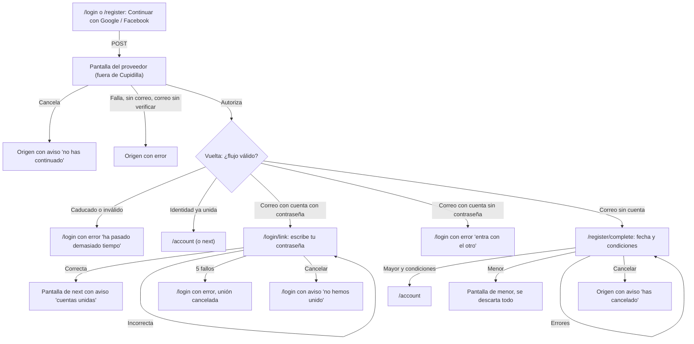
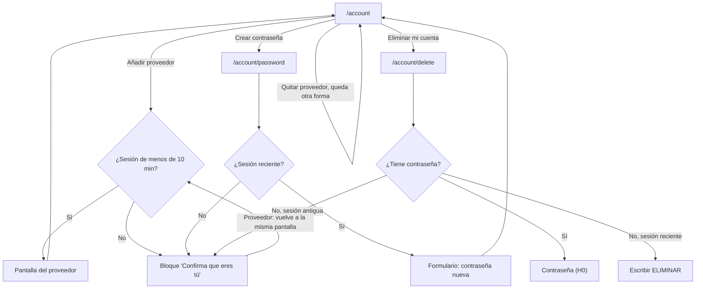

# Entrada con Google y Facebook — Diseño UX

[← Índice](../README.md) · Complementa: [H0 — Diseño UX](h0-diseno-ux.md) · Parte técnica: [login-terceros-diseno-tecnico.md](login-terceros-diseno-tecnico.md)

Especificación de interfaz para entrar y registrarse con Google y Facebook, y para gestionar esas formas de entrar en `/account`. Fecha del documento: 13 de noviembre de 2026. Textos en español de España, con tuteo. Todo lo que no se redefine aquí se rige por H0: plantilla de página (H0 §2.1), patrón de formulario y errores (§2.2), control de contraseña (§2.3), tokens de estilo (§7), accesibilidad (§6) y convención de claves (§5).

**Reparto con el diseño técnico.** El técnico manda en código, datos, API y seguridad; este documento, en pantallas, textos y flujo visible. Las rutas de §2.1 y los valores de `?notice=` y `?error=` de §5.8 coinciden con los del técnico (§11.4).

## 0. Alcance y principios

**Dentro**: botones de proveedor en `/login` y `/register`; completar el alta; unir con una cuenta existente; errores del proveedor; en `/account`: formas de entrar, añadir y quitar proveedor, crear contraseña, y borrado sin contraseña con sesión reciente.
**Fuera**: recuperación de contraseña, **cambiar** una contraseña que ya existe, verificación de correo propia, otros proveedores, cambio de correo.

**Usuarios y objetivo.** Una persona adulta que no quiere inventar otra contraseña y prefiere pulsar un botón conocido. Quiere entrar en dos pasos, saber qué recibe Cupidilla de su cuenta de Google o Facebook y no quedarse encerrada ni perder su cuenta por error. La edad sigue siendo un requisito: ningún camino salta la comprobación de 18 años.

Principios (añaden a los de H0):

1. **Una sola entrada, varios resultados.** El botón dice «Continuar con…» en `/login` y en `/register`: el servidor decide si es entrada, alta o unión.
2. **Nada se crea hasta que se completa.** Entrar con un proveedor por primera vez no crea cuenta; la crea el paso de fecha de nacimiento y condiciones (§3.2).
3. **Sin sorpresas con el correo.** El correo del proveedor se muestra, no se edita y no se pide otra vez.
4. **Salida siempre a la vista.** Toda pantalla intermedia tiene «Cancelar».
5. **Nunca sin forma de entrar.** La interfaz y el servidor impiden quitar la última.
6. **Lo delicado pide una sesión reciente.** Borrar la cuenta sin contraseña, añadir un proveedor y crear una contraseña exigen haber entrado hace menos de 10 minutos; si no, un paso claro de «Confirma que eres tú» (§3.5.2). Quien acaba de entrar no ve ningún paso de más.

## 1. Flujos

### 1.1 Mapa





### 1.2 Entrada con proveedor (cuenta ya unida)

1. En `/login` (o `/register`) la persona pulsa «Continuar con Google».
2. Sale de Cupidilla, elige cuenta y autoriza en el proveedor.
3. Vuelve y se le inicia sesión: 303 a `/account` o a `next`. Sin pantalla intermedia.

### 1.3 Primera vez con un proveedor: alta

1. El correo del proveedor no existe en Cupidilla.
2. Aterriza en `/register/complete` (§3.2): ve su correo, escribe la fecha de nacimiento y marca las condiciones.
3. Mayor de edad: se crea la cuenta (sin contraseña), se guarda el consentimiento y se inicia sesión. 303 a `/account`.
4. Menor: pantalla de cierre y se descarta todo lo recibido del proveedor (§3.2.2).

**Orden de validación** (igual que H0 §1.2, sin el paso de unicidad): forma de los campos → menor (pantalla inmediata aunque haya otros errores) → casilla de condiciones → creación atómica. Si entre medias alguien ha creado una cuenta con ese correo: si tiene contraseña, 303 a `/login/link` sin error; si no la tiene, 303 a `/login` con `?error=other-provider`.

### 1.4 Correo con cuenta con contraseña: unión

1. El correo que da el proveedor coincide con una cuenta con contraseña.
2. Aterriza en `/login/link` (§3.3): escribe su contraseña una vez.
3. Correcta: se une la identidad, se inicia sesión, 303 a `next` o `/account` con `?notice=linked&provider=…`. Desde entonces entra con cualquiera de las dos formas.

**Por qué es razonable decir «ya tienes una cuenta con este correo».** Se llega aquí solo si el proveedor entrega un correo que damos por fiable, es decir, quien llega controla ese correo en el proveedor. No sirve para listar correos registrados. **Con Google**, el proveedor declara el correo verificado. **Con Facebook, el correo se da por verificado por una decisión nuestra, no porque Meta lo diga**: Meta no ofrece ningún indicador de verificación y lo único que hacemos es aceptar el correo que devuelve (técnico §6; pregunta D9 al CEO). Por eso la garantía real de la unión no es el proveedor sino la contraseña: sin ella no se une nada. Un correo ausente o no verificado nunca llega a esta pantalla (§3.4).

### 1.5 Casos que no cubre la decisión inicial

| Caso | Resolución |
|---|---|
| El correo tiene una cuenta **sin contraseña** creada con otro proveedor (alta con Google, ahora entra con Facebook) | No se une nada. 303 a `/login` con `?error=other-provider&provider=google`: «entra con Google y añade el otro desde Tu cuenta». Decidido (D2) |
| Quien creó su cuenta con proveedor intenta entrar con correo y contraseña | Error genérico de H0 y línea fija `entrar.ayuda.proveedor`, que se muestra siempre: no revela nada |
| Quien olvidó su contraseña y entra con proveedor | No puede unir las cuentas hasta que haya recuperación de contraseña por correo. **Riesgo aceptado (D1)**. La pantalla de unión lo dice (`union.ayuda.olvido`) |
| Con sesión abierta | Los botones solo existen en `/login` y `/register`, que redirigen a `/account` con sesión. En `/account` los botones de añadir son otro caso (§3.5.1) |
| Identidad ya unida, pero el proveedor devuelve otro correo | Se entra igualmente: manda el identificador, no el correo |

## 2. Estructura común nueva

### 2.1 Rutas

| Ruta | Método | Uso |
|---|---|---|
| `/login`, `/register` | GET | Pantallas existentes con los botones |
| `/auth/google`, `/auth/facebook` | POST | Empieza el flujo; 303 al proveedor. Campos ocultos `from` y `next` |
| `/auth/google/callback`, `/auth/facebook/callback` | GET | Vuelta; nunca pinta HTML, solo redirige |
| `/register/complete` | GET, POST | Completar el alta (§3.2) |
| `/login/link` | GET, POST | Unir cuentas (§3.3) |
| `/account/password` | GET, POST | Crear contraseña (§3.7) |

Los botones son `<button type="submit">` en `<form method="POST">`: no se puede iniciar el flujo con un enlace GET y funciona sin JavaScript. Los formularios de proveedor no usan `use:enhance`: acaban en una redirección a otro sitio.

`from` solo vale `login`, `register` o `account`. La pantalla a la que se vuelve tras reautenticar o añadir (`/account`, `/account/password` o `/account/delete`) sale de `next`, que pasa por la lista cerrada de rutas de H0 §1.7 ampliada con `/account/password`.

`/register/complete` y `/login/link` dependen de un estado temporal propio y llevan `Cache-Control: no-store`. Sin estado válido, o caducado: 303 a `/login?error=provider-expired`. Con sesión abierta: 303 a `/account`, sin mensaje. `/account/password`: sin sesión, 303 a `/login?next=/account/password`; si la cuenta ya tiene contraseña, 303 a `/account`.

### 2.2 Avisos y errores en la URL

Los avisos y errores se identifican por `?notice=` y `?error=` con listas cerradas (§5.8), más `&provider=google|facebook` cuando el texto lleva el nombre. Un valor fuera de la lista, o un `provider` ausente o inválido en un texto que lo necesita, no muestra nada. «Atrás» puede volver a mostrar el mismo aviso: es información, no cambia datos.

Se muestran primero dentro de `<main>`, con el patrón general de H0 §2.2 (`role="alert"`, `tabindex="-1"`, sin lista de enlaces, `<title>` con «Error:», foco con JavaScript). **Cancelar no es un error**: es una decisión de la persona. Se muestra como aviso informativo (`role="status"`, borde neutro con icono ℹ, no rojo, sin «Error:» en el título) y sin culpa.

## 3. Pantallas

### 3.1 Botones de proveedor en `/login` y `/register`

#### 3.1.1 Colocación

**Encima del formulario de correo**, separados de él por una línea de texto.

```
<h1> Entra en tu cuenta                     (o: Crea tu cuenta)
[aviso o resumen de errores]
<div role="group" aria-label="Continuar con otro servicio">
  [ G  Continuar con Google   ]
  [ f  Continuar con Facebook ]
</div>
(solo /register)  Si es la primera vez, te pediremos tu fecha de nacimiento y que aceptes
                  las condiciones ... De Google o Facebook solo guardamos tu correo y un identificador.
──  O entra con tu correo y contraseña  ──          (/register: «O crea tu cuenta con tu correo»)
Correo electrónico   [ ______ ]
Contraseña ...
[ Entrar ]
¿No tienes cuenta? Crea una
```

Razones: camino más corto y con menos escritura (en `/register` evita cuatro campos); Facebook pide que el botón se vea sin pulsar antes «Entrar» o «Registrarse»; el botón principal ciruela de H0 sigue siendo el único relleno de color, y los de proveedor son secundarios de fondo claro, como mandan sus marcas.

**Orden: Google, Facebook** (alfabético, sin preferencia comercial), mismo tamaño y peso visual (Google exige igual prominencia). **Texto: «Continuar con Google» y «Continuar con Facebook»**, idéntico en las dos páginas: «Entrar con» sería falso para quien se da de alta y «Registrarse con» para quien ya tiene cuenta. El texto es HTML, no imagen.

Atributos: `<button type="submit">`; nombre accesible = texto visible; logo `aria-hidden`. Con JavaScript, al enviar: `aria-disabled="true"`, segundo clic ignorado y anuncio oculto `proveedor.estado.conectando`; el texto visible no cambia.

#### 3.1.2 Qué pide cada guía de marca y cómo se cumple

Consultadas el 13 de noviembre de 2026: [Google](https://developers.google.com/identity/branding-guidelines) y [Facebook](https://developers.facebook.com/docs/facebook-login/userexperience). Contrastarlas otra vez antes de publicar; no las ha revisado ni Google ni Meta.

**Google**

| La guía pide | Cómo se cumple |
|---|---|
| Textos «Sign in with Google», «Sign up with Google» o «Continue with Google»; se anima a traducirlos | «Continuar con Google» |
| No usar «Google» solo como acción; que quede claro que se entra con credenciales de Google | El texto lo dice; `/register` lo refuerza |
| Logo «G» de colores estándar, sin cambiar color ni proporciones, solo sobre fondo claro, oscuro o neutro; prohibidas versiones monocromas; no usar la «G» sin el borde del botón ni sin texto | SVG oficial del paquete de Google, servido desde Cupidilla (ninguna petición a terceros antes de pulsar). Fondo blanco. G y texto siempre dentro del botón |
| Tema claro: fondo `#FFFFFF`, borde interior 1 px `#747775`, texto `#1F1F1F` | Tema claro (H0 es solo claro). Texto 16:1 sobre blanco; borde 4,5:1 |
| Google Sans Medium 14/20; paddings web 12 / 10 / 12 px | Peso medio 14/20 con **la fuente del sistema** (decidido; no se descargan fuentes). Paddings tal cual |
| Igual prominencia entre opciones de terceros | Mismo tamaño y estilo en los dos |
| Permisos adicionales solo cuando hagan falta | Solo identificador y correo |

**Facebook**

| La guía pide | Cómo se cumple |
|---|---|
| «Continue with Facebook» o «Login with Facebook», dentro del botón, con la «f» antes del texto | «Continuar con Facebook» (la guía no habla de traducción; comprobar en el Brand Resource Center) |
| Solo el logo «f» aprobado, sin modificar proporciones, color ni estilo, y no sin llamada a la acción | Archivo oficial, propio dominio |
| Azul `#1877F2` y blanco (la página cita también `#5890FF` en un texto de diseño: verificar el vigente). Si no se puede usar el azul, blanco y negro | **Decidido: botón blanco con borde `#747775`, texto `#1F1F1F` y «f» azul `#1877F2`, pendiente de que Meta lo confirme.** Texto blanco sobre `#1877F2` da ≈ 4,2:1 (cálculo propio), por debajo del 4,5:1 del AA. **Plan B** si Meta no lo admite: fondo `#1877F2`, texto blanco en negrita de 18,67 px o más (texto grande, mínimo 3:1). La «f» azul sobre blanco da ≈ 4,2:1, ≥ 3:1 exigido a gráficos |
| Botón grande y a mano en móvil | Ancho completo, 48 px de alto, arriba |
| No pedir «Entrar» o «Registrarse» antes de mostrar el botón | Los botones van los primeros |
| Tras entrar con Facebook, no pedir crear usuario ni contraseña | No se pide contraseña. Sí fecha de nacimiento y condiciones, que se explican antes de pulsar. Comprobar con Meta junto con el botón |
| Pedir solo los permisos necesarios | `public_profile` (implícito) y `email`; sin revisión de la app |
| Ofrecer cerrar sesión, desvincular o eliminar la cuenta | Cerrar sesión, quitar (§3.5) y eliminar (§3.6) |

Hover y pulsado: capa del 8 % y 12 % de `#1F1F1F`. Foco: anillo de H0 (3 px, `--color-foco`, margen 2 px) por fuera del borde de marca. Los botones de marca también se usan en `/account` y `/account/delete` para añadir o reautenticar (§3.5).

#### 3.1.3 Estados

| Estado | Comportamiento |
|---|---|
| Normal | Como arriba |
| Enviando (JS) | `aria-disabled`, sin cambio de texto, anuncio oculto |
| Tras error o cancelación | Los botones siguen en su sitio; el aviso va encima |
| Sin JavaScript | Funciona igual |
| Proveedor sin configurar | No se dibuja su botón. Si no hay ninguno, no aparecen ni el grupo ni el separador |

A 320 px el texto cabe en una línea; con zoom del 200 % puede pasar a dos: alto con `min-height`, texto centrado.

### 3.2 `/register/complete`: completar el alta

```
<h1> Termina de crear tu cuenta
<p>  Has entrado con Google. Antes de crear tu cuenta de Cupidilla necesitamos dos cosas más.
<dl> Correo de Google        persona@ejemplo.com
     (ayuda) Este será el correo de tu cuenta. Viene de Google y no se puede cambiar aquí.
<p>  Entrarás siempre con Google: no te pedimos contraseña.
[resumen de errores]
<fieldset><legend> Fecha de nacimiento ...  Día [__] Mes [__] Año [____]
[ ] Acepto las condiciones de uso de Cupidilla (versión {version}).   [Leer las condiciones]
[ Crear mi cuenta ]
<p small> Por seguridad, tienes 30 minutos para terminar. ...
(formulario aparte)  [ Cancelar ]
```

**Correo no editable.** Texto en un `<dl>`, **no** `<input disabled>` ni `readonly`: los campos desactivados no reciben foco, algunos lectores los saltan, su contraste es bajo y sugieren que se puede arreglar. El correo no viaja en el formulario: la API usa el de su estado guardado. Se parte con `overflow-wrap: anywhere`.

Fecha y casilla: exactamente los de H0 §3.2 (tres campos numéricos en `fieldset`, mismos `autocomplete`, casilla desmarcada, enlace a condiciones fuera de la etiqueta y en pestaña nueva), con los textos `registro.*` (§5.3). No se pide nombre, foto ni otro dato.

«Cancelar» está en **su propio formulario** y después del principal en el DOM: Intro en un campo envía el alta, nunca cancela. Es un `<button>` con aspecto de enlace. Al cancelar: 303 a la página de origen con `?notice=signup-cancelled`.

Orden de tabulación: saltar → encabezado → (resumen) → día → mes → año → casilla → enlace → Crear mi cuenta → Cancelar → pie.

| Estado | Comportamiento |
|---|---|
| Inicial | Vacío, casilla desmarcada, correo visible. Sin `autofocus` |
| Enviando (JS) | «Creando cuenta…», `aria-disabled`, región de estado |
| Error de validación | Resumen y errores por campo como H0; se conservan día, mes, año y casilla |
| Menor | Pantalla de cierre (§3.2.2) |
| Estado caducado | 303 a `/login?error=provider-expired`. Se pierde lo escrito (única excepción a 3.3.7: sin estado válido no hay dónde conservarlo) |
| Otra persona ha creado esa cuenta mientras tanto | Ver §1.3: unión o `other-provider`, sin error de campo |
| Error general | `comun.error.limite` o `alta.error.servidor`, valores conservados |
| Resultado incierto (503) | Bloque general (H0 §3.2) con `alta.error.resultado_incierto` y `alta.enlace.comprobar` (a `/login`, pestaña nueva). Valores conservados |
| Éxito | 303 a `/account` o `next` |

El límite de tiempo (30 minutos, decidido) se dice en pantalla para que no sorprenda (2.2.1: límite avisado y esencial por seguridad).

**Resultado incierto: qué pasa de verdad.** Repetir el envío es inocuo, pero el estado es de un solo uso: si la primera petición sí se hizo, el reintento da `provider-expired` («ha pasado demasiado tiempo»). El texto lo explica y propone la comprobación fiable: entrar con el proveedor; si se llega a la cuenta, ya está creada.

#### 3.2.2 Menor de edad

Igual que H0 §3.2.2 (422, sin formulario, sin enlace para corregir, único botón «Volver al inicio», `<title>` «No podemos crear tu cuenta — Cupidilla», `role="alert"`), más una línea:

```
<h1> No podemos crear tu cuenta
<p>  Cupidilla es solo para personas de 18 años o más, así que no hemos creado tu cuenta ni hemos guardado ningún dato.
<p>  No hemos guardado nada de tu cuenta de Google.
<p>  No es nada personal: es una condición del servicio.
[ Volver al inicio ]
```

Debe ser verdad: el estado temporal con el correo del proveedor se borra en el acto, sin dejar nada en registros del servidor, ni cuenta, ni identidad. No se bloquea el correo ni se marca el navegador. Cupidilla no guarda ningún acceso a la cuenta del proveedor y no lo dice.

### 3.3 `/login/link`: unir con la cuenta existente

```
<h1> Ya tienes una cuenta con este correo
<p>  Con el correo de tu cuenta de Google ya hay una cuenta de Cupidilla con correo y contraseña.
     Escribe tu contraseña para unirlas. Después podrás entrar con Google o con tu contraseña.
<dl> Correo de la cuenta     persona@ejemplo.com
[resumen de errores]
Contraseña   [ ________ ] [Mostrar contraseña]
  Es la que elegiste al crear tu cuenta. Solo te la pedimos esta vez.
  Si no la recuerdas, de momento no podemos recuperarla y no podrás unir las cuentas.
  Podrás hacerlo cuando haya recuperación de contraseña por correo.
[ Unir cuentas ]
(formulario aparte)  [ Cancelar ]
```

- Contraseña: `type="password"`, `name="password"`, `autocomplete="current-password"`, control de H0 §2.3.
- Correo como texto, igual que §3.2. Para los gestores de contraseñas puede añadirse un `<input type="text" autocomplete="username" readonly>` **sin `name`** (no se envía), `aria-hidden`, `tabindex="-1"`, fuera de la vista. Opcional. (La acción web sí reenvía el correo que le dio la API para el contador de intentos; es un detalle técnico, no un campo visible.)
- No hay «unir sin contraseña». Quien no recuerda su contraseña no puede unir hasta que haya recuperación (D1, riesgo aceptado).
- «Cancelar» en formulario aparte; descarta el estado y va a `/login?notice=link-cancelled`.
- Orden de tabulación: saltar → encabezado → (resumen) → contraseña → mostrar (JS) → Unir cuentas → Cancelar → pie.

| Estado | Comportamiento |
|---|---|
| Inicial | Vacío, sin `autofocus`. `no-store` |
| Enviando (JS) | «Uniendo cuentas…», `aria-disabled` |
| Contraseña vacía | `union.error.contrasena_vacia` en campo y resumen |
| Contraseña incorrecta | `union.error.contrasena` en campo y resumen; campo vacío; el estado sigue. Mensaje específico: el proveedor ya acreditó el correo |
| Límite general (IP o correo, el mismo cubo que `/login`) | Bloque general con `comun.error.limite`; se queda en la pantalla |
| 5 fallos en esta unión | Se destruye el estado, 303 a `/login?error=link-limit`. Para reintentar hay que volver a pasar por el proveedor |
| Caducado | 303 a `/login?error=provider-expired` |
| Error general | `union.error.servidor` |
| Resultado incierto (503) | `union.error.resultado_incierto` (misma regla que §3.2: reintentar da «caducado» si la primera vez sí se hizo) |
| Éxito | 303 a `next` o `/account`, con `?notice=linked&provider=…` |

No se muestran los intentos que quedan.

### 3.4 Errores del proveedor

Siempre se vuelve a la página de origen (`/login`, `/register`, o `/account`, `/account/password` y `/account/delete` si venía de allí) y nunca se deja una página en blanco ni un texto técnico del proveedor. Los botones y el formulario de correo siguen disponibles.

| Situación | Valor en la URL | Texto |
|---|---|---|
| **El usuario cancela** en Google o Facebook (Cancelar, Ahora no, cierra, deniega) | `?notice=provider-cancelled` | `proveedor.aviso.cancelado` (en `/account*`: `verificar.aviso.cancelado`). `role="status"`, neutro |
| **El proveedor falla** (error, respuesta inválida, tiempo agotado, no responde; también 5xx de nuestra API) | `?error=provider-failed` | `proveedor.error.fallo` (en `/account*`: `cuenta.error.proveedor_fallo`) |
| **No devuelve correo** | `?error=email-missing` | `proveedor.error.sin_correo` |
| **Correo sin verificar** | `?error=email-unverified` | `proveedor.error.correo_sin_verificar` |
| **Estado caducado o inválido** (tardó mucho, volvió atrás, repitió el enlace de retorno, sin cookie) | `/login?error=provider-expired` | `proveedor.error.caducado` |
| **Cuenta con otro proveedor** | `/login?error=other-provider&provider=<el que ya tiene>` | `proveedor.error.cuenta_con_otro`: nombra solo al proveedor que ya tiene; la URL no dice con cuál se intentó |
| **Límite al empezar** | `?error=rate-limited` | `comun.error.limite` |

Reglas:

- Un correo sin verificar o ausente nunca avanza a la unión ni al alta ni dice si existe cuenta. Sin cambios en base de datos.
- Los errores de `/account*` no ofrecen «seguir con tu correo» (no aplica): por eso tienen textos propios.
- Sin reintento automático.
- Cancelar no usa el icono ni el color de error.

### 3.5 `/account`

```
<h1> Tu cuenta
[aviso o error opcional]
<section> <h2> Tus datos          (Correo, Condiciones aceptadas, como H0)
<section> <h2> Formas de entrar
   Estas son las formas con las que puedes entrar en tu cuenta.
   <ul>
     Correo y contraseña   No tienes contraseña                 Crear contraseña  (enlace a /account/password)
     Google                Unido el 13 de noviembre de 2026     [ Quitar Google ]
     Facebook              No unido                             [ f  Continuar con Facebook ]   (solo con sesión reciente)
   Si quitas una forma de entrar no se borra tu cuenta, ni tu cuenta en ese servicio. Siempre debe quedarte al menos una.
   [bloque «Confirma que eres tú», solo con sesión antigua y algo que añadir]
<section> <h2> Cupidilla ...
<section> <h2> Sesión
<section> <h2> Eliminar tu cuenta
```

Va entre «Tus datos» y «Cupidilla». Lista `<ul>`, una fila por forma, con nombre, estado y acción. Móvil: nombre y estado arriba, acción debajo a ancho completo; escritorio: acción a la derecha.

| Forma | Estado |
|---|---|
| Correo y contraseña | «Activa» si hay contraseña; «No tienes contraseña» y el enlace «Crear contraseña» si no la hay |
| Proveedor unido | «Unido el {fecha}» (en español) y «Quitar {proveedor}» |
| Proveedor no unido | «No unido» y, con sesión reciente, el botón de marca para añadirlo |

**Desvincular: sí, con un límite estricto: nunca puede quedar la cuenta sin forma de entrar.**

- Una forma = la contraseña (si existe) + cada proveedor unido. Se puede quitar un proveedor solo si, sin él, queda al menos una.
- Si es la única, **no se dibuja el botón**: aparece `cuenta.acceso.ultima` («Es tu única forma de entrar, así que no se puede quitar»). Sin botón no hay nada desactivado que explicar. Quien quiera quitar el único proveedor debe antes crear una contraseña o añadir el otro proveedor.
- El servidor lo comprueba y bloquea la fila: si falla, `?error=last-method` → `cuenta.error.ultima_forma`. Dos pestañas no pueden quitar las dos últimas formas.
- **Sin contraseña de confirmación y sin `confirm()`**: no destruye datos y se puede deshacer añadiendo de nuevo. Es `<button type="submit">` en un `<form method="POST">` por proveedor, con nombre visible «Quitar Google» (único por fila). Tras quitarlo: 303 a `/account?notice=unlinked&provider=…` → `cuenta.aviso.quitada`; foco con JavaScript al aviso.
- No cierra la sesión actual ni revoca nada en el proveedor.

#### 3.5.1 Añadir un proveedor

- Se muestra solo si la sesión es de menos de 10 minutos. Es el botón de marca («f Continuar con Facebook»), **sin** «Añadir»: las guías de marca solo permiten sus textos. El contexto lo da la fila («Facebook, No unido»).
- Es el formulario `POST /auth/facebook` con `from=account`. Si va bien: 303 a `/account?notice=linked&provider=facebook` → `cuenta.aviso.unida`. El correo del proveedor puede ser distinto del de la cuenta.
- Si la identidad ya es de otra cuenta: `?error=identity-in-use` → `cuenta.error.proveedor_en_uso`. Si ya estaba unida a esta misma cuenta (otra pestaña): `?error=already-linked` → `cuenta.error.ya_unido`.
- Errores del proveedor: §3.4, en `/account`.
- Con la sesión antigua no se dibuja el botón: se muestra el bloque de §3.5.2 en su lugar.

#### 3.5.2 Bloque «Confirma que eres tú» (sesión antigua)

Se usa en `/account` (para añadir), `/account/password` y `/account/delete`. Es el mismo componente con distinto texto de acción.

```
<h2> Confirma que eres tú                 (en /account/delete y /account/password: dentro de la página, tras el h1)
<p>  Por seguridad, para añadir una forma de entrar tienes que haber entrado hace menos de 10 minutos.
     Vuelve a entrar y continuarás en esta página.
  si hay proveedor unido:  [ G  Continuar con Google ]  [ f  Continuar con Facebook ]   (solo los unidos)
  si la cuenta tiene contraseña y ningún proveedor:  Contraseña [ ______ ] [Confirmar]
```

- Un botón de marca por cada proveedor unido (el que se use debe ser una identidad de esa cuenta; si no, `?error=identity-mismatch`). Es el formulario `POST /auth/{proveedor}` con `from=account` y `next` igual a la pantalla actual.
- Solo si la cuenta tiene contraseña y ningún proveedor, la confirmación es con la contraseña (formulario propio, mismos errores que H0). Requiere un endpoint que el técnico aún no tiene (T16).
- Mientras la sesión es antigua, la acción protegida (formulario, campo ELIMINAR, botón de añadir) **no se dibuja**: no hay botón que falle después.
- Al volver con éxito: misma página, con `?notice=reauthenticated` → `verificar.aviso.confirmada` (`role="status"`) y la acción ya disponible.
- Cancelar en el proveedor: `?notice=provider-cancelled` → `verificar.aviso.cancelado`. Otra cuenta del proveedor: `?error=identity-mismatch` → `verificar.error.otra_cuenta`. Falla: `?error=provider-failed` → `cuenta.error.proveedor_fallo`.
- **Si la sesión caduca entre cargar la página y enviar** (el servidor da 403 `REAUTHENTICATION_REQUIRED`): 303 a la misma página con `?error=reauth-required` → `verificar.error.necesaria`, que se muestra junto al bloque. Nada se ha ejecutado.

| Estado de `/account` | Comportamiento |
|---|---|
| Normal | Como arriba |
| Aviso (unida, quitada, contraseña creada, confirmada, cancelada) | `role="status"`, borde verde (o neutro si cancelada), primero en `<main>` |
| Error (última forma, servidor, proveedor en uso, ya unido, fallo, otra cuenta, límite) | `role="alert"` primero; el resto se muestra |
| Enviando (JS) | El botón pulsado: «Quitando…», `aria-disabled` |
| Sesión antigua | Sin botones de añadir; el enlace de crear contraseña lleva a una pantalla con el bloque de §3.5.2 |

### 3.6 `/account/delete`

Tres casos según la cuenta:

| Cuenta | Qué se pide |
|---|---|
| Tiene contraseña (con o sin proveedores) | Contraseña, exactamente como H0 §3.5. No hay bloque de §3.5.2 |
| Sin contraseña, sesión de menos de 10 minutos | Escribir ELIMINAR (abajo) |
| Sin contraseña, sesión antigua | Bloque «Confirma que eres tú» (§3.5.2) en lugar del campo; tras volver, el campo ELIMINAR |

Por qué la palabra: se entiende al primer vistazo, funciona sin JavaScript, y es coherente con H0 §1.6. Confirma la intención; la identidad la prueba la sesión reciente o la reautenticación. (Decidido, D8; el técnico lo llama opción C.)

```
<h1> Eliminar tu cuenta
[aviso 'confirmada' o resumen de errores]
<p>  Se borrará de inmediato tu cuenta y todo lo que hemos guardado de ti: correo, fecha de
     nacimiento, consentimientos y la unión con Google. No tocamos nada en tu cuenta de Google.
<p>  No se puede deshacer. Si más adelante quieres volver, tendrás que crear una cuenta nueva.
Escribe ELIMINAR para confirmar     [ ________ ]
  Como no tienes contraseña, esta es la forma de confirmar. Da igual si lo escribes en mayúsculas o minúsculas.
[ Eliminar mi cuenta definitivamente ]
Cancelar
```

Con sesión antigua, en lugar del campo y del botón de eliminar: el bloque de §3.5.2 con la acción «eliminar tu cuenta» y «Cancelar» debajo. Los dos párrafos de alcance se muestran siempre, antes de pedir nada.

- `<input type="text" name="confirmation" autocomplete="off" autocapitalize="none" spellcheck="false">`. «ELIMINAR» va escrito en la etiqueta (texto seleccionable y copiable) y **se permite pegar** (3.3.8). Se compara sin distinguir mayúsculas y sin espacios en los extremos. La valida la web.
- Error (vacío o distinto): `eliminar.error.confirmacion`; no se borra nada.
- Mismos botones y estados que H0 §3.5.
- Resultado incierto (503): `eliminar.error.resultado_incierto_proveedor`. Aquí hay una señal clara, a diferencia de H0: si al entrar con el proveedor Cupidilla pide fecha de nacimiento y condiciones como a una persona nueva, la cuenta ya no existe.
- Si la sesión envejece entre cargar y enviar: `?error=reauth-required` (§3.5.2).
- Con contraseña: el resultado incierto de H0, sin cambios.

### 3.7 `/account/password`: crear contraseña

Solo para cuentas sin contraseña. Cambiar una contraseña existente queda fuera.

```
<h1> Crea una contraseña
[aviso o resumen de errores]
<div aviso destacado, borde neutro, icono ℹ, role no alert>
  Desde este momento también podrás entrar con tu correo y tu contraseña, además de con Google.
  Tu cuenta de Google no cambia.
<dl> Tu correo       persona@ejemplo.com
Contraseña   [ ________ ] [Mostrar contraseña]
  Mínimo 10 caracteres, sin más reglas: una frase larga vale.
  De momento no podemos recuperarla, así que guárdala en un gestor de contraseñas o donde no se te pierda.
[ Crear contraseña ]
Cancelar     (enlace a /account)
```

- Campo: `type="password"`, `name="password"`, `autocomplete="new-password"`, `autocapitalize="none"`, `spellcheck="false"`. **Mismas reglas que el registro** (H0 §2.3 y §3.2): 10 a 128 caracteres, sin más reglas, sin segundo campo de repetición, se permite pegar, botón «Mostrar contraseña» solo con JavaScript. Errores: `registro.error.contrasena_vacia`, `contrasena_corta`, `contrasena_larga`.
- El aviso de efecto va **antes del campo**, siempre visible (no en un tooltip ni como ayuda del campo). Dice qué se gana y que de ahora en adelante hay otra puerta a la cuenta.
- El correo se muestra como texto: es el que se usará para entrar. Ayuda a los gestores de contraseñas.
- Orden de tabulación: saltar → encabezado → (resumen) → contraseña → mostrar (JS) → Crear contraseña → Cancelar → pie.
- Con sesión antigua: el bloque de §3.5.2 (acción «crear una contraseña») y sin campo.

| Estado | Comportamiento |
|---|---|
| Inicial | Campo vacío, sin `autofocus` |
| Enviando (JS) | «Creando contraseña…», `aria-disabled` |
| Contraseña vacía, corta o larga | Error de campo y resumen |
| Error general | `comun.error.limite` o `contrasena.error.servidor` |
| Resultado incierto (503) | Bloque general con `contrasena.error.resultado_incierto` y enlace `contrasena.enlace.comprobar` a `/account` (misma pestaña): si ahí se lee «Correo y contraseña: Activa», ya está creada. Campo vacío |
| Sesión envejecida al enviar | `?error=reauth-required` (§3.5.2) |
| La cuenta ya tiene contraseña (otra pestaña) | 303 a `/account` |
| Éxito | 303 a `/account?notice=password-created` → `contrasena.aviso.creada` |

Después de crear la contraseña: el borrado pide la contraseña (H0), se puede entrar con correo y contraseña, y se puede quitar el único proveedor.

## 4. Estados: resumen transversal

| Pantalla | Inicial | Enviando | Error por campo | Error general | Éxito |
|---|---|---|---|---|---|
| `/login` y `/register` (botones) | botones visibles | `aria-disabled` | n/a | cancelado (informativo), fallo, sin correo, sin verificar, caducado, cuenta con otro, límite | proveedor → `/account`, alta o unión |
| `/register/complete` | correo visible | «Creando cuenta…» | fecha, condiciones | límite, servidor, resultado incierto | `/account` |
| `/register/complete` (menor) | n/a | n/a | n/a | pantalla de cierre | n/a |
| `/login/link` | vacío | «Uniendo cuentas…» | contraseña vacía o incorrecta | límite, 5 fallos, servidor, resultado incierto | pantalla de `next` con aviso |
| `/account` | formas de entrar | «Quitando…» | n/a | última forma, servidor, en uso, ya unido, fallo, límite, otra cuenta | aviso |
| `/account/delete` (sin contraseña) | ELIMINAR o bloque de confirmar | «Eliminando…» | confirmación | límite, servidor, incierto, sesión antigua | `/` con aviso |
| `/account/password` | campo o bloque de confirmar | «Creando contraseña…» | vacía, corta, larga | límite, servidor, incierto, sesión antigua | `/account` con aviso |

Casos límite: correo de 254 caracteres (se parte); zoom 200 % y 320 px; sin JavaScript; doble envío; «atrás» tras unir, tras el alta y tras cerrar sesión; dos pestañas con el mismo estado temporal (la segunda recibe `provider-expired`); repetir el enlace de retorno; sesión que cumple 10 minutos mientras se escribe.

## 5. Textos de interfaz

Convención de H0 §5. `{proveedor}` es «Google» o «Facebook»; `{minutos}`, el límite vigente (10 para la sesión reciente; 30 para el estado pendiente).

### 5.1 Proveedores (botones y errores compartidos)

| Clave | Texto |
|---|---|
| `proveedor.grupo.etiqueta` | Continuar con otro servicio |
| `proveedor.boton.google` | Continuar con Google |
| `proveedor.boton.facebook` | Continuar con Facebook |
| `proveedor.estado.conectando` | Conectando con {proveedor}… |
| `proveedor.separador.entrar` | O entra con tu correo y contraseña |
| `proveedor.separador.registro` | O crea tu cuenta con tu correo |
| `proveedor.ayuda.registro` | Si es la primera vez, te pediremos tu fecha de nacimiento y que aceptes las condiciones antes de crear tu cuenta. De Google o Facebook solo guardamos tu correo y un identificador. |
| `proveedor.aviso.cancelado` | No has continuado con {proveedor}, así que no hemos hecho ningún cambio. Puedes volver a intentarlo o seguir con tu correo. |
| `proveedor.error.fallo` | {proveedor} no ha respondido como esperábamos y no hemos podido completar el proceso. No hemos hecho ningún cambio. Inténtalo de nuevo en unos minutos o sigue con tu correo. |
| `proveedor.error.sin_correo` | {proveedor} no nos ha enviado tu correo y lo necesitamos para crear tu cuenta. Comprueba en {proveedor} que tu cuenta tiene un correo y que has dado permiso para compartirlo, e inténtalo de nuevo. También puedes seguir con tu correo en Cupidilla. |
| `proveedor.error.correo_sin_verificar` | El correo de tu cuenta de {proveedor} todavía no está verificado y no podemos usarlo. Verifícalo en {proveedor} e inténtalo de nuevo, o sigue con tu correo en Cupidilla. |
| `proveedor.error.caducado` | Ha pasado demasiado tiempo o has vuelto atrás, y por seguridad hemos cancelado el proceso. Pulsa de nuevo el botón del servicio que quieras usar. |
| `proveedor.error.cuenta_con_otro` | Ya existe una cuenta con ese correo, pero se creó con {proveedor}. Entra con {proveedor} y, desde Tu cuenta, añade la otra forma de entrar. |

`proveedor.error.caducado` no dice «no hemos hecho ningún cambio»: puede aparecer tras un reintento cuando la primera petición sí se hizo (§3.2).

### 5.2 Entrar (añadidos)

| Clave | Texto |
|---|---|
| `entrar.ayuda.proveedor` | Si creaste tu cuenta con Google o Facebook, usa esos botones. |

Se muestra siempre bajo `entrar.error.credenciales`, exista el correo o no. No cambia `entrar.error.credenciales`.

### 5.3 Completar el alta

Se reutilizan de H0 §5.3 sin cambios: `registro.campo.nacimiento`, `registro.ayuda.nacimiento`, `registro.campo.dia`, `.mes`, `.anio`, `registro.campo.condiciones`, `registro.enlace.condiciones`, `registro.ayuda.condiciones`, `registro.error.dia`, `.mes`, `.anio`, `.fecha_vacia`, `.fecha_inexistente`, `.fecha_futura`, `.condiciones`, `.condiciones_version`, y `registro.menor.*`.

| Clave | Texto |
|---|---|
| `alta.meta.titulo` | Termina de crear tu cuenta |
| `alta.titulo` | Termina de crear tu cuenta |
| `alta.texto.intro` | Has entrado con {proveedor}. Antes de crear tu cuenta de Cupidilla necesitamos dos cosas más. |
| `alta.campo.correo` | Correo de {proveedor} |
| `alta.ayuda.correo` | Este será el correo de tu cuenta. Viene de {proveedor} y no se puede cambiar aquí. |
| `alta.texto.acceso` | Entrarás siempre con {proveedor}: no te pedimos contraseña. |
| `alta.boton.enviar` | Crear mi cuenta |
| `alta.boton.enviando` | Creando cuenta… |
| `alta.estado.enviando` | Creando tu cuenta… |
| `alta.boton.cancelar` | Cancelar |
| `alta.aviso.cancelada` | Has cancelado. No hemos creado ninguna cuenta ni guardado tus datos. |
| `alta.texto.caducidad` | Por seguridad, tienes {minutos} minutos para terminar. Si se acaba el tiempo, tendrás que empezar de nuevo. |
| `alta.menor.texto3` | No hemos guardado nada de tu cuenta de {proveedor}. |
| `alta.error.servidor` | Algo ha fallado por nuestra parte y no hemos podido crear tu cuenta. Inténtalo de nuevo en unos minutos. |
| `alta.error.resultado_incierto` | No sabemos si tu cuenta se ha creado: se ha perdido la conexión antes de recibir la respuesta. Para comprobarlo, entra con {proveedor}: si llegas a tu cuenta, ya está creada. Si Cupidilla te vuelve a pedir la fecha de nacimiento, no se ha creado y puedes completarla otra vez. Si vuelves a enviar este formulario y te dice que ha pasado demasiado tiempo, es que la primera vez sí se creó: entra con {proveedor}. |
| `alta.enlace.comprobar` | Probar a entrar con {proveedor} |

`alta.error.servidor` solo si sabemos que no se creó nada. El enlace va dentro del bloque, a `/login`, en pestaña nueva con `comun.nueva_pestana`, sin datos en la URL.

### 5.4 Unir cuentas

| Clave | Texto |
|---|---|
| `union.meta.titulo` | Unir tus cuentas |
| `union.titulo` | Ya tienes una cuenta con este correo |
| `union.texto.intro` | Con el correo de tu cuenta de {proveedor} ya hay una cuenta de Cupidilla con correo y contraseña. Escribe tu contraseña para unirlas. Después podrás entrar con {proveedor} o con tu contraseña. |
| `union.campo.correo` | Correo de la cuenta |
| `union.campo.contrasena` | Contraseña |
| `union.ayuda.contrasena` | Es la que elegiste al crear tu cuenta. Solo te la pedimos esta vez. |
| `union.ayuda.olvido` | Si no la recuerdas, de momento no podemos recuperarla y no podrás unir las cuentas. Podrás hacerlo cuando haya recuperación de contraseña por correo. |
| `union.boton.enviar` | Unir cuentas |
| `union.boton.enviando` | Uniendo cuentas… |
| `union.estado.enviando` | Uniendo tus cuentas… |
| `union.boton.cancelar` | Cancelar |
| `union.aviso.cancelada` | No hemos unido las cuentas. Puedes entrar con tu correo y tu contraseña. |
| `union.error.contrasena_vacia` | Escribe tu contraseña para unir las cuentas. |
| `union.error.contrasena` | La contraseña no es correcta. No hemos unido las cuentas. |
| `union.error.limite` | Has fallado varias veces. Por seguridad hemos cancelado la unión. Para volver a intentarlo, empieza de nuevo con tu cuenta de Google o Facebook. |
| `union.error.servidor` | Algo ha fallado por nuestra parte y no hemos podido unir tus cuentas. Inténtalo de nuevo en unos minutos. |
| `union.error.resultado_incierto` | No sabemos si se han unido las cuentas: se ha perdido la conexión antes de recibir la respuesta. Para comprobarlo, entra con {proveedor}: si llegas a tu cuenta, ya están unidas. Si vuelves a enviar este formulario y te dice que ha pasado demasiado tiempo, es que la primera vez sí se unieron. |

`union.error.limite` aparece en `/login` (tras `link-limit`), no en la pantalla de unión.

### 5.5 Cuenta (añadidos)

| Clave | Texto |
|---|---|
| `cuenta.acceso.titulo` | Formas de entrar |
| `cuenta.acceso.intro` | Estas son las formas con las que puedes entrar en tu cuenta. |
| `cuenta.acceso.contrasena` | Correo y contraseña |
| `cuenta.acceso.estado_activa` | Activa |
| `cuenta.acceso.estado_sin_contrasena` | No tienes contraseña |
| `cuenta.acceso.enlace_crear_contrasena` | Crear contraseña |
| `cuenta.acceso.estado_unido` | Unido el {fecha} |
| `cuenta.acceso.estado_no_unido` | No unido |
| `cuenta.acceso.boton_quitar` | Quitar {proveedor} |
| `cuenta.acceso.boton_quitando` | Quitando… |
| `cuenta.acceso.ultima` | Es tu única forma de entrar, así que no se puede quitar. |
| `cuenta.acceso.nota` | Si quitas una forma de entrar, no se borra tu cuenta de Cupidilla ni tu cuenta en ese servicio. Siempre debe quedarte al menos una. |
| `cuenta.aviso.unida` | Hemos unido {proveedor} a tu cuenta. Ya puedes entrar con cualquiera de tus formas de entrar. |
| `cuenta.aviso.quitada` | Hemos quitado {proveedor}. Ya no puedes entrar con él. |
| `cuenta.error.ultima_forma` | No hemos quitado {proveedor} porque es la única forma que tienes de entrar. |
| `cuenta.error.quitar_servidor` | Algo ha fallado por nuestra parte y no hemos podido quitar {proveedor}. Inténtalo de nuevo en unos minutos. |
| `cuenta.error.proveedor_en_uso` | Esa cuenta de {proveedor} ya está unida a otra cuenta de Cupidilla. Si es tuya, entra en esa cuenta y quítala desde allí. |
| `cuenta.error.ya_unido` | Esa cuenta de {proveedor} ya está unida a tu cuenta. No hemos hecho ningún cambio. |
| `cuenta.error.proveedor_fallo` | {proveedor} no ha respondido como esperábamos y no hemos podido completar el paso. No hemos hecho ningún cambio. Inténtalo de nuevo en unos minutos. |

«Con él» vale para Google y Facebook; con otros proveedores se sustituye por «con esa forma». `cuenta.aviso.unida` se usa también en `/account/password` y `/account/delete` cuando llega `?notice=linked` (tras una unión por contraseña con `next` a esas pantallas).

### 5.6 Confirmar que eres tú

| Clave | Texto |
|---|---|
| `verificar.titulo` | Confirma que eres tú |
| `verificar.texto` | Por seguridad, para {accion} tienes que haber entrado hace menos de {minutos} minutos. Vuelve a entrar y continuarás en esta página. |
| `verificar.accion.eliminar` | eliminar tu cuenta |
| `verificar.accion.anadir` | añadir una forma de entrar |
| `verificar.accion.contrasena` | crear una contraseña |
| `verificar.campo.contrasena` | Contraseña |
| `verificar.boton.contrasena` | Confirmar |
| `verificar.boton.confirmando` | Confirmando… |
| `verificar.error.contrasena_vacia` | Escribe tu contraseña para confirmar. |
| `verificar.error.contrasena` | La contraseña no es correcta. |
| `verificar.aviso.confirmada` | Listo, hemos confirmado que eres tú. |
| `verificar.aviso.cancelado` | No has continuado con {proveedor}, así que no hemos confirmado nada ni hemos hecho ningún cambio. |
| `verificar.error.necesaria` | Han pasado más de {minutos} minutos desde que entraste. Confirma que eres tú para continuar. No hemos hecho ningún cambio. |
| `verificar.error.otra_cuenta` | Has entrado con una cuenta de {proveedor} distinta de la que tienes unida a Cupidilla. Vuelve a intentarlo con la cuenta correcta. |

### 5.7 Crear contraseña y eliminar sin contraseña

Crear contraseña reutiliza `registro.ayuda.contrasena` y `registro.error.contrasena_vacia`, `.contrasena_corta`, `.contrasena_larga`.

| Clave | Texto |
|---|---|
| `contrasena.meta.titulo` | Crear contraseña |
| `contrasena.titulo` | Crea una contraseña |
| `contrasena.aviso.efecto` | Desde este momento también podrás entrar con tu correo y tu contraseña, además de con {proveedores}. Tu cuenta de {proveedores} no cambia. |
| `contrasena.campo.correo` | Tu correo |
| `contrasena.campo.contrasena` | Contraseña |
| `contrasena.boton.enviar` | Crear contraseña |
| `contrasena.boton.enviando` | Creando contraseña… |
| `contrasena.estado.enviando` | Creando tu contraseña… |
| `contrasena.enlace.cancelar` | Cancelar |
| `contrasena.aviso.creada` | Hemos creado tu contraseña. Ya puedes entrar con tu correo y tu contraseña. |
| `contrasena.error.servidor` | Algo ha fallado por nuestra parte y no hemos podido crear tu contraseña. Inténtalo de nuevo en unos minutos. |
| `contrasena.error.resultado_incierto` | No sabemos si tu contraseña se ha creado: se ha perdido la conexión antes de recibir la respuesta. Para comprobarlo, ve a tu cuenta: si en «Formas de entrar» pone «Correo y contraseña: Activa», ya está creada. Si no, vuelve a intentarlo. |
| `contrasena.enlace.comprobar` | Ir a mi cuenta para comprobarlo |
| `eliminar.texto.alcance_proveedor` | Se borrará de inmediato tu cuenta y todo lo que hemos guardado de ti: correo, fecha de nacimiento, consentimientos y las uniones con {proveedores}. No tocamos nada en tu cuenta de {proveedores}. |
| `eliminar.texto.alcance_mixta` | Se borrará de inmediato tu cuenta y todo lo que hemos guardado de ti: correo, contraseña, fecha de nacimiento, consentimientos y las uniones con {proveedores}. No tocamos nada en tu cuenta de {proveedores}. |
| `eliminar.campo.confirmacion` | Escribe ELIMINAR para confirmar |
| `eliminar.ayuda.confirmacion` | Como no tienes contraseña, esta es la forma de confirmar. Da igual si lo escribes en mayúsculas o en minúsculas. |
| `eliminar.error.confirmacion` | Escribe ELIMINAR para confirmar. No hemos borrado nada. |
| `eliminar.error.resultado_incierto_proveedor` | No sabemos si tu cuenta se ha eliminado: se ha perdido la conexión antes de recibir la respuesta. Para comprobarlo, ve a tu cuenta. Si la ves, sigue activa y puedes volver a intentarlo. Si te pide entrar, entra con {proveedor}: si entras, la cuenta sigue activa; si Cupidilla te pide fecha de nacimiento y condiciones como si fuera la primera vez, la cuenta ya no existe. Si te dice que hay demasiados intentos o que algo ha fallado, espera unos minutos y vuelve a intentarlo: eso no dice nada sobre tu cuenta. |

`{proveedores}` es «Google», «Facebook» o «Google y Facebook». En `contrasena.aviso.efecto` son los proveedores unidos a la cuenta. `alcance_mixta` se usa si hay contraseña y al menos un proveedor. `eliminar.enlace.comprobar` se reutiliza. En `/account/delete` con contraseña, los textos de H0 no cambian.

### 5.8 Correspondencia con `?notice=` y `?error=` (técnico §11.4)

Coincide con las listas cerradas del técnico (§11.4). `*` marca los valores que exigen `&provider=` (si falta o no es válido, no se muestra nada).

| Página | Valor | Texto |
|---|---|---|
| `/login`, `/register` | `notice=provider-cancelled` | `proveedor.aviso.cancelado` |
| | `notice=signup-cancelled` | `alta.aviso.cancelada` |
| | `notice=link-cancelled` | `union.aviso.cancelada` |
| | `error=provider-failed` | `proveedor.error.fallo` |
| | `error=provider-expired` | `proveedor.error.caducado` |
| | `error=email-missing` | `proveedor.error.sin_correo` |
| | `error=email-unverified` | `proveedor.error.correo_sin_verificar` |
| | `error=other-provider`* | `proveedor.error.cuenta_con_otro` |
| | `error=link-limit` | `union.error.limite` |
| | `error=rate-limited` | `comun.error.limite` |
| `/account` | `notice=linked`* | `cuenta.aviso.unida` |
| | `notice=unlinked`* | `cuenta.aviso.quitada` |
| | `notice=password-created` | `contrasena.aviso.creada` |
| | `notice=reauthenticated` | `verificar.aviso.confirmada` |
| | `notice=provider-cancelled` | `verificar.aviso.cancelado` |
| | `error=provider-failed` | `cuenta.error.proveedor_fallo` |
| | `error=identity-in-use` | `cuenta.error.proveedor_en_uso` |
| | `error=already-linked` | `cuenta.error.ya_unido` |
| | `error=identity-mismatch` | `verificar.error.otra_cuenta` |
| | `error=last-method` | `cuenta.error.ultima_forma` |
| | `error=reauth-required` | `verificar.error.necesaria` |
| | `error=rate-limited` | `comun.error.limite` |
| `/account/password` y `/account/delete` | `notice=reauthenticated` | `verificar.aviso.confirmada` |
| | `notice=provider-cancelled` | `verificar.aviso.cancelado` |
| | `notice=linked`* | `cuenta.aviso.unida` |
| | `error=provider-failed` | `cuenta.error.proveedor_fallo` |
| | `error=identity-mismatch` | `verificar.error.otra_cuenta` |
| | `error=reauth-required` | `verificar.error.necesaria` |
| | `error=rate-limited` | `comun.error.limite` |

`verificar.aviso.cancelado` y `verificar.error.otra_cuenta` llevan `{proveedor}`: se toman de `&provider=`, que el técnico añade a `failed` (§11.3). `from` no aparece en ninguna URL de aviso.

### 5.9 Condiciones de uso: borrador de las secciones que cambian

Decidido (D6): se **sube la versión** del texto para las altas nuevas; quien ya aceptó una versión anterior **no** tiene que volver a aceptar. Propuesta de versión: `2026-11-borrador-2` (la constante la fija el técnico; la casilla, el consentimiento y `/account` la usan). Marcado en pantalla como en H0 §5.9: borrador pendiente de revisión jurídica; los `[PENDIENTE]` los rellena quien tenga la información.

| Clave | Texto |
|---|---|
| `condiciones.version` | Versión 2026-11-borrador-2 |
| `condiciones.s4.titulo` | 4. Tu cuenta |
| `condiciones.s4.texto` | Puedes entrar con un correo y una contraseña, o con tu cuenta de Google o de Facebook. Puedes tener varias formas de entrar a la vez, añadirlas o quitarlas desde «Tu cuenta», siempre que te quede al menos una. Cuida tus formas de entrar y no las compartas. Por ahora no hay forma de recuperar una contraseña si la pierdes. |
| `condiciones.s5.titulo` | 5. Qué datos pedimos y para qué |
| `condiciones.s5.texto` | Para crear la cuenta pedimos tu correo, tu fecha de nacimiento y, si te registras con correo, una contraseña. Los usamos para que puedas entrar y para comprobar que eres mayor de edad. Si entras con Google o Facebook, recibimos de ellos solo un identificador tuyo en ese servicio y tu correo. No usamos tu nombre, tu foto ni tus contactos y no guardamos ningún acceso a tu cuenta en ese servicio. Guardamos también que has aceptado estas condiciones: qué versión y cuándo. [PENDIENTE: base jurídica, plazos de conservación, encargados del tratamiento, derechos y cómo ejercerlos. Irá en la política de privacidad, cuyo enlace piden Google y Facebook.] |
| `condiciones.s7.titulo` | 7. Eliminar tu cuenta |
| `condiciones.s7.texto` | Puedes eliminar tu cuenta cuando quieras desde «Tu cuenta». Es inmediato y no se puede deshacer, y borra también las uniones con Google o Facebook; no toca nada en tu cuenta de esos servicios. Si no tienes contraseña, te pediremos que hayas entrado hace poco y que escribas una palabra de confirmación. [PENDIENTE: confirmar si debe conservarse alguna prueba del consentimiento tras el borrado y por cuánto tiempo; si se conserva, este párrafo y el de la pantalla de eliminar deben decirlo. PENDIENTE: instrucciones de eliminación de datos que exige Facebook.] |
| `condiciones.s9.titulo` | 9. Cambios |
| `condiciones.s9.texto` | Si cambiamos estas condiciones publicaremos una nueva versión. Si el cambio te afecta de forma importante, te avisaremos y te pediremos que la aceptes antes de seguir usando el servicio; en los demás casos, sigue valiendo la versión que aceptaste. [PENDIENTE: revisión jurídica de este criterio.] |

`condiciones.s3`, `s6` y `s8` no cambian. `condiciones.s9.texto` sustituye al de H0 §5.9, que decía que siempre se pediría aceptar la nueva versión: ya no es cierto con esta decisión. El enlace «Leer las condiciones» de `/register/complete` y `/register` abre siempre la versión vigente.

## 6. Responsive y accesibilidad

Aplica H0 §6 y §7.4. Lo específico:

**Estructura y nombres**
- Botones de proveedor en `<div role="group" aria-label>`; nombre accesible = texto visible; logos decorativos.
- Los formularios principal y «Cancelar» son independientes. Una `<h1>` por pantalla; correo del proveedor y de la cuenta en `<dl>`.
- El separador es un `<p>` de texto. El bloque «Confirma que eres tú» es una `<section>` con `<h2>` y, en `/account/delete` y `/account/password`, va tras la `<h1>`.
- El aviso de efecto de `/account/password` va antes del campo y se asocia con `aria-describedby` al campo de contraseña.

**Errores**
- Errores de campo: patrón H0 §2.2. Errores del proveedor: `role="alert"`; la cancelación y las confirmaciones, `role="status"`; nunca solo color.

**Teclado**
- Intro en un campo envía el formulario principal, nunca «Cancelar».
- Con aviso o error por redirección, sin JavaScript el bloque es lo primero de `<main>`; con JavaScript recibe el foco.
- Tras reautenticar, el foco va al aviso `verificar.aviso.confirmada`, y la acción habilitada es alcanzable con Tab inmediatamente después.

**Tiempo (2.2.1 y 2.2.6).** El estado pendiente (30 minutos) se avisa en pantalla. El límite de 10 minutos de sesión reciente se dice en el bloque de confirmar. Ambos son esenciales por seguridad. Quien pierde la sesión reciente mientras escribe no pierde nada: vuelve a la misma página con `verificar.error.necesaria` (en `/account/password`, el campo queda vacío, la contraseña nunca se conserva).

**Zonas táctiles**: 44×44 px mínimo, 8 px entre objetivos (12 px entre los botones de proveedor). El campo ELIMINAR y los de contraseña, igual que H0.

**Contraste**: según 3.1.2; QA lo comprueba con herramienta, sobre todo el botón de Facebook y el hover.

**Móvil**: botones de proveedor a ancho completo y apilados, también a 48em (no en fila: el texto es largo). Las filas de `/account` se apilan.

**Sin JavaScript**: todo funciona con formularios POST y redirecciones 303.

**Privacidad de la interfaz**: pantallas con el correo del proveedor, `no-store`; logos y fuentes desde Cupidilla, sin peticiones a terceros antes de pulsar.

## 7. Criterios de aceptación

Salvo que se indique, con y sin JavaScript. Del 1 al 61: primera versión, con los ajustes marcados como «(revisado)». Del 62 en adelante: nuevos.

### Botones de proveedor

1. `/login` y `/register` muestran, antes de los campos de correo, un grupo con «Continuar con Google» y «Continuar con Facebook», en ese orden y con el mismo tamaño y peso visual.
2. Cada botón es un `<button type="submit">` dentro de un `<form method="POST">`; visitar por GET la ruta de inicio no inicia el flujo.
3. El texto visible es el de `proveedor.boton.*`, idéntico en las dos páginas, y es el nombre accesible del botón.
4. El logo de Google es el SVG oficial de colores sin modificar, sobre fondo blanco, con borde de 1 px `#747775`, texto `#1F1F1F` y paddings de 12/10/12 px. El de Facebook es el oficial sin modificar, antes del texto, en un botón blanco con borde `#747775`, texto `#1F1F1F` y «f» azul (o, si Meta lo exige, el plan B de 3.1.2). Ningún logo aparece sin texto de acción.
5. Los logos son decorativos para lectores de pantalla y se sirven desde el propio dominio; ninguna petición a terceros antes de pulsar.
6. Contraste de texto ≥ 4,5:1 y de borde y logo ≥ 3:1 en normal, hover, foco y enviando.
7. Mide ≥ 44 px de alto y de ancho en móvil, con ≥ 8 px entre botones, sin desbordar a 320 px ni al 200 % de zoom.
8. Con JavaScript, al pulsar se ignora un segundo clic y se anuncia `proveedor.estado.conectando`; el texto del botón no cambia.
9. `/register` muestra `proveedor.ayuda.registro`; `/login` no.
10. El separador usa `proveedor.separador.entrar` en `/login` y `proveedor.separador.registro` en `/register`.
11. El orden de tabulación es botones de proveedor → campos del formulario de correo.
12. Con sesión iniciada, `/login` y `/register` redirigen a `/account`.
13. Un error de credenciales en `/login` muestra `entrar.error.credenciales` y debajo `entrar.ayuda.proveedor`, igual para correo inexistente que para contraseña errónea.
13b. Un proveedor sin credenciales configuradas no dibuja su botón; si no hay ninguno, tampoco el grupo ni el separador.

### Flujo de alta

14. Entrar por primera vez con un proveedor cuyo correo no existe no crea cuenta ni consentimiento hasta enviar `/register/complete` con datos válidos (comprobar en base de datos).
15. `/register/complete` muestra el correo del proveedor como texto no editable (no `input`); un POST con otro correo lo ignora.
16. Pide día, mes, año y condiciones con los mismos controles y atributos que `/register` (criterios 23, 24 y 26 de H0), la casilla desmarcada la primera vez, y no pide ni muestra otro dato.
17. Con datos válidos y mayoría de edad se crea la cuenta sin contraseña, se guarda el consentimiento con fecha y versión vigente, se inicia sesión y se va a `/account`.
18. Quien cumple 18 hoy puede completar el alta; quien los cumple mañana, no.
19. Con una fecha de menor (aunque haya otros errores): pantalla de menor con `alta.menor.texto3`, 422, sin formulario ni enlace para corregir; no queda cuenta, identidad, consentimiento ni estado temporal; ni correo ni fecha en los registros del servidor; volver a pulsar el botón empieza desde cero.
20. Sin marcar la casilla se muestra `registro.error.condiciones`; los valores escritos se conservan.
21. «Cancelar» descarta el estado, vuelve al origen con `?notice=signup-cancelled` (`alta.aviso.cancelada`) y no crea nada. Intro en un campo nunca cancela.
22. Se muestra `alta.texto.caducidad` con el valor real del límite (30).
23. Con el estado caducado, destruido o ausente, `/register/complete` redirige a `/login?error=provider-expired`. Con sesión, a `/account` sin mensaje. Tras crear la cuenta, «atrás» no vuelve a mostrar la pantalla.
24. (revisado) Si entre medias otra persona crea una cuenta con ese correo: con contraseña, el envío lleva a `/login/link`; sin contraseña, a `/login?error=other-provider&provider=…`. En ningún caso hay error de campo.
25. (revisado) Si no hay respuesta tras enviar, 503 con `alta.error.resultado_incierto`, que propone entrar con el proveedor y explica que, si la primera petición sí se hizo, reenviar da «ha pasado demasiado tiempo». No dice «reintenta sin riesgo». Si se rechaza antes de enviar, `alta.error.servidor`.

### Flujo de unión

26. Si el correo que da el proveedor coincide con una cuenta con contraseña, se llega a `/login/link`, sin sesión ni alta.
27. La pantalla muestra el correo como texto no editable y pide solo la contraseña (`autocomplete="current-password"`, «Mostrar contraseña» solo con JavaScript).
28. Con contraseña correcta: se une la identidad, se inicia sesión, se va a `next` o `/account` con `cuenta.aviso.unida`, y después se puede entrar con el proveedor y con correo y contraseña.
29. Con contraseña incorrecta: `union.error.contrasena` en campo y resumen, campo vacío, nada se une y no hay sesión.
30. Con contraseña vacía: `union.error.contrasena_vacia`.
31. (revisado) Al 5.º fallo se destruye el estado y se va a `/login?error=link-limit` con `union.error.limite`; para seguir hay que repetir el flujo. El límite general (compartido con `/login`) muestra `comun.error.limite` en la misma pantalla.
32. «Cancelar» descarta el estado, va a `/login?notice=link-cancelled` y no une nada. Intro nunca cancela.
33. Con estado caducado: `/login?error=provider-expired`.
34. La contraseña nunca reaparece rellena en el HTML.
35. (revisado) Si el correo existe y la cuenta no tiene contraseña, se muestra `proveedor.error.cuenta_con_otro` en `/login` nombrando el proveedor de esa cuenta y no se llega a ninguna pantalla de contraseña.
36. Un correo no verificado o ausente nunca lleva a `/login/link` ni a `/register/complete` ni revela si existe una cuenta con ese correo.
36b. La pantalla de unión incluye `union.ayuda.olvido`: dice que quien no recuerda su contraseña no puede unir hasta que haya recuperación por correo, y no ofrece ninguna forma de saltarse la contraseña.

### Errores del proveedor

37. Si la persona cancela, se vuelve al origen con `?notice=provider-cancelled` y su texto como aviso informativo (`role="status"`, sin «Error:», sin rojo), sin cambios en base de datos.
38. Si el proveedor falla o devuelve algo inválido, `?error=provider-failed` con `proveedor.error.fallo` (en `/account*`, `cuenta.error.proveedor_fallo`), sin códigos ni textos técnicos.
39. Sin correo: `proveedor.error.sin_correo`. Correo sin verificar: `proveedor.error.correo_sin_verificar`. Sin cambios y sin estado temporal.
40. Estado caducado, inválido, repetido o sin cookie: `/login?error=provider-expired` con `proveedor.error.caducado`, sin nombre de proveedor.
41. Abrir el enlace de retorno dos veces no crea dos cuentas, identidades ni sesiones.
42. En todos los errores, el bloque va primero en `<main>`, el `<title>` empieza por «Error:» (salvo cancelar), con JavaScript recibe el foco, y los botones y el formulario de correo siguen disponibles y operables.
43. (revisado) Un `?notice=` o `?error=` fuera de la lista de 5.8 para esa página, o con `provider` ausente o inválido cuando el texto lo necesita, no muestra nada. «Atrás» puede repetir un aviso válido sin cambiar datos.
43b. Todos los pares de la tabla 5.8 muestran su texto exacto en su página.

### `/account`

44. `/account` muestra «Formas de entrar» con una fila por forma: contraseña (activa o no) y cada proveedor (unido con fecha en español o no unido).
45. Cada proveedor unido tiene «Quitar {proveedor}» en un formulario POST (cuando queda otra forma); al pulsarlo se elimina la unión, se va a `/account?notice=unlinked&provider=…` con `cuenta.aviso.quitada` y la sesión sigue.
46. Tras quitar un proveedor no se puede entrar con él (va al flujo de alta o unión) y el resto sigue intacto.
47. Si solo queda una forma no hay botón de quitar y se muestra `cuenta.acceso.ultima`.
48. Un POST de quitar la última forma o dos peticiones simultáneas para quitar las dos últimas: queda al menos una; la primera da `?error=last-method`.
49. (revisado) Con sesión reciente, cada proveedor no unido muestra su botón de marca; al volver con éxito, `/account?notice=linked&provider=…` con `cuenta.aviso.unida`. El correo del proveedor puede ser distinto del de la cuenta. Si esa identidad es de otra cuenta, `?error=identity-in-use`; si ya es de esta, `?error=already-linked`.

### Eliminar sin contraseña (revisado)

50. Cuenta con contraseña (con o sin proveedores): `/account/delete` pide la contraseña como H0, sin bloque de confirmar ni campo ELIMINAR.
51. Cuenta sin contraseña con sesión de menos de 10 minutos: muestra `eliminar.campo.confirmacion`, sin campo de contraseña, con `eliminar.texto.alcance_proveedor` (dice «inmediato», «no se puede deshacer» y no menciona contraseña).
52. Con la palabra correcta (cualquier mayúscula o minúscula, con espacios alrededor, pegada) se elimina la cuenta y sus uniones, se cierra la sesión y se va a `/` con `portada.aviso.cuenta_eliminada`.
53. Con el campo vacío o distinto: `eliminar.error.confirmacion`, no se borra nada y la sesión sigue.
54. Tras eliminar, entrar con el mismo proveedor lleva a `/register/complete` como a una persona nueva.
55. Sin respuesta tras enviar: 503 con `eliminar.error.resultado_incierto_proveedor`, sin afirmar que la cuenta sigue ni que se ha borrado; campo vacío.

### Accesibilidad y textos

56. Todos los textos nuevos coinciden palabra por palabra con la sección 5, sin textos fuera de ella.
57. Todo el flujo (proveedor, alta, unión, cancelar, quitar, añadir, confirmar, crear contraseña, eliminar) se completa solo con teclado, en el orden descrito, sin trampas de foco.
58. Las pantallas nuevas cumplen los criterios 33 a 48 de H0.
59. `/register/complete` y `/login/link` llevan `Cache-Control: no-store`; «atrás» tras terminar no muestra el correo.
60. Todos los flujos funcionan con JavaScript desactivado.
61. Ninguna pantalla pide ni muestra datos del proveedor distintos del correo (y la fecha de unión en `/account`).

### Sesión reciente y «Confirma que eres tú» (nuevos)

62. «Sesión reciente» es haber demostrado la identidad hace menos de 10 minutos (entrar con cualquier forma, o reautenticarse). Entrar con el proveedor y pulsar enseguida «Eliminar mi cuenta» no muestra ningún bloque de confirmar.
63. Cuenta sin contraseña con sesión de 10 minutos o más: `/account/delete` muestra los textos de alcance, el bloque `verificar.*` con la acción `verificar.accion.eliminar`, un botón de marca por cada proveedor unido, «Cancelar», y **no** el campo ELIMINAR ni el botón de eliminar. Un POST directo no borra nada y devuelve a la pantalla con `?error=reauth-required`.
64. Al volver del proveedor con una identidad de esa cuenta: misma página con `verificar.aviso.confirmada` y el campo ELIMINAR disponible; la sesión cuenta como reciente.
65. Si vuelve con una cuenta del proveedor distinta de la unida: `verificar.error.otra_cuenta` (`identity-mismatch`), el bloque sigue y no cambia nada.
66. Si cancela en el proveedor desde `/account`, `/account/password` o `/account/delete`: `verificar.aviso.cancelado` como aviso informativo, sin cambios.
67. Si la sesión envejece entre cargar y enviar: vuelve a la misma pantalla con `verificar.error.necesaria`, sin ejecutar nada; los campos de contraseña quedan vacíos.
68. Una cuenta con contraseña y sin proveedores con sesión antigua que quiere añadir un proveedor ve el bloque con campo de contraseña (`verificar.campo.contrasena`); con contraseña incorrecta, `verificar.error.contrasena`; con la correcta, la sesión pasa a reciente y vuelve a la misma pantalla.
69. Con sesión antigua, `/account` no dibuja los botones de añadir proveedor; los sustituye el bloque de confirmar. Con sesión reciente, el bloque no aparece.

### Crear contraseña (nuevos)

70. «Crear contraseña» aparece en `/account` solo si la cuenta no tiene contraseña; `/account/password` con una cuenta que ya la tiene redirige a `/account`; sin sesión, a `/login?next=/account/password`.
71. Con sesión reciente, `/account/password` muestra: el correo de la cuenta como texto; un campo de contraseña (`type="password"`, `autocomplete="new-password"`, sin segundo campo); y, **antes del campo**, `contrasena.aviso.efecto` con los proveedores unidos.
72. Reglas iguales a las del registro: 9 caracteres da `registro.error.contrasena_corta`; 10 se acepta; 128 se acepta; 129 da `registro.error.contrasena_larga`; vacío da `registro.error.contrasena_vacia`; se puede pegar; «Mostrar contraseña» solo con JavaScript.
73. Con contraseña válida: se crea, la sesión sigue, 303 a `/account?notice=password-created` con `contrasena.aviso.creada`, y la fila muestra «Correo y contraseña: Activa» sin el enlace de crear.
74. Después se puede entrar en `/login` con ese correo y esa contraseña; el borrado pide la contraseña (no ELIMINAR); y se puede quitar el único proveedor.
75. Con sesión antigua, `/account/password` muestra el bloque `verificar.*` con `verificar.accion.contrasena` y no el campo. La contraseña nunca reaparece rellena.
76. Sin respuesta tras enviar: 503 con `contrasena.error.resultado_incierto` y enlace a `/account`; campo vacío.
77. Ninguna pantalla ofrece cambiar una contraseña ya existente.

### Textos y condiciones (nuevos)

78. `entrar.ayuda.proveedor` sigue apareciendo igual para credenciales inexistentes y erróneas (criterio 13).
79. Las condiciones muestran la versión nueva (5.9) con las secciones 4, 5, 7 y 9 revisadas; una cuenta que aceptó la versión anterior no es obligada a aceptar de nuevo y `/account` sigue mostrando la versión y la fecha que aceptó; una alta nueva guarda la versión nueva.
80. `/register` y `/register/complete` enlazan a la versión vigente de las condiciones.
81. `from` solo toma los valores `login`, `register` y `account`; ningún formulario del documento envía otro.

## 8. Decisiones y dudas

### 8.1 Decisiones cerradas el 13 de noviembre de 2026

| Tema | Decisión |
|---|---|
| D1 | Quien olvidó su contraseña no puede unir cuentas hasta que haya recuperación por correo. Riesgo aceptado; el texto lo dice (`union.ayuda.olvido`) |
| D2 | Cuenta sin contraseña de otro proveedor: entra con el que ya tiene y añade el otro desde `/account` |
| D3 y D4 | En `/account` se puede añadir un proveedor, quitarlo si queda otra forma de entrar y crear una contraseña. Añadir y crear contraseña exigen sesión reciente. Cambiar una contraseña existente, fuera |
| D5 | Botón de Facebook blanco con «f» azul, pendiente de que Meta lo confirme (plan B en 3.1.2). Fuente del sistema |
| D6 | Se sube la versión de las condiciones para las altas nuevas; nadie que ya aceptó vuelve a aceptar. Borrador en 5.9 |
| D7 | Solo identificador y correo |
| D8 | Borrado sin contraseña: palabra ELIMINAR y sesión de menos de 10 minutos; si es más antigua, antes se vuelve a entrar con el proveedor |

### 8.2 Para el arquitecto

Las T1 a T12 anteriores y la T13 (valores de `from`, la pantalla de vuelta sale de `next`) y la T14 (valores de `?notice=` y `?error=`) están cerradas en el técnico. Se aceptan sus desacuerdos U1 a U6. Quedan:

T16. **Reautenticación con contraseña** para cuentas con contraseña y sin proveedor que quieren añadir uno con sesión antigua (§3.5.2): endpoint que ponga `authenticated_at = now` tras verificar la contraseña, con el mismo contador de intentos que `/login`. Alternativa: pedirles que cierren sesión y vuelvan a entrar; UX lo considera peor.
T17. **Crear contraseña**: confirmar endpoint, 403 `REAUTHENTICATION_REQUIRED` con sesión antigua, 409 si la cuenta ya tiene contraseña, misma política que el registro.
T18. **`authenticated_at` de una sesión creada con contraseña** vale `created_at`: confirmar que cuenta como reciente igual que una entrada con proveedor.

### 8.3 Para el CEO

D9. **Política de correo de Facebook.** Meta no da indicador de «verificado»; lo damos por verificado por decisión nuestra. La unión siempre pide contraseña, así que el riesgo es el de H0 (alguien registra el correo de otra persona). ¿Se acepta?
D10. **Confirmar con Meta** que el botón blanco con «f» azul y «Continuar con Facebook» son admisibles, y que pedir fecha de nacimiento y condiciones tras entrar no choca con sus reglas. Sin esa respuesta, plan B.
D11. **Texto legal y políticas.** El borrador de 5.9 y la política de privacidad (Google y Facebook piden su enlace; Facebook, instrucciones de eliminación de datos) necesitan revisión jurídica antes de publicar. Se propone el nombre de versión `2026-11-borrador-2`.
D12. **Contraseña sin recuperación.** Con D1 y D3, ahora se pueden crear contraseñas que no se pueden recuperar. Se avisa en el texto, pero la recuperación por correo pasa a ser más urgente antes de abrir la beta.

## 9. Lo que cambia respecto a H0

| Documento | Cambio |
|---|---|
| H0 §3.2 y §3.3 | Bloque de botones encima del formulario; cambia el orden de tabulación; el resto igual |
| H0 §3.4 | «Formas de entrar», avisos y errores nuevos |
| H0 §3.5 | Variante sin contraseña con sesión reciente o reautenticación |
| H0 §1.7 | `next` admite `/account/password`; `/register/complete` y `/login/link` se comportan como `/register` y `/login` respecto a la sesión |
| H0 §5 | Claves nuevas `proveedor.*`, `alta.*`, `union.*`, `verificar.*`, `contrasena.*`, `cuenta.acceso.*`, `cuenta.aviso.*`, `cuenta.error.*` (nuevas), `eliminar.*` (nuevas), `entrar.ayuda.proveedor` |
| H0 §5.9 | Versión nueva y secciones 4, 5, 7 y 9 revisadas (5.9 de este documento). H0 §5.9 decía que se pediría aceptar toda versión nueva: ya no |
